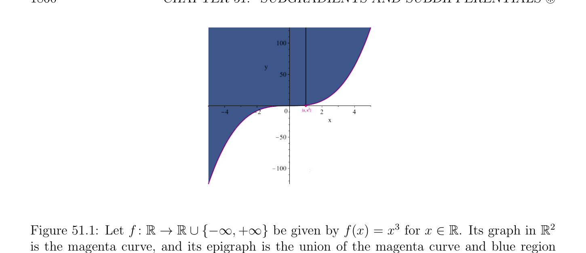
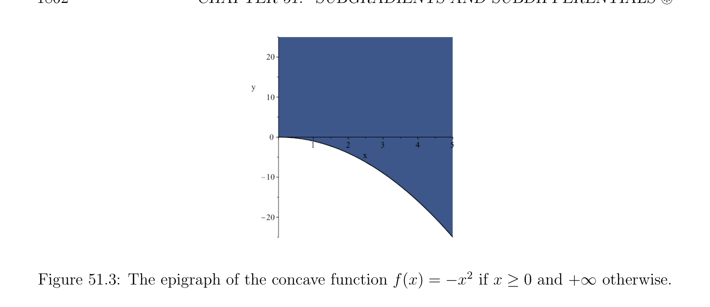
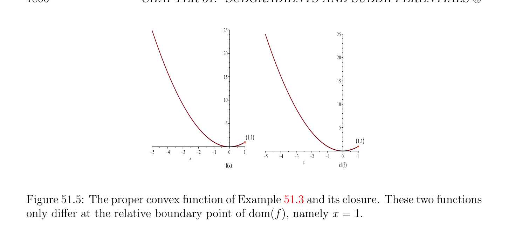
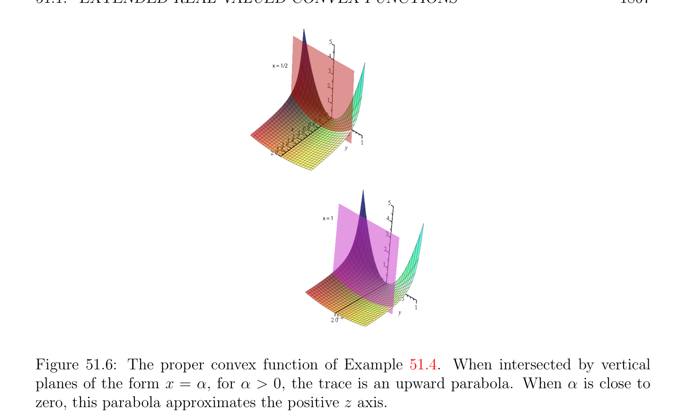

# Được mở rộng Nhận giá trị thực (real-valued) Các hàm lồi

<!-- PAGE 1859 -->
Bất đẳng thức các ràng buộc mà là lồi nhưng không nhất thiết khả vi (differentiable). Thực ra, nó là fair đến nói rằng lý thuyết của được mở rộng nhận giá trị thực (real-valued) các hàm lồi và các khái niệm của dưới gradien (subgradient) và vi phân dưới (subdifferential) developed trong chương này constitute machinery cần thiết để mở rộng Hàm Lagrange (Lagrangian) khung lý thuyết đến các hàm lồi rằng là không nhất thiết khả vi (differentiable). Điều này chương relies heavily trên Rockafellar $[143]$. Một số của các kết quả trong chương này cũng được thảo luận trong Bertsekas $[16, 19, 17]$. Nó nên được lưu ý rằng Bertsekas có developed khung lý thuyết đến thảo luận đối ngẫu rằng he refers đến như min $common/max$ crossing khung lý thuyết, cho ngắn $MC/MC$. Mặc dù điều này khung lý thuyết là thanh lịch và thú vị trong của nó own phải, sự kiện rằng Bertsekas relies trên nó để chứng minh các tính chất của các vi phân dưới làm cho nó little khó hơn cho độc giả đến “jump trong.”

## 51.1 Được mở rộng Nhận giá trị thực (real-valued) Các hàm lồi

Ta mở rộng thứ tự trên $\mathbb{R}$ bằng cách đặt
$$-\infty < x < +\infty ,for all x \in \mathbb{R}.$$
$$\mathbb{R}^{n} \mathbb{R}$$

> **Định nghĩa 51.2.** (tổng) hàm $f$: $\to  \cup {-\infty , +\infty$ } được gọi là một được mở rộng realvalued hàm. Với mọi $x \in \mathbb{R}^{n}$, ta nói rằng f(x) là hữu hạn nếu f(x) $\in \mathbb{R}$ (tương đương, f(x) $\neq  \pm \infty$). hàm $f$ là hữu hạn nếu f(x) là hữu hạn với mọi $x \in \mathbb{R}^{n}$.
$$\mathbb{R}^{n} \mathbb{R}$$
Thích nghi slightly Định nghĩa 40.8, cho trước hàm $f$: $\to \cup {-\infty , +\infty$ }, trên đồ thị (epigraph)
$$\mathbb{R}^{n+1}$$
Của $f$ là tập con của cho trước bởi
$$\mathbb{R}^{n+1}$$
$$epi(f) = {(x, y) \in | f(x) \le y}.$$
Xem Hình 51.1. Nếu $S$ là khác rỗng tập con của $\mathbb{R}^{n}$, trên đồ thị (epigraph) của thu hẹp của $f$ đến $S$ được định nghĩa như
$$\mathbb{R}^{n+1}$$
$$epi(f|S) = {(x, y) \in | f(x) \le y, x \in S}.$$
Quan sát sau đây các sự kiện: $1$. Với mọi $x \in S$, nếu f(x) $= -\infty$, thì epi(f) chứa “đứng đường thẳng” ${(x, y)$ | $y \in \mathbb{R}}$ trong $\mathbb{R}^{n+1}. 2$. Với mọi $x \in S$, nếu f(x) $\in \mathbb{R}$, thì epi(f) chứa tia ${(x, y)}$ | f(x) $\le y}$ trong $\mathbb{R}^{n+1}. 3$. Với mọi $x \in S$, nếu f(x) $= +\infty$, thì epi(f) thực hiện không chứa bất kỳ điểm $(x, y)$, với $y \in \mathbb{R}. 4$. Ta có epi(f) $= \emptyset$ khi và chỉ khi $f$ tương ứng với riêng hàm undefined everywhere; nghĩa là, f(x) $= +\infty$ với mọi $x \in \mathbb{R}^{n}$.

<!-- PAGE 1860 -->
$$(x, x  )3$$
$$> >$$
$$\mathbb{R}\mathbb{R} \mathbb{R} \mathbb{R}^{2}$$

**Hình 51.1:** Cho $f$: $\to  \cup {-\infty , +\infty$ } là cho trước bởi f(x) $= x^{3}$ cho $x \in$. Của nó đồ thị trong là magenta đường cong, và của nó trên đồ thị (epigraph) là hợp của magenta đường cong và xanh lam miền “ở trên” điều này đường cong. Với mọi điểm $x \in \mathbb{R}$, epi(f) chứa tia mà các bắt đầu tại $(x, x^{3})$ và mở rộng upward.
$$\mathbb{R}^{n} \mathbb{R}^{n} \mathbb{R}$$

> **Định nghĩa 51.3.** Cho trước khác rỗng tập con $S$ của, (tổng) hàm $f$: $\to  \cup {-\infty , +\infty$ } là lồi trên $S$ nếu của nó trên đồ thị (epigraph) epi(f|S) là lồi như tập con $of\mathbb{R}^{n+1}$. Xem Hình 51.2. hàm $f$ là lõm trên $S$ nếu $-f$ là lồi trên $S$. hàm $f$ là afin trên $S$ nếu nó là hữu hạn, lồi, và lõm. Nếu $S =\mathbb{R}^{n}$, ta đơn giản rằng $f$ là lồi (resp. lõm, resp. afin).
$$\mathbb{R}^{n} \mathbb{R}$$

> **Định nghĩa 51.4.** Cho trước bất kỳ hàm $f$: $\to \cup {-\infty , +\infty$ }, effective miền xác định dom(f) của $f$ được cho bởi
$$\mathbb{R}^{n} \mathbb{R}\mathbb{R}^{n}$$
$$dom(f) = {x \in | (\exists y \in )((x, y) \in epi(f))} = {x \in | f(x) < +\infty }.$$
$$\mathbb{R}^{n}$$
Nhận thấy rằng effective miền xác định của $f$ chứa các vectơ $x \in$ sao cho f(x) $= -\infty$,
$$\mathbb{R}^{n}$$
Nhưng excludes các vectơ $x \in$ sao cho f(x) $= +\infty$.

> **Ví dụ 51.1.** ở trên sự kiện được minh họa bởi hàm $f$: $\mathbb{R} \to \mathbb{R}\cup {-\infty , +\infty$ } ở đâu
$$($$
$$-x^{2}if x \ge 0$$
$$f(x) =$$
$$+\infty if x < 0.$$
Trên đồ thị (epigraph) của hàm này được minh họa Hình 51.3. Theo Định nghĩa dom(f) $= [0, \infty$). Nếu $f$ là hàm lồi (convex function), vì dom(f) là ảnh (image) của epi(f) bởi ánh xạ tuyến tính (linear map) (phép chiếu), nó là lồi. Theo Định nghĩa, epi(f|S) là lồi khi và chỉ khi với mọi $(x_{1}, y_{1})$ và $(x_{2}, y_{2})$ với $x_{1}, x_{2} \in S$ và $y_{1}, y_{2} \in \mathbb{R}$ sao cho $f(x_{1}) \le y_{1}$ và $f(x_{2}) \le y_{2}$, với mọi $\lambda$ sao cho $0 \le \lambda  \le 1$, ta có
$$(1 -\lambda )(x_{1}, y_{1}) + \lambda (x_{2}, y_{2}) = ((1 -\lambda )x_{1} + \lambda x_{2}, (1 -\lambda )y_{1} + \lambda y_{2}) \in epi(f|S),$$

<!-- PAGE 1861 -->
$$\mathbb{R}\mathbb{R} \mathbb{R} \mathbb{R}^{2}$$

**Hình 51.2:** Cho $f$: $\to  \cup {-\infty , +\infty$ } là cho trước bởi f(x) $= x^{2}$ cho $x \in$. Của nó đồ thị trong là magenta đường cong, và của nó trên đồ thị (epigraph) là hợp của magenta đường cong và xanh lam miền
$$\mathbb{R}^{2}$$
“ở trên” điều này đường cong. Nhận thấy rằng epi(f) là tập lồi (convex set) của vì aqua đường thẳng đoạn thẳng connecting bất kỳ hai các điểm được chứa trong phạm vi trên đồ thị (epigraph). mà có nghĩa là $(1$ - $\lambda )x_{1} + \lambda x_{2} \in S$ và
$$f((1 -\lambda )x_{1} + \lambda x_{2}) \le (1 -\lambda )y_{1} + \lambda y_{2}.(*)$$
Do đó $S$ phải là lồi và f((1 - $\lambda )x_{1} + \lambda x_{2}) < +\infty$. Điều kiện (*) là little awkward, vì nó thực hiện không refer một cách tường minh đến $f(x_{1})$ và $f(x_{2})$, như các giá trị này có thể là $-\infty$, trong mà trường hợp nó là không rõ ràng những gì biểu thức $(1$ - $\lambda )f(x_{1}) + \lambda f(x_{2})$ có nghĩa là. Trong thứ tự đến perform arithmetic các phép toán liên quan đến $-\infty$ và $+\infty$, ta adopt sau đây các quy ước:
$$\alpha  + (+\infty ) = +\infty + \alpha  = +\infty -\infty < \alpha  \le +\infty$$
$$\alpha  + -\infty = -\infty + \alpha  = -\infty -\infty \le \alpha  < +\infty$$
$$\alpha (+\infty ) = (+\infty )\alpha  = +\infty 0 < \alpha  \le +\infty$$
$$\alpha (-\infty ) = (-\infty )\alpha  = -\infty 0 < \alpha  \le +\infty$$
$$\alpha (+\infty ) = (+\infty )\alpha  = -\infty -\infty \le \alpha  < 0$$
$$\alpha (-\infty ) = (-\infty )\alpha  = +\infty -\infty \le \alpha  < 0$$
$$0(+\infty ) = (+\infty )0 = 00(-\infty ) = (-\infty )0 = 0$$
$$-(-\infty ) = +\infty$$
$$\inf \emptyset = +\infty \sup \emptyset = -\infty .$$
Các biểu thức $+\infty + (-\infty$) và $-\infty + (+\infty$) là meaningless. sau đây các đặc trưng của các hàm lồi là dễ để chỉ ra.

> **Mệnh đề 51.1.** Cho $C$ là khác rỗng lồi tập con của $\mathbb{R}^{n}$.

<!-- PAGE 1862 -->

**Hình 51.3:** trên đồ thị (epigraph) của hàm lõm (concave function) f(x) $= -x^{2}$ nếu $x \ge 0$ và $+\infty$ ngược lại.
$$\mathbb{R}^{n}$$
$(1) A$ hàm $f$: $C \to \cup {+\infty$ } là lồi trên $C$ khi và chỉ khi
$$f((1 -\lambda )x + \lambda y) \le (1 -\lambda )f(x) + \lambda f(y)$$
Với mọi $x, y \in C$ và tất cả $\lambda$ sao cho $0 < \lambda  < 1$.
$$\mathbb{R}^{n} \mathbb{R}^{n}$$
$(2) A$ hàm $f$: $\to \cup {-\infty , +\infty$ } là lồi khi và chỉ khi
$$f((1 -\lambda )x + \lambda y) < (1 -\lambda )\alpha  + \lambda \beta$$
$$\mathbb{R}\mathbb{R}^{n}$$
Với mọi $\alpha , \beta  \in$, tất cả $x, y \in$ sao cho f(x) $< \alpha$ và f(y) $< \beta$, và tất cả $\lambda$ sao cho $0 < \lambda  < 1$. “tốt” các hàm lồi rằng ta sẽ like đến deal với được định nghĩa ở dưới.
$$\mathbb{R}^{n} \mathbb{R}$$

> **Định nghĩa 51.5.** hàm lồi (convex function) $f$: $\to  \cup {-\infty , +\infty$ } là $proper^{1}$ nếu của nó trên đồ thị (epigraph) là khác rỗng và thực hiện không chứa bất kỳ đứng đường thẳng. Tương đương, hàm lồi (convex function) $f$ là thực sự/đúng đắn
$$\mathbb{R}^{n} \mathbb{R}^{n}$$
Nếu f(x) $> -\infty$ với mọi $x \in$ và f(x) $< +\infty$ với một số $x \in$. hàm lồi (convex function) mà là không thực sự/đúng đắn được gọi là một suy rộng/không thực sự hàm. Nhận thấy rằng hàm lồi (convex function) $f$ là thực sự/đúng đắn khi và chỉ khi dom(f) $\neq  \emptyset$ và nếu thu hẹp của $f$ đến dom(f) là hữu hạn hàm. Ta kiểm chứng được ngay rằng tập hợp $C$ là lồi khi và chỉ khi của nó indicator hàm $I_{C}$ là lồi, và rõ ràng, indicator hàm của tập lồi (convex set) là thực sự/đúng đắn. quan trọng object của study là tập hợp của thực sự/đúng đắn các hàm, nhưng suy rộng/không thực sự các hàm có thể’t là tránh được. $\overline{1}\overline{This} \overline{terminology} \overline{is} \overline{unfortunate} \overline{because}$ nó clashes với khái niệm của thực sự/đúng đắn hàm từ tôpô, mà có đến thực hiện với preservation của compắc các tập con dưới nghịch đảo các ảnh.

<!-- PAGE 1863 -->

> **Ví dụ 51.2.** Đây là một ví dụ của suy rộng/không thực sự hàm lồi (convex function) $f$: $\mathbb{R} \to \mathbb{R}\cup {-\infty , +\infty$ }:
$$-\infty if |x| < 1$$
$$$$
$$$$
$$f(x) =0if |x| = 1$$
$$+\infty if |x| > 1$$
$$$$
Nhận thấy rằng dom(f) $= [-1, 1]$, và rằng epi(f) là không đóng. Xem Hình 51.4.
$$\overline{-1}\overline{1}$$
$$\overline{-1}\overline{1}$$

**Hình 51.4:** suy rộng/không thực sự hàm lồi (convex function) của Ví dụ 51.2 và của nó trên đồ thị (epigraph) depicted như rose colored miền của $\mathbb{R}^{2}$. Các hàm có trên đồ thị (epigraph) là đóng tiến tới đến có tốt hơn các tính chất. để đặc trưng hóa như vậy các hàm ta giới thiệu sublevel các tập hợp.
$$\mathbb{R}^{n} \mathbb{R}\mathbb{R}$$

> **Định nghĩa 51.6.** Cho trước hàm $f$: $\to  \cup {-\infty , +\infty$ }, với mọi $\alpha  \in  \cup {-\infty , +\infty$ }, sublevel các tập hợp $sublev_{\alpha}(f)$ và $sublev_{<\alpha}(f)$ là các tập hợp
$$\mathbb{R}^{n} \mathbb{R}^{n}$$
$$sublev_{\alpha}(f) = {x \in | f(x) \le \alpha }andsublev_{<\alpha}(f) = {x \in | f(x) < \alpha }.$$
Cho suy rộng/không thực sự hàm lồi (convex function) của Ví dụ 51.2, ta có $sublev_{-\infty}(f) = (-1, 1)$ trong khi $sublev_{<-\infty}(f) = \emptyset$. $sublev_{\alpha}(f) = (-1, 1) = sublev_{<\alpha}(f)$ bất cứ khi nào $-\infty < \alpha  < 0. sublev_{0}(f) = [-1, 1]$ trong khi $sublev_{<0}(f) = (-1, 1). sublev_{\alpha}(f) = [-1, 1] = sublev_{<\alpha}(f)$ bất cứ khi nào $0 < \alpha  < +\infty$. $sublev_{+\infty}(f) =\mathbb{R}$ trong khi $sublev_{<+\infty}(f) = [-1, 1]$. hữu ích hệ quả của Mệnh đề 51.1 là kết quả sau đây có (dễ) chứng minh có thể được tìm thấy trong Rockafellar $[143]$ (Định lý 4.6).

<!-- PAGE 1864 -->

> **Mệnh đề 51.2.** Nếu $f$ là bất kỳ hàm lồi (convex function) trên $\mathbb{R}^{n}$, thì với mọi $\alpha  \in \mathbb{R} \cup {-\infty , +\infty$ }, sublevel các tập hợp $sublev_{\alpha}(f)$ và $sublev_{<\alpha}(f)$ là lồi.
$$\mathbb{R}^{n} \mathbb{R}$$

> **Định nghĩa 51.7.** hàm $f$: $\to  \cup {-\infty , +\infty$ } là thấp hơn nửa liên tục (semi-continuous) nếu
$$\mathbb{R}^{n} \mathbb{R}$$
Sublevel các tập hợp $sublev_{\alpha}(f) = {x \in$ | f(x) $\le \alpha$ } là đóng với mọi $\alpha  \in$. Nhận thấy rằng suy rộng/không thực sự hàm lồi (convex function) của Ví dụ 51.2 là không thấp hơn nửa liên tục (semi-continuous) vì $sublev_{\alpha}(f) = (-1, 1)$ bất cứ khi nào $-\infty < \alpha  < 0$. kết quả này reflects sự kiện rằng trên đồ thị (epigraph) là không đóng như được hiển thị trong sau đây mệnh đề; xem Rockafellar $[143]$ (Định lý 7.1).
$$\mathbb{R}^{n} \mathbb{R}$$

> **Mệnh đề 51.3.** Cho $f$: $\to  \cup {-\infty , +\infty$ } là bất kỳ hàm. Các tính chất sau đây là tương đương:
$(1)$ hàm $f$ là thấp hơn nửa liên tục (semi-continuous).
$(2)$ trên đồ thị (epigraph) của $f$ là tập đóng (closed set) trong $\mathbb{R}^{n+1}$. khái niệm của bao đóng (closure) của hàm lồi (convex function) đóng quan trọng vai trò. Nó là bit tinh tế bởi vì hàm lồi (convex function) có thể là suy rộng/không thực sự.
$$\mathbb{R}^{n} \mathbb{R}$$

> **Định nghĩa 51.8.** Cho $f$: $\to  \cup {-\infty , +\infty$ } là bất kỳ hàm. hàm có trên đồ thị (epigraph) là bao đóng (closure) của trên đồ thị (epigraph) epi(f) của $f$ (trong $\mathbb{R}^{n+1})$ được gọi là thấp hơn semicontinuous bao (hull) của $f$. Nếu $f$ là hàm lồi (convex function) và nếu f(x) $> -\infty$ với mọi $x \in \mathbb{R}^{n}$, thì bao đóng (closure) cl(f) của $f$ bằng của nó thấp hơn nửa liên tục (semi-continuous) bao (hull), khác nếu f(x) $= -\infty$ với một số $x \in \mathbb{R}^{n}$, thì bao đóng (closure) cl(f) của $f$ là hằng số hàm với giá trị $-\infty$. hàm lồi (convex function) $f$ là đóng nếu $f =$ cl(f). Định nghĩa 51.8 suy ra rằng có chỉ hai đóng suy rộng/không thực sự các hàm lồi: hằng số hàm với giá trị $-\infty$ và hằng số hàm với giá trị $+\infty$. Cũng, theo Mệnh đề 51.3, thực sự/đúng đắn hàm lồi (convex function) là đóng khi và chỉ khi nó bằng của nó thấp hơn nửa liên tục (semi-continuous) bao (hull) khi và chỉ khi của nó trên đồ thị (epigraph) là khác rỗng và đóng. Cho trước tập lồi (convex set) $C$ trong $\mathbb{R}^{n}$, phần trong (interior) int(C) của $C$ (lớn nhất mở tập con của $\mathbb{R}^{n}$ được chứa trong $C)$ là thường không thú vị bởi vì $C$ có thể có số chiều nhỏ hơn hơn $n$. Cho
$$\mathbb{R}^{3}$$
Ví dụ, (đóng) tam giác trong có rỗng phần trong (interior). remedy là đến xét afin bao (hull) aff(C) của $C$, mà là nhỏ nhất afin tập hợp chứa $C$; xem Mục 44.2. số chiều của $C$ là số chiều của aff(C). Thì tương đối phần trong (interior) của $C$ là phần trong (interior) của $C$ trong aff(C) endowed với không gian con tôpô được cảm sinh trên aff(C). Nhiều hơn/thêm một cách tường minh, ta có thể tạo sau đây định nghĩa.

> **Định nghĩa 51.9.** Cho $C$ là tập con của $\mathbb{R}^{n}$. tương đối phần trong (interior) của $C$ là tập hợp
$$relint(C) = {x \in C | B_{\epsilon}(x) \cap aff(C) \subseteq Cfor some \epsilon  > 0},$$
$$\mathbb{R}^{n}$$
$$where B_{\epsilon}(x) = {y \in | \|x -y\|_{2} < \epsilon }, the open \frac{ball}{C} of center x and radius \mathbb{R}^{n} \epsilon  . The relative$$
Biên (boundary) của $C$ được định nghĩa như $\overline{C}$ - relint(C), ở đâu là bao đóng (closure) của $C$ trong (nhỏ nhất
$$\mathbb{R}^{n}$$
Đóng tập con của chứa $C)$.

<!-- PAGE 1865 -->
Nhận xét. Nhận thấy rằng int(C) $\subseteq$ relint(C). Rockafellar ký hiệu tương đối phần trong (interior) của tập hợp $C$ bởi ri(C). Kết quả sau đây từ Rockafellar $[143]$ (Định lý 7.2) cho ta biết chúng ta rằng suy rộng/không thực sự hàm lồi (convex function) một cách hầu hết lấy vô hạn các giá trị, ngoại trừ perhaps tại tương đối biên (boundary) các điểm của của nó effective miền xác định.

> **Mệnh đề 51.4.** Nếu $f$ là suy rộng/không thực sự hàm lồi (convex function), thì f(x) $= -\infty$ với mọi $x \in$ relint(dom(f)). Do đó suy rộng/không thực sự hàm lồi (convex function) lấy vô hạn các giá trị, ngoại trừ tại tương đối biên (boundary) các điểm của của nó effective miền xác định. Ví dụ 51.2 minh họa Mệnh đề 51.4. Kết quả sau đây cũng nghiệm đúng; xem Rockafellar $[143]$ (Hệ quả 7.2.3).

> **Mệnh đề 51.5.** Nếu $f$ là hàm lồi (convex function) có effective miền xác định là một cách tương đối mở, mà có nghĩa là relint(dom(f)) $=$ dom(f), thì hoặc f(x) $> -\infty$ với mọi $x \in \mathbb{R}^{n}$, hoặc f(x) $= \pm \infty$ với mọi $x \in \mathbb{R}^{n}$. Ta cũng có kết quả sau đây chỉ ra rằng bao đóng (closure) của thực sự/đúng đắn hàm lồi (convex function) thực hiện không khác nhau nhiều từ ban đầu hàm; xem Rockafellar $[143]$ (Định lý 7.4).
$$\mathbb{R}^{n} \mathbb{R}$$

> **Mệnh đề 51.6.** Cho $f$: $\to  \cup {+\infty$ } là thực sự/đúng đắn hàm lồi (convex function). Thì cl(f) là đóng thực sự/đúng đắn hàm lồi (convex function), và cl(f) agrees với $f$ trên dom(f) ngoại trừ có thể tại tương đối biên (boundary) các điểm.

> **Ví dụ 51.3.** Cho ví dụ của Các mệnh đề 51.6 và 51.5, cho $f$: $\mathbb{R} \to \mathbb{R} \cup {+\infty$ } là thực sự/đúng đắn hàm lồi (convex function)
$$($$
$$x^{2}if x < 1$$
$$f(x) =$$
$$+\infty if |x| \ge 1.$$
Thì cl(f) là
$$($$
$$x^{2}if x \le 1$$
$$clf(x) =$$
$$+\infty if |x| > 1,$$
Và clf(x) $=$ f(x) bất cứ khi nào $x \in (-\infty , 1) =$ relint(dom(f)) $=$ dom(f). Hơn nữa, vì relint(dom(f)) $=$ dom(f), f(x) $> -\infty$ với mọi $x \in \mathbb{R}$. Xem Hình 51.5. Nhỏ miracle: indicator hàm $I_{C}$ của bất kỳ đóng tập lồi (convex set) là thực sự/đúng đắn và đóng.
$$\mathbb{R}\mathbb{R}^{n}$$
Thật vậy, với mọi $\alpha  \in$ sublevel tập hợp ${x \in$ | $I_{C}(x) \le \alpha$ } là hoặc rỗng nếu $\alpha  < 0$, hoặc bằng $C$ nếu $\alpha  \ge 0$, và $C$ là đóng. Ta bây giờ thảo luận ngắn gọn tính liên tục các tính chất của các hàm lồi. sự kiện rằng hàm lồi (convex function) $f$ có thể lấy các giá trị $\pm \infty$ gây ra difficulty, do đó ta xét thu hẹp của $f$ đến của nó effective miền xác định. Ở đó là vẫn bài toán bởi vì suy rộng/không thực sự hàm có thể lấy giá trị $-\infty$. Tuy nhiên, nếu ta xét bất kỳ tập con $C$ của dom(f) mà là một cách tương đối mở, mà có nghĩa là relint(C) $= C$, thì $C \subseteq$ relint(dom(f)), do đó theo Mệnh đề 51.4, hàm

<!-- PAGE 1866 -->
$$25$$
$$25$$
$$20$$
$$20$$
$$15$$
$$15$$
$$10$$
$$10$$
$$5$$
$$5$$
$$(1,1)$$
$$(1,1)$$
$$\overline{5}\overline{4}\overline{3}\overline{2}\overline{1}\overline{0}\overline{1}$$
$$x\overline{5}\overline{4}\overline{3}\overline{2}\overline{1}\overline{0}\overline{1}$$
$$f(x)xcl(f)$$

**Hình 51.5:** thực sự/đúng đắn hàm lồi (convex function) của Ví dụ 51.3 và bao đóng (bao đóng (closure)) của nó. Các phần tử này hai các hàm chỉ khác nhau tại tương đối biên (boundary) điểm của dom(f), cụ thể là $x = 1. f$ có hằng số giá trị $-\infty$ trên $C$, và do đó nó có thể được được xét là liên tục trên $C$. Do đó ta là đã dẫn đến đến xét thực sự/đúng đắn các hàm.

> **Định nghĩa 51.10.** Cho trước thực sự/đúng đắn hàm lồi (convex function) $f$, với mọi tập con $S \subseteq$ dom(f), ta nói rằng $f$ là liên tục tương đối đến $S$ nếu thu hẹp của $f$ đến $S$ là liên tục, với $S$ endowed với không gian con tôpô. Kết quả sau đây được chứng minh trong Rockafellar $[143]$ (Định lý 10.1).

> **Mệnh đề 51.7.** Nếu $f$ là thực sự/đúng đắn hàm lồi (convex function), thì $f$ là liên tục trên bất kỳ lồi một cách tương đối mở tập con $C$ (relint(C) $= C)$ được chứa trong của nó effective miền xác định dom(f), đặc biệt tương đối đến relint(dom(f)).
$$\mathbb{R}^{n}$$
Như hệ quả, bất kỳ hàm lồi (convex function) $f$ mà là hữu hạn trên là liên tục. behavior của hàm lồi (convex function) tại tương đối biên (boundary) các điểm của effective miền xác định có thể được khó/tinh tế. Đây là một ví dụ do Rockafellar $[143]$ minh họa các bài tập.

> **Ví dụ 51.4.** Xét thực sự/đúng đắn hàm lồi (convex function) (trên $\mathbb{R}^{2})$ cho trước bởi
$$y^{2}/(2x)if x > 0$$
$$$$
$$$$
$$f(x, y) =0if x = 0, y = 0$$
$$+\infty otherwise.$$
$$$$
Ta có
$$\mathbb{R}^{2}$$
$$dom(f) = {(x, y) \in | x > 0} \cup {(0, 0)}.$$
Xem Hình 51.6.
$$\mathbb{R}^{2}$$
Hàm $f$ là liên tục trên mở phải half-plane ${(x, y) \in$ | $x > 0}$, nhưng không tại $(0, 0)$. giới hạn của f(x, $y)$ khi $(x, y)$ các cách tiếp cận $(0, 0)$ trên parabol của phương trình

<!-- PAGE 1867 -->
$$x = 1/2$$
$$x = 1$$

**Hình 51.6:** thực sự/đúng đắn hàm lồi (convex function) của Ví dụ 51.4. Khi được giao nhau bởi đứng các mặt phẳng của tạo thành $x = \alpha$, cho $\alpha  > 0$, vết (trace) là upward parabol. Khi $\alpha$ là close đến không, điều này parabol các xấp xỉ dương $z$ trục. $x = y^{2}/(2\alpha$) là $\alpha$ với mọi $\alpha  > 0$. Xem Hình 51.7 Tuy nhiên, nó là dễ để xem rằng giới hạn dọc theo bất kỳ đường thẳng đoạn thẳng từ $(0, 0)$ đến điểm trong mở phải half-plane là $0$. Ta kết luận điều này quick tour của cơ bản các tính chất của các hàm lồi với kết quả liên quan đến Lipschitz điều kiện.

> **Định nghĩa 51.11.** Cho $f$: $E \to F$ là hàm giữa các không gian vectơ định chuẩn $E$ và $F$, và cho $U$ là khác rỗng tập con của $E$. Ta nói rằng $f$ Lipschitzian trên $U$ (hoặc có Lipschitz điều kiện trên $U)$ nếu tồn tại một $c \ge 0$ sao cho
$$\|f(x) -f(y)\|_{F} \le c \|x -y\|_{E}for all x, y \in U.$$
Hiển nhiên, nếu $f$ là Lipschitzian trên $U$ nó là liên tục đều (uniformly continuous) trên $U$. Kết quả sau đây được chứng minh trong Rockafellar $[143]$ (Định lý 10.4).

> **Mệnh đề 51.8.** Cho $f$ là thực sự/đúng đắn hàm lồi (convex function), và cho $S$ là bất kỳ (khác rỗng) đóng bị chặn tập con của relint(dom(f)). Thì $f$ là Lipschitzian trên $S$.
$$\mathbb{R}^{n}$$
Đặc biệt, hữu hạn hàm lồi (convex function) trên là Lipschitzian trên mọi compắc tập con của $\mathbb{R}^{n}  \mathbb{R}^{n}$. Tuy nhiên, như vậy hàm có thể không là Lipschitzian trên như toàn bộ.
