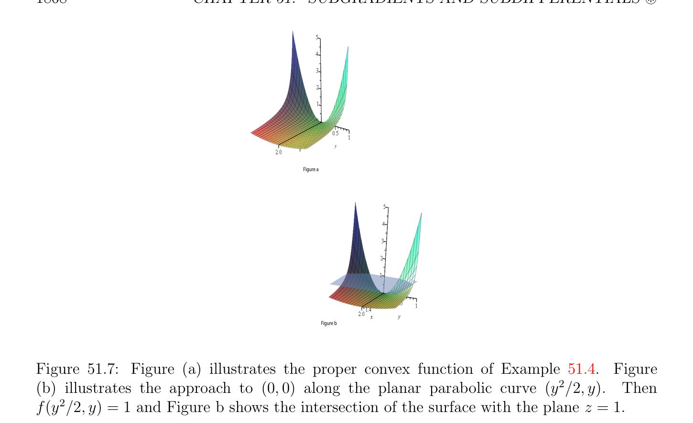
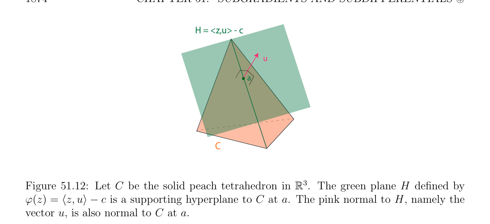
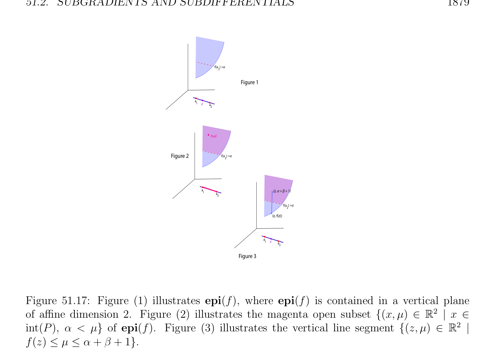

# Các dưới gradien và Các vi phân dưới

<!-- PAGE 1868 -->
$$Figure a$$
$$Figure b$$

**Hình 51.7:** Hình () minh họa thực sự/đúng đắn hàm lồi (convex function) của Ví dụ 51.4. Hình
$(b)$ minh họa cách tiếp cận đến $(0, 0)$ dọc theo phẳng parabolic đường cong $(y^{2}/2, y)$. Thì $f(y^{2}/2, y) = 1$ và Hình $b$ chỉ ra giao của mặt với mặt phẳng $z = 1$.

## 51.2 Các dưới gradien và Các vi phân dưới

Ta đã thấy trong mục trước rằng thực sự/đúng đắn các hàm lồi có “tốt” tính liên tục prop-
$$\mathbb{R}^{n}$$
Erties. Đáng chú ý, nếu $f$ là hàm lồi (convex function), với mọi $x \in$ sao cho f(x) là hữu hạn, một phía đạo hàm f' $(x; u)$ tồn tại với mọi $u \in \mathbb{R}^{n}$; kết quả này có đã được được hiển thị ít nhất vì $1893$, như được lưu ý bởi Stoltz (xem Rockafellar $[143]$, trang $428)$. Directional các đạo hàm sẽ được thảo luận trong Mục 51.3. Nếu $f$ là differentitable tại $x$, thì của course
$$df_{x}(u) = \langle \nabla f_{x}, u\rangle for all u \in \mathbb{R}^{n},$$
Ở đâu $\nabla f_{x}$ là gradien của $f$ tại $x$. Nhưng chẵn/ngay cả nếu $f$ là không khả vi (differentiable) tại $x$, hóa ra là cho “hầu hết” $x \in$ dom(f), đặc biệt nếu $x \in$ relint(dom(f)), có một khác rỗng đóng tập lồi (convex set) $\partial$ f(x) mà có thể được quan điểm như tổng quát hóa của gradien $\nabla f_{x}$. Điều này tập lồi (convex set) của $\mathbb{R}^{n}, \partial$ f(x), được gọi là vi phân dưới (subdifferential) của $f$ tại $x$, có một số của các tính chất của gradien $\nabla f_{x}$. các vectơ trong $\partial$ f(x) được gọi là các dưới gradien tại $x$. Ví dụ, nếu $f$ là thực sự/đúng đắn hàm lồi (convex function), thì $f$ đạt được
$$\mathbb{R}^{n}$$
Của nó cực tiểu tại $x \in$ iff0 $\in \partial$ f(x). Một số của các định lý của Chương $50$ có thể được suy rộng/tổng quát hóa đến các hàm lồi rằng là không nhất thiết khả vi (differentiable) bằng cách thay thế các điều kiện liên quan đến các gradien bởi các điều kiện liên quan đến các vi phân dưới. Các phần tử này các tổng quát hóa là then chốt cho justification rằng khác nhau các phương pháp lặp cho việc giải tối ưu hóa các bài toán quy hoạch hội tụ. Ví dụ, chúng được sử dụng để chứng minh sự hội tụ của ADMM phương pháp được thảo luận trong Chương $52$.

<!-- PAGE 1869 -->
Một nên lưu ý rằng khái niệm của vi phân dưới (subdifferential) là không chỉ gratuitous toán học tổng quát hóa. đáng chú ý sự kiện rằng tối ưu hóa bài toán
$$minimizeJ(u)$$
$$subject to u \in C,$$
$$\mathbb{R}^{n}$$
Ở đâu $C$ là đóng tập lồi (convex set) trong có thể được được viết lại như
$$minimizeJ(u) + I_{C}(z)$$
$$subject to u -z = 0,$$
Ở đâu $I_{C}$ là indicator hàm của $C$, buộc chúng ta đến deal với các hàm chẳng hạn như $J(u)+I_{C}(z)$ mà là không khả vi (differentiable), chẵn/ngay cả nếu $J$ là. ADMM có thể cope với tình huống này (dưới nhất định các điều kiện), và các vi phân dưới không thể là tránh được trong justifying của nó sự hội tụ. Tuy nhiên, nó nên được nói rằng vi phân dưới (subdifferential) $\partial$ f(x) là lý thuyết công cụ rằng là không bao giờ được tính trong thực tế (ngoại trừ trong rất đặc biệt đơn giản các trường hợp). để định nghĩa các dưới gradien ta cần đến ôn tập/tổng quan (afin) các siêu phẳng.
$$\mathbb{R}^{n} \mathbb{R}$$
Nhắc lại rằng afin tạo thành $\phi$: $\to$ là hàm của tạo thành
$$\phi (x) = h(x) + c,x \in \mathbb{R}^{n},$$
$$\mathbb{R}^{n} \mathbb{R}\mathbb{R}\mathbb{R}^{n}$$
Ở đâu $h: \to$ là dạng tuyến tính (linear form) và $c \in$ là một số hằng số. afin siêu phẳng (hyperplane) $H \subseteq$
$$\mathbb{R}^{n} \mathbb{R}$$
Là hạt nhân (kernel) của bất kỳ nonconstant afin tạo thành $\phi$: $\to$ (mà có nghĩa là dạng tuyến tính (linear form) $h$ định nghĩa $\phi$ là không không dạng tuyến tính (linear form)),
$$\mathbb{R}^{n}$$
$$H = \phi^{-1} (0) = {x \in | \phi (x) = 0}.$$
Bất kỳ hai nonconstant afin các dạng $\phi$ và $\psi$ định nghĩa cùng (afin) siêu phẳng (hyperplane) $H$, trong nghĩa rằng $H = \phi^{-1} (0) = \psi^{-1} (0)$, phải là tỷ lệ, mà có nghĩa là tồn tại một khác không $\alpha  \in \mathbb{R}$ sao cho $\psi  = \alpha \phi$. nonconstant afin tạo thành $\phi$ cũng định nghĩa hai một nửa các không gian $H_{+}$ và $H_{-}$ cho trước bởi
$$\mathbb{R}^{n} \mathbb{R}^{n}$$
$$H_{+} = {x \in | \phi (x) \ge 0},H_{-}= {x \in | \phi (x) \le 0}.$$
Rõ ràng, $H_{+} \cap H_{-} = H$, của chúng chung/phổ biến biên (boundary). Xem Hình 51.8. lựa chọn của dấu là somewhat tùy ý, vì afin tạo thành $\alpha \phi$ với $\alpha  < 0$ định nghĩa một nửa các không gian với $H_{-}$ và $H_{+}$ (một nửa các không gian là swapped).
$$\mathbb{R}^{n} \mathbb{R}^{n} \mathbb{R}$$
Bởi đối ngẫu được cảm sinh bởi Euclidean tích vô hướng (inner product) trên, dạng tuyến tính (linear form) $h: \to$
$$\mathbb{R}^{n}$$
Tương ứng với duy nhất vectơ $u \in$ sao cho
$$h(x) = \langle x, u\rangle for all x \in \mathbb{R}^{n}.$$
Thì nếu $\phi$ là afin tạo thành cho trước bởi $\phi (x) = \langle x, u\rangle + c$, điều này afin tạo thành là nonconstant khi và chỉ khi $u \neq  0$, và $u$ là chuẩn tắc/bình thường đến siêu phẳng (hyperplane) $H$, trong nghĩa rằng nếu $x_{0} \in H$ là bất kỳ cố định vectơ trong $H$, và $x$ là bất kỳ vectơ trong $H$, thì $\langle x$ - $x_{0}, u\rangle = 0$.

<!-- PAGE 1870 -->
$$(0,0,5)$$
$$(5,0,0)(0,5,0)$$
$$\mathbb{R}^{3}$$

**Hình 51.8:** afin siêu phẳng (hyperplane) $H = {x \in$ | $x + y + z$ - $2 = 0}$. một nửa không gian $H_{+}$ các mặt viewer và chứa điểm $(0, 0, 10)$, trong khi một nửa không gian $H_{-}$ là đằng sau $H$ và chứa điểm $(0, 0, 0)$. Thật vậy, $x_{0} \in H$ có nghĩa là $\langle x_{0}, u\rangle + c = 0$, và $x \in H$ có nghĩa là $\langle x, u\rangle + c = 0$, do đó ta thu được $\langle x_{0}, u\rangle = \langle x, u\rangle$, mà suy ra $\langle x$ - $x_{0}, u\rangle = 0$. Ở đây là nhận xét mà đóng then chốt vai trò trong định nghĩa khái niệm của dưới gradien (subgradient). illustration của sau đây mệnh đề là miễn là/được cung cấp bởi Hình 51.9.
$$\mathbb{R}^{n} \mathbb{R} \mathbb{R}^{n+1}$$

> **Mệnh đề 51.9.** Cho $\phi$: $\to$ là nonconstant afin tạo thành. Thì ánh xạ $\omega$: $\to \mathbb{R}$ cho trước bởi
$$\omega (x, \alpha ) = \phi (x) -\alpha ,x \in \mathbb{R}^{n}, \alpha  \in \mathbb{R},$$
Là nonconstant afin tạo thành định nghĩa siêu phẳng (hyperplane) $\mathcal{H} = \omega^{-1} (0)$ mà là đồ thị của afin tạo thành $\phi$. Hơn nữa, điều này siêu phẳng (hyperplane) là nonvertical trong $\mathbb{R}^{n+1}$, trong nghĩa rằng $\mathcal{H}$ không thể được định nghĩa bởi nonconstant afin tạo thành $(x, \alpha$) $\mapsto \psi (x)$ mà không phụ thuộc vào $\alpha$.

*Chứng minh.* Thật vậy, $\phi$ là của tạo thành $\phi (x) =$ h(x) $+ c$ với một số khác không dạng tuyến tính (linear form) $h$, do đó
$$\omega (x, \alpha ) = h(x) -\alpha  + c.$$
Vì $h$ là tuyến tính, ánh xạ $(x, \alpha$) $=$ h(x) - $\alpha$ là hiển nhiên tuyến tính và khác không, do đó $\omega$ là nonconstant afin tạo thành định nghĩa siêu phẳng (hyperplane) $\mathcal{H}$ trong $\mathbb{R}^{n+1}$. Theo Định nghĩa,
$$\mathbb{R}^{n+1} \mathbb{R}^{n+1}$$
$$\mathcal{H} = {(x, \alpha ) \in | \omega (x, \alpha ) = 0} = {(x, \alpha ) \in | \phi (x) -\alpha  = 0},$$
Mà là đồ thị của $\phi$. Nếu $\mathcal{H}$ đã là đứng siêu phẳng (hyperplane), thì $\mathcal{H}$ sẽ được định nghĩa bởi nonconstant afin tạo thành $\psi$ độc lập của $\alpha$, nhưng afin tạo thành $\omega$ cho trước bởi $\omega (x, \alpha$) $= \phi (x)-\alpha$ và afin tạo thành $\psi (x)$ có thể’t là tỷ lệ, một mâu thuẫn.
$$\mathbb{R}^{n+1} \mathbb{R}^{n} \mathbb{R}$$
Ta nói rằng $\mathcal{H}$ là siêu phẳng (hyperplane) (trong) được cảm sinh bởi afin tạo thành $\phi$: $\to$. Cũng nhắc lại khái niệm của tựa/hỗ trợ siêu phẳng (hyperplane) đến tập lồi (convex set).

<!-- PAGE 1871 -->
$$10$$
$$8$$
$$6$$
$$4$$
$$2$$
$$\overline{10}\overline{5}\overline{0}\overline{5}\overline{10}$$
$$2x$$
$$4\omega (x, \alpha ) = x+1 - \alpha$$
$$6$$
$$8$$
$$\mathbb{R}\mathbb{R} \mathbb{R}^{2} \mathbb{R}$$

**Hình 51.9:** Cho $\phi$: $\to$ là afin tạo thành $\phi (x) = x + 1$. Cho $\omega$: $\to$ là afin tạo thành $\omega (x, \alpha$) $= x + 1$ - $\alpha$. siêu phẳng (hyperplane) $\mathcal{H} = \omega^{-1} (0)$ là đỏ đường thẳng với phương trình $x$ - $\alpha  + 1 = 0$.
$$\mathbb{R}^{n}$$

> **Định nghĩa 51.12.** Nếu $C$ là khác rỗng tập lồi (convex set) trong và $x$ là vectơ trong $C$, afin siêu phẳng (hyperplane) $H$ là tựa/hỗ trợ siêu phẳng (hyperplane) đến $C$ tại $x$ nếu
$(1) x \in H$.
$(2)$ Hoặc $C \subseteq H_{+}$ hoặc $C \subseteq H_{-}$. Xem Hình 51.10. Tương đương, tồn tại một nonconstant afin tạo thành $\phi$ sao cho $\phi (z) =$
$$\mathbb{R}^{n}\mathbb{R}^{n} \mathbb{R}$$
$\langle z, u\rangle$ - $c$ với mọi $z \in$, với một số khác không $u \in$ và một số $c \in$, sao cho
$(1) \langle x, u\rangle = c$.
$(2) \langle z, u\rangle \le c$ với mọi $z \in C$ khái niệm của vectơ chuẩn tắc/bình thường đến tập lồi (convex set) được định nghĩa như sau.

> **Định nghĩa 51.13.** Cho trước khác rỗng tập lồi (convex set) $C$ trong $\mathbb{R}^{n}$, với mọi $a \in C$, vectơ $u \in \mathbb{R}^{n}$ là chuẩn tắc/bình thường đến $C$ tại nếu
$$\langle z -a, u\rangle \le 0for all z \in C.$$
Nói cách khác, $u$ thực hiện không tạo acute góc với bất kỳ đường thẳng đoạn thẳng trong $C$ với như endpoint. Tập hợp tất cả các vectơ $u$ chuẩn tắc/bình thường đến $C$ được gọi là chuẩn tắc/bình thường nón đến $C$ tại và được ký hiệu bởi $N_{C}(a)$. Xem Hình 51.11. Nó là dễ để kiểm tra rằng chuẩn tắc/bình thường nón đến $C$ tại là nón lồi (convex cone). Cũng, nếu siêu phẳng (hyperplane) $H$ được định nghĩa bởi afin tạo thành $\phi (z) = \langle z, u\rangle -c$ với $u \neq  0$ là tựa/hỗ trợ siêu phẳng (hyperplane) đến $C$ tại $x$, vì $\langle z, u\rangle \le c$ với mọi $z \in C$ và $\langle x, u\rangle = c$, ta có $\langle z$ - $x, u\rangle \le 0$ với mọi $z \in C$, mà có nghĩa là $u$ là chuẩn tắc/bình thường đến $C$ tại $x$. Điều này khái niệm được minh họa bởi Hình 51.12.

<!-- PAGE 1872 -->
$$H$$
$$x$$
$$C$$

**Hình 51.10:** Cho $C$ là solid peach tứ diện $in\mathbb{R}^{3}$. xanh lục mặt phẳng $H$ là tựa/hỗ trợ siêu phẳng (hyperplane) đến điểm $x$ vì $x \in H$ và $C \subseteq H_{+}$, i.e. $H$ chỉ cắt $C$ trên cạnh chứa $x$ và do đó tứ diện lies trong “trước” của $H$.
$$\mathbb{R}^{n} \mathbb{R}$$
Khái niệm của dưới gradien (subgradient) có thể được motived như sau. hàm $f$: $\to$ là differen-
$$\mathbb{R}^{n}$$
Tiable tại $x \in$ nếu
$$f(x + y) = f(x) + df_{x}(y) + \epsilon (y) \|y\|_{2} ,$$
$$\mathbb{R}^{n}  \mathbb{R}^{n} \mathbb{R}$$
Với mọi $y \in$ trong một số khác rỗng tập con chứa $x$, ở đâu $df_{x}$: $\to$ là dạng tuyến tính (linear form), và $\epsilon$ là một số hàm sao cho $lim_{\|y\|\mapsto0} \epsilon (y) = 0$. Hơn nữa,
$$df_{x}(y) = \langle y, \nabla f_{x}\rangle for all y \in \mathbb{R}^{n},$$
Ở đâu $\nabla f_{x}$ là gradien của $f$ tại $x$, do đó
$$f(x + y) = f(x) + \langle y, \nabla f_{x}\rangle + \epsilon (y) \|y\|_{2} .$$
Nếu ta giả sử rằng $f$ là lồi, nó làm cho nghĩa đến thay thế đẳng thức dấu bởi bất đẳng thức dấu $\ge$ trong ở trên phương trình và đến bỏ “sai số số hạng” $\epsilon (y) \|y\|_{2}$, do đó vectơ $u$ là dưới gradien (subgradient) của $f$ tại $x$ nếu
$$f(x + y) \ge f(x) + \langle y, u\rangle for all y \in \mathbb{R}^{n}.$$
Do đó ta là đã dẫn đến đến sau đây định nghĩa.
$$\mathbb{R}^{n} \mathbb{R}\mathbb{R}^{n}$$

> **Định nghĩa 51.14.** Cho $f$: $\to  \cup {-\infty , +\infty$ } là hàm lồi (convex function). Với mọi $x \in$,
$$\mathbb{R}^{n}$$
Dưới gradien (subgradient) của $f$ tại $x$ là bất kỳ vectơ $u \in$ sao cho
$$f(z) \ge f(x) + \langle z -x, u\rangle ,for all z \in \mathbb{R}^{n}.(*_{subgrad})$$
Ở trên bất đẳng thức được gọi là dưới gradien (subgradient) bất đẳng thức. Tập hợp tất cả các dưới gradien của $f$ tại $x$ được ký hiệu là $\partial$ f(x) và được gọi là vi phân dưới (subdifferential) của $f$ tại $x$. Nếu $\partial$ f(x) $\neq  \emptyset$, thì ta nói rằng $f$ là khả vi dưới tại $x$.

<!-- PAGE 1873 -->
$$N  (a)C$$
$$a$$
$$uFigure a$$
$$C$$
$$N  (a)C$$
$$a$$
$$z$$
$$CFigure b$$

**Hình 51.11:** Cho $C$ là solid peach tứ diện trong $\mathbb{R}^{3}$. nhỏ upside-down magenta tứ diện là translate của $N_{C}(a)$. Hình () chỉ ra rằng chuẩn tắc/bình thường nón được tách từ $C$ bởi ngang xanh lục tựa/hỗ trợ siêu phẳng (hyperplane). Hình $(b)$ chỉ ra rằng bất kỳ vectơ $u \in N_{C}(a)$ thực hiện không tạo acute góc với đường thẳng đoạn thẳng trong $C$ emanating từ. Giả sử rằng f(x) là hữu hạn. Nhận thấy rằng dưới gradien (subgradient) bất đẳng thức nói rằng rằng $0$ là dưới gradien (subgradient) tại $x$ khi và chỉ khi $f$ có cực tiểu toàn cục (global minimum) tại $x$. Trong trường hợp này, siêu phẳng (hyperplane) $\mathcal{H}$ (trong $\mathbb{R}^{n+1})$ được định nghĩa bởi afin tạo thành $\omega (y, \alpha$) $=$ f(x) - $\alpha$ là ngang tựa/hỗ trợ siêu phẳng (hyperplane) đến trên đồ thị (epigraph) epi(f) tại $(x$, f(x)). Nếu $u \in \partial$ f(x) và u̸ $= 0$, thì $(*_{subgrad})$ nói rằng rằng siêu phẳng (hyperplane) được cảm sinh bởi afin tạo thành $z \mapsto \langle z$ - $x, u\rangle +$ f(x) như trong Mệnh đề 51.9 là nonvertical tựa/hỗ trợ siêu phẳng (hyperplane) $\mathcal{H}$ (trong $\mathbb{R}^{n+1})$ đến trên đồ thị (epigraph) epi(f) tại $(x$, f(x)).
$$\mathbb{R}^{n+1}$$
Vectơ $(u, -1) \in$ là chuẩn tắc/bình thường đến siêu phẳng (hyperplane) $\mathcal{H}$. Xem Hình 51.13. Thật vậy, nếu $u \neq  0$, siêu phẳng (hyperplane) $\mathcal{H}$ được cho bởi
$$\mathbb{R}^{n+1}$$
$$\mathcal{H} = {(y, \alpha ) \in | \omega (y, \alpha ) = 0}$$
Với $\omega (y, \alpha$) $= \langle y$ - $x, u\rangle +$ f(x) - $\alpha$, do đó $\omega (x$, f(x)) $= 0$, mà có nghĩa là $(x$, f(x)) $\in H$. Cũng, với mọi $(z, \beta$) $\in$ epi(f), bởi $(*_{subgrad})$, ta có
$$\omega (z, \beta ) = \langle z -x, u\rangle + f(x) -\beta  \le f(z) -\beta  \le 0,$$
Vì $(z, \beta$) $\in$ epi(f), do đó epi(f) $\subseteq H_{-}$, và $\mathcal{H}$ là nonvertical tựa/hỗ trợ siêu phẳng (hyperplane) (trong $\mathbb{R}^{n+1})$ đến trên đồ thị (epigraph) epi(f) tại $(x$, f(x)). Vì
$$\omega (y, \alpha ) = \langle y -x, u\rangle + f(x) -\alpha  = \langle (y -x, \alpha ), (u, -1)\rangle + f(x),$$
Vectơ $(u, -1)$ là thật vậy chuẩn tắc/bình thường đến siêu phẳng (hyperplane) $\mathcal{H}$. ở trên các sự kiện là quan trọng và recorded như sau đây mệnh đề.

> **Mệnh đề 51.10.** Với mọi $x \in \mathbb{R}^{n}$, nếu f(x) là hữu hạn, thì $f$ là khả vi dưới tại $x$ khi và chỉ khi có một nonvertical tựa/hỗ trợ siêu phẳng (hyperplane) (trong $\mathbb{R}^{n+1})$ đến trên đồ thị (epigraph) epi(f) tại

<!-- PAGE 1874 -->
$$H = <z,u> - c$$
$$u$$
$$a$$
$$C$$

**Hình 51.12:** Cho $C$ là solid peach tứ diện trong $\mathbb{R}^{3}$. xanh lục mặt phẳng $H$ được định nghĩa bởi $\phi (z) = \langle z, u\rangle$ - $c$ là tựa/hỗ trợ siêu phẳng (hyperplane) đến $C$ tại. hồng chuẩn tắc/bình thường đến $H$, cụ thể là vectơ $u$, là cũng chuẩn tắc/bình thường đến $C$ tại. $(x$, f(x)). Trong trường hợp này có một afin tạo thành $\phi$ (trên $\mathbb{R}^{n})$ sao cho f(y) $\ge \phi (y)$ với mọi $y \in \mathbb{R}^{n}$. Ta có thể chọn $\phi$ cho trước bởi $\phi (y) = \langle y$ - $x, u\rangle +$ f(x) với mọi $y \in \mathbb{R}^{n}$. Nó là dễ để xem rằng $\partial$ f(x) là đóng và lồi. tập hợp $\partial$ f(x) có thể là rỗng, hoặc rút gọn đến đơn lẻ phần tử. Trong $\partial$ f(x) bao gồm của đơn lẻ phần tử nó có thể được được hiển thị rằng $f$ là hữu hạn near $x$, khả vi (differentiable) tại $x$, và rằng $\partial$ f(x) $= {\nabla f_{x}}$, gradien của $f$ tại $x$.
$$\mathbb{R}^{n}$$

> **Ví dụ 51.5.** $\ell^{2}$ chuẩn (norm) f(x) $= \|x\|_{2}$ là khả vi dưới với mọi $x \in$, thực ra
$$\mathbb{R}^{n}$$
Khả vi (differentiable) với mọi $x \neq  0$. Cho $x = 0$, tập hợp $\partial$ f(0) bao gồm của tất cả $u \in$ sao cho
$$\|z\|_{2} \ge \langle z, u\rangle for all z \in \mathbb{R}^{n},$$
$$\mathbb{R}^{n}$$
Cụ thể là (bởi Cauchy–Schwarz), Euclidean unit hình cầu ${u \in$ | $\|u\|_{2} \le 1}$. Xem Hình 51.14.

> **Ví dụ 51.6.** Cho $\ell^{\infty}$ chuẩn (norm) nếu f(x) $= \|x\|_{\infty}$, ta để lại nó như một bài tập để chỉ ra rằng $\partial$ f(0) là đa diện
$$\partial f(0) = conv{\pm e_{1}, \dots  , \pm e_{n}}.$$
Xem Hình 51.15. Một có thể cũng hoạt động/công trình ra những gì là $\partial$ f(x) nếu $x \neq  0$, nhưng điều này là nhiều hơn/thêm phức tạp; xem Rockafellar $[143]$, trang $215$.

> **Ví dụ 51.7.** sau đây hàm là ví dụ của thực sự/đúng đắn hàm lồi (convex function) mà là không khả vi dưới everywhere:
$$($$
$$-(1 -|x|^{2})^{1/2}if |x| \le 1$$
$$f(x) =$$
$$+\infty otherwise.$$

<!-- PAGE 1875 -->
$$= 1/2$$
$$u$$
$$f(x)$$
$$> +$$
$$-x,u$$
$$(0,3/2)u = 0<z$$
$$(0,3/2)$$
$$\overline{(1,1)}(1,1)<z-x,u> + f(x)   u =$$
$$-1/4$$
$$(-1/4,1)(1/2,-1)$$

**Hình 51.13:** Cho $f$: $\mathbb{R} \to \mathbb{R}\cup {-\infty , +\infty$ } là từng khúc hàm được định nghĩa bởi f(x) $= x+1$ cho $x \ge 1$ và f(x) $= -_{2}^{1}x +^{3}$ cho $x < 1$. Của nó trên đồ thị (epigraph) là shaded xanh lam miền trong $\mathbb{R}^{2}$. Vì $f$ có cực tiểu tại $x = 1, 0^{2} \partial$ f(1), và đồ thị của f(x) có ngang tựa/hỗ trợ
$$hyperplane at (1, 1). Since {^{1} \frac{\in}{(} , -_{4}^{1}} \subset \partial f(1), the maroon line_{2}^{1} (x -1) + 1 (with normal$$
$(_{2}^{1}, -1))$ và violet đường thẳng $-_{4}^{12}x-1)+1$ (với chuẩn tắc/bình thường $(-_{4}^{1}, -1))$ là tựa/hỗ trợ các siêu phẳng đến đồ thị của f(x) tại $(1, 1)$. Xem Hình 51.16. Ta để lại nó như một bài tập để chỉ ra rằng $f$ là khả vi dưới (thực ra khả vi (differentiable)) tại $x$ khi |x| $< 1$, nhưng $\partial$ f(x) $= \emptyset$ khi |x| $\ge 1$, chẵn/ngay cả dù $x \in$ dom(f) cho |x| $= 1$.

> **Ví dụ 51.8.** vi phân dưới (subdifferential) của indicator hàm là thú vị. Cho $C$ là khác rỗng tập lồi (convex set). Theo Định nghĩa, $u \in \partial I_{C}(x)$ khi và chỉ khi
$$I_{C}(z) \ge I_{C}(x) + \langle z -x, u\rangle for all z \in \mathbb{R}^{n}.$$
Vì $C$ là khác rỗng, tồn tại một $z \in C$ sao cho $I_{C}(z) = 0$, do đó ở trên điều kiện suy ra rằng $x \in C$ (ngược lại $I_{C}(x) = +\infty$ nhưng $0 \ge +\infty +\langle z -u, u\rangle$ là không thể), do đó $0 \ge \langle z -x, u\rangle$ với mọi $z \in C$, mà có nghĩa là $z$ là chuẩn tắc/bình thường đến $C$ tại $x$. Vì vậy, $\partial I_{C}(x)$ là chuẩn tắc/bình thường nón $N_{C}(x)$ đến $C$ tại $x$.

> **Ví dụ 51.9.** các vi phân dưới của indicator hàm $f$ của không âm orthant $\mathbb{R}^{n}$ của reveal connection đến độ bù lỏng (complementary slackness) các điều kiện. Nhắc lại rằng điều này indicator hàm được cho bởi
$$($$
$$0if x_{i} \ge 0, 1 \le i \le n,$$
$$f(x_{1}, \dots  , x_{n}) =$$
$$+\infty otherwise.$$
Bởi Ví dụ 51.8, các dưới gradien $y$ của $f$ tại $x \ge 0$ tạo thành chuẩn tắc/bình thường nón đến không âm orthant tại $x$. Điều này có nghĩa là $y \in N_{C}(x)$ khi và chỉ khi
$$\langle z -x, y\rangle \le 0for all z \ge 0$$

<!-- PAGE 1876 -->
$$Figure 1$$
$$Figure 2$$
$$\mathbb{R}^{3} p$$

**Hình 51.14:** Hình $(1)$ chỉ ra đồ thị trong của f(x, $y) = \|(x, y)\|_{2} = \overline{x}^{2} \overline{+}\overline{y}^{2}$. Hình
$(2)$ chỉ ra tựa/hỗ trợ siêu phẳng (hyperplane) với chuẩn tắc/bình thường $(_{2}^{\sqrt1} ,_{2}^{\sqrt1}, -1)$, ở đâu $(_{2}^{\sqrt1} ,_{2}^{\sqrt1}) \in \partial$ f(0). khi và chỉ khi
$$\langle z, y\rangle \le \langle x, y\rangle for all z \ge 0.$$
Đặc biệt, cho $z = 0$ ta thu được $\langle x, y\rangle \ge 0$, và cho $z =$ 2x $\ge 0$, ta có $\langle x, y\rangle \le 0$, do đó $\langle x, y\rangle = 0$. Hệ quả là, $y \in N_{C}(x)$ khi và chỉ khi $\langle x, y\rangle = 0$ và
$$\langle z, y\rangle \le 0for all z \ge 0.$$
Cho $z = e_{j} \ge 0$, ta thu được $y_{j} \le 0$. Ngược lại, nếu $y \le 0$ và $\langle x, y\rangle = 0$, vì $x \ge 0$, ta thu được $\langle z, y\rangle \le 0$ với mọi $z \ge 0$, và do đó
$$\mathbb{R}^{n}$$
$$\partial f(x) = {y = (y_{1}, \dots  , y_{n}) \in | y \le 0, \langle x, y\rangle = 0}.$$
$$But for x \ge 0 and y \le 0 we have \langle x, y\rangle = \sum_{j}  n=1 x_{j}y_{j} = 0 iff x_{j}y_{j} = 0 for j = 1, \dots  , n, thus$$
Ta xem rằng $y \in \partial$ f(x) khi và chỉ khi ta có
$$x_{j} \ge 0, y_{j} \le 0, x_{j}y_{j} = 0,1 \le j \le n,$$
Mà là độ bù lỏng (complementary slackness) các điều kiện. Tựa/hỗ trợ các siêu phẳng đến trên đồ thị (epigraph) của thực sự/đúng đắn hàm lồi (convex function) $f$ có thể được được sử dụng để chứng minh tính chất mà đóng then chốt vai trò trong tối ưu hóa lý thuyết. chứng minh sử dụng cổ điển kết quả của lồi hình học, cụ thể là Minkowski tựa/hỗ trợ siêu phẳng (hyperplane) định lý.

<!-- PAGE 1877 -->
$$Figure 1$$
$$Figure 2$$
$$\mathbb{R}^{3}$$

**Hình 51.15:** Hình $(1)$ chỉ ra đồ thị trong của f(x, $y) = \|(x, y)\|_{\infty} = sup{|x|, |y|}$. Hình
$(2)$ chỉ ra tựa/hỗ trợ siêu phẳng (hyperplane) với chuẩn tắc/bình thường $(_{2}^{1},_{2}^{1} , -1)$, ở đâu $(_{2}^{1},_{2}^{1}$) $\in \partial$ f(0).

> **Định lý 51.11.** (Minkowski) Cho $C$ là khác rỗng tập lồi (convex set) trong $\mathbb{R}^{n}$. Với mọi điểm $a \in C$ - relint(C), có một tựa/hỗ trợ siêu phẳng (hyperplane) $H$ đến $C$ tại. Định lý 51.11 được chứng minh trong Rockafellar $[143]$ (Định lý 11.6). Xem cũng Berger $[11]$ (Mệnh đề 11.5.2). chứng minh là không như đơn giản như một có thể kỳ vọng, và là based trên hình học phiên bản của Hahn–Banach định lý. Trong thứ tự để chứng minh Định lý 51.14 ở dưới ta cần hai technical các mệnh đề.

> **Mệnh đề 51.12.** Cho $C$ là bất kỳ khác rỗng tập lồi (convex set) trong $\mathbb{R}^{n}$. Với mọi $x \in$ relint(C) và bất kỳ $y \in \overline{C}$, ta có $(1-\lambda )x+\lambda y \in$ relint(C) với mọi $\lambda$ sao cho $0 \le \lambda  < 1$. Nói cách khác, đường thẳng đoạn thẳng từ $x$ đến $y$ bao gồm cả $x$ và excluding $y$ lies hoàn toàn trong phạm vi relint(C). Mệnh đề 51.12 được chứng minh trong Rockafellar $[143]$ (Định lý 6.1). chứng minh là không khó nhưng khá technical.

> **Mệnh đề 51.13.** Với mọi thực sự/đúng đắn hàm lồi (convex function) $f$ trên $\mathbb{R}^{n}$, ta có
$$\mathbb{R}^{n+1}$$
$$relint(epi(f)) = {(x, \mu ) \in | x \in relint(dom(f)), f(x) < \mu }.$$

*Chứng minh.* Mệnh đề 51.13 được chứng minh trong Rockafellar $[143]$ (Bổ đề 7.3). Bởi làm việc trong afin bao (hull) của epi(f), phát biểu của Mệnh đề 51.13 là tương đương đến
$$\mathbb{R}^{m+1}$$
$$int(epi(f)) = {(x, \mu ) \in | x \in int(dom(f)), f(x) < \mu },$$

<!-- PAGE 1878 -->
$$Figure 51.16: The graph of the function in Example 51.7.$$
Giả sử rằng afin bao (hull) của epi(f) có số chiều $m + 1$. Xem Hình $(1)$ của Hình 51.17. inclusion $\subseteq$ là hiển nhiên, do đó ta chỉ cần để chứng minh reverse inclusion. Thì với mọi $z \in$ int(dom(f)), ta có thể tìm lồi polyhedral tập con $P = conv(a_{1}, \dots  , a_{m+1})$ với $a_{1}, \dots  , a_{m+1} \in$ dom(f) sao cho $z \in$ int(P). Cho
$$\alpha  = \max{f(a_{1}), \dots  , f(a_{m+1})}.$$
Vì bất kỳ $x \in P$ có thể được biểu diễn dưới dạng
$$x = \lambda_{1} a_{1} + \cdots  + \lambda_{m+1} a_{m+1},\lambda_{1}  + \cdots  + \lambda_{m+1}  = 1, \lambda_{i}  \ge 0,$$
Và vì $f$ là lồi ta có f(x) $\le \lambda_{1} f(a_{1}) + \cdots  + \lambda_{m+1} f(a_{m+1}) \le (\lambda_{1}  + \cdots  + \lambda_{m+1} )\alpha  = \alpha$ với mọi $x \in P$. ở trên chỉ ra rằng mở tập con
$$\mathbb{R}^{m+1}$$
$${(x, \mu ) \in | x \in int(P), \alpha  < \mu }$$
Được chứa trong epi(f). Xem Hình $(2)$ của Hình 51.17. Đặc biệt, với mọi $\mu  > \alpha$, ta có
$$(z, \mu ) \in int(epi(f)).$$
Do đó với mọi $\beta  \in \mathbb{R}$ sao cho $\beta  >$ f(z), ta xem rằng $(z, \beta$) thuộc đến tương đối phần trong (interior) của
$$\mathbb{R}^{m+1}$$
Đứng đường thẳng đoạn thẳng ${(z, \mu$) $\in$ | f(z) $\le \mu  \le \alpha  + \beta  + 1}$ mà meets int(epi(f)). Xem Hình $(3)$ của Hình 51.17. Theo Mệnh đề 51.12, $(z, \beta$) $\in$ int(epi(f)). Ta có thể bây giờ chứng minh sau đây quan trọng định lý.

> **Định lý 51.14.** Cho $f$ là thực sự/đúng đắn hàm lồi (convex function) trên $\mathbb{R}^{n}$. Với mọi $x \in$ relint(dom(f)), có một nonvertical tựa/hỗ trợ siêu phẳng (hyperplane) $\mathcal{H}$ đến epi(f) tại $(x$, f(x)). Hệ quả là $f$ là
$$\mathbb{R}^{n} \mathbb{R}$$
Subdiffentiable với mọi $x \in$ relint(dom(f)), và tồn tại một afin tạo thành $\phi$: $\to$ sao cho f(y) $\ge \phi (y)$ với mọi $y \in \mathbb{R}^{n}$.

<!-- PAGE 1879 -->
$$f(a  ) =2\alpha$$
$$Figure 1$$
$$a1z$$
$$a2$$
$$(x,\mu )$$
$$Figure 2f(a  ) =\alpha$$
$$2$$
$$a1(z, \alpha  + \beta  + 1)$$
$$a2$$
$$f(a  ) =2\alpha$$
$$(z, f(z))$$
$$a1z$$
$$a2$$
$$Figure 3$$

**Hình 51.17:** Hình $(1)$ minh họa epi(f), ở đâu epi(f) được chứa trong đứng mặt phẳng
$$\mathbb{R}^{2}$$
Của afin số chiều $2$. Hình $(2)$ minh họa magenta mở tập con ${(x, \mu$) $\in$ | $x \in$
$$\mathbb{R}^{2}$$
Int(P), $\alpha  < \mu$ } của epi(f). Hình $(3)$ minh họa đứng đường thẳng đoạn thẳng ${(z, \mu$) $\in$ | f(z) $\le \mu  \le \alpha  + \beta  + 1}$.

*Chứng minh.* Theo Mệnh đề 51.14, với mọi $x \in$ relint(dom(f)), ta có $(x, \mu$) $\in$ relint(epi(f)) với mọi $\mu  \in \mathbb{R}$ sao cho f(x) $< \mu$. Vì theo định nghĩa của epi(f) ta có $(x$, f(x)) $\in$ epi(f) - relint(epi(f)), bởi Minkowski’s định lý (Định lý 51.11), có một tựa/hỗ trợ siêu phẳng (hyperplane) $\mathcal{H}$ đến epi(f) qua $(x$, f(x)). Vì $x \in$ relint(dom(f)) và $f$ là thực sự/đúng đắn, siêu phẳng (hyperplane) $\mathcal{H}$ là không đứng siêu phẳng (hyperplane). Theo Định nghĩa 51.14, hàm $f$ là khả vi dưới tại bất kỳ $x \in$ relint(dom(f)), và dưới gradien (subgradient) bất đẳng thức chỉ ra rằng nếu ta chọn một số $x \in$ relint(dom(f)) và nếu ta cho $\phi (z) =$ f(x) $+ \langle z -x, u\rangle$, thì $\phi$ là afin tạo thành sao cho f(z) $\ge \phi (z)$ với mọi $z \in \mathbb{R}^{n}$. Một cách trực quan, thực sự/đúng đắn hàm lồi (convex function) có thể’t giảm faster hơn afin hàm. Nó là đáng ngạc nhiên cách mà nhiều hoạt động/công trình nó lấy để chứng minh như vậy “hiển nhiên” sự kiện.
Nhận xét: Xét thực sự/đúng đắn hàm lồi (convex function) $f$: $\mathbb{R} \to \mathbb{R} \cup {+\infty$ } cho trước bởi
$$\sqrt$$
$$($$
$$-\overline{x} if x \ge 0$$
$$f(x) =$$
$$+\infty if x < 0.$$
