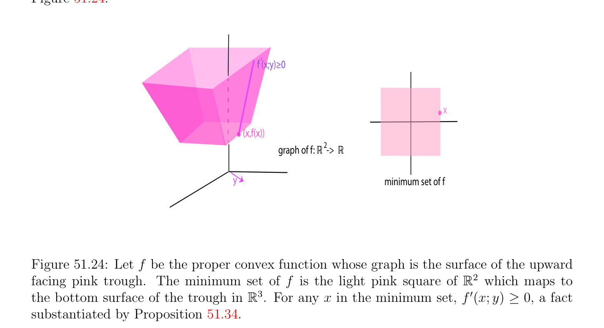
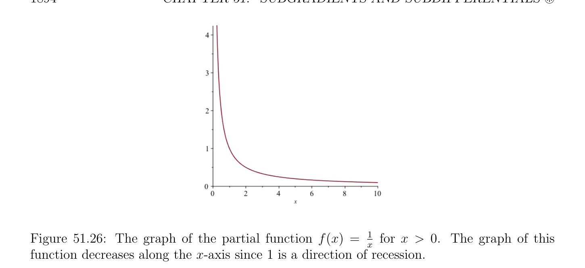

# Cực tiểu của Thực sự/đúng đắn Hàm lồi (convex function)

<!-- PAGE 1890 -->
Khi và chỉ khi
$$\epsilon  \ge \langle y, u\rangle -f(x + y) + f(x) = \langle y, u\rangle -h_{x}(y).$$
Vì theo Định nghĩa
$$h_{x}^{*}(u) = \sup(\langle y, u\rangle -h_{x}(y)),$$
$$y\in \mathbb{R} n$$
Ta kết luận rằng
$$\mathbb{R}^{n}$$
$$\partial_{\epsilon} f(x) = {u \in | h_{x}^{*}(u) \le \epsilon },$$
Như đã khẳng định.
Nhận xét: Bởi Fenchel’s bất đẳng thức $h_{x}^{*}(y) \ge 0$, và theo Mệnh đề 51.28(d), tập hợp của các vectơ ở đâu $h_{x}^{*}$ triệt tiêu là $\partial$ f(x).
$$\mathbb{R}^{n}$$
Phương trình $\partial_{\epsilon}$ f(x) $= {u \in$ | $h_{x}^{*}(u) \le \epsilon$ } chỉ ra rằng $\partial_{\epsilon}$ f(x) là đóng tập lồi (convex set). Như $\epsilon$ thu được nhỏ hơn, tập hợp $\partial_{\epsilon}$ f(x) giảm, và ta có
$$\partial f(x) = \bigcap_{\epsilon >0}  \partial_{\epsilon} f(x).$$
Tuy nhiên $\delta^{*} (y|\partial_{\epsilon}$ f(x)) $= I_{\partial\epsilon f(x)}^{*}(y)$ thực hiện không nhất thiết giảm đến $\delta^{*} (y|\partial$ f(x)) $= I_{\partial f(x)}^{*}(y)$ như $\epsilon$ giảm đến không. discrepancy tương ứng với discrepancy giữa f' $(x; y)$ và $\delta^{*} (y|\partial$ f(x)) $= I_{\partial f(x)}^{*}(y)$ và là do sự kiện rằng $f$ là không nhất thiết đóng (xem Mệnh đề 51.16) như được hiển thị bởi kết quả sau đây được chứng minh trong Rockafellar $[143]$ (Định lý 23.6).
$$\mathbb{R}^{n}$$

> **Mệnh đề 51.33.** Cho $f$ là đóng và thực sự/đúng đắn hàm lồi (convex function), và cho $x \in$ sao cho f(x) là hữu hạn. Thì
$$f' (x; y) = lim \delta^{*} (y|\partial_{\epsilon} f(x)) = lim I_{\partial\epsilon f(x)}^{*}(y)for all y \in \mathbb{R}^{n}.$$
$$\epsilon \downarrow 0\epsilon \downarrow 0$$
Lý thuyết của các hàm lồi là rich và ta có chỉ cho trước sample của một số của hầu hết đáng kể các kết quả rằng là relevant đến tối ưu hóa lý thuyết. Có một vài nhiều hơn/thêm các kết quả regarding cực tiểu của các hàm lồi rằng là một cách cụ thể quan trọng do của chúng các ứng dụng đến tối ưu hóa lý thuyết.

## 51.5 Cực tiểu của Thực sự/đúng đắn Hàm lồi (convex function)

Cho $h$ là thực sự/đúng đắn hàm lồi (convex function) trên $\mathbb{R}^{n}$. tổng quát bài toán là đến study cực tiểu của $h$ trên khác rỗng tập lồi (convex set) $C$ trong $\mathbb{R}^{n}$, có thể được định nghĩa bởi tập hợp của bất đẳng thức và đẳng thức các ràng buộc. Ta đã được quan sát rằng cực tiểu hóa $h$ trên $C$ là tương đương đến cực tiểu hóa thực sự/đúng đắn hàm lồi (convex function) $f$ cho trước bởi
$$($$
$$h(x)if x \in C$$
$$f(x) = h(x) + I_{C}(x) =$$
$$+\infty if x \in /C.$$
Vì vậy nó làm cho nghĩa đến bắt đầu bởi xét bài toán của cực tiểu hóa thực sự/đúng đắn lồi
$$\mathbb{R}^{n}\mathbb{R}^{n}$$
Hàm $f$ trên. Của course, cực tiểu hóa trên là tương đương đến cực tiểu hóa trên dom(f).

<!-- PAGE 1891 -->

> **Định nghĩa 51.18.** Cho $f$ là thực sự/đúng đắn hàm lồi (convex function) $on\mathbb{R}^{n}$. Ta ký hiệu bởi inf $f$ đại lượng
$$\inf f =\inf f(x).$$
$$x\in dom(f)$$
$$\mathbb{R}^{n}$$
Điều này là cực tiểu của hàm $f$ trên (nó có thể là bằng $-\infty$). Với mọi $\alpha  \in \mathbb{R}$, ta có sublevel tập hợp
$$\mathbb{R}^{n}$$
$$sublev_{\alpha}(f) = {x \in | f(x) \le \alpha }.$$
Theo Mệnh đề 51.2, ta biết rằng sublevel các tập hợp $sublev_{\alpha}(f)$ là lồi và rằng
$$dom(f) = \bigcup_{\alpha\in R}  sublev_{\alpha}(f).$$
Nhận thấy rằng $sublev_{\alpha}(f) = \emptyset$ nếu $\alpha  <$ inf $f$. Nếu inf $f > -\infty$, thì cho $\alpha  =$ inf $f$, sublevel tập hợp $sublev_{\alpha}(f)$ bao gồm của tập hợp của các vectơ ở đâu $f$ đạt được nó cực tiểu.

> **Định nghĩa 51.19.** Cho $f$ là thực sự/đúng đắn hàm lồi (convex function) trên $\mathbb{R}^{n}$. Nếu inf $f > -\infty$, thì sublevel tập hợp $sublev_{inff}(f)$ được gọi là cực tiểu tập hợp của $f$ (tập hợp này có thể là rỗng). Xem Hình 51.24.
$$f (x;y)\ge 0‘$$
$$x$$
$$(x,f(x))$$
$$graph of f: 2 ->$$
$$R R$$
$$\overline{y} minimum set of f$$

**Hình 51.24:** Cho $f$ là thực sự/đúng đắn hàm lồi (convex function) có đồ thị là mặt của upward
$$\mathbb{R}^{2}$$
Facing hồng trough. cực tiểu tập hợp của $f$ là light hồng square của mà các ánh xạ đến đáy/dưới mặt của trough trong $\mathbb{R}^{3}$. Với mọi $x$ trong cực tiểu tập hợp, f' $(x; y) \ge 0$, sự kiện substantiated theo Mệnh đề 51.34. Nó là quan trọng để xác định liệu cực tiểu tập hợp là rỗng hoặc khác rỗng, hoặc liệu nó chứa đơn lẻ điểm. Như ta được lưu ý trong Định lý 40.13(2), nếu $f$ là lồi chặt (strictly convex) thì cực tiểu tập hợp chứa nhiều nhất một điểm.

<!-- PAGE 1892 -->
Trong bất kỳ trường hợp, ta biết từ Mệnh đề 51.2 và Mệnh đề 51.3 rằng cực tiểu tập hợp của $f$ là lồi, và đóng khi và chỉ khi $f$ là đóng.
$$\mathbb{R}^{n}$$
Các vi phân dưới cung cấp thứ nhất tiêu chuẩn cho deciding liệu vectơ $x \in$ thuộc đến cực tiểu tập hợp của $f$. Thật vậy, rất định nghĩa của dưới gradien (subgradient) nói rằng rằng $x \in \mathbb{R}^{n}$ thuộc đến cực tiểu tập hợp của $f$ iff0 $\in \partial$ f(x). Bằng cách sử dụng Mệnh đề 51.16, ta thu được kết quả sau kết quả.
$$\mathbb{R}^{n}\mathbb{R}^{n}$$

> **Mệnh đề 51.34.** Cho $f$ là thực sự/đúng đắn hàm lồi (convex function) trên. vectơ $x \in$ thuộc đến cực tiểu tập hợp của $f$ khi và chỉ khi
$$0 \in \partial f(x)$$
Khi và chỉ khi f(x) là hữu hạn và
$$f' (x; y) \ge 0for all y \in \mathbb{R}^{n}.$$
Của course, nếu $f$ là khả vi (differentiable) tại $x$, thì $\partial$ f(x) $= {\nabla f_{x}}$, và ta thu được well-known điều kiện $\nabla f_{x} = 0$. Có nhiều các cách của biểu diễn các điều kiện của Mệnh đề 51.34, và cực tiểu tập hợp của $f$ có thể chẵn/ngay cả được đặc trưng hóa theo liên hợp hàm $f^{*}$. khái niệm của hướng của recession đóng then chốt vai trò.
$$\mathbb{R}^{n} \mathbb{R}$$

> **Định nghĩa 51.20.** Cho $f$: $\to  \cup {+\infty$ } là bất kỳ hàm. hướng của recession của $f$
$$\mathbb{R}^{n}$$
Là bất kỳ non-zero vectơ $u \in$ sao cho với mọi $x \in$ dom(f), hàm $\lambda  \mapsto$ f(x $+ \lambda u)$ là nonincreasing (điều này có nghĩa là với mọi $\lambda_{1} , \lambda_{2}  \in \mathbb{R}$, nếu $\lambda_{1}  < \lambda_{2}$, thì $x + \lambda_{1} u \in$ dom(f), $x + \lambda_{2} u \in$ dom(f), và f(x $+ \lambda_{2} u) \le$ f(x $+ \lambda_{1} u))$.
$$\mathbb{R}^{2} \mathbb{R}$$

> **Ví dụ 51.12.** Xét hàm $f$: $\to$ cho trước bởi f(x, $y) =$ 2x $+ y^{2}$. Vì
$$f(x + \lambda u, y + \lambda v) = 2(x + \lambda u) + (y + \lambda v)^{2}= 2x + y^{2}+ 2(u + yv)\lambda  + v^{2}\lambda^{2} ,$$
Nếu $v \neq  0$, ta xem rằng ở trên toàn phương hàm của $\lambda$ tăng cho $\lambda  \ge$ -(u $+ yv)/v^{2}$. Nếu $v = 0$, thì hàm $\lambda  \mapsto$ 2x $+ y^{2} + 2u\lambda$ giảm đến $-\infty$ khi $\lambda$ đi đến $+\infty$ nếu $u < 0$, do đó tất cả các vectơ $(-u, 0)$ với $u > 0$ là các hướng của recession. Xem Hình 51.25. hàm f(x, $y) =$ 2x $+ x^{2} + y^{2}$ thực hiện không có bất kỳ hướng của recession, bởi vì
$$f(x + \lambda u, y + \lambda v) = 2x + x^{2}+ y^{2}+ 2(u + ux + yv)\lambda  + (u^{2}+ v^{2})\lambda^{2} ,$$
Và vì $(u, v) \neq  (0, 0)$, ta có $u^{2} + v^{2} > 0$, do đó như hàm của $\lambda$, ở trên toàn phương hàm tăng cho $\lambda  \ge$ -(u $+$ ux $+ yv)/(u^{2} + v^{2})$. Xem Hình 51.25. Thực ra, ở trên ví dụ là typical. Với mọi đối xứng xác định dương (SPD) $n\times n$ ma trận $A$ và bất kỳ vectơ $b \in \mathbb{R}^{n}$, toàn phương chặt hàm lồi (convex function) $q$ cho trước bởi q(x) $= x^{\top}Ax + b^{\top}x$ có không có các hướng của recession. Với mọi $u \in \mathbb{R}^{n}$, với $u \neq  0$, ta có
$$q(x + \lambda u) = (x + \lambda u)^{\top}A(x + \lambda u) + b^{\top}(x + \lambda u)$$
$$= x^{\top}Ax + b^{\top}x + (2x^{\top}Au + b^{\top}u)\lambda  + (u^{\top}Au)\lambda^{2} .$$

<!-- PAGE 1893 -->
$$f(x,y) = 2x + y2$$
$$f(x,y) = 2x + x   + y22$$

**Hình 51.25:** các đồ thị của hai các hàm được thảo luận trong Ví dụ 51.12. đồ thị của f(x, $y) = 2x+y^{2}$ các hệ số góc ”downward” dọc theo âm trục $x$, reflecting sự kiện rằng $(-u, 0)$ là hướng của recession. Vì u̸̸ $= 0$ và $A$ là SPD, ta có $u^{\top}Au > 0$, và ở trên toàn phương hàm tăng cho $\lambda  \ge -(2x^{\top}Au + b^{\top}u)/(2u^{\top}Au)$. ở trên sự kiện cho ta quan trọng mẹo/kỹ thuật của lồi tối ưu hóa. Nếu $f$ là bất kỳ thực sự/đúng đắn đóng và hàm lồi (convex function), thì với mọi toàn phương chặt hàm lồi (convex function) $q$, hàm $h = f +q$ là thực sự/đúng đắn và đóng chặt hàm lồi (convex function) rằng có cực tiểu mà là đạt được cho duy nhất vectơ. Điều này mẹo/kỹ thuật là tại core của phương pháp của augmented các hàm Lagrange (Lagrangian), và đặc biệt ADMM. Đáng ngạc nhiên là, chặt chẽ chứng minh đòi hỏi deep định lý ở dưới. Một nên là careful không để kết luận hastily rằng nếu hàm lồi (convex function) là thực sự/đúng đắn và đóng, thì dom(f) và Im(f) là cũng đóng. Cũng, đóng và thực sự/đúng đắn hàm lồi (convex function) có thể không đạt được của nó cực tiểu. Ví dụ, hàm $f$: $\mathbb{R} \to \mathbb{R} \cup {+\infty$ } cho trước bởi
$$ \frac{1}{x} if x > 0$$
$$f(x) =$$
$$+\infty if x \le 0$$
$$$$
Là thực sự/đúng đắn, đóng và hàm lồi (convex function), nhưng dom(f) $= (0, +\infty$) và Im(f) $= (0, +\infty$). Lưu ý rằng inf $f = 0$ là không đạt được. bài toán là rằng $f$ có $1$ có hướng của recession như evidenced bởi đồ thị miễn là/được cung cấp trong Hình 51.26. sau đây định lý được chứng minh trong Rockafellar $[143]$ (Định lý 27.1).

<!-- PAGE 1894 -->

**Hình 51.26:** đồ thị của riêng hàm f(x) $=^{1}$ cho $x > 0$. đồ thị của hàm này giảm dọc theo trục $x$ vì $1$ là hướng $of^{x}$ recession.

> **Định lý 51.35.** Cho $f$ là thực sự/đúng đắn và đóng hàm lồi (convex function) trên $\mathbb{R}^{n}$. sau đây các phát biểu đúng:
$(1)$ Ta có inf $f = -f^{*} (0)$. Do đó $f$ là bị chặn ở dưới khi và chỉ khi $0 \in dom(f^{*}$).
$(2)$ cực tiểu tập hợp của $f$ bằng $\partial f^{*} (0)$. Do đó cận dưới đúng (infimum) của $f$ là đạt được (mà
$$\mathbb{R}^{n}$$
Có nghĩa là tồn tại một $x \in$ sao cho f(x) $=$ inf $f)$ khi và chỉ khi $f^{*}$ là khả vi dưới tại $0$. điều kiện này nghiệm đúng đặc biệt khi $0 \in relint(dom(f^{*}$)). Hơn thế nữa, $0 \in relint(dom(f^{*}$)) khi và chỉ khi mọi hướng của recession của $f$ là hướng trong mà $f$ là hằng số.
$(3)$ Cho cận dưới đúng (infimum) của $f$ là hữu hạn nhưng unattained, nó là cần và đủ rằng $f^{*} (0)$ là hữu hạn và $(f^{*}$)'(0; $y) = -\infty$ với một số $y \in \mathbb{R}^{n}$.
$(4)$ cực tiểu tập hợp của $f$ là khác rỗng bị chặn tập hợp khi và chỉ khi $0 \in int(dom(f^{*}$)). điều kiện này nghiệm đúng khi và chỉ khi $f$ có không có các hướng của recession.
$(5)$ cực tiểu tập hợp của $f$ bao gồm của duy nhất vectơ $x$ khi và chỉ khi $f^{*}$ là khả vi (differentiable) tại $x$ và $x = \nabla f_{0}^{*}$.
$(6)$ Với mỗi $\alpha  \in \mathbb{R}$, hỗ trợ/giá (support) hàm của $sublev_{\alpha}(f)$ là bao đóng (closure) của một cách dương thuần nhất hàm lồi (convex function) được sinh bởi $f^{*} + \alpha$. Nếu $f$ là bị chặn ở dưới, thì hỗ trợ/giá (support) hàm của cực tiểu tập hợp của $f$ là bao đóng (closure) của đạo hàm theo hướng (directional derivative) ánh xạ $y \mapsto (f^{*}$)'(0; $y)$. Xét theo importance của Định lý 51.35(4), ta phát biểu tính chất này như sau đây hệ quả.

<!-- PAGE 1895 -->

> **Hệ quả 51.36.** Cho $f$ là đóng thực sự/đúng đắn hàm lồi (convex function) trên $\mathbb{R}^{n}$. Thì tối tiểu tập hợp của $f$ là non-empty bị chặn tập hợp khi và chỉ khi $f$ có không có các hướng của recession. Đặc biệt, nếu $f$ có không có các hướng của recession, thì cực tiểu inf $f$ của $f$ là hữu hạn và đạt được với một số $x \in \mathbb{R}^{n}$. Định lý 51.14 suy ra kết quả sau đây mà là rất quan trọng cho design của tối ưu hóa các quy trình.

> **Mệnh đề 51.37.** Cho $f$ là thực sự/đúng đắn và đóng hàm lồi (convex function) trên $\mathbb{R}^{n}$. hàm $h$ cho trước bởi h(x) $=$ f(x) $+$ q(x) thu được bằng cách cộng bất kỳ lồi chặt (strictly convex) toàn phương hàm $q$ của tạo thành q(x) $= x^{\top}Ax + b^{\top}x$ (ở đâu $A$ là đối xứng xác định dương (SPD)) là thực sự/đúng đắn đóng
$$\mathbb{R}^{n}$$
Chặt hàm lồi (convex function) sao cho inf $h$ là hữu hạn, và tồn tại duy nhất một $x^{*} \in$ sao cho $h$ đạt của nó cực tiểu trong $x^{*}$ (rằng là, $h(x^{*}) =$ inf $h)$.

*Chứng minh.* Theo Định lý 51.14 tồn tại một afin tạo thành $\phi$ cho trước bởi $\phi (x) = c^{\top}x + \alpha$ (với $\alpha  \in \mathbb{R})$ sao cho f(x) $\ge \phi (x)$ với mọi $x \in \mathbb{R}^{n}$. Thì ta có
$$h(x) = f(x) + q(x) \ge x^{\top}Ax + (b^{\top}+ c^{\top})x + \alpha for all x \in \mathbb{R}^{n}.$$
Vì $A$ là đối xứng xác định dương (SPD), bởi Ví dụ 51.12, toàn phương hàm $Q$ cho trước bởi Q(x) $= x^{\top}Ax + (b^{\top} + c^{\top})x + \alpha$ có không có các hướng của recession. Vì h(x) $\ge$ Q(x) với mọi $x \in \mathbb{R}^{n}$, ta khẳng định rằng $h$ có không có các hướng của recession. Ngược lại, ở đó sẽ là một số khác không vectơ $u$, sao cho hàm $\lambda  \mapsto$ h(x $+ \lambda u)$ là nonincreasing với mọi $x \in$ dom(h), do đó h(x $+ \lambda u) \le \beta$ với một số $\beta$ với mọi $\lambda$. Nhưng ta đã chỉ ra rằng cho $\lambda$ lớn đủ, hàm $\lambda  \mapsto$ Q(x $+ \lambda u)$ tăng like $\lambda^{2}$, do đó cho $\lambda$ lớn đủ, ta sẽ có Q(x $+ \lambda u) > \beta$, contradicting sự kiện rằng $h$ majorizes $Q$. Theo Hệ quả 51.36, $h$ có hữu hạn cực tiểu $x^{*}$ mà là đạt được. Nếu $f$ và $g$ là thực sự/đúng đắn các hàm lồi và nếu $g$ là lồi chặt (strictly convex), thì $f + g$ là thực sự/đúng đắn hàm. Với mọi $x, y \in \mathbb{R}^{n}$, với mọi $\lambda$ sao cho $0 < \lambda  < 1$, vì $f$ là lồi và $g$ là lồi chặt (strictly convex), ta có
$$f((1 -\lambda )x + \lambda y) \le (1 -\lambda )f(x) + \lambda f(y)$$
$$g((1 -\lambda )x + \lambda y) < (1 -\lambda )g(x) + \lambda g(y),$$
Do đó ta suy ra rằng f((1 - $\lambda )x + \lambda y) +$ g((1 - $\lambda )x + \lambda y) < ((1$ - $\lambda$)(f(x) $+$ g(x)) $+ \lambda$ (f(x) $+$ g(x))), mà chỉ ra rằng $f + g$ là lồi chặt (strictly convex). Thì, như $f + q$ là lồi chặt (strictly convex), nó có duy nhất cực tiểu tại $x^{*}$. Ta bây giờ đến quay lại đến bài toán của cực tiểu hóa thực sự/đúng đắn hàm lồi (convex function) $h$ trên khác rỗng lồi tập con $C$. Ở đây là đẹp đặc trưng.

> **Mệnh đề 51.38.** Cho $h$ là thực sự/đúng đắn hàm lồi (convex function) trên $\mathbb{R}^{n}$, và cho $C$ là khác rỗng lồi tập con của $\mathbb{R}^{n}$.

<!-- PAGE 1896 -->
$(1)$ Với mọi $x \in \mathbb{R}^{n}$, nếu tồn tại một $y \in \partial$ h(x) sao cho $-y \in N_{C}(x)$, nghĩa là, $-y$ là chuẩn tắc/bình thường đến $C$ tại $x$, thì $h$ đạt của nó cực tiểu trên $C$ tại $x$.
$(2)$ Nếu relint(dom(h)) $\cap$ relint(C) $\neq  \emptyset$, thì điều ngược lại của $(1)$ nghiệm đúng. Điều này có nghĩa là nếu $h$ đạt của nó cực tiểu trên $C$ tại $x$, thì tồn tại một $y \in \partial$ h(x) sao cho $-y \in N_{C}(x)$. Mệnh đề 51.38 được chứng minh trong Rockafellar $[143]$ (Định lý 27.4). chứng minh là thực sự khá đơn giản.

*Chứng minh.* $(1)$ Theo Mệnh đề 51.34, $h$ đạt của nó cực tiểu trên $C$ tại $x$ khi và chỉ khi
$$0 \in \partial (h + I_{C})(x).$$
Theo Mệnh đề 51.23, vì
$$\partial h(x) + \partial I_{C}(x) \subseteq \partial (h + I_{C})(x),$$
Nếu $0 \in \partial$ h(x) $+ \partial I_{C}(x)$, thì $h$ đạt của nó cực tiểu trên $C$ tại $x$. Nhưng ta đã thấy trong Mục 51.2 rằng $\partial I_{C}(x) = N_{C}(x)$, chuẩn tắc/bình thường nón đến $C$ tại $x$. Thì điều kiện $0 \in \partial$ h(x) $+ \partial I_{C}(x)$ nói rằng rằng tồn tại một $y \in \partial$ h(x) sao cho $y + z = 0$ với một số $z \in N_{C}(x)$, và điều này là tương đương đến $-y \in N_{C}(x)$.
$(2)$ Theo định nghĩa của $I_{C}$, điều kiện relint(dom(h)) $\cap$ relint(C) $\neq  \emptyset$ là giả thiết của Mệnh đề 51.23 đến có
$$\partial (h + I_{C})(x) = \partial h(x) + \partial I_{C}(x).$$
Nếu $h$ đạt của nó cực tiểu trên $C$ tại $x$, thì theo Mệnh đề 51.34 ta có $0 \in \partial (h + I_{C})(x)$, do đó $0 \in \partial$ h(x) $+ \partial I_{C}(x) = \partial$ h(x) $+ N_{C}(x)$, và bởi lập luận của Phần $(1)$, điều này có nghĩa là tồn tại một $y \in \partial$ h(x) sao cho $-y \in N_{C}(x)$.
Nhận xét: $A$ polyhedral hàm là hàm lồi (convex function) có trên đồ thị (epigraph) là đa diện. Nó là dễ để xem rằng Mệnh đề 51.38(2) cũng nghiệm đúng trong sau đây các trường hợp
$(1) C$ là $a \mathcal{H}-polyhedron$ và relint(dom(h)) $\cap C \neq  \emptyset$
$(2) h$ là polyhedral và dom(h) $\cap$ relint(C) $\neq  \emptyset$.
$(3)$ Cả hai $h$ và $C$ là polyhedral, và dom(h) $\cap C \neq  \emptyset$.
