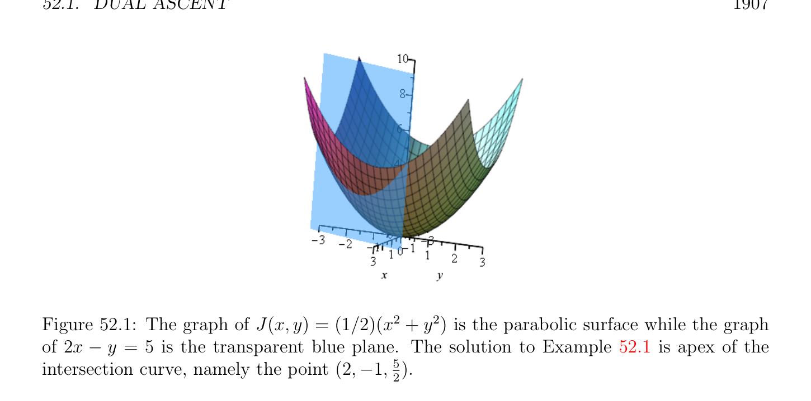

# Tăng đối ngẫu (dual ascent)

<!-- PAGE 1905 -->
Và
$$0 \in \partial f(x^{*}) + \partial g(z^{*}) + A^{\top}\lambda^{*} + B^{\top}\lambda^{*} ,(\dagger )$$
Giả định $(3)$ là cũng tương đương đến Các điều kiện () và $(b)$ của Định lý 51.41. Đặc biệt, của ta bài toán quy hoạch có nghiệm tối ưu (optimal solution) $(x^{*}, z^{*})$. Theo Định lý 51.43, $\lambda^{*}$ là maximizer của đối ngẫu (dual) hàm $G(\lambda$) $= inf_{x,z} L_{0}(x, z, \lambda$) và đối ngẫu mạnh (strong duality) nghiệm đúng, nghĩa là, $G(\lambda^{*}$) $= f(x^{*}) + g(z^{*})$ (khoảng cách đối ngẫu (duality gap) là không). Ta sẽ chỉ ra sau chứng minh của Định lý 52.1 rằng Giả định $(2)$ là thực sự được suy ra bởi Giả định $(3)$. Điều này cho phép chúng ta để chứng minh sự hội tụ kết quả mạnh hơn hơn sự hội tụ kết quả được chứng minh trong Boyd et al. $[28]$ (dưới chính xác cùng các giả định $(1)$ và $(3))$. Đặc biệt, ta chứng minh rằng tất cả của các dãy $(x^{k}), (z^{k})$, và $(\lambda^{k}$) hội tụ đến tối ưu các nghiệm (x,z), và $\lambda$. core của chứng minh của chúng ta là do Boyd et al. $[28]$, nhưng có mới
$$e e e$$
Các bước bởi vì ta có mạnh hơn giả thiết $(2)$. Trong Mục 52.5, ta thảo luận stopping các tiêu chuẩn. Trong Mục 52.6 ta trình bày một số các ứng dụng của ADMM, đặc biệt, cực tiểu hóa của
$$\mathbb{R}^{n}$$
Thực sự/đúng đắn đóng hàm lồi (convex function) $f$ trên đóng tập lồi (convex set) $C$ trong và toàn phương quy hoạch. thứ hai ví dụ cung cấp một của tốt nhất các phương pháp cho việc giải toàn phương các bài tập, bao gồm cả SVM các bài tập được thảo luận trong Chương $54$, mạng đàn hồi (elastic net) phương pháp trong Mục 55.6, và $\nu$ -SV hồi quy trong Chương $56$. Mục 52.8 cho các ứng dụng của ADMM đến $\ell^{1}$ -chuẩn (norm) các bài tập, đặc biệt, lasso chỉnh quy hóa (regularization), mà đóng quan trọng vai trò trong máy học (learning).

## 52.1 Tăng đối ngẫu (dual ascent)

Của ta mục tiêu là để giải cực tiểu hóa bài toán, Bài toán $(P)$,
$$minimizeJ(u)$$
$$subject to Au = b,$$
Với afin đẳng thức các ràng buộc (với $A$ một ma trận cỡ $m \times  n$ và $b \in \mathbb{R}^{m})$. Hàm Lagrange (Lagrangian) L(u, $\lambda$) của Bài toán $(P)$ được cho bởi
$$L(u, \lambda ) = J(u) + \lambda^{\top} (Au -b).$$
Với $\lambda  \in \mathbb{R}^{m}$. Từ Mệnh đề 50.20, đối ngẫu (dual) hàm $G(\lambda$) $= inf_{u\in Rn}$ L(u, $\lambda$) được cho bởi
$$($$
$$-b^{\top}\lambda  -J^{*}(-A^{\top}\lambda )if -A^{\top}\lambda  \in dom(J^{*}),$$
$$G(\lambda ) =$$
$$-\infty otherwise,$$
Với mọi $\lambda  \in \mathbb{R}^{m}$, ở đâu $J^{*}$ là liên hợp của $J$. Nhắc lại rằng theo Định nghĩa 50.11, liên hợp $\mathbb{R}  \mathbb{R}^{n}   \mathbb{R}^{n} \mathbb{R} f^{*}$ của hàm $f$: $U \to$ được định nghĩa trên tập con $U$ của là riêng hàm $f^{*}: \to$ được định nghĩa bởi
$$f^{*} (y) = \sup(y^{\top}x -f(x)),y \in \mathbb{R}^{n}.$$
$$x\in U$$

<!-- PAGE 1906 -->
Nếu các điều kiện của Định lý 50.19(1) đúng, mà trong trường hợp của chúng ta có nghĩa là với mọi $\mathbb{R}^{m} \mathbb{R}^{n} \lambda  \in$, tồn tại duy nhất một $u_{\lambda} \in$ sao cho
$$G(\lambda ) = L(u_{\lambda}, \lambda ) = \inf L(u, \lambda ),$$
$$u\in \mathbb{R} n$$
Và rằng hàm $\lambda  \mapsto u_{\lambda}$ là liên tục, thì $G$ là khả vi (differentiable). Hơn nữa, ta có
$$\nabla G_{\lambda} = Au_{\lambda} -b,$$
Và với mọi nghiệm $\mu  = \lambda^{*}$ của bài toán đối ngẫu (dual problem)
$$maximizeG(\lambda )$$
$$subject to \lambda  \in \mathbb{R}^{m},$$
Vectơ $u^{*} = u_{\mu}$ là nghiệm của bài toán gốc (primal problem) $(P)$. Hơn nữa, $J(u^{*}) = G(\lambda^{*}$), nghĩa là, khoảng cách đối ngẫu (duality gap) là không. tăng đối ngẫu (dual ascent) phương pháp là về cơ bản hạ gradien (gradient descent) ứng dụng đến đối ngẫu (dual) hàm $G$. Nhưng vì $G$ là maximized, hạ gradien (gradient descent) trở thành gradien ascent. Cũng, ta không có dài hơn worry rằng cực tiểu hóa bài toán $inf_{u\in Rn}$ L(u, $\lambda$) có duy nhất nghiệm, do đó ta ký hiệu bởi $u^{+}$ một số điểm cực tiểu hóa của ở trên bài toán, cụ thể là
$$u^{+}= arg minL(u, \lambda ).$$
$$u$$
Cho trước một số ban đầu đối ngẫu (dual) biến $\lambda^{0}$, tăng đối ngẫu (dual ascent) phương pháp bao gồm của sau đây hai các bước:
$$u^{k+1}= arg minL(u, \lambda^{k} )$$
$$u$$
$$\lambda^{k+1} = \lambda^{k} + \alpha^{k} (Au^{k+1}-b),$$
Ở đâu $\alpha^{k} > 0$ là bước kích thước. bước thứ nhất được sử dụng để tính “mới gradien” (thật vậy, nếu điểm cực tiểu hóa $u^{k+1}$ là duy nhất, thì $\nabla G_{\lambda k} = Au^{k+1}$ - $b)$, và bước thứ hai là đối ngẫu (dual) biến update.

> **Ví dụ 52.1.** Cho chúng ta nhìn tại rất đơn giản ví dụ của gradien ascent phương pháp ứng dụng đến bài toán ta thứ nhất encountered trong Mục 42.1, cụ thể là cực tiểu hóa J(x, $y) = (1/2)(x^{2} + y^{2})$ subject đến 2x - $y = 5$. Hàm Lagrange (Lagrangian) là
$$+$$
$$L(x, y, \lambda ) = \frac{1}{2} (x^{2} y^{2}) + \lambda (2x -y -5).$$
Xem Hình 52.1. phương pháp của Hàm Lagrange (Lagrangian) đối ngẫu nói rằng thứ nhất tính toán
$$G(\lambda ) =inf_{R} L(x, y, \lambda ).$$
$$(x,y)\in 2$$

<!-- PAGE 1907 -->

**Hình 52.1:** đồ thị của J(x, $y) = (1/2)(x^{2} + y^{2})$ là parabolic mặt trong khi đồ thị của 2x - $y = 5$ là transparent xanh lam mặt phẳng. nghiệm đến Ví dụ 52.1 là đỉnh của giao đường cong, cụ thể là điểm $(2, -1,_{2}^{5}$). Vì
$$J(x, y) = \frac{1}{2} \begin{pmatrix} x & y \end{pmatrix} \begin{pmatrix} 1 & 0 \\ 0 & 1 \end{pmatrix} \begin{pmatrix} x \\ y \end{pmatrix} ,$$
Ta nhận thấy rằng J(x, $y)$ là toàn phương hàm được xác định bởi xác định dương (positive definite) ma trận
$$\begin{pmatrix} 1 & 0 \\ 0 & 1 \\ = \end{pmatrix} , and hence to calculate G(\lambda ), we must set \nabla L_{x,y} = 0. By calculating_{\partial x}^{\partial J}  = 0 and$$
$\partial J 0$, ta tìm rằng $x = -2\lambda$ và $y = \lambda$. Thì $G(\lambda$) $= -5/2\lambda^{2}$ - $5\lambda$, và ta phải $\overline{\partial y}$ tính toán cực đại của $G(\lambda$) đối với $\lambda  \in \mathbb{R}$. Điều này có nghĩa là tính toán $G'(\lambda$) $= 0$ và thu được $\lambda  = -1$ cho nghiệm của $(x, y, \lambda$) $= (-2\lambda , \lambda , \lambda$) $= (2, -1, -1)$. Thay vì của việc giải một cách trực tiếp cho $\lambda$ theo $(x, y)$, phương pháp của đối ngẫu (dual) assent các bắt đầu với số estimate cho $\lambda$, cụ thể là $\lambda^{0}$, và các dạng “số” Hàm Lagrange (Lagrangian)
$$+$$
$$L(x, y, \lambda^{0} ) = \frac{1}{2} (x^{2} y^{2}) + \lambda^{0} (2x -y -5).$$
Với điều này số giá trị $\lambda^{0}$, ta cực tiểu hóa L(x, $y, \lambda^{0}$) đối với $(x, y)$. Điều này phép tính sẽ là đồng nhất đến rằng được sử dụng đến tạo thành $G(\lambda$) ở trên, và vì vậy, ta thu được lặp bước $(x^{1}, y^{1}) = (-2\lambda^{0} , \lambda^{0}$). Do đó nếu ta thay thế $\lambda^{0}$ bởi $\lambda^{k}$, ta có bước thứ nhất của tăng đối ngẫu (dual ascent) phương pháp, cụ thể là
$$u^{k+1}= \begin{pmatrix} x^{k+1} \\ y^{k+1} \end{pmatrix} = \begin{pmatrix} -2 \\ 1 \end{pmatrix} \lambda^{k} .$$
Bước thứ hai của tăng đối ngẫu (dual ascent) phương pháp refines số estimate của $\lambda$ bởi tính toán
$$\lambda^{k+1} = \lambda^{k} + \alpha^{k} \begin{pmatrix}  & x^{k+1} \\ 2 & -1 & y^{k+1} \end{pmatrix} \begin{pmatrix}\end{pmatrix} \begin{pmatrix} -5 \end{pmatrix} .$$

<!-- PAGE 1908 -->
$$(Recall that in our original problem the constraint is 2x -y = 5 or \begin{pmatrix} 2 & -1 \\ that \end{pmatrix} \begin{pmatrix} x \\ y \end{pmatrix} -5, so$$
$$A = \begin{pmatrix} 2 & -1 \end{pmatrix} and b = 5.) By simplifying the above equation, we find$$
$$\lambda^{k+1} = (1 -\beta )\lambda^{k} -\beta ,\beta  = 5\alpha^{k} .$$
Quay lại thế cho $\lambda^{k}$ trong trước đó phương trình chỉ ra rằng
$$\lambda^{k+1} = (1 -\beta )^{k+1}\lambda^{0} + (1 -\beta )^{k+1}-1.$$
Nếu $0 < \beta  \le 1$, trước đó đường thẳng suy ra rằng $\lambda^{k+1}$ hội tụ đến $\lambda  = -1$, mà trùng với với câu trả lời miễn là/được cung cấp bởi ban đầu Hàm Lagrange (Lagrangian) đối ngẫu phương pháp. Nhận thấy rằng nếu $\beta  = 1$ hoặc $\alpha^{k} =_{5}^{1}$, tăng đối ngẫu (dual ascent) phương pháp kết thúc trong một bước. Với thích hợp lựa chọn của $\alpha^{k}$, ta có $G(\lambda^{k+1}$) $> G(\lambda^{k}$), do đó phương pháp làm cho progress. Dưới nhất định các giả định, ví dụ, rằng $J$ là lồi chặt (strictly convex) và một số các điều kiện của $\alpha^{k}$, nó có thể được được hiển thị rằng tăng đối ngẫu (dual ascent) hội tụ đến nghiệm tối ưu (optimal solution) (cả hai cho gốc (primal) và đối ngẫu (dual)). Tuy nhiên, chính flaw của tăng đối ngẫu (dual ascent) là rằng cực tiểu hóa bước có thể diverge. Ví dụ, điều này xảy ra là $J$ là khác không afin hàm của một của các thành phần của nó. remedy là đến cộng hình phạt (penalty) số hạng đến Hàm Lagrange (Lagrangian). Trên dương vế/cạnh, tăng đối ngẫu (dual ascent) phương pháp dẫn đến đến decentralized thuật toán nếu
$$function J is separable. Suppose that u can be split as u = \sum_{i}  N=1 u_{i}, with u_{i} \in \mathbb{R}_{i}^{n} and$$
$$n = \sum_{i}  N=1 n_{i}, that$$
$$J(u) = \sum_{i=1}^{N}  J_{i}(u_{i}),$$
Và rằng $A$ là split vào $N$ các khối $A_{i}$ (với $A_{i}$ một ma trận cỡ $m \times  n_{i}$) như $A = [A_{1} \cdots  A_{N}]$, sao cho
$$Au = \sum_{k}  N=1 A_{i}u_{i}. Then the Lagrangian can be written as$$
$$L(u, \lambda ) = \sum_{i=1}^{N}  L_{i}(u_{i}, \lambda ),$$
Với
$$L_{i}(u_{i}, \lambda ) = J_{i}(u_{i}) + \lambda^{\top} \begin{pmatrix} 1 \\ A_{i}u_{i} -N b \end{pmatrix} .$$
Suy ra rằng cực tiểu hóa của L(u, $\lambda$) đối với gốc (primal) biến $u$ có thể được split vào $N$ tách cực tiểu hóa các bài tập rằng có thể được được giải trong song song. thuật toán thì performs $N$ updates
$$u_{i}^{k+1}= arg minL_{i}(u_{i}, \lambda^{k} )$$
$$ui$$
Trong song song, và thì bước
$$\lambda^{k+1} = \lambda^{k} + \alpha^{k} (Au^{k+1}-b).$$
