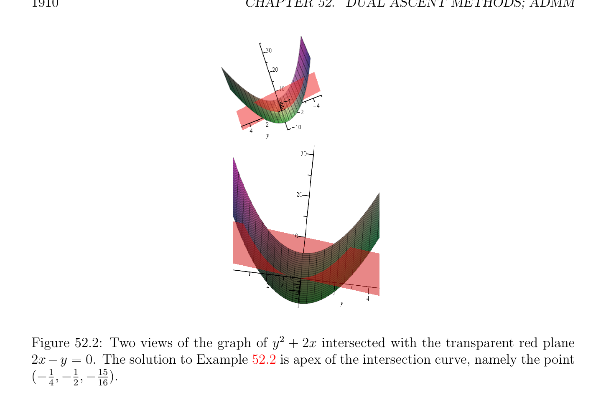

# Augmented các hàm Lagrange (Lagrangian) và Phương pháp của Các nhân tử

<!-- PAGE 1909 -->

## 52.2 Augmented các hàm Lagrange (Lagrangian) và Phương pháp của

$$Multipliers$$
Trong thứ tự để tạo cực tiểu hóa bước của tăng đối ngẫu (dual ascent) phương pháp nhiều hơn/thêm robust, một có thể sử dụng mẹo/kỹ thuật của cộng hình phạt (penalty) số hạng $(\rho /2) \|Au$ - $b\|_{2}^{2}$ đến Hàm Lagrange (Lagrangian).

> **Định nghĩa 52.1.** Cho trước Tối ưu hóa Bài toán $(P)$,
$$minimizeJ(u)$$
$$subject to Au = b,$$
Augmented Hàm Lagrange (Lagrangian) được cho bởi
$$L_{\rho}(u, \lambda ) = J(u) + \lambda^{\top} (Au -b) + (\rho /2) \|Au -b\|_{2}^{2} ,$$
Với $\lambda  \in \mathbb{R}^{m}$, và ở đâu $\rho  > 0$ được gọi là hình phạt (penalty) tham số. augmented Hàm Lagrange (Lagrangian) $L_{\rho}(u, \lambda$) có thể được được quan điểm như thông thường Hàm Lagrange (Lagrangian) của Cực tiểu hóa Bài toán $(P_{\rho})$,
$$minimizeJ(u) + (\rho /2) \|Au -b\|_{2}^{2}$$
$$subject to Au = b.$$
Ở trên bài toán là tương đương đến Bài toán quy hoạch $(P)$, vì với mọi nghiệm chấp nhận được (feasible solution) của $(P_{\rho})$, ta phải có Au - $b = 0$. benefit của cộng hình phạt (penalty) số hạng $(\rho /2) \|Au$ - $b\|_{2}^{2}$ là rằng theo Mệnh đề 51.37, Bài toán $(P_{\rho})$ có duy nhất nghiệm tối ưu (optimal solution) dưới nhẹ các điều kiện trên $A$. Tăng đối ngẫu (dual ascent) ứng dụng đến đối ngẫu (dual) của $(P_{\rho})$ cho ta phương pháp của các nhân tử, mà bao gồm của sau đây các bước, cho trước một số ban đầu $\lambda^{0}$:
$$u^{k+1}= arg minL_{\rho}(u, \lambda^{k} )$$
$$u$$
$$\lambda^{k+1} = \lambda^{k} + \rho (Au^{k+1}-b).$$
Nhận thấy rằng bước thứ hai sử dụng tham số $\rho$. lý do là rằng nó có thể được được hiển thị rằng chọn $\alpha^{k} = \rho$ các đảm bảo rằng $(u^{k+1}, \lambda^{k+1}$) thỏa mãn phương trình
$$\nabla J_{uk+1} + A^{\top}\lambda^{k+1} = 0,$$
Mà có nghĩa là $(u^{k+1}, \lambda^{k+1}$) là đối ngẫu (dual) chấp nhận được (feasible); xem Boyd, Parikh, Chu, Peleato và Eckstein $[28]$, Mục 2.3.

> **Ví dụ 52.2.** Xét cực tiểu hóa bài toán
$$minimizey^{2}+ 2x$$
$$subject to 2x -y = 0.$$

<!-- PAGE 1910 -->

**Hình 52.2:** Hai các quan điểm của đồ thị của $y^{2} +$ 2x được giao nhau với transparent đỏ mặt phẳng 2x-y $= 0$. nghiệm đến Ví dụ 52.2 là đỉnh của giao đường cong, cụ thể là điểm $(-_{4}^{1}, -_{2}^{1}, -_{16}^{15})$. Xem Hình 52.2. toàn phương hàm
$$J(x, y) = y^{2}+ 2x = \begin{pmatrix} x & y \end{pmatrix} \begin{pmatrix} 0 & 0 \\ 0 & 1 \end{pmatrix} \begin{pmatrix} x \\ y \end{pmatrix} + \begin{pmatrix} 2 & 0 \end{pmatrix} \begin{pmatrix} x \\ y \end{pmatrix}$$
Là lồi nhưng không lồi chặt (strictly convex). Vì $y =$ 2x, bài toán là tương đương đến cực tiểu hóa $y^{2} +$ 2x $= 4x^{2} +$ 2x, có cực tiểu là đạt được cho $x = -1/4$ (vì đặt đạo hàm của hàm $x \mapsto 4x^{2} + 2$ cho ta 8x $+ 2 = 0)$. Do đó, duy nhất cực tiểu của bài toán của chúng ta là đạt được cho $(x = -1/4, y = -1/2)$. Hàm Lagrange (Lagrangian) của bài toán của chúng ta là
$$L(x, y, \lambda ) = y^{2}+ 2x + \lambda (2x -y).$$
Nếu ta áp dụng tăng đối ngẫu (dual ascent) phương pháp, cực tiểu hóa của L(x, $y, \lambda$) đối với $x$ và $y$ giữ $\lambda$ hằng số cho ta các phương trình
$$2 + 2\lambda  = 0$$
$$2y -\lambda  = 0,$$
Thu được bằng cách đặt gradien của $L$ (đối với $x$ và $y)$ đến không. Nếu $\lambda$ ̸ $= -1$, bài toán có không có nghiệm. Thật vậy, nếu $\lambda  \neq  -1$, cực tiểu hóa L(x, $y, \lambda$) $= y^{2} +$ 2x $+ \lambda$ (2x - $y)$ đối với $x$ và $y$ cho ta $-\infty$.

<!-- PAGE 1911 -->
Augmented Hàm Lagrange (Lagrangian) là
$$L_{\rho}(x, y, \lambda ) = y^{2}+ 2x + \lambda (2x -y) + (\rho /2)(2x -y)^{2}$$
$$= 2\rho x^{2}-2\rho xy + 2(1 + \lambda )x -\lambda y + \begin{pmatrix} \rho \\ 1 + \\ 2 \end{pmatrix} y^{2},$$
Mà trong ma trận tạo thành là
$$2\rho^{2} -\rho !$$
$$L_{\rho}(x, y, \lambda ) = \begin{pmatrix} x & y \end{pmatrix} -\rho 1 + \frac{\rho}{2} \begin{pmatrix} x \\ y \end{pmatrix} + \begin{pmatrix} 2(1 + \lambda ) & -\lambda \end{pmatrix} \begin{pmatrix} x \\ y \end{pmatrix} .$$
Vết (trace) của ở trên ma trận là $1 +_{2}^{\rho} + 2\rho^{2} > 0$, và định thức (determinant) là
$$ $$
$$2\rho^{2} 1 + \frac{\rho}{2} -\rho^{2} = \rho^{2} (1 + \rho ) > 0,$$
Vì $\rho  > 0$. Vì vậy, ở trên ma trận là đối xứng xác định dương (SPD). Cực tiểu hóa $L_{\rho}(x, y, \lambda$) đối với $x$ và $y$, ta tập hợp gradien của $L_{\rho}(x, y, \lambda$) (đối với $x$ và $y)$ đến không, và ta thu được các phương trình:
$$2\rho x -\rho y + (1 + \lambda ) = 0$$
$$-2\rho x + (2 + \rho )y -\lambda  = 0.$$
Nghiệm là
$$x = - \frac{1}{4} - \frac{1 + \lambda}{2\rho} ,y = - \frac{1}{2} .$$
Do đó các bước cho phương pháp của các nhân tử là
$$x^{k+1}= - \frac{1}{4} - \frac{1 + \lambda^{k}}{2\rho}$$
$$y^{k+1}= - \frac{1}{2}$$
$$\lambda^{k+1} = \lambda^{k} + \rho \begin{pmatrix} 2 & -1 \end{pmatrix} \begin{pmatrix} -_{4}^{1}-^{1+\lambda k} \\ -_{2}^{12\rho} \end{pmatrix} ,$$
Và bước thứ hai simplifies đến
$$\lambda^{k+1} = -1.$$
Hệ quả là, ta xem rằng phương pháp hội tụ sau hai các bước với mọi ban đầu giá trị của $\lambda^{0}$, và ta thu được
$$x = - \frac{1}{4} y = - \frac{1}{2} ,\lambda  = -1.$$
Phương pháp của các nhân tử cũng hội tụ cho các hàm $J$ rằng là không chẵn/ngay cả lồi, như được minh họa bởi tiếp theo ví dụ.

<!-- PAGE 1912 -->

**Hình 52.3:** Hai các quan điểm của đồ thị của saddle của 2xy $(\beta  = 1)$ được giao nhau với transparent magenta mặt phẳng 2x - $y = 0$. nghiệm đến Ví dụ 52.3 là đỉnh của giao đường cong, cụ thể là điểm $(0, 0, 0)$.

> **Ví dụ 52.3.** Xét cực tiểu hóa bài toán
$$minimize2\beta xy$$
$$subject to 2x -y = 0,$$
Với $\beta  > 0$. Xem Hình 52.3. toàn phương hàm
$$J(x, y) = 2\beta xy = \begin{pmatrix} x & y \end{pmatrix} \begin{pmatrix} 0 & \beta \\ \beta & 0 \end{pmatrix} \begin{pmatrix} x \\ y \end{pmatrix}$$
Là không lồi bởi vì ở trên ma trận là không chẵn/ngay cả nửa xác định dương (positive semidefinite) (các trị riêng (eigenvalues) của ma trận là $-\beta$ và $+\beta$). augmented Hàm Lagrange (Lagrangian) là
$$L_{\rho}(x, y, \lambda ) = 2\beta xy + \lambda (2x -y) + (\rho /2)(2x -y)^{2}$$
$$= 2\rho x^{2}+ 2(\beta  -\rho )xy + 2\lambda x -\lambda y + \frac{\rho}{2} y^{2},$$
Mà trong ma trận tạo thành là
$$2\rho \beta \rho !$$
$$L_{\rho}(x, y, \lambda ) = \begin{pmatrix} x & y \end{pmatrix} \beta  -\rho \frac{-\rho}{2} \begin{pmatrix} x \\ y \end{pmatrix} + \begin{pmatrix} 2\lambda & -\lambda \end{pmatrix} \begin{pmatrix} x \\ y \end{pmatrix} .$$

<!-- PAGE 1913 -->
Vết (trace) của ở trên ma trận là $2\rho  +_{2}^{\rho}  =_{2}^{5} \rho  > 0$, và định thức (determinant) là
$$\rho^{2} -(\beta  -\rho )^{2}= \beta (2\rho  -\beta ).$$
Định thức (định thức (determinant)) này là dương nếu $\rho  > \beta /2$, trong mà trường hợp ma trận là đối xứng xác định dương (SPD). Cực tiểu hóa $L_{\rho}(x, y, \lambda$) đối với $x$ và $y$, ta tập hợp gradien của $L_{\rho}(x, y, \lambda$) (đối với $x$ và $y)$ đến không, và ta thu được các phương trình:
$$2\rho x + (\beta  -\rho )y + \lambda  = 0$$
$$2(\beta  -\rho )x + \rho y -\lambda  = 0.$$
Vì ta là giả sử rằng $\rho  > \beta /2$, các nghiệm là
$$x = - \frac{\lambda}{2(2\rho  -\beta )} ,y = \frac{\lambda}{(2\rho  -\beta )} .$$
Do đó các bước cho phương pháp của các nhân tử là
$$x^{k+1}= - \frac{\lambda^{k}}{2(2\rho  -\beta )}$$
$$y^{k+1}= \frac{\lambda^{k}}{(2\rho  -\beta )}$$
$$\lambda^{k+1}  = \lambda^{k}  + \frac{\rho}{2(2\rho  -\beta )} \begin{pmatrix} 2 & -1 \end{pmatrix} \begin{pmatrix} -\lambda^{k} \\ 2\lambda^{k} \end{pmatrix} ,$$
Và bước thứ hai simplifies đến
$$\lambda^{k+1} = \lambda^{k} + \frac{\rho}{2(2\rho  -\beta )} (-4\lambda^{k} ),$$
Rằng là,
$$\lambda^{k+1} = - \frac{\beta}{2\rho  -} \beta  \lambda^{k} .$$
Nếu ta chọn $\rho  > \beta  > 0$, mà suy ra rằng $\rho  > \beta /2$, thì
$$\frac{\beta}{2\rho  -\beta} < 1,$$
Và phương pháp hội tụ với mọi intial giá trị $\lambda^{0}$ đến nghiệm
$$x = 0,y = 0,\lambda  = 0.$$
Thật vậy, vì ràng buộc 2x-y $= 0$ nghiệm đúng, $2\beta$ xy $= 4\beta x^{2}$, và cực tiểu của hàm $x \mapsto 4\beta x^{2}$ là đạt được cho $x = 0$ (vì $\beta  > 0)$.
