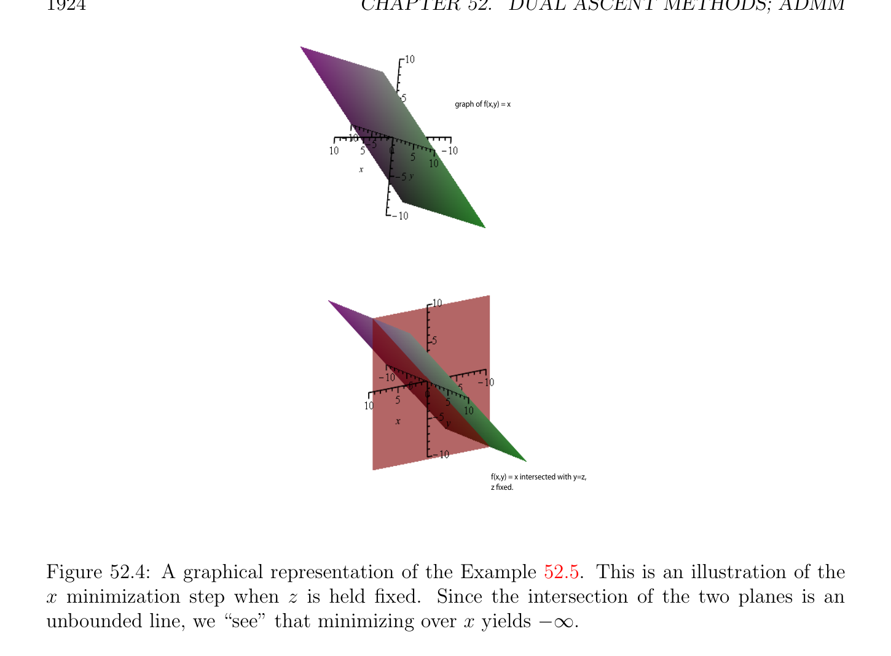

# Sự hội tụ của ADMM

<!-- PAGE 1917 -->
Thì ta có
$$\lambda^{\top} r + (\rho /2) \|r\|_{2}^{2} = (\rho /2) \|r + (1/\rho )\lambda \|_{2}^{2} -(1/(2\rho )) \|\lambda \|_{2}^{2}$$
$$= (\rho /2) \|r + \mu \|_{2}^{2} -(\rho /2) \|\mu \|_{2}^{2} .$$
Scaled tạo thành của ADMM bao gồm của sau đây các bước:
$$x^{k+1}= arg minx \begin{pmatrix} f(x) + (\rho /2) & Ax + Bz^{k} -c + \mu_{2}^{k2} \end{pmatrix}$$
$$z^{k+1}= arg minz \begin{pmatrix} g(z) + (\rho /2) & Ax^{k+1} + Bz -c + \mu_{2}^{k2} \end{pmatrix}$$
$$\mu^{k+1} = \mu^{k} + Ax^{k+1}+ Bz^{k+1}-c.$$
Nếu ta định nghĩa phần dư (residual) $r^{k}$ tại bước $k$ như
$$r^{k}= Ax^{k}+ Bz^{k}-c = \mu^{k} -\mu^{k-1} = (1/\rho )(\lambda^{k} -\lambda^{k-1} ),$$
Thì ta xem rằng
$$r = u^{0} + \sum_{j=1}^{k}  r^{j}.$$
Các công thức trong scaled tạo thành là thường shorter hơn các công thức trong unscaled tạo thành. Ta bây giờ thảo luận sự hội tụ của ADMM.
$$⊛$$

## 52.4 Sự hội tụ của ADMM

Cho chúng ta repeat các bước của ADMM: Cho trước một số ban đầu $(z^{0}, \lambda^{0}$), thực hiện:
$$x^{k+1}= arg minL_{\rho}(x, z^{k}, \lambda^{k} )(x-update)$$
$$x$$
$$z^{k+1}= arg minL_{\rho}(x^{k+1}, z, \lambda^{k} )(z-update)$$
$$z$$
$$\lambda^{k+1} = \lambda^{k} + \rho (Ax^{k+1}+ Bz^{k+1}-c).(\lambda -update)$$
Sự hội tụ của ADMM có thể được được chứng minh dưới sau đây ba các giả định:
$(1)$ các hàm $f$: $\mathbb{R} \to \mathbb{R}\cup {+\infty$ } và $g: \mathbb{R} \to \mathbb{R}\cup {+\infty$ } là thực sự/đúng đắn và đóng các hàm lồi (xem Mục 51.1) sao cho relint(dom(f)) $\cap$ relint(dom(g)) $\neq  \emptyset$.
$(2)$ ma trận cỡ $n \times  n$ $A^{\top}A$ là khả nghịch và ma trận cỡ $m \times  m$ $B^{\top}B$ là khả nghịch. Tương đương, ma trận cỡ $p \times  n$ $A$ có hạng (rank) $n$ và ma trận cỡ $p \times  m$ có hạng (rank) $m$.
$(3)$ unaugmented Hàm Lagrange (Lagrangian) $L_{0}(x, z, \lambda$) $= f(x)+g(z)+\lambda^{\top} (Ax+Bz -c)$ có điểm yên ngựa (saddle point), mà có nghĩa là tồn tại $x^{*}, z^{*}, \lambda^{*}$ (không nhất thiết duy nhất) sao cho
$$L_{0}(x^{*}, z^{*}, \lambda ) \le L_{0}(x^{*}, z^{*}, \lambda^{*} ) \le L_{0}(x, z, \lambda^{*} )$$
Với mọi $x, z, \lambda$.

<!-- PAGE 1918 -->
Nhắc lại rằng augmented Hàm Lagrange (Lagrangian) được cho bởi
$$L_{\rho}(x, z, \lambda ) = f(x) + g(z) + \lambda^{\top} (Ax + Bz -c) + (\rho /2) \|Ax + Bz -c\|_{2}^{2} .$$
Cho $z$ (và $\lambda$) cố định, ta có $L_{\rho}(x, z, \lambda$) $=$ f(x) $+$ g(z) $+ \lambda^{\top}$ (Ax $+$ Bz - $c) + (\rho /2)(Ax +$ Bz - $c)^{\top}(Ax +$ Bz - $c)$
$$= f(x) + (\rho /2)x^{\top}A^{\top}Ax + (\lambda^{\top} + \rho (Bz -c)^{\top})Ax$$
$$+ g(z) + \lambda^{\top} (Bz -c) + (\rho /2)(Bz -c)^{\top}(Bz -c).$$
Giả sử rằng $(1)$ và $(2)$ đúng. Vì $A^{\top}A$ là khả nghịch, thì nó là đối xứng xác định dương (SPD), và theo Mệnh đề 51.37 x-minimization bước có duy nhất nghiệm (cực tiểu hóa bài toán thành công với duy nhất điểm cực tiểu hóa). Tương tự, cho $x$ (và $\lambda$) cố định, ta có $L_{\rho}(x, z, \lambda$) $=$ f(x) $+$ g(z) $+ \lambda^{\top}$ (Ax $+$ Bz - $c) + (\rho /2)(Ax +$ Bz - $c)^{\top}(Ax +$ Bz - $c)$
$$= g(z) + (\rho /2)z^{\top}B^{\top}Bz + (\lambda^{\top} + \rho (Ax -c)^{\top})Bz$$
$$+ f(x) + \lambda^{\top} (Ax -c) + (\rho /2)(Ax -c)^{\top}(Ax -c).$$
Vì $B^{\top}B$ là khả nghịch, thì nó là đối xứng xác định dương (SPD), và theo Mệnh đề 51.37 z-minimization bước có duy nhất nghiệm (cực tiểu hóa bài toán thành công với duy nhất điểm cực tiểu hóa). Theo Định lý 51.41, Giả định $(3)$ là tương đương đến sự kiện rằng KKT các phương trình được thỏa mãn bởi một số bộ ba $(x^{*}, z^{*}, \lambda^{*}$), cụ thể là
$$Ax^{*}+ Bz^{*}-c = 0(*)$$
Và
$$0 \in \partial f(x^{*}) + \partial g(z^{*}) + A^{\top}\lambda^{*} + B^{\top}\lambda^{*} ,(\dagger )$$
Giả định $(3)$ là cũng tương đương đến Các điều kiện () và $(b)$ của Định lý 51.41. Đặc biệt, của ta bài toán quy hoạch có nghiệm tối ưu (optimal solution) $(x^{*}, z^{*})$. Theo Định lý 51.43, $\lambda^{*}$ là maximizer của đối ngẫu (dual) hàm $G(\lambda$) $= inf_{x,z} L_{0}(x, z, \lambda$) và đối ngẫu mạnh (strong duality) nghiệm đúng, nghĩa là, $G(\lambda^{*}$) $= f(x^{*}) + g(z^{*})$ (khoảng cách đối ngẫu (duality gap) là không). Ta sẽ xem sau chứng minh của Định lý 52.1 rằng Giả định $(2)$ là thực sự được suy ra bởi Giả định $(3)$. Điều này cho phép chúng ta để chứng minh sự hội tụ kết quả mạnh hơn hơn sự hội tụ kết quả được chứng minh trong Boyd et al. $[28]$ dưới chính xác cùng các giả định $(1)$ và $(3)$.
$$\mathbb{R}^{m+p}$$
Cho $p^{*}$ là cực tiểu giá trị của $f+g$ trên tập lồi (convex set) ${(x, z) \in$ | $Ax+Bz-c = 0}$, và cho $(p^{k})$ là dãy cho trước bởi $p^{k} = f(x^{k})+g(z^{k})$, và nhắc lại rằng $r^{k} = Ax^{k}+Bz^{k}-c$. Của ta chính mục tiêu là để chứng minh kết quả sau đây.

> **Định lý 52.1.** Giả sử sau đây các giả định đúng:

<!-- PAGE 1919 -->
$(1)$ các hàm $f$: $\mathbb{R} \to \mathbb{R}\cup {+\infty$ } và $g: \mathbb{R} \to \mathbb{R}\cup {+\infty$ } là thực sự/đúng đắn và đóng các hàm lồi (xem Mục 51.1) sao cho relint(dom(f)) $\cap$ relint(dom(g)) $\neq  \emptyset$.
$(2)$ ma trận cỡ $n \times  n$ $A^{\top}A$ là khả nghịch và ma trận cỡ $m \times  m$ $B^{\top}B$ là khả nghịch. Tương đương, ma trận cỡ $p \times  n$ $A$ có hạng (rank) $n$ và ma trận cỡ $p \times  m$ có hạng (rank) $m$. (Điều này giả định là thực sự redundant, bởi vì nó được suy ra bởi Giả định $(3))$.
$(3)$ unaugmented Hàm Lagrange (Lagrangian) $L_{0}(x, z, \lambda$) $= f(x)+g(z)+\lambda^{\top} (Ax+Bz -c)$ có điểm yên ngựa (saddle point), mà có nghĩa là tồn tại $x^{*}, z^{*}, \lambda^{*}$ (không nhất thiết duy nhất) sao cho
$$L_{0}(x^{*}, z^{*}, \lambda ) \le L_{0}(x^{*}, z^{*}, \lambda^{*} ) \le L_{0}(x, z, \lambda^{*} )$$
Với mọi $x, z, \lambda$. Thì với mọi ban đầu các giá trị $(z^{0}, \lambda^{0}$), các tính chất sau đây đúng:
$(1)$ dãy $(r^{k})$ hội tụ đến $0$ (phần dư (residual) sự hội tụ).
$(2)$ dãy $(p^{k})$ hội tụ đến $p^{*}$ (mục tiêu sự hội tụ).
$(3)$ các dãy $(x^{k})$ và $(z^{k})$ hội tụ đến nghiệm tối ưu (optimal solution) (x,z) của Bài toán $(P_{admm})$
$$e e$$
Và dãy $(\lambda^{k}$) hội tụ nghiệm tối ưu (optimal solution) $\lambda$ của bài toán đối ngẫu (dual problem) (gốc (primal) và
$$e$$
Đối ngẫu (dual) biến sự hội tụ).

*Chứng minh.* core của chứng minh là do Boyd et al. $[28]$, nhưng có mới các bước bởi vì ta có mạnh hơn giả thiết $(2)$, mà cho mạnh hơn kết quả $(3)$. chứng minh bao gồm của một vài các bước. Nó là không khả dĩ/có thể để chứng minh một cách trực tiếp rằng các dãy $(x^{k}), (z^{k})$, và $(\lambda^{k}$) hội tụ, do đó thứ nhất ta chứng minh rằng dãy $(r^{k+1})$ hội tụ đến không, và rằng các dãy $(Ax^{k+1})$ và $(Bz^{k+1})$ cũng hội tụ. Bước $1$. Chứng minh bất đẳng thức (A1) ở dưới. Xét dãy của các số thực $(V^{k}$) cho trước bởi
$$-

-$$
$$V^{k}= (1/\rho )\lambda^{k} \lambda_{2}^{*2}  + \rho B(z^{k}z^{*})_{2}^{2} .$$
Nó có thể được được hiển thị rằng $V^{k}$ thỏa mãn sau đây bất đẳng thức:
$$-$$
$$V^{k+1}\le V^{k}-\rho r_{2}^{k+12} -\rho B(z^{k+1}z^{k})_{2}^{2} .(A1)$$
Điều này là khá arduous. Vì đầy đủ chứng minh là cho trước trong Boyd et al. $[28]$, ta sẽ chỉ cung cấp một số của then chốt các bước sau này. Bất đẳng thức (A1) chỉ ra rằng dãy $(V^{k}$) trong nonincreasing. Nếu ta viết các bất đẳng thức này cho $k, k$ - $1, \dots  , 0$, ta có
$$-$$
$$V^{k+1}\le V^{k}-\rho r_{2}^{k+12} -\rho B(z^{k+1}z^{k})_{2}^{2}$$
$$-$$
$$V^{k}\le V^{k-1}-\rho r_{2}^{k2} -\rho B(z^{k}z^{k-1})_{2}^{2}$$
$$\vdots$$
$$-$$
$$V^{1}\le V^{0}-\rho r_{2}^{12} -\rho B(z^{1}z^{0})_{2}^{2} ,$$

<!-- PAGE 1920 -->
Và bằng cách cộng lên các bất đẳng thức này, ta thu được
$$

-

$$
$$V^{k+1}\le V^{0}-\rho \sum_{j=0}^{k}  r_{2}^{j+12} +B(z^{j+1}z^{j})_{2}^{2},$$
Mà suy ra rằng
$$

-

$$
$$\rho \sum_{j=0}^{k}  r_{2}^{j+12} +B(z^{j+1}z^{j})_{2}^{2}\le V_{0} -V^{k+1}\le V^{0},(B)$$
Vì $V^{k+1} \le V^{0}$. Bước $2$. Chứng minh rằng dãy $(r^{k})$ hội tụ đến $0$, và rằng các dãy $(Ax^{k+1})$ và $(Bz^{k+1})$ cũng hội tụ.
$$\infty  \infty$$
$$Inequality (B) implies that the series \sum_{k}  r^{k}and \sum  k=0 B(z^{k+1}-z^{k}) converge absolutely.$$
Đặc biệt, dãy $(r^{k}) converges^{=1}$ đến $0$.
$$\infty  -$$
$$The nth partial sum of the series \sum_{k}  =0 B(z^{k+1}z^{k}) is$$
$$\sum_{k=0}^{n}  B(z^{k+1}-z^{k}) = B(z^{n+1}-z^{0}),$$
$$\infty$$
$$and since the series \sum_{k+1k}  =0 B(z^{k+1} -z^{k}) converges, we deduce that the sequence (Bz^{k+1})$$
Hội tụ. Vì Ax $+ Bz^{k+1}$ - $c = r^{k+1}$, sự hội tụ của $(r^{k+1})$ và $(Bz^{k+1})$ suy ra rằng dãy $(Ax^{k+1})$ cũng hội tụ. Bước $3$. Chứng minh rằng các dãy $(x^{k+1})$ và $(z^{k+1})$ hội tụ. Bởi Giả định $(2)$, các ma trận $A^{\top}A$ và $B^{\top}B$ là khả nghịch, do đó nhân mỗi vectơ $Ax^{k+1}$ bởi $(A^{\top}A)^{-1}A^{\top}$, nếu dãy $(Ax^{k+1})$ hội tụ đến $u$, thì dãy $(x^{k+1})$ hội tụ đến $(A^{\top}A)^{-1}A^{\top}u$. Siimilarly, nếu dãy $(Bz^{k+1})$ hội tụ đến $v$, thì dãy $(z^{k+1})$ hội tụ đến $(B^{\top}B)^{-1}B^{\top}v$. Bước $4$. Chứng minh rằng dãy $(\lambda^{k}$) hội tụ. Nhắc lại rằng
$$\lambda^{k+1} = \lambda^{k} + \rho r^{k+1}.$$
Nó suy ra bởi quy nạp rằng
$$\lambda^{k+p} = \lambda^{k} + \rho (r^{k+1}+ \cdots  + \rho^{k+p} ),p \ge 2.$$
Hệ quả là, ta thu được
$$-

$\le$

$+$$$
$$\lambda^{k+p} \lambda^{k} \rho (r^{k+1} \cdots  +r^{k+p}).$$

<!-- PAGE 1921 -->
$$Since the series \sum_{k}  \infty

$r^{k}$

Hội tụ, riêng các tổng tạo thành Dãy Cauchy (Cauchy sequence), và điều này$$ immediately $implies^{=1}$ that for any $\epsilon > 0$ we can find $N > 0$ sao cho
$$\rho (

$r^{k+1}$

$+ \cdots  +$

$r^{k+p}$

) $< \epsilon$,với mọi $k, p + k \ge$ N,$$ so the sequence $(\lambda^{k}$ ) is also a Cauchy sequence, thus it converges. Step $5$. Prove that the sequence $(p^{k})$ converges to $p^{*}$. For this, we need two more inequalities. Following Boyd et al. $[28]$, ta cần để chứng minh rằng
$$p^{k+1}-p^{*}\le -(\lambda^{k+1} )^{\top}r^{k+1}-\rho (B(z^{k+1}-z^{k}))^{\top}(-r^{k+1}+ B(z^{k+1}-z^{*}))(A2)$$
Và
$$p^{*}-p^{k+1}\le (\lambda^{*} )^{\top}r^{k+1}.(A3)$$
Vì ta được chứng minh rằng dãy $(r^{k})$ và $B(z^{k+1}$ - $z^{k})$ hội tụ đến $0$, và rằng dãy $(\lambda^{k+1}$) hội tụ, từ $(\lambda^{k+1} )^{\top}r^{k+1} + \rho (B(z^{k+1}$ - $z^{k}))^{\top}(-r^{k+1} + B(z^{k+1}$ - $z^{*})) \le p^{*}$ - $p^{k+1} \le (\lambda^{*} )^{\top}r^{k+1}$, ta suy ra rằng trong giới hạn, $p^{k+1}$ hội tụ đến $p^{*}$. Bước $6$. Chứng minh (A3). Vì $(x^{*}, y^{*}, \lambda^{*}$) là điểm yên ngựa (saddle point), ta có
$$L_{0}(x^{*}, z^{*}, \lambda^{*} ) \le L_{0}(x^{k+1}, z^{k+1}, \lambda^{*} ).$$
Vì $Ax^{*} + Bz^{*} = c$, ta có $L_{0}(x^{*}, z^{*}, \lambda^{*}$) $= p^{*}$, và vì $p^{k+1} = f(x^{k+1}) + g(z^{k+1})$, ta có
$$L_{0}(x^{k+1}, z^{k+1}, \lambda^{*} ) = p^{k+1}+ (\lambda^{*} )^{\top}r^{k+1},$$
Do đó ta thu được
$$p^{*}\le p^{k+1}+ (\lambda^{*} )^{\top}r^{k+1},$$
Mà cho ta (A3). Bước $7$. Chứng minh (A2). Theo Mệnh đề 51.34, $z^{k+1}$ cực tiểu hóa $L_{\rho}(x^{k+1}, z, \lambda^{k}$) khi và chỉ khi
$$0 \in \partial g(z^{k+1}) + B^{\top}\lambda^{k} + \rho B^{\top}(Ax^{k+1}+ Bz^{k+1}-c)$$
$$= \partial g(z^{k+1}) + B^{\top}\lambda^{k} + \rho B^{\top}r^{k+1}$$
$$= \partial g(z^{k+1}) + B^{\top}\lambda^{k+1} ,$$
Vì $r^{k+1} = Ax^{k+1} + Bz^{k+1}$ - $c$ và $\lambda^{k+1} = \lambda^{k} + \rho (Ax^{k+1} + Bz^{k+1}$ - $c)$. Trong tóm tắt, ta có
$$0 \in \partial g(z^{k+1}) + B^{\top}\lambda^{k+1} ,(\dagger_{1} )$$

<!-- PAGE 1922 -->
Mà chỉ ra rằng $z^{k+1}$ cực tiểu hóa hàm
$$z \mapsto g(z) + (\lambda^{k+1} )^{\top}Bz.$$
Hệ quả là, ta có
$$g(z^{k+1}) + (\lambda^{k+1} )^{\top}Bz^{k+1}\le g(z^{*}) + (\lambda^{k+1} )^{\top}Bz^{*}.(B1)$$
Tương tự, $x^{k+1}$ cực tiểu hóa $L_{\rho}(x, z^{k}, \lambda^{k}$) khi và chỉ khi
$$0 \in \partial f(x^{k+1}) + A^{\top}\lambda^{k} + \rho A^{\top}(Ax^{k+1}+ Bz^{k}-c)$$
$$= \partial f(x^{k+1}) + A^{\top}(\lambda^{k} + \rho r^{k+1}+ \rho B(z^{k}-z^{k+1}))$$
$$= \partial f(x^{k+1}) + A^{\top}\lambda^{k+1} + \rho A^{\top}B(z^{k}-z^{k+1})$$
Vì $r^{k+1}$ - $Bz^{k+1} = Ax^{k+1}$ - $c$ và $\lambda^{k+1} = \lambda^{k} + \rho (Ax^{k+1} + Bz^{k+1}$ - $c) = \lambda^{k} + \rho r^{k+1}$. Tương đương, ở trên derivation chỉ ra rằng
$$0 \in \partial f(x^{k+1}) + A^{\top}(\lambda^{k+1} -\rho B(z^{k+1}-z^{k})),(\dagger_{2} )$$
Mà chỉ ra rằng $x^{k+1}$ cực tiểu hóa hàm
$$x \mapsto f(x) + (\lambda^{k+1} -\rho B(z^{k+1}-z^{k}))^{\top}Ax.$$
Hệ quả là, ta có $f(x^{k+1}) + (\lambda^{k+1}$ - $\rho B(z^{k+1}$ - $z^{k}))^{\top}Ax^{k+1} \le f(x^{*}) + (\lambda^{k+1}$ - $\rho B(z^{k+1}$ - $z^{k}))^{\top}Ax^{*}$. (B2) Cộng lên Các bất đẳng thức (B1) và (B2), bằng cách sử dụng phương trình $Ax^{*} + Bz^{*} = c$, và rearranging, ta thu được bất đẳng thức (A2). Bước $8$. Chứng minh rằng $(x^{k}), (z^{k})$, và $(\lambda^{k}$) hội tụ đến tối ưu các nghiệm. Nhắc lại rằng $(r^{k})$ hội tụ đến $0$, và rằng $(x^{k}), (z^{k})$, và $(\lambda^{k}$) hội tụ đến các giới hạn $x, z$, và
$$+ - e e$$
$\lambda$. Vì $r^{k} = Ax^{k}  Bz^{k} c$, trong giới hạn, ta có $e$
$$Ax + Bz -c = 0.(*_{1})$$
$$ee$$
Bằng cách sử dụng $(\dagger_{1}$), trong giới hạn, ta thu được
$$0 \in \partial g(z) + B^{\top}\lambda .(*_{2})$$
$$ee$$
Vì $(B(z^{k+1}$ - $z^{k}))$ hội tụ đến $0$, bằng cách sử dụng $(\dagger_{2}$), trong giới hạn, ta thu được
$$0 \in \partial f(x) + A^{\top}\lambda .(*_{3})$$
$$ee$$
Từ $(*_{2})$ và $(*_{3})$, ta thu được
$$0 \in \partial f(x) + \partial g(z) + A^{\top}\lambda  + B^{\top}\lambda .(*_{4})$$
$$eeee$$

<!-- PAGE 1923 -->
Nhưng $(*_{1})$ và $(*_{4})$ là chính xác KKT các phương trình, và theo Định lý 51.41, ta kết luận rằng $x,z,\lambda$ là tối ưu các nghiệm. $e  e  e$ Bước $9$. Chứng minh (A1). Điều này là hầu hết tẻ nhạt/dài dòng bước của chứng minh. Ta bắt đầu bằng cách cộng lên
(A2) và (A3), và thì perform khá bit hoặc rewriting và manipulation. đầy đủ derivation có thể được tìm thấy trong Boyd et al. $[28]$.
Các nhận xét:
$(1)$ Xét theo Định lý 51.42, ta có thể thay thế Giả định $(3)$ bởi slightly mạnh hơn các giả định rằng tối ưu giá trị của của ta bài toán quy hoạch là hữu hạn và rằng các ràng buộc là qualified. Vì các ràng buộc là afin, điều này có nghĩa là tồn tại một nghiệm chấp nhận được (feasible solution) trong relint(dom(f)) $\cap$ relint(dom(g)). Các phần tử này các giả định là nhiều hơn/thêm thực tế hơn Giả định $(3)$.
$(2)$ Thực sự, Giả định $(3)$ suy ra Giả định $(2)$. Thật vậy, ta biết từ Định lý 51.41 rằng sự tồn tại của điểm yên ngựa (saddle point) suy ra rằng của ta bài toán quy hoạch có hữu hạn nghiệm tối ưu (optimal solution). Tuy nhiên, nếu hoặc $A^{\top}A$ hoặc $B^{\top}B$ là không khả nghịch, thì Bài toán quy hoạch $(P)$ có thể không có hữu hạn nghiệm tối ưu (optimal solution), như được hiển thị bởi sau đây phản ví dụ.

> **Ví dụ 52.5.** Cho
$$f(x, y) = x,g(z) = 0,y -z = 0.$$
Thì
$$L_{\rho}(x, y, z, \lambda ) = x + \lambda (y -z) + (\rho /2)(y -z)^{2},$$
Nhưng cực tiểu hóa trên $(x, y)$ với $z$ held hằng số cho ta $-\infty$, mà suy ra rằng ở trên bài toán quy hoạch có không có hữu hạn nghiệm tối ưu (optimal solution). Xem Hình 52.4. bài toán là rằng
$$A = \begin{pmatrix} 0 & 1 \end{pmatrix} ,B = \begin{pmatrix} -1 \end{pmatrix} ,$$
Nhưng
$$A^{\top}A = \begin{pmatrix} 0 & 0 \\ 0 & 1 \end{pmatrix}$$
Là không khả nghịch.
$(3)$ Chứng minh (A1), (A2), (A3), và sự hội tụ của $(r^{k})$ đến $0$ và của $(p^{k})$ đến $p^{*}$ thực hiện không đòi hỏi Giả định $(2)$. chứng minh, bằng cách sử dụng ingeneous Bất đẳng thức (A1) (và $(B))$ là chứng minh cho trước trong Boyd et al. $[28]$. Ta đã là cũng able để chứng minh rằng $(\lambda^{k}$), $(Ax^{k})$ và $(Bz^{k})$ hội tụ mà không có Giả định $(2)$, nhưng để chứng minh rằng $(x^{k}), (y^{k})$, và $(\lambda^{k}$) hội tụ đến tối ưu các nghiệm, ta đã có để sử dụng Giả định $(2)$.

<!-- PAGE 1924 -->
$$graph of f(x,y) = x$$
$$f(x,y) = x intersected with y=z,$$
$$z fixed.$$

**Hình 52.4:** graphical biểu diễn của Ví dụ 52.5. Điều này là illustration của $x$ cực tiểu hóa bước khi $z$ là held cố định. Vì giao của hai các mặt phẳng là không bị chặn đường thẳng, ta “xem” rằng cực tiểu hóa trên $x$ cho ta $-\infty$.
$(4)$ Bertsekas các thảo luận ADMM trong $[17]$, Các mục 2.2 và 5.4. His formulation của ADMM là slightly khác nhau, cụ thể là
$$minimizef(x) + g(z)$$
$$subject to Ax = z.$$
Bertsekas phát biểu sự hội tụ kết quả cho điều này phiên bản của ADMM dưới các giả thiết rằng hoặc dom(f) là compắc hoặc rằng $A^{\top}A$ là khả nghịch, và rằng điểm yên ngựa (saddle point) tồn tại; xem Mệnh đề 5.4.1. chứng minh là cho trước trong Bertsekas $[20]$, Mục 3.4, Mệnh đề 4.2. Nó xuất hiện rằng chứng minh làm cho sử dụng của các gradien, do đó nó là không rõ ràng rằng nó áp dụng trong nhiều hơn/thêm tổng quát trường hợp ở đâu $f$ và $g$ là không khả vi (differentiable).
$(5)$ Các phiên bản của ADMM được thảo luận trong Gabay $[70]$ (Các mục $4$ và $5)$. Chúng là nhiều hơn/thêm tổng quát hơn phiên bản được thảo luận ở đây. Một số sự hội tụ các chứng minh là cho trước, nhưng bởi vì Gabay’s khung lý thuyết là nhiều hơn/thêm tổng quát, nó là không rõ ràng rằng chúng áp dụng đến của ta đặt. Cũng, các phần tử này các chứng minh rely trên trước đó kết quả bởi Lions và Mercier, mà làm cho comparison khó.

<!-- PAGE 1925 -->
$(5)$ Giả định $(2)$ thực hiện không suy ra rằng hệ Ax $+$ Bz $= c$ có bất kỳ nghiệm. Ví dụ, nếu
$$A = \begin{pmatrix} 1 \\ 1 \end{pmatrix} ,B = \begin{pmatrix} -1 \\ -1 \end{pmatrix} ,c = \begin{pmatrix} 1 \\ 0 \end{pmatrix} ,$$
Hệ
$$x -z = 1$$
$$x -z = 0$$
Có không có nghiệm. Tuy nhiên, vì Giả định $(3)$ suy ra rằng bài toán quy hoạch có nghiệm tối ưu (optimal solution), nó suy ra rằng $c$ thuộc đến cột không gian của $p \times  (n + m)$
$$matrix \begin{pmatrix} A & B \\ example \end{pmatrix} .$$
Ở đây là ở đâu ADMM diverges cho bài toán có tối ưu giá trị là $-\infty$.

> **Ví dụ 52.6.** Xét bài toán cho trước bởi
$$f(x) = x,g(z) = 0,x -z = 0.$$
Vì f(x) $+$ g(z) $= x$, và $x = z$, biến $x$ là không ràng buộc và ở trên hàm đi đến $-\infty$ khi $x$ đi đến $-\infty$. augmented Hàm Lagrange (Lagrangian) là
$$L_{\rho}(x, z, \lambda ) = x + \lambda (x -z) + \frac{\rho}{2} (x -z)^{2}$$
$$-  +$$
$$= \frac{\rho}{2} x^{2}\rho xz + \frac{\rho}{2} z^{2} x + \lambda x -\lambda z.$$
Ma trận
$$\begin{pmatrix} 1 & -_{2}^{1} \\ -_{2}^{1}\overline{2} & 1 \\ \overline{2} \end{pmatrix}$$
Là suy biến và $L_{\rho}(x, z, \lambda$) đi đến $-\infty$ trong khi $(x, z) =$ t(1, $1)$ và $t$ đi đến $-\infty$. ADMM các bước là:
$$-$$
$$x^{k+1}= z^{k}- \frac{1}{\rho} \lambda^{k} \frac{1}{\rho}$$
$$z^{k+1}= x^{k+1}+ \frac{1}{\rho} \lambda^{k}$$
$$\lambda^{k+1} = \lambda^{k} + \rho (x^{k+1}-z^{k+1}),$$
Và các phương trình này đúng với mọi $k \ge 0$. Từ cuối cùng hai các phương trình ta suy ra rằng
$$\lambda^{k+1} = \lambda^{k} + \rho (x^{k+1}-z^{k+1}) = \lambda^{k} + \rho (- \frac{1}{\rho} \lambda^{k} ) = 0,for all k \ge 0,$$
Do đó
$$z^{k+2}= x^{k+2}+ \frac{1}{\rho} \lambda^{k+1} = x^{k+2},for all k \ge 0.$$
