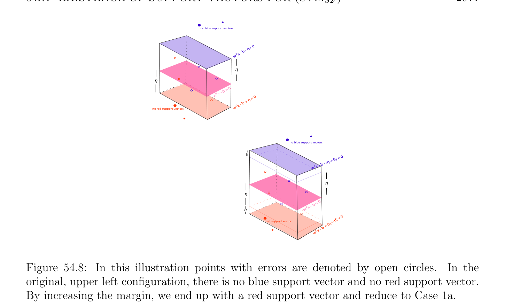

# Sự tồn tại của Hỗ trợ/giá (support) Các vectơ cho (SVMs2')

<!-- PAGE 2008 -->
Bởi trước đó nhận xét, $p_{f} \le p_{m}$ và $q_{f} \le q_{m}$, thứ nhất bất đẳng thức đang là chặt nếu tồn tại một $i$ sao cho $0 < \lambda_{i}  < K$, và thứ hai bất đẳng thức đang là chặt nếu tồn tại một $j$ sao cho $0 < \mu_{j}  < K$. Điều này sẽ là trường hợp dưới Tiêu chuẩn Lề (margin) Giả thiết. Nhận thấy rằng nhỏ giá trị của $\nu$ các giữ $p_{f}$ và $q_{f}$ nhỏ, mà là đạt được nếu $\delta$ -dải phẳng (slab) là narrow (để tránh có các điểm trên sai các vế/cạnh của lề (margin) các siêu phẳng). lớn giá trị của $\nu$ cho phép $p_{m}$ và $q_{m}$ là fairly lớn, mà là đạt được nếu $\delta$ -dải phẳng (slab) là wide. Do đó nhỏ hơn $\nu$ là, narrower $\delta$ -dải phẳng (slab) là, và lớn hơn $\nu$ là, wider $\delta$ -dải phẳng (slab) là. Điều này là opposite của behavior rằng ta witnessed trong $\nu$ -hồi quy (xem Mục 56.1).

## 54.7 Sự tồn tại của Hỗ trợ/giá (support) Các vectơ cho (SVM)

$$s2'$$
Ta bây giờ xét vấn đề của sự tồn tại của hỗ trợ/giá (support) các vectơ. Ta sẽ chỉ ra rằng trong “generic trường hợp” ở đó là luôn luôn một số xanh lam hỗ trợ/giá (support) vectơ và một số đỏ hỗ trợ/giá (support) vectơ. số hạng generic có đến thực hiện với lựa chọn của $\nu$ và sẽ được giải thích ở dưới. Cho trước bất kỳ thực các số $u, v, x, y$, nếu $max{u, v} < min{x, y}$, thì $u < x$ và $v < y$. Điều này là bởi vì $u, v \le max{u, v} < min{x, y} \le x, y$. Hệ quả là, vì theo Mệnh đề 54.1, $max{2p_{f}/(p + q), 2q_{f}/(p + q)} \le \nu$, nếu $\nu  < min{2p/(p + q), 2q/(p + q)}$, thì $p_{f} < p$ và $q_{f} < q$, và vì $p_{sf} \le p_{f}$ và $q_{sf} \le q_{f}$, ta cũng có $p_{sf} < p$ và $q_{sf} < q$. Điều này suy ra rằng có các ràng buộc tương ứng với một số $i \in / E_{\lambda}$ (trong mà trường hợp $\epsilon_{i}  = 0)$ và đến một số $j \in / E_{\mu}$ (trong mà trường hợp $\xi_{j}  = 0)$, của tạo thành
$$w^{\top}u_{i} -b \ge \eta i \in /E_{\lambda}$$
$$-w^{\top}v_{j} + b \ge \eta j \in /E_{\mu}.$$
Nếu $w^{\top}u_{i}$ - $b = \eta$ với một số $i \in / E_{\lambda}$ và $-w^{\top}v_{j} + b = \eta$ với một số $j \in / E_{\mu}$, thì ta có xanh lam hỗ trợ/giá (support) vectơ và đỏ hỗ trợ/giá (support) vectơ. Ngược lại, ta chỉ ra cách mà đến sửa đổi $b$ và $\eta$ để thu được nghiệm tối ưu (optimal solution) với xanh lam hỗ trợ/giá (support) vectơ và đỏ hỗ trợ/giá (support) vectơ.

> **Mệnh đề 54.2.** Với mọi nghiệm tối ưu (optimal solution) $(w, b, \eta , \epsilon , \xi$) của Bài toán $(SVM_{s2'})$ với $w \neq  0$ và $\eta  > 0$, nếu
$$\nu  < \min{2p/(p + q), 2q/(p + q)}$$
Và nếu hoặc không có $u_{i}$ là hỗ trợ/giá (support) vectơ hoặc không có $v_{j}$ là hỗ trợ/giá (support) vectơ, thì ở đó là một cái khác nghiệm tối ưu (optimal solution) (cho cùng $w)$ với một số $i_{0}$ sao cho $\epsilon_{i0}  = 0$ và $w^{\top}u_{i0}$ - $b = \eta$, và tồn tại một $j_{0}$ sao cho $\xi_{j0}  = 0$ và $-w^{\top}v_{j0} + b = \eta$; nói cách khác, một số $u_{i0}$ và một số $v_{j0}$ là hỗ trợ/giá (support) vectơ; đặc biệt, $p_{sf} < p$ và $q_{sf} < q$.

*Chứng minh.* Ta chỉ được giải thích rằng $p_{sf} < p$ và $q_{sf} < q$, do đó sau đây các ràng buộc đúng:
$$w^{\top}u_{i} -b = \eta  -\epsilon_{i} \epsilon_{i}  > 0i \in E_{\lambda}$$
$$-w^{\top}v_{j} + b = \eta  -\xi_{j} \xi_{j}  > 0j \in E_{\mu}$$
$$w^{\top}u_{i} -b \ge \eta i \in /E_{\lambda}$$
$$-w^{\top}v_{j} + b \ge \eta j \in /E_{\mu},$$

<!-- PAGE 2009 -->
Ở đâu tồn tại một $i \in / E_{\lambda}$ và một số $j \in / E_{\mu}$. Nếu của ta nghiệm tối ưu (optimal solution) thực hiện không có xanh lam hỗ trợ/giá (support) vectơ và đỏ hỗ trợ/giá (support) vectơ, thì hoặc $w^{\top}u_{i}$ - $b > \eta$ với mọi $i \in / E_{\lambda}$ hoặc $-w^{\top}v_{j} + b > \eta$ với mọi $j \in / E_{\mu}$. Trường hợp $1$. Ta có
$$w^{\top}u_{i} -b > \eta i \in /E_{\lambda}$$
$$-w^{\top}v_{j} + b \ge \eta j \in /E_{\mu}.$$
Có hai subcases. Trường hợp 1a. Giả sử rằng tồn tại một $j \in / E_{\mu}$ sao cho $-w^{\top}v_{j} + b = \eta$. Của ta chiến lược là đến tăng $\eta$ và $b$ bởi nhỏ lượng $\theta$ trong như vậy cách rằng một số bất đẳng thức trở thành phương trình với một số $i \in / E_{\lambda}$. Geometrically, điều này tương đương với đến raising tách siêu phẳng (hyperplane) $H_{w,b}$ và tăng chiều rộng của dải phẳng (slab), giữ đỏ lề (margin) siêu phẳng (hyperplane) unchanged. Xem Hình 54.7.
$$no blue support vectors$$
$$\eta = 0$$
$$x - b -$$
$$w T$$
$$\eta$$
$$\eta$$
$$b = 0$$
$$wT  x -$$
$$red support vector \eta  = 0$$
$$x - b +$$
$$wT$$
$$blue support vector 0$$
$$+ \theta ) =$$
$$\theta ) - (\eta$$
$$- (b +$$
$$wT  x$$
$$\theta$$
$$\eta 0$$
$$\theta ) =$$
$$\eta (b +$$
$$w  x - T$$
$$\theta$$
$$red support vector) = 0$$
$$\eta  + \theta$$
$$\theta ) + ($$
$$(b +$$
$$w  xT -$$

**Hình 54.7:** Trong điều này illustration các điểm với các sai số được ký hiệu bởi mở các đường tròn. Trong ban đầu, trên trái configuration, không có xanh lam hỗ trợ/giá (support) vectơ. Bởi raising hồng tách siêu phẳng (hyperplane) và tăng lề (margin), ta kết thúc/cuối lên với xanh lam hỗ trợ/giá (support) vectơ. Cho chúng ta chọn $\theta$ sao cho
$$\theta  = (1/2) \min{w^{\top}u_{i} -b -\eta  | i \in /E_{\lambda}}.$$

<!-- PAGE 2010 -->
Của ta các giả thiết suy ra rằng $\theta  > 0$. Ta có thể viết
$$w^{\top}u_{i} -(b + \theta ) = \eta  + \theta  -(\epsilon_{i}  + 2\theta )\epsilon_{i}  > 0i \in E_{\lambda}$$
$$-w^{\top}v_{j} + b + \theta  = \eta  + \theta  -\xi_{j} \xi_{j}  > 0j \in E_{\mu}$$
$$w^{\top}u_{i} -(b + \theta ) \ge \eta  + \theta i \in /E_{\lambda}$$
$$-w^{\top}v_{j} + b + \theta  \ge \eta  + \theta j \in /E_{\mu}.$$
Bởi giả thiết
$$-w^{\top}v_{j} + b + \theta  = \eta  + \theta for some j \in /E_{\mu},$$
Và bởi lựa chọn của $\theta$,
$$w^{\top}u_{i} -(b + \theta ) = \eta  + \theta for some i \in /E_{\lambda}.$$
Mới giá trị của hàm mục tiêu (objective function) là
$$\omega (\theta ) = \frac{1}{2} w^{\top}w -\nu (\eta  + \theta ) + \frac{1}{p + q} \sum_{i\in E\lambda}  \sum_{j\in E\mu}$$
$$\begin{pmatrix} (\epsilon_{i}  + 2\theta ) + & \xi_{j} \\  & 2 \end{pmatrix}$$
$$= \frac{1}{2} w^{\top}w -\nu \eta  + \frac{1}{p + q} \sum_{i\in E\lambda}  \sum_{j\in E\mu}  - \begin{pmatrix} p_{sf} \\ \nu  - \\ p + q \end{pmatrix} \theta .$$
$$\begin{pmatrix} \epsilon_{i}  + & \xi_{j} \end{pmatrix}$$
Theo Mệnh đề 54.1 ta có
$$ $$
$$\max \frac{2p_{f}}{p + q} , \frac{2q_{f}}{p + q} \le \nu$$
Và $p_{sf} \le p_{f}$ và $q_{sf} \le q_{f}$, mà suy ra rằng
$$\nu  - \frac{2p_{sf}}{p + q} \ge 0,(*_{1})$$
Và do đó $\omega (\theta$) $\le \omega (0)$. Nếu bất đẳng thức $(*_{1})$ là chặt, thì điều này contradicts tính tối ưu của ban đầu nghiệm. Vì vậy, $\nu  = 2p_{sf}/(p + q), \omega (\theta$) $= \omega (0)$, và $(w, b + \theta , \eta  + \theta , \epsilon  + 2\theta , \xi$) là nghiệm tối ưu (optimal solution) sao cho
$$w^{\top}u_{i} -(b + \theta ) = \eta  + \theta$$
$$-w^{\top}v_{j} + b + \theta  = \eta  + \theta$$
Với một số $i \in / E_{\lambda}$ và một số $j \in / E_{\mu}$. Trường hợp 1b. Ta có $-w^{\top}v_{j} + b > \eta$ với mọi $j \in / E_{\mu}$. Của ta chiến lược là đến tăng $\eta$ và các sai số bởi nhỏ $\theta$ trong như vậy cách rằng một số bất đẳng thức trở thành phương trình với một số $i \in / E_{\lambda}$ hoặc với một số $j \in / E_{\mu}$. Geometrically, điều này tương ứng với tăng chiều rộng của dải phẳng (slab), giữ tách siêu phẳng (hyperplane) unchanged. Xem Các hình 54.8 và 54.9. Thì ta là rút gọn đến Trường hợp 1a hoặc Trường hợp 2a.

<!-- PAGE 2011 -->
$$no blue support vectors$$
$$\eta = 0$$
$$x - b -$$
$$w T$$
$$\eta$$
$$\eta$$
$$b = 0$$
$$wT  x -$$
$$\eta  = 0$$
$$x - b +$$
$$no red support vectorswT$$
$$no blue support vectors$$
$$\theta = 0$$
$$(\eta  + \theta )$$
$$x - b -$$
$$w T$$
$$\eta$$
$$\eta$$
$$b = 0$$
$$wT  x -$$
$$\theta$$
$$\theta ) = 0$$
$$red support vector\eta  +$$
$$b + ($$
$$w T x -$$

**Hình 54.8:** Trong điều này illustration các điểm với các sai số được ký hiệu bởi mở các đường tròn. Trong ban đầu, trên trái configuration, không có xanh lam hỗ trợ/giá (support) vectơ và không có đỏ hỗ trợ/giá (support) vectơ. Bởi tăng lề (margin), ta kết thúc/cuối lên với đỏ hỗ trợ/giá (support) vectơ và rút gọn đến Trường hợp 1a. Ta có
$$w^{\top}u_{i} -b = \eta  -\epsilon_{i} \epsilon_{i}  > 0i \in E_{\lambda}$$
$$-w^{\top}v_{j} + b = \eta  -\xi_{j} \xi_{j}  > 0j \in E_{\mu}$$
$$w^{\top}u_{i} -b > \eta i \in /E_{\lambda}$$
$$-w^{\top}v_{j} + b > \eta j \in /E_{\mu}.$$
Cho chúng ta chọn $\theta$ sao cho
$$\theta  = \min{w^{\top}u_{i} -b -\eta , -w^{\top}v_{j} + b -\eta  | i \in /E_{\lambda}, j \in /E_{\mu}}.$$
Của ta các giả thiết suy ra rằng $\theta  > 0$. Ta có thể viết
$$w^{\top}u_{i} -b = \eta  + \theta  -(\epsilon_{i}  + \theta )\epsilon_{i}  > 0i \in E_{\lambda}$$
$$-w^{\top}v_{j} + b = \eta  + \theta  -(\xi_{j}  + \theta )\xi_{j}  > 0j \in E_{\mu}$$
$$w^{\top}u_{i} -b \ge \eta  + \theta i \in /E_{\lambda}$$
$$-w^{\top}v_{j} + b \ge \eta  + \theta j \in /E_{\mu},$$
Và bởi lựa chọn của $\theta$, hoặc
$$w^{\top}u_{i} -b = \eta  + \theta for some i \in /E_{\lambda}$$

<!-- PAGE 2012 -->
$$no blue support vectors$$
$$\eta = 0$$
$$x - b -$$
$$w T$$
$$\eta$$
$$\eta$$
$$b = 0$$
$$wT  x -$$
$$\eta  = 0$$
$$x - b +$$
$$wT$$
$$no red support vectors$$
$$Case 2a$$
$$\theta blue support vector= 0$$
$$(\eta  + \theta )$$
$$x - b -$$
$$w T$$
$$\eta$$
$$\eta$$
$$b = 0$$
$$wT  x -$$
$$\theta$$
$$= 0$$
$$+ \theta )$$
$$+ (\eta$$
$$- b$$
$$no red support vectorsw T x$$

**Hình 54.9:** Trong điều này illustration các điểm với các sai số được ký hiệu bởi mở các đường tròn. Trong ban đầu, trên trái configuration, không có xanh lam hỗ trợ/giá (support) vectơ và không có đỏ hỗ trợ/giá (support) vectơ. Bởi tăng lề (margin), ta kết thúc/cuối lên với xanh lam hỗ trợ/giá (support) vectơ và rút gọn đến Trường hợp 2a. hoặc
$$-w^{\top}v_{j} + b = \eta  + \theta for some j \in /E_{\mu}.$$
Mới giá trị của hàm mục tiêu (objective function) là
$$\omega (\theta ) = \frac{1}{2} w^{\top}w -\nu (\eta  + \theta ) + \frac{1}{p + q} \sum_{i\in E\lambda}  \sum_{j\in E\mu}$$
$$\begin{pmatrix} (\epsilon_{i}  + \theta ) + & (\xi_{j} + \theta ) \\  & p_{sf}+ \end{pmatrix}$$
$$= \frac{1}{2} w^{\top}w -\nu \eta  + \frac{1}{p + q} \sum_{i\in E\lambda}  \sum_{j\in E\mu}  - \begin{pmatrix} q_{sf} \\ \nu  - \\ p + q \end{pmatrix} \theta .$$
$$\begin{pmatrix} \epsilon_{i}  + & \xi_{j} \end{pmatrix}$$
Vì $max{2p_{f}/(p + q), 2q_{f}/(p + q)} \le \nu$ suy ra rằng $(p_{f} + q_{f})/(p + q) \le \nu$ và $p_{sf} \le p_{f}, q_{sf} \le q_{f}$, ta có
$$\nu  - \frac{p_{sf}+ q_{sf}}{p + q} \ge 0,(*_{2})$$
Và do đó $\omega (\theta$) $\le \omega (0)$. Nếu bất đẳng thức $(*_{2})$ là chặt, thì điều này contradicts tính tối ưu của ban đầu nghiệm. Vì vậy, $\nu  = (p_{sf} +q_{sf})/(p+q), \omega (\theta$) $= \omega (0)$ và $(w, b, \eta  +\theta , \epsilon +\theta , \xi  +\theta$) là nghiệm tối ưu (optimal solution) sao cho hoặc
$$w^{\top}u_{i} -b = \eta  + \theta for some i \in /E_{\lambda}$$
Hoặc
$$-w^{\top}v_{j} + b = \eta  + \theta for some j \in /E_{\mu}.$$

<!-- PAGE 2013 -->
Ta là bây giờ rút gọn đến Trường hợp 1a hoặc Trường hợp 2a. Trường hợp $2$. Ta có
$$w^{\top}u_{i} -b \ge \eta i \in /E_{\lambda}$$
$$-w^{\top}v_{j} + b > \eta j \in /E_{\mu}.$$
Có hai subcases. Trường hợp 2a. Giả sử rằng tồn tại một $i \in / E_{\lambda}$ sao cho $w^{\top}u_{i}$ - $b = \eta$. Của ta chiến lược là đến tăng $\eta$ và giảm $b$ bởi nhỏ lượng $\theta$ trong như vậy cách rằng một số bất đẳng thức trở thành phương trình với một số $j \in / E_{\mu}$. Geometrically, điều này tương đương với đến thấp hơn tách siêu phẳng (hyperplane) $H_{w,b}$ và tăng chiều rộng của dải phẳng (slab), giữ xanh lam lề (margin) siêu phẳng (hyperplane) unchanged. Xem Hình 54.10.
$$\eta = 0$$
$$b -$$
$$blue support vectorw T x -$$
$$\eta$$
$$\eta$$
$$b = 0$$
$$wT  x -$$
$$= 0$$
$$b + \eta$$
$$wT  x -$$
$$no red support vectors$$
$$\eta +\theta )= 0$$
$$\theta ) - ($$
$$blue support vector x - (b-$$
$$wT$$
$$\eta$$
$$= 0$$
$$\eta  - \theta )$$
$$x - (b$$
$$w T$$
$$\theta$$
$$\theta = 0$$
$$+\theta )$$
$$red support vector + (\eta$$
$$b-\theta )$$
$$x - ($$
$$wT$$

**Hình 54.10:** Trong điều này illustration các điểm với các sai số được ký hiệu bởi mở các đường tròn. Trong ban đầu, trên trái configuration, không có đỏ hỗ trợ/giá (support) vectơ. Bởi thấp hơn hồng tách siêu phẳng (hyperplane) và tăng lề (margin), ta kết thúc/cuối lên với đỏ hỗ trợ/giá (support) vectơ. Cho chúng ta chọn $\theta$ sao cho
$$\theta  = (1/2) \min{-w^{\top}v_{j} + b -\eta  | j \in /E_{\mu}}.$$
Của ta các giả thiết suy ra rằng $\theta  > 0$. Ta có thể viết
$$w^{\top}u_{i} -(b -\theta ) = \eta  + \theta  -\epsilon_{i} \epsilon_{i}  > 0i \in E_{\lambda}$$
$$-w^{\top}v_{j} + b -\theta  = \eta  + \theta  -(\xi_{j}  + 2\theta )\xi_{j}  > 0j \in E_{\mu}$$
$$w^{\top}u_{i} -(b -\theta ) \ge \eta  + \theta i \in /E_{\lambda}$$
$$-w^{\top}v_{j} + b -\theta  \ge \eta  + \theta j \in /E_{\mu}.$$

<!-- PAGE 2014 -->
Bởi giả thiết
$$w^{\top}u_{i} -(b -\theta ) = \eta  + \theta for some i \in /E_{\lambda},$$
Và bởi lựa chọn của $\theta$,
$$-w^{\top}v_{j} + b -\theta  = \eta  + \theta for some j \in /E_{\mu}.$$
Mới giá trị của hàm mục tiêu (objective function) là
$$\omega (\theta ) = \frac{1}{2} w^{\top}w -\nu (\eta  + \theta ) + \frac{1}{p + q} \sum_{i\in E\lambda}  \sum_{j\in E\mu}$$
$$\begin{pmatrix} \epsilon_{i}  + & (\xi_{j} + 2\theta ) \\  & 2 \end{pmatrix}$$
$$= \frac{1}{2} w^{\top}w -\nu \eta  + \frac{1}{p + q} \sum_{i\in E\lambda}  \sum_{j\in E\mu}  - \begin{pmatrix} q_{sf} \\ \nu  - \\ p + q \end{pmatrix} \theta .$$
$$\begin{pmatrix} \epsilon_{i}  + & \xi_{j} \end{pmatrix}$$
Rest của chứng minh là đồng dạng đến Trường hợp 1a với $p_{sf}$ được thay thế bởi $q_{sf}$. Trường hợp 2b. Ta có $w^{\top}u_{i}$ - $b > \eta$ với mọi $i \in / E_{\lambda}$. Vì bởi giả thiết $-w^{\top}v_{j} + b > \eta$ với mọi $j \in / E_{\mu}$, Trường hợp 2b là đồng nhất đến Trường hợp 1b, và ta được thực hiện. tinh tế điểm ở đây là rằng Mệnh đề 54.2 chỉ ra rằng nếu có một nghiệm tối ưu (optimal solution), thì ở đó là một với xanh lam và đỏ hỗ trợ/giá (support) vectơ, nhưng nó thực hiện không đảm bảo rằng các phần tử này là hỗ trợ/giá (support) các vectơ của loại/kiểu $1$. Vì đối ngẫu (dual) bài toán quy hoạch thực hiện không xác định $b$ và $\eta$ trừ khi các phần tử này hỗ trợ/giá (support) các vectơ là của loại/kiểu $1$, từ thực tế điểm của quan điểm mệnh đề này là không helpful. chứng minh của Mệnh đề 54.2 reveals rằng có ba tới hạn/quan trọng các giá trị cho $\nu$:
$$\frac{2p_{sf}}{p + q} , \frac{2q_{sf}}{p + q} , \frac{p_{sf}+ q_{sf}}{p + q} .$$
Các giá trị này có thể được tránh được bởi đòi hỏi chặt bất đẳng thức
$$ $$
$$\max \frac{2p_{sf}}{p + q} , \frac{2q_{sf}}{p + q} < \nu .$$
Thì sau đây hệ quả nghiệm đúng.

> **Định lý 54.3.** Với mọi nghiệm tối ưu (optimal solution) $(w, b, \eta , \epsilon , \xi$) của Bài toán $(SVM_{s2'})$ với $w \neq  0$ và $\eta  > 0$, nếu
$$\max{2p_{f}/(p + q), 2q_{f}/(p + q)} < \nu  < \min{2p/(p + q), 2q/(p + q)},$$
Thì một số $u_{i0}$ và một số $v_{j0}$ là hỗ trợ/giá (support) vectơ.

*Chứng minh.* Ta tiến hành bởi mâu thuẫn. Giả sử rằng với mọi nghiệm tối ưu (optimal solution) với $w \neq  0$ và $\eta  > 0$ không có $u_{i}$ là xanh lam hỗ trợ/giá (support) vectơ hoặc không có $v_{j}$ là đỏ hỗ trợ/giá (support) vectơ. Vì $\nu  < min{2p/(p + q), 2q/(p + q)}$, Mệnh đề 54.2 nghiệm đúng, do đó ở đó là một cái khác nghiệm tối ưu (optimal solution). Nhưng vì tới hạn/quan trọng các giá trị của $\nu$ là tránh được, chứng minh của Mệnh đề 54.2 chỉ ra rằng giá trị của hàm mục tiêu (objective function) cho điều này mới nghiệm tối ưu (optimal solution) là chặt nhỏ hơn hơn ban đầu giá trị tối ưu (optimal value), một mâu thuẫn.

<!-- PAGE 2015 -->
Ta cũng có sau đây mệnh đề rằng cho đủ điều kiện suy ra rằng $\eta$ và $b$ có thể được tìm thấy theo nghiệm tối ưu (optimal solution) $(\lambda , \mu$) của đối ngẫu (dual).

> **Mệnh đề 54.4.** Nếu $(w, b, \eta , \epsilon , \xi$) là nghiệm tối ưu (optimal solution) của Bài toán $(SVM_{s2'})$ với $w \neq  0$ và $\eta  > 0$, nếu
$$\max{2p_{f}/(p + q), 2q_{f}/(p + q)} < \nu  < \min{2p/(p + q), 2q/(p + q)},$$
Thì $\eta$ và $b$ có thể luôn luôn được xác định từ nghiệm tối ưu (optimal solution) $(\lambda , \mu$) của đối ngẫu (dual) theo đơn lẻ hỗ trợ/giá (support) vectơ.

*Chứng minh.* Theo Định lý 54.3 một số $u_{i0}$ và một số $v_{j0}$ là hỗ trợ/giá (support) vectơ. Như ta đã được giải thích, Bài toán $(SVM_{s2'})$ thỏa mãn các điều kiện cho có không khoảng cách đối ngẫu (duality gap). Vì vậy, cho tối ưu các nghiệm ta có
$$L(w, \epsilon , \xi , b, \eta , \lambda , \mu , \alpha , \beta ) = G(\lambda , \mu , \alpha , \beta ),$$
Mà có nghĩa là
$$\frac{1}{2} w^{\top}w -\nu \eta  + \frac{1}{p + q} \begin{pmatrix} \epsilon_{i}  + & \xi_{j} \end{pmatrix} \sum_{i=1}^{p}  \sum_{j=1}^{q}  = - \frac{1}{2} \begin{pmatrix} \lambda^{\top} & \mu^{\top} \end{pmatrix} X^{\top}X \begin{pmatrix} \lambda \\ \mu \end{pmatrix} ,$$
Và vì
$$w = -X \begin{pmatrix} \lambda \\ \mu \end{pmatrix} ,$$
Ta thu được
$$\frac{1}{p + q} \begin{pmatrix} \epsilon_{i}  + & \xi_{j} \end{pmatrix} \sum_{i=1}^{p}  \sum_{j=1}^{q}  = \nu \eta  - \begin{pmatrix} \lambda^{\top} & \mu^{\top} \end{pmatrix} X^{\top}X \begin{pmatrix} \lambda \\ \mu \end{pmatrix} .(*)$$
Cho $K_{\lambda} = {i \in {1, \dots  , p}$ | $\lambda_{i}  = K_{s}}$ và $K_{\mu} = {j \in {1, \dots  , q}$ | $\mu_{j}  = K_{s}}$. Theo Định nghĩa, $p_{f} = |K_{\lambda}|$ và $q_{f} = |K_{\mu}|$ (ở đây ta giả sử rằng $K_{s} = 1/(p + q))$. Bởi độ bù lỏng (complementary slackness) sau đây các phương trình là hoạt động:
$$w^{\top}u_{i} -b = \eta  -\epsilon_{i} i \in K_{\lambda}$$
$$-w^{\top}v_{j} + b = \eta  -\xi_{j} j \in K_{\mu}.$$
Nhưng (*) có thể được viết dưới dạng
$$\frac{1}{p + q} \begin{pmatrix} \epsilon_{i}  + & \xi_{j} \end{pmatrix} \sum_{i\in K\lambda}  \sum_{j\in K\mu}  = \nu \eta  - \begin{pmatrix} \lambda^{\top} & \mu^{\top} \end{pmatrix} X^{\top}X \begin{pmatrix} \lambda \\ \mu \end{pmatrix} ,(**)$$
Và vì
$$\epsilon_{i}  = \eta  -w^{\top}u_{i} + bi \in K_{\lambda}$$
$$\xi_{j}  = \eta  + w^{\top}v_{j} -bj \in K_{\mu},$$

<!-- PAGE 2016 -->
Bằng cách thế trong Phương trình (**) ta thu được
$$\begin{pmatrix} p_{f}+ q_{f} \\ \nu  - \\ p + q \end{pmatrix} \eta  = \frac{p_{f}q_{f}}{p + q} - b + \frac{1}{p + q} w^{\top} \sum_{i\in K\mu}  \sum_{i\in K\lambda}  +X^{\top}X \begin{pmatrix} \lambda \\ \mu \end{pmatrix} .$$
$$\begin{pmatrix} v_{j}- & u_{i} \end{pmatrix} \begin{pmatrix} \lambda^{\top} & \mu^{\top} \end{pmatrix}$$
Ta cũng biết rằng $w^{\top}u_{i0}$ - $b = \eta$ và $-w^{\top}v_{j0} + b = \eta$ với một số $i_{0}$ và một số $j_{0}$. Trong trường hợp thứ nhất $b = -\eta  + w^{\top}u_{i0}$, và bằng cách thế $b$ trong ở trên phương trình ta thu được phương trình
$$\begin{pmatrix} p_{f}+ q_{f} \\ \nu  - \\ p + q \end{pmatrix} \eta  = - \frac{p_{f}q_{f}}{p + q} - \eta  + \frac{p_{f}q_{f}}{p + q} - w^{\top}u_{i0} + \frac{1}{p + q} w^{\top} \sum_{i\in K\mu}  \sum_{i\in K\lambda}$$
$$\begin{pmatrix} v_{j}- & u_{i} \end{pmatrix}$$
$$+ \begin{pmatrix} \lambda^{\top} & \mu^{\top} \end{pmatrix} X^{\top}X \begin{pmatrix} \lambda \\ \mu \end{pmatrix} ,$$
Rằng là,
$$\begin{pmatrix} 2q_{f} \\ \nu  - \\ p + q \end{pmatrix} \eta  = \frac{p_{f}q_{f}}{p + q} - w^{\top}u_{i0} + \frac{1}{p + q} w^{\top} \sum_{i\in K\mu}  \sum_{i\in K\lambda}$$
$$\begin{pmatrix} v_{j}- & u_{i} \end{pmatrix}$$
$$+ \begin{pmatrix} \lambda^{\top} & \mu^{\top} \end{pmatrix} X^{\top}X \begin{pmatrix} \lambda \\ \mu \end{pmatrix} .$$
Trong trường hợp thứ hai $b = \eta  + w^{\top}v_{j0}$, và ta thu được phương trình
$$\begin{pmatrix} p_{f}+ q_{f} \\ \nu  - \\ p + q \end{pmatrix} \eta  = \frac{p_{f}q_{f}}{p + q} - \eta  + \frac{p_{f}q_{f}}{p + q} - w^{\top}v_{j0} + \frac{1}{p + q} w^{\top} \sum_{i\in K\mu}  \sum_{i\in K\lambda}$$
$$\begin{pmatrix} v_{j}- & u_{i} \end{pmatrix}$$
$$+ \begin{pmatrix} \lambda^{\top} & \mu^{\top} \end{pmatrix} X^{\top}X \begin{pmatrix} \lambda \\ \mu \end{pmatrix} ,$$
Rằng là,
$$\begin{pmatrix} 2p_{f} \\ \nu  - \\ p + q \end{pmatrix} \eta  = \frac{p_{f}q_{f}}{p + q} - w^{\top}v_{j0} + \frac{1}{p + q} w^{\top} \sum_{i\in K\mu}  \sum_{i\in K\lambda}$$
$$\begin{pmatrix} v_{j}- & u_{i} \end{pmatrix}$$
$$+ \begin{pmatrix} \lambda^{\top} & \mu^{\top} \end{pmatrix} X^{\top}X \begin{pmatrix} \lambda \\ \mu \end{pmatrix} .$$
Ta cần đến chọn $\nu$ sao cho $2p_{f}/(p + q)$ - $\nu$ ̸ $= 0$ và $2q_{f}/(p + q)$ - $\nu$ ̸ $= 0$. Vì theo Mệnh đề 54.1, ta có $max{2p_{f}/(p + q), 2q_{f}/(p + q)} \le \nu$, nó suffices đến chọn $\nu$ sao cho $max{2p_{f}/(p + q), 2q_{f}/(p + q)} < \nu$. Nếu điều kiện này được thỏa mãn ta có thể giải cho $\eta$, và thì ta tìm $b$ từ hoặc $b = -\eta  + w^{\top}u_{i0}$ hoặc $b = \eta  + w^{\top}v_{j0}$.
Nhận xét: Của course các giả thiết của mệnh đề suy ra rằng $w^{\top}u_{i0}-b = \eta$ và $-w^{\top}v_{j0}+ b = \eta$ với một số $i_{0}$ và một số $j_{0}$. Do đó ta có thể cũng tính $b$ và $\eta$ bằng cách sử dụng các công thức
$$b = \frac{w^{\top}(u_{i0}+ v_{j0})}{2}$$
$$-$$
$$\eta  = \frac{w^{\top}(u_{i0}v_{j0})}{2} .$$

<!-- PAGE 2017 -->
Interest của Mệnh đề 54.4 lies trong sự kiện rằng nó cho phép chúng ta để tính $b$ và $\eta$ biết chỉ đơn lẻ hỗ trợ/giá (support) vectơ. Trong thực tế ta có thể chỉ tìm hỗ trợ/giá (support) các vectơ của loại/kiểu $1$ do đó Mệnh đề 54.4 là hữu ích nếu ta có thể chỉ tìm một số xanh lam hỗ trợ/giá (support) vectơ của loại/kiểu $1$ hoặc một số đỏ hỗ trợ/giá (support) vectơ của loại/kiểu $1$. Như trước đó, nếu ta định nghĩa $I_{\lambda}$ và $I_{\mu}$ như
$$I_{\lambda} = {i \in {1, \dots  , p} | 0 < \lambda_{i}  < K_{s}}$$
$$I_{\mu} = {j \in {1, \dots  , q} | 0 < \mu_{j}  < K_{s}},$$
Thì ta có kết quả sau các trường hợp để tính $\eta$ và $b$.
$(1)$ Nếu $I_{\lambda} \neq  \emptyset$ và $I_{\mu} \neq  \emptyset$, thì
$$ \sum_{\in I\lambda}  \sum_{\in I\mu}  $$
$$b = w^{\top}/|I_{\lambda}| +/|I_{\mu}|/2$$
$$ \begin{pmatrix} u_{i} \\ i \end{pmatrix} \begin{pmatrix} v_{j} \\ j \end{pmatrix} $$
$$ \sum_{i\in I\lambda}  \sum_{j\in I\mu}  $$
$$\eta  = w^{\top}/|I_{\lambda}| -/|I_{\mu}|/2.$$
$$ \begin{pmatrix} u_{i} \end{pmatrix} \begin{pmatrix} v_{j} \end{pmatrix} $$
$(2)$ Nếu $I_{\lambda} \neq  \emptyset$ và $I_{\mu} = \emptyset$, thì
$$b = -\eta  + w^{\top} \begin{pmatrix} u_{i} \end{pmatrix} \sum_{i\in I\lambda}  /|I_{\lambda}|$$
$$((p + q)\nu  -2q_{f})\eta  = (p_{f} -q_{f})w^{\top} \begin{pmatrix} u_{i} \end{pmatrix} \sum_{i\in I\lambda}  /|I_{\lambda}| + w^{\top} \begin{pmatrix} v_{j}- & u_{i} \end{pmatrix} \sum_{i\in K\mu}  \sum_{i\in K\lambda}$$
$$+ (p + q) \begin{pmatrix} \lambda^{\top} & \mu^{\top} \end{pmatrix} X^{\top}X \begin{pmatrix} \lambda \\ \mu \end{pmatrix} .$$
$(3)$ Nếu $I_{\lambda} = \emptyset$ và $I_{\mu} \neq  \emptyset$, thì
$$b = \eta  + w^{\top} \begin{pmatrix} v_{j} \end{pmatrix} \sum_{j\in I\mu}  /|I_{\mu}|$$
$$((p + q)\nu  -2p_{f})\eta  = (p_{f} -q_{f})w^{\top} \begin{pmatrix} v_{j} \end{pmatrix} \sum_{j\in I\mu}  /|I_{\mu}| + w^{\top} \begin{pmatrix} v_{j}- & u_{i} \end{pmatrix} \sum_{i\in K\mu}  \sum_{i\in K\lambda}$$
$$+ (p + q) \begin{pmatrix} \lambda^{\top} & \mu^{\top} \end{pmatrix} X^{\top}X \begin{pmatrix} \lambda \\ \mu \end{pmatrix} .$$
Ở trên các công thức tương ứng với $K_{s} = 1/(p + q)$. Nói chung ta có đến thay thế rightmost $(p + q)$ bởi $1/K_{s}$.
