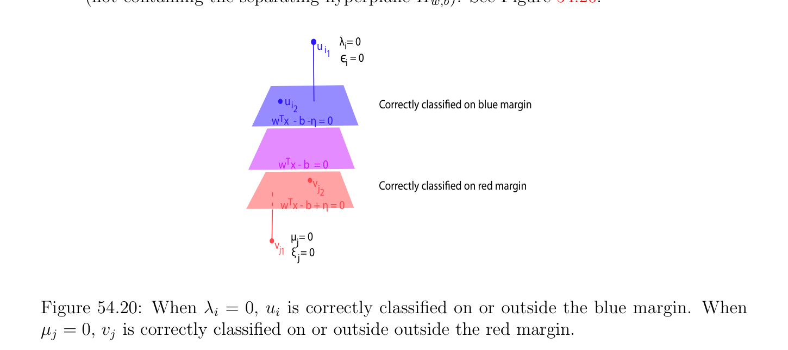

# Lề mềm (soft margin) SVM; (SVMs4)

<!-- PAGE 2037 -->

## 54.13 Lề mềm (soft margin) SVM; (SVM)

$$s4$$
Trong mục này ta xét phiên bản của Bài toán $(SVM_{s2'})$ trong mà thay vì của bằng cách sử dụng
$$function K \sum_{2i}  \sum  as a regularizing function we use the quadratic function$$
$$\begin{pmatrix} p & \epsilon_{i} + & q & \xi_{j} \\ =1 & j=1 \\ \|_{2}). \end{pmatrix}$$
$K(\|\epsilon \|_{2}^{2} + \|\xi$ Lề mềm (soft margin) SVM $(SVM_{s4})$:
$$minimize \frac{1}{2} w^{\top}w + (p + q)K_{s} \begin{pmatrix} 1 \\ -\nu \eta  + & (\epsilon^{\top} \epsilon  + \xi^{\top} \xi ) \\ p + q \end{pmatrix}$$
$$subject to$$
$$w^{\top}u_{i} -b \ge \eta  -\epsilon_{i} ,i = 1, \dots  , p$$
$$-w^{\top}v_{j} + b \ge \eta  -\xi_{j} ,j = 1, \dots  , q$$
$$\eta  \ge 0,$$
Ở đâu $\nu$ và $K_{s}$ là hai cho trước dương các hằng số. Như ta đã thấy trước đó, về mặt lý thuyết, nó là thuận tiện đến chọn $K_{s} = 1/(p + q)$. Khi viết máy tính bài toán quy hoạch, nó được ưu tiên hơn giả sử rằng $K_{s}$ là tùy ý. Trong điều này trường hợp $\nu$ cần được thay thế bởi $(p + q)K_{s}\nu$ trong tất cả các công thức thu được với $K_{s} = 1/(p + q)$. mới twist với điều này formulation của bài toán là rằng nếu $\epsilon_{i}  < 0$, thì tương ứng bất đẳng thức $w^{\top}u_{i}$ - $b \ge \eta$ - $\epsilon_{i}$ suy ra bất đẳng thức $w^{\top}u_{i}$ - $b \ge \eta$ thu được bằng cách đặt $\epsilon_{i}$ đến không trong khi rút gọn giá trị của $\|\epsilon \|^{2}$, và tương tự nếu $\xi_{j}  < 0$, thì tương ứng bất đẳng thức $-w^{\top}v_{j} +b \ge \eta  -\xi_{j}$ suy ra bất đẳng thức $-w^{\top}v_{j} +b \ge \eta$ thu được bằng cách đặt $\xi_{j}$ đến không trong khi rút gọn giá trị của $\|\xi \|^{2}$. Vì vậy, nếu $(w, b, \epsilon , \xi$) là nghiệm tối ưu (optimal solution) của Bài toán $(SVM_{s4})$, nó là không cần đến thu hẹp bù/lỏng các biến $\epsilon_{i}$ và $\xi_{j}$ đến không âm, mà simplifies matters bit. Thực ra, ta sẽ xem rằng cho nghiệm tối ưu (optimal solution), $\epsilon  = \lambda /(2K_{s})$ và $\xi  = \mu /(2K_{s})$. biến $\eta$ có thể cũng được xác định bởi biểu diễn rằng khoảng cách đối ngẫu (duality gap) là không. Một của advantages của các phương pháp này là rằng $\epsilon$ được xác định bởi $\lambda , \xi$ được xác định bởi $\mu$, và $\eta$ và $b$ được xác định bởi $\lambda$ và $\mu$. phương pháp này thực hiện không đòi hỏi hỗ trợ/giá (support) các vectơ để tính $b$. Ta có thể bỏ qua ràng buộc $\eta  \ge 0$, bởi vì cho nghiệm tối ưu (optimal solution) nó có thể được được hiển thị bằng cách sử dụng đối ngẫu rằng $\eta  \ge 0$; xem Mục 54.14. drawback của Bài toán quy hoạch $(SVM_{s4})$ là rằng cho cố định $K_{s}$, đại lượng $\delta  = \eta / \|w\|$ và các siêu phẳng $H_{w,b}, H_{w,b+\eta}$ và $H_{w,b-\eta}$ là độc lập của $\nu$. Điều này sẽ được hiển thị trong Định lý 54.8. Do đó phương pháp này là ít hơn flexible hơn $(SVM_{s2'})$ và $(SVM_{s3})$.

<!-- PAGE 2038 -->
Hàm Lagrange (Lagrangian) được cho bởi
$$L(w, \epsilon , \xi , b, \eta , \lambda , \mu , \gamma ) = \frac{1}{2} w^{\top}w -\nu \eta  + K_{s}(\epsilon^{\top} \epsilon  + \xi^{\top} \xi ) + w^{\top}X \begin{pmatrix} \lambda \\ \mu \end{pmatrix}$$
$$\epsilon^{\top} \lambda  -\xi^{\top} \mu  + b(1_{p}^{\top} \lambda  -1_{q}^{\top} \mu ) + \eta (1_{p}^{\top} \lambda  + 1_{q}^{\top} \mu ) -\gamma \eta$$
$$= \frac{-1}{2} w^{\top}w + w^{\top}X \begin{pmatrix} \lambda \\ \mu \end{pmatrix} + \eta (1_{p}^{\top} \lambda  + 1_{q}^{\top} \mu  -\nu  -\gamma )$$
$$+ K_{s}(\epsilon^{\top} \epsilon  + \xi^{\top} \xi ) -\epsilon^{\top} \lambda  -\xi^{\top} \mu  + b(1_{p}^{\top} \lambda  -1_{q}^{\top} \mu ).$$
Để tìm đối ngẫu (dual) hàm $G(\lambda , \mu , \gamma$) ta cực tiểu hóa L(w, $\epsilon , \xi , b, \eta , \lambda , \mu , \gamma$) đối với $w, \epsilon , \xi$,
$$\mathbb{R}^{n} \mathbb{R}^{p} \mathbb{R}^{q} \mathbb{R}\mathbb{R}$$
$b$, và $\eta$. Vì Hàm Lagrange (Lagrangian) là lồi và $(w, \epsilon , \xi , b, \eta$) $\in \times \times \times  \times$, lồi tập mở (open set), theo Định lý 40.13, Hàm Lagrange (Lagrangian) có cực tiểu trong $(w, \epsilon , \xi , b, \eta$) khi và chỉ khi $\nabla L_{w,\epsilon ,\xi ,b,\eta} = 0$, do đó ta tính $\nabla L_{w,\epsilon ,\xi ,b,\eta}$. gradien $\nabla L_{w,\epsilon ,\xi ,b,\eta}$ được cho bởi
$$\begin{pmatrix}\end{pmatrix}$$
$$\nabla L_{w,\epsilon ,\xi ,b,\eta} = \begin{pmatrix} \lambda  \\ w + X & \mu \\ 2K_{s}\epsilon  -\lambda \\ 2K_{s}\xi  -\mu \\ 1_{p}^{\top}\lambda  -1_{q}^{\top}\mu \\ 1_{p}^{\top}\lambda  + 1_{q}^{\top}\mu & \nu & \gamma \end{pmatrix} .$$
$$- -$$
Bằng cách đặt $\nabla L_{w,\epsilon ,\xi ,b,\eta} = 0$ ta thu được các phương trình
$$w = -X \begin{pmatrix} \lambda \\ \mu \end{pmatrix} ,(*_{w})$$
$$2K_{s}\epsilon  = \lambda$$
$$2K_{s}\xi  = \mu$$
$$1_{p}^{\top} \lambda  = 1_{q}^{\top} \mu$$
$$1_{p}^{\top} \lambda  + 1_{q}^{\top} \mu  = \nu  + \gamma .$$
Cuối cùng hai các phương trình là đồng nhất đến cuối cùng hai các phương trình thu được trong Bài toán $(SVM_{s2'})$. Ta có thể sử dụng khác các phương trình để thu được sau đây biểu thức cho đối ngẫu (dual) hàm $G(\lambda , \mu , \gamma$),
$$G(\lambda , \mu , \gamma ) = - \frac{1}{4K_{s}} (\lambda^{\top} \lambda  + \mu^{\top} \mu ) - \frac{1}{2} \begin{pmatrix} \lambda^{\top} & \mu^{\top} \end{pmatrix} X^{\top}X \begin{pmatrix} \lambda \\ \mu \end{pmatrix}$$
$$= - \frac{1}{2} \begin{pmatrix} \lambda^{\top} & \mu^{\top} \end{pmatrix} \begin{pmatrix} 1 \\ X^{\top}X+ & I_{p+q} \\ 2K_{s} \end{pmatrix} \begin{pmatrix} \lambda \\ \mu \end{pmatrix} .$$
Hệ quả là đối ngẫu (dual) bài toán quy hoạch là tương đương đến cực tiểu hóa bài toán quy hoạch

<!-- PAGE 2039 -->
Đối ngẫu (dual) của Lề mềm (soft margin) SVM $(SVM_{s4})$:
$$minimize \frac{1}{2} \begin{pmatrix} \lambda^{\top} & \mu^{\top} \end{pmatrix} \begin{pmatrix} 1 \\ X^{\top}X+ & I_{p+q} \\ 2K_{s} \end{pmatrix} \begin{pmatrix} \lambda \\ \mu \end{pmatrix}$$
$$subject to$$
$$\sum_{i=1}^{p}  \lambda_{i}  - \sum_{j=1}^{q}  \mu_{j}  = 0$$
$$\sum_{i=1}^{p}  \lambda_{i}  + \sum_{j=1}^{q}  \mu_{j}  \ge \nu$$
$$\lambda_{i}  \ge 0,i = 1, \dots  , p$$
$$\mu_{j}  \ge 0,j = 1, \dots  , q.$$
Ở trên bài toán quy hoạch là đồng dạng đến bài toán quy hoạch rằng đã là thu được cho Bài toán $(SVM_{s2'})$ nhưng ma trận $X^{\top}X$ được thay thế bởi ma trận $X^{\top}X +(1/2K_{s})I_{p+q}$, mà là xác định dương (positive definite) vì $K_{s} > 0$, và cũng các bất đẳng thức $\lambda_{i}  \le K_{s}$ và $\mu_{j}  \le K_{s}$ không có dài hơn đúng. Nó được hiển thị trong Mục 54.14 cách mà đối ngẫu (dual) bài toán quy hoạch được giải bằng cách sử dụng ADMM từ Mục 52.6. Nếu bài toán gốc (primal problem) là giải được, điều này cho ta các nghiệm cho $\lambda$ và $\mu$. Ta thu được $w$ từ $\lambda$ và $\mu$, như trong Bài toán $(SVM_{s2'})$; cụ thể là,
$$w = -X \begin{pmatrix} \lambda \\ \mu \end{pmatrix} = \sum_{i=1}^{p}  \lambda_{i} u_{i} - \sum_{j=1}^{q}  \mu_{j} v_{j}.$$
Vì các biến $\epsilon_{i}$ và $\xi_{j}$ là không bị thu hẹp là không âm ta không có dài hơn có độ bù lỏng (complementary slackness) các điều kiện liên quan đến chúng, nhưng ta biết rằng
$$\epsilon  = \frac{\lambda}{2K_{s}} ,\xi  = \frac{\mu}{2K_{s}} .$$
Cũng vì các ràng buộc
$$\sum_{i=1}^{p}  \lambda_{i}  \ge \frac{\nu}{2} and \sum_{j=1}^{q}  \mu_{j}  \ge \frac{\nu}{2}$$
Suy ra rằng tồn tại một $i_{0}$ sao cho $\lambda_{i0}  > 0$ và một số $j_{0}$ sao cho $\mu_{j0}  > 0$, ta có $\epsilon_{i0}  > 0$ và $\xi_{j0}  > 0$, mà có nghĩa là ít nhất hai các điểm là misclassified, do đó Bài toán $(SVM_{s4})$ nên chỉ được sử dụng khi các tập hợp ${u_{i}}$ và ${v_{j}}$ là không một cách tuyến tính khả ly. Bởi vì $\epsilon_{i}  = \lambda_{i} /(2K_{s}), \xi_{j}  = \mu_{j} /(2K_{s})$, và không có trên cận $K_{s}$ trên $\lambda_{i}$ và $\mu_{j}$, phân loại của các điểm là đơn giản hơn hơn trong trước đó các trường hợp.
$(1)$ Nếu $\lambda_{i}  = 0$, thì $\epsilon_{i}  = 0$ và bất đẳng thức $w^{\top}u_{i} -b -\eta  \ge 0$ nghiệm đúng. Nếu đẳng thức nghiệm đúng thì $u_{i}$ là hỗ trợ/giá (support) vectơ trên xanh lam lề (margin) (siêu phẳng (hyperplane) $H_{w,b+\eta})$. Ngược lại $u_{i}$ là

<!-- PAGE 2040 -->
Trong xanh lam mở nửa không gian (half-space) bị chặn bởi lề (margin) siêu phẳng (hyperplane) $H_{w,b+\eta}$ (không chứa tách siêu phẳng (hyperplane) $H_{w,b})$. Xem Hình 54.20. Tương tự, nếu $\mu_{j}  = 0$, thì $\xi_{j}  = 0$ và bất đẳng thức $-w^{\top}v_{j} + b$ - $\eta  \ge$ nghiệm đúng. Nếu đẳng thức nghiệm đúng thì $v_{j}$ là hỗ trợ/giá (support) vectơ trên đỏ lề (margin) (siêu phẳng (hyperplane) $H_{w,b-\eta})$. Ngược lại $v_{j}$ là trong đỏ mở nửa không gian (half-space) bị chặn bởi lề (margin) siêu phẳng (hyperplane) $H_{w,b-\eta}$ (không chứa tách siêu phẳng (hyperplane) $H_{w,b})$. Xem Hình 54.20.
$$u \lambda  = 0$$
$$ii$$
$$1є = 0$$
$$i$$
$$ui2Correctly classified on blue margin$$
$$w  x  - b -\eta  = 0T$$
$$w  x - b  = 0T$$
$$vCorrectly classified on red margin$$
$$j2$$
$$w  x - b + \eta  = 0T$$
$$\mu  = 0$$
$$vj$$
$$j1\xi   = 0$$
$$j$$

**Hình 54.20:** Khi $\lambda_{i}  = 0, u_{i}$ là một cách chính xác được phân loại trên hoặc bên ngoài xanh lam lề (margin). Khi $\mu_{j}  = 0, v_{j}$ là một cách chính xác được phân loại trên hoặc bên ngoài bên ngoài đỏ lề (margin).
$(2)$ Nếu $\lambda_{i}  > 0$, thì $\epsilon_{i}  = \lambda_{i} /(2K_{s}) > 0$. tương ứng ràng buộc là hoạt động, do đó ta có
$$w^{\top}u_{i} -b = \eta  -\epsilon_{i} .$$
Nếu $\epsilon_{i}  \le \eta$, thì các điểm $u_{i}$ là bên trong dải phẳng (slab) bị chặn bởi xanh lam lề (margin) siêu phẳng (hyperplane) $H_{w,b+\eta}$ và tách siêu phẳng (hyperplane) $H_{w,b}$. Nếu $\epsilon_{i}  > \eta$, thì điểm $u_{i}$ thuộc đến mở nửa không gian (half-space) bị chặn bởi tách siêu phẳng (hyperplane) và chứa đỏ lề (margin) siêu phẳng (hyperplane) (đỏ vế/cạnh); nó là misclassified. Xem Hình 54.21. Tương tự, nếu $\mu_{j}  > 0$, thì $\xi_{j}  = \mu_{j} /(2K_{s}) > 0$. tương ứng ràng buộc là hoạt động, do đó ta có
$$-w^{\top}v_{j} + b = \eta  -\xi_{j} .$$
Nếu $\xi_{j}  \le \eta$, thì các điểm $v_{j}$ là bên trong dải phẳng (slab) bị chặn bởi đỏ lề (margin) siêu phẳng (hyperplane) $H_{w,b-\eta}$ và tách siêu phẳng (hyperplane) $H_{w,b}$. Nếu $\xi_{j}  > \eta$, thì điểm $v_{j}$ thuộc đến mở nửa không gian (half-space) bị chặn bởi tách siêu phẳng (hyperplane) và chứa xanh lam lề (margin) siêu phẳng (hyperplane) (xanh lam vế/cạnh); nó là misclassified. Xem Hình 54.21. Ta có thể sử dụng sự kiện rằng khoảng cách đối ngẫu (duality gap) là $0$ để tìm $\eta$. Ta có
$$\frac{1}{2} w^{\top}w -\nu \eta  + K_{s}(\epsilon^{\top} \epsilon  + \xi^{\top} \xi ) = - \frac{1}{2} \begin{pmatrix} \lambda^{\top} & \mu^{\top} \end{pmatrix} \begin{pmatrix} 1 \\ X^{\top}X+ & I_{p+q} \\ 2K_{s} \end{pmatrix} \begin{pmatrix} \lambda \\ \mu \end{pmatrix} ,$$

<!-- PAGE 2041 -->
$$\lambda  i > 0T$$
$$w  x  - b - \eta  = 0Tw  x  - b - \eta  = 0$$
$$Є  < \eta i\lambda  i> 0$$
$$ui\mu   > 0vv$$
$$jju iЄ  = \eta i$$
$$\xi  = \eta jw  x - b  = 0T$$
$$\mu   > 0w  x - b  = 0T$$
$$jv$$
$$\xi  < \eta jj$$
$$w  x - b + \eta  = 0Tw  x - b + \eta  = 0T$$
$$(1)Correctly classified in slab$$
$$w  x  - b - \eta = 0T$$
$$\mu   > 0$$
$$j\xi  > \eta vvj$$
$$j(2)Misclassified$$
$$w  x - b  = 0T$$
$$\lambda  i> 0$$
$$ui$$
$$Є > \eta i$$
$$w  x - b + \eta  = 0T$$

**Hình 54.21:** phân loại của các điểm cho $SVM_{s4}$ khi Các nhân tử Lagrange (Lagrange multipliers) là dương. trái illustration của Hình $(1)$ là khi $u_{i}$ là bên trong lề (margin) vẫn chưa vẫn trên đúng vế/cạnh của tách siêu phẳng (hyperplane) $w^{\top}x$ - $b = 0$. Tương tự, $v_{j}$ là bên trong lề (margin) trên đúng vế/cạnh của tách siêu phẳng (hyperplane). phải illustration depicts $u_{i}$ và $v_{j}$ trên tách siêu phẳng (hyperplane). Hình $(2)$ illustrations misclassification của $u_{i}$ và $v_{j}$. và vì
$$w = -X \begin{pmatrix} \lambda \\ \mu \end{pmatrix}$$
Ta thu được
$$\nu \eta  = K_{s}(\epsilon^{\top} \epsilon  + \xi^{\top} \xi ) + \begin{pmatrix} \lambda^{\top} & \mu^{\top} \end{pmatrix} \begin{pmatrix} 1 \\ X^{\top}X+ & I_{p+q} \\ 4K_{s} \\ \lambda  \end{pmatrix} \begin{pmatrix} \lambda \\ \mu \end{pmatrix}$$
$$= \begin{pmatrix} \lambda^{\top} & \mu^{\top} \end{pmatrix} \begin{pmatrix} 1 \\ X^{\top}X+ & I_{p+q} \\ 2K_{s} \\ wehave\eta \end{pmatrix} \begin{pmatrix} \mu \end{pmatrix} .$$
Ở trên xác nhận rằng tại tính tối ưu $\ge 0$.
Nhận xét: Nếu ta thực hiện không giả sử rằng $K_{s} = 1/(p+q)$, thì ở trên công thức phải được thay thế bởi
$$(p + q)K_{s}\nu \eta  = \begin{pmatrix} \lambda^{\top} & \mu^{\top} \end{pmatrix} \begin{pmatrix} 1 \\ X^{\top}X+ & I_{p+q} \\ 2K_{s} \\ theexistenceof \end{pmatrix} \begin{pmatrix} \lambda \\ \mu \end{pmatrix} .$$
Vì $\eta$ được xác định một cách độc lập của hỗ trợ/giá (support) các vectơ, lề (margin) siêu phẳng (hyperplane) $H_{w,b+\eta}$ có thể không chứa bất kỳ điểm $u_{i}$ và lề (margin) siêu phẳng (hyperplane) $H_{w,b-\eta}$ có thể không chứa bất kỳ điểm $v_{j}$. Ta có thể giải cho $b$ bằng cách sử dụng một số hoạt động ràng buộc tương ứng với bất kỳ $i_{0}$ sao cho $\lambda_{i0}  > 0$ và bất kỳ $j_{0}$ sao cho $\mu_{j0}  > 0$ (bởi trước đó nhận xét, các ràng buộc suy ra rằng như vậy $i_{0}$ và

<!-- PAGE 2042 -->
$j_{0}$ phải tồn tại). Đến cải thiện số tính ổn định ta trung bình trên sau đây các tập hợp của các chỉ số. Cho $I_{\lambda}$ và $I_{\mu}$ là tập hợp của các chỉ số cho trước bởi
$$I_{\lambda} = {i \in {1, \dots  , p} | \lambda_{i}  > 0}$$
$$I_{\mu} = {j \in {1, \dots  , q} | \mu_{j}  > 0},$$
Và cho $p_{m} = |I_{\lambda}|$ và $q_{m} = |I_{\mu}|$. Ta thu được công thức
$$\sum_{\in I\lambda}  \sum_{\in I\mu}  \sum_{i\in I\lambda}  \sum_{j\in I\mu}  $$
$$b = \begin{pmatrix}  \\ w^{\top} & u_{i} \\ i \end{pmatrix} \begin{pmatrix}  \\ /p_{m} + & v_{j} \\ j \end{pmatrix} \begin{pmatrix} /q_{m} \end{pmatrix} \begin{pmatrix}  \\ + & \epsilon_{i} \end{pmatrix} \begin{pmatrix}  \\ /p_{m} - & \xi_{j} \end{pmatrix} /q_{m}/2.$$
Ta bây giờ chứng minh rằng cho cố định $K_{s}$, nghiệm đến Bài toán $(SVM_{s4})$ là duy nhất và độc lập của giá trị của $\nu$.

> **Định lý 54.8.** Cho $K_{s}$ và $\nu$ cố định, nếu Bài toán $(SVM_{s4})$ thành công, thì nó có duy nhất nghiệm. Nếu Bài toán $(SVM_{s4})$ thành công và trả về $(\lambda , \mu , \eta , w, b)$ cho giá trị $\nu$ và $(\lambda^{\kappa} , \mu^{\kappa} , \eta^{\kappa} , w^{\kappa}, b^{\kappa})$ cho giá trị $\kappa \nu$ với $\kappa  > 0$, thì
$$\lambda^{\kappa} = \kappa \lambda , \mu^{\kappa} = \kappa \mu , \eta^{\kappa} = \kappa \eta , w^{\kappa}= \kappa w, b^{\kappa}= \kappa b.$$
Hệ quả là, $\delta  = \eta / \|w\| = \eta^{\kappa} / \|w^{\kappa}\| = \delta^{\kappa}$, và các siêu phẳng $H_{w,b}, H_{w,b+\eta}$ và $H_{w,b-\eta}$ là độc lập của $\nu$.

*Chứng minh.* Ta đã được quan sát rằng cho nghiệm tối ưu (optimal solution) với $\eta  > 0$, ta có $\gamma  = 0$. Điều này có nghĩa là $(\lambda , \mu$) là nghiệm của bài toán
$$minimize \frac{1}{2} \begin{pmatrix} \lambda^{\top} & \mu^{\top} \end{pmatrix} \begin{pmatrix} 1 \\ X^{\top}X+ & I_{p+q} \\ 2K_{s} \end{pmatrix} \begin{pmatrix} \lambda \\ \mu \end{pmatrix}$$
$$subject to$$
$$\sum_{i=1}^{p}  \lambda_{i}  - \sum_{j=1}^{q}  \mu_{j}  = 0$$
$$\sum_{i=1}^{p}  \lambda_{i}  + \sum_{j=1}^{q}  \mu_{j}  = \nu$$
$$\lambda_{i}  \ge 0,i = 1, \dots  , p$$
$$\mu_{j}  \ge 0,j = 1, \dots  , q.$$
Vì $K_{s} > 0$ và $X^{\top}X$ là đối xứng nửa xác định dương (positive semidefinite), ma trận
$$\mathbb{R}^{p+q}$$
$P = X^{\top}X +_{2Ks}^{1}I_{p+q}$ là đối xứng xác định dương (SPD). Cho $\Omega =$ và cho $U$ là tập lồi (convex set) cho trước bởi
$$U = \begin{pmatrix} \lambda \\ \mu \end{pmatrix} \begin{pmatrix} 1_{p}^{\top} & -1_{q}^{\top}! \\ \in \mathbb{R}_{+}^{p+q} & \lambda \\ 1_{p}^{\top} & 1_{q}^{\top} & \mu \end{pmatrix} \begin{pmatrix}  & 0 \\ = & (p + q)K_{s}\nu \end{pmatrix} \begin{pmatrix}\end{pmatrix} .$$

<!-- PAGE 2043 -->
Vì ma trận $P$ là đối xứng xác định dương (SPD), phiếm hàm
$$F(\lambda , \mu ) = -G(\lambda , \mu ) = \frac{1}{2} \begin{pmatrix} \lambda^{\top} & \mu^{\top} \end{pmatrix} P \begin{pmatrix} \lambda \\ \mu \end{pmatrix}$$
Là lồi chặt (strictly convex) và $U$ là lồi, do đó theo Định lý 40.13(2,4), nếu nó có cực tiểu, thì nó là duy nhất. Xét tập lồi (convex set)
$$U^{\kappa}= \begin{pmatrix} \lambda \\ \mu \end{pmatrix} \begin{pmatrix} 1_{p}^{\top} & -1_{q}^{\top}! \\ \in \mathbb{R}_{+}^{p+q} & \lambda \\ 1_{p}^{\top} & 1_{q}^{\top} & \mu \end{pmatrix} \begin{pmatrix}  & 0 \\ = & (p + q)K_{s}\kappa \nu \end{pmatrix} \begin{pmatrix}\end{pmatrix} .$$
Nhận thấy rằng
$$\kappa U = \begin{pmatrix} \kappa \lambda \\ \kappa \mu \end{pmatrix} \begin{pmatrix} 1_{p}^{\top} & -1_{q}^{\top}! \\ \in \mathbb{R}_{+}^{p+q} & \kappa \lambda \\ 1_{p}^{\top} & 1_{q}^{\top} & \kappa \mu \end{pmatrix} \begin{pmatrix}  & 0 \\ = & (p + q)K_{s}\kappa \nu \end{pmatrix} \begin{pmatrix}\end{pmatrix} = U^{\kappa} .$$
Theo Định lý 40.13(3), $(\lambda , \mu$) $\in U$ là cực tiểu của $F$ trên $U$ khi và chỉ khi
$$dF_{\lambda ,\mu} \begin{pmatrix} \lambda'  -\lambda \\ \mu' -\mu \end{pmatrix} \ge 0for all \begin{pmatrix} \lambda' \\ \mu' \end{pmatrix} \in U.$$
Vì
$$dF_{\lambda ,\mu} \begin{pmatrix} \lambda'  -\lambda \\ \mu' -\mu \end{pmatrix} = \begin{pmatrix} \lambda^{\top} & \mu^{\top} \end{pmatrix} P \begin{pmatrix} \lambda'  -\lambda \\ \mu' -\mu \end{pmatrix}$$
Ở trên các điều kiện là tương đương đến
$$\begin{pmatrix} \lambda^{\top} & \mu^{\top} \end{pmatrix} P \begin{pmatrix} \lambda'  -\lambda \\ \mu' -\mu \end{pmatrix} \ge 0$$
$$1_{p}^{\top}-1_{q}^{\top}!$$
$$1_{p}^{\top}1_{q}^{\top} \begin{pmatrix} \lambda \\ \mu \end{pmatrix} = \begin{pmatrix} 0 \\ (p + q)K_{s}\nu \end{pmatrix}$$
$$\mathbb{R}_{+}^{p} \mathbb{R}_{+}^{q}$$
$$\lambda , \lambda' \in , \mu , \mu' \in .$$
Vì $\kappa  > 0$, bằng cách nhân ở trên bất đẳng thức bởi $\kappa^{2}$ và các phương trình bởi $\kappa$, sau đây các điều kiện đúng:
$$\begin{pmatrix} \kappa \lambda^{\top} & \kappa \mu^{\top} \end{pmatrix} P \begin{pmatrix} \kappa \lambda'  -\kappa \lambda \\ \kappa \mu' -\kappa \mu \end{pmatrix} \ge 0$$
$$1_{p}^{\top}-1_{q}^{\top}!$$
$$1_{p}^{\top}1_{q}^{\top} \begin{pmatrix} \kappa \lambda \\ \kappa \mu \end{pmatrix} = \begin{pmatrix} 0 \\ (p + q)K_{s}\kappa \nu \end{pmatrix}$$
$$\mathbb{R}_{+}^{p} \mathbb{R}_{+}^{q}$$
$$\kappa \lambda , \kappa \lambda' \in , \kappa \mu , \kappa \mu' \in .$$
Theo Định lý 40.13(3), $(\kappa \lambda , \kappa \mu$) $\in U^{\kappa}$ là cực tiểu của $F$ trên $U^{\kappa}$, và bởi vì $F$ là lồi chặt (strictly convex) và $U^{\kappa}$ là lồi, nếu $F$ có cực tiểu trên $U^{\kappa}$, thì $(\kappa \lambda , \kappa \mu$) $\in U^{\kappa}$ là duy nhất cực tiểu. Vì vậy, $\lambda^{\kappa} = \kappa \lambda , \mu^{\kappa} = \kappa \mu$.

<!-- PAGE 2044 -->
Vì $w$ được cho bởi phương trình
$$w = -X \begin{pmatrix} \lambda \\ \mu \end{pmatrix}$$
Và vì ta chỉ đã chỉ ra rằng $\lambda^{\kappa} = \kappa \lambda , \mu^{\kappa} = \kappa \mu$, ta suy ra rằng $w^{\kappa} = \kappa w$. Ta đã chỉ ra trước đó rằng $\eta$ được cho bởi phương trình
$$(p + q)K_{s}\nu \eta  = \begin{pmatrix} \lambda^{\top} & \mu^{\top} \end{pmatrix} \begin{pmatrix} 1 \\ X^{\top}X+ & I_{p+q} \\ 2K_{s} \end{pmatrix} \begin{pmatrix} \lambda \\ \mu \end{pmatrix} .$$
Nếu ta thay thế $\nu$ bởi $\kappa \nu$, vì $\lambda$ được thay thế bởi $\kappa \lambda$ và $\mu$ bởi $\kappa \nu$, ta xem rằng $\eta^{\kappa} = \kappa \eta$. Cuối cùng, $b$ được cho bởi phương trình
$$-$$
$$b = \frac{w^{\top}(u_{i0}+ v_{j0}) + \epsilon_{i0} \xi_{j0}}{2}$$
Cho và $i_{0}$ sao cho $\lambda_{i0}  > 0$ và bất kỳ $j_{0}$ sao cho $\mu_{j0}  > 0$. Nếu $\lambda$ được thay thế bởi $\kappa \lambda$ và $\mu$ bởi $\kappa \mu$, vì $\epsilon  = \lambda /(2K_{s})$ và $\xi  = \mu /(2K_{s})$, ta xem rằng $\epsilon$ được thay thế bởi $\kappa \epsilon$ và $\xi$ bởi $\kappa \xi$, do đó $b^{\kappa} = \kappa b$. Vì $w^{\kappa} = \kappa w$ và $\eta^{\kappa} = \kappa \eta$ ta thu được $\delta  = \eta / \|w\| = \eta^{\kappa} / \|w^{\kappa}\| = \delta^{\kappa}$. Vì $w^{\kappa} = \kappa w, \eta^{\kappa} = \kappa \eta$ và $b^{\kappa} = \kappa b$, được chuẩn hóa các phương trình của các siêu phẳng $H_{w,b}, H_{w,b+\eta}$ và $H_{w,b-\eta}$ (thu được bằng cách chia bởi $\|w\|)$ là tất cả đồng nhất, do đó các siêu phẳng $H_{w,b}, H_{w,b+\eta}$ và $H_{w,b-\eta}$ là độc lập của $\nu$. chiều rộng của dải phẳng (slab) là controlled bởi $K$. lớn hơn $K$ là nhỏ hơn là chiều rộng của dải phẳng (slab). Về mặt lý thuyết, vì phương pháp này thực hiện không rely trên hỗ trợ/giá (support) các vectơ để tính $b$, nó không thể thất bại nếu nghiệm tồn tại, nhưng trong thực tế toàn phương solver thực hiện không hội tụ cho các giá trị của $K$ rằng là cũng lớn. Tuy nhiên, phương pháp handles rất nhỏ các giá trị của $K$, mà có thể cho các dải phẳng (slab) của excessive chiều rộng. “kernelized” phiên bản của Bài toán $(SVM_{s4})$ là sau đây: Lề mềm (soft margin) hạt nhân (kernel) SVM $(SVM_{s4})$:
$$minimize \frac{1}{2} \langle w, w\rangle -\nu \eta  + K_{s}(\epsilon^{\top} \epsilon  + \xi^{\top} \xi )$$
$$subject to$$
$$\langle w, \phi (u_{i})\rangle -b \ge \eta  -\epsilon_{i} ,i = 1, \dots  , p$$
$$-\langle w, \phi (v_{j})\rangle + b \ge \eta  -\xi_{j} ,j = 1, \dots  , q$$
$$\eta  \ge 0,$$
Với $K_{s} = 1/(p + q)$. Bởi đi trên derivation của đối ngẫu (dual) bài toán quy hoạch, ta thu được
