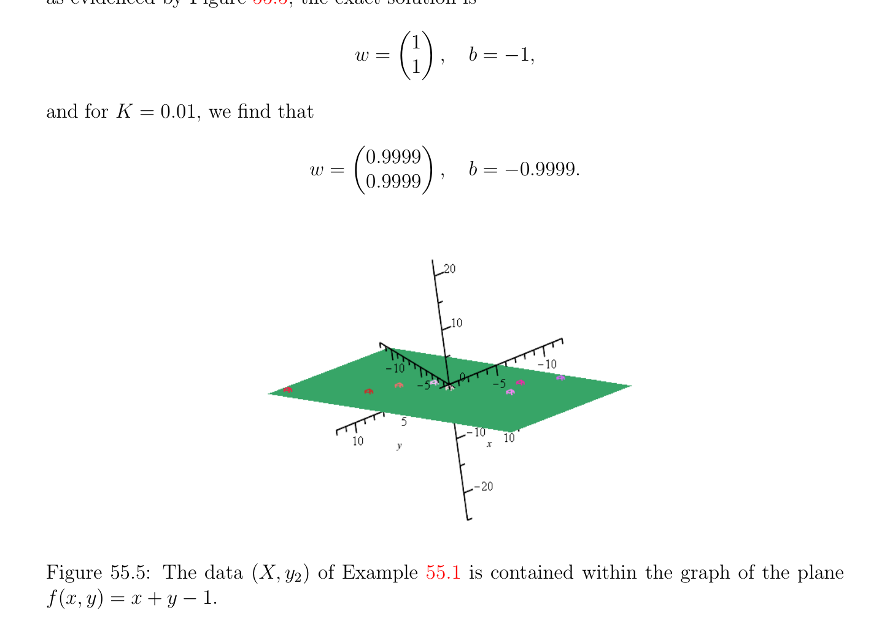

# Hồi quy Ridge (ridge regression); Học (learning) Afin Hàm

<!-- PAGE 2075 -->
Ở trên suggests định nghĩa biến $\alpha$ sao cho $\xi  = K\alpha$, do đó ta có $\lambda  = 2K\alpha$ và $w = X^{\top}\alpha$. Thì ta thu được đối ngẫu (dual) hàm như hàm của $\alpha$ bằng cách thế ở trên các giá trị của $\xi , \lambda$ và $w$ quay lại trong Hàm Lagrange (Lagrangian) và ta thu được
$$G(\alpha ) = K^{2}\alpha^{\top} \alpha  + K\alpha^{\top} XX^{\top}\alpha  -2K\alpha^{\top} XX^{\top}\alpha  -2K^{2}\alpha^{\top} \alpha  + 2K\alpha^{\top} y$$
$$= -K\alpha^{\top} (XX^{\top}+ KI_{m})\alpha  + 2K\alpha^{\top} y.$$
Điều này là chặt hàm lõm (concave function) do đó theo Định lý 40.13(4), của nó cực đại là đạt được khi và chỉ khi $\nabla G_{\alpha} = 0$, nghĩa là,
$$2K(XX^{\top}+ KI_{m})\alpha  = 2Ky,$$
Mà cho ta
$$\alpha  = (XX^{\top}+ KI_{m})^{-1}y.$$
Đặt everything cùng nhau ta thu được
$$\alpha  = (XX^{\top}+ KI_{m})^{-1}y$$
$$w = X^{\top}\alpha$$
$$\xi  = K\alpha ,$$
Mà cho ta
$$w = X^{\top}(XX^{\top}+ KI_{m})^{-1}y.(*_{wd})$$
Trước đó trong $(*_{wp})$ ta tìm thấy rằng
$$w = (X^{\top}X + KI_{n})^{-1}X^{\top}y,$$
Và nó là dễ để kiểm tra rằng
$$(X^{\top}X + KI_{n})^{-1}X^{\top}= X^{\top}(XX^{\top}+ KI_{m})^{-1}.$$
Nếu $n < m$ nó là cheaper để sử dụng công thức trên vế trái, nhưng nếu $m < n$ nó là cheaper để sử dụng công thức trên vế phải.

## 55.2 Hồi quy Ridge (ridge regression); Học (learning) Afin Hàm

Nó là dễ đến thích nghi ở trên phương pháp đến learn afin hàm f(x) $= x^{\top}w + b$ thay vì của tuyến tính hàm f(x) $= x^{\top}w$, ở đâu $b \in \mathbb{R}$. Ta có kết quả sau tối ưu hóa bài toán quy hoạch Bài toán quy hoạch (RR3):
$$minimize\xi^{\top} \xi  + Kw^{\top}w$$
$$subject to$$
$$y -Xw -b1 = \xi ,$$

<!-- PAGE 2076 -->
$$\mathbb{R}^{m} \mathbb{R}^{n}$$
Với $y, \xi , 1 \in$ và $w \in$. Lưu ý rằng trong Bài toán quy hoạch (RR3) cực tiểu hóa là performed trên $\xi , w$ và $b$, nhưng $b$ là không có phạt trong hàm mục tiêu (objective function). Như trong Mục 55.1, hàm mục tiêu (objective function) là lồi. Hàm Lagrange (Lagrangian) liên kết với điều này bài toán quy hoạch là
$$L(\xi , w, b, \lambda ) = \xi^{\top} \xi  + Kw^{\top}w -w^{\top}X^{\top}\lambda  -\xi^{\top} \lambda  -b1^{\top}\lambda  + \lambda^{\top} y.$$
Vì $L$ là lồi như hàm của $\xi , b, w$, theo Định lý 40.13(4), nó có cực tiểu khi và chỉ khi $\nabla L_{\xi ,b,w} = 0$. Ta thu được
$$\lambda  = 2\xi$$
$$1^{\top}\lambda  = 0$$
$$\xi$$
$$w = \frac{1}{2} K X^{\top}\lambda  = X^{\top}K .$$
Như trước, nếu ta tập hợp $\xi  = K\alpha$ ta thu được $\lambda  = 2K\alpha , w = X^{\top}\alpha$, và
$$G(\alpha ) = -K\alpha^{\top} (XX^{\top}+ KI_{m})\alpha  + 2K\alpha^{\top} y.$$
Vì $K > 0$ và $\lambda  = 2K\alpha$, đối ngẫu (dual) đến hồi quy Ridge (ridge regression) là sau đây bài toán quy hoạch Bài toán quy hoạch (DRR3):
$$minimize\alpha^{\top} (XX^{\top}+ KI_{m})\alpha  -2\alpha^{\top} y$$
$$subject to$$
$$1^{\top}\alpha  = 0,$$
Ở đâu cực tiểu hóa là trên $\alpha$. Nhận thấy rằng sai khác nhân tử $1/2$, bài toán này thỏa mãn các điều kiện của Mệnh đề 42.3 với
$$A = (XX^{\top}+ KI_{m})^{-1}$$
$$b = y$$
$$B = 1_{m}$$
$$f = 0,$$
Và $x$ renamed như $\alpha$. Vì vậy, nó có duy nhất nghiệm $(\alpha , \mu$) (beware rằng $\lambda  = 2K\alpha$ là không $\lambda$ được sử dụng trong Mệnh đề 42.3, mà ta rename như $\mu$), mà là duy nhất nghiệm của KKT-equations
$$\begin{pmatrix} XX^{\top}+ KI_{m} & 1_{m} \\ 1_{m}^{\top} & 0 \end{pmatrix} \begin{pmatrix} \alpha \\ \mu \end{pmatrix} = \begin{pmatrix} y \\ 0 \end{pmatrix} .$$
Vì nghiệm cho trước theo Mệnh đề 42.3 là
$$\mu  = (B^{\top}AB)^{-1}(B^{\top}Ab -f),\alpha  = A(b -B\mu ),$$

<!-- PAGE 2077 -->
Ta thu được $\mu  = (1^{\top}(XX^{\top} + KI_{m})^{-1}1)^{-1}1^{\top}(XX^{\top} + KI_{m})^{-1}y, \alpha  = (XX^{\top} + KI_{m})^{-1}(y$ - $\mu 1)$. Lưu ý rằng ma trận $B^{\top}AB$ là vô hướng (scalar) $1^{\top}(XX^{\top} + KI_{m})^{-1}1$, mà là âm của Phần bù Schur (Schur complement) của $XX^{\top} + KI_{m}$. một cách thú vị $b = \mu$, mà là không hiển nhiên tiên nghiệm (a priori).

> **Mệnh đề 55.2.** Ta có $b = \mu$.

*Chứng minh.* để chứng minh kết quả này ta cần đến biểu diễn $\alpha$ một cách khác nhau. Vì $\mu$ là vô hướng (scalar), $\mu 1 = 1\mu$, do đó
$$\mu 1 = 1\mu  = (1^{\top}(XX^{\top}+ KI_{m})^{-1}1)^{-1}11^{\top}(XX^{\top}+ KI_{m})^{-1}y,$$
Và ta thu được $\alpha  = (XX^{\top} + KI_{m})^{-1}(I_{m}$ - $(1^{\top}(XX^{\top} + KI_{m})^{-1}1)^{-1}11^{\top}(XX^{\top} + KI_{m})^{-1})y. (*_{\alpha3})$ Vì $w = X^{\top}\alpha$, ta có $w = X^{\top}(XX^{\top} + KI_{m})^{-1}(I_{m}$ - $(1^{\top}(XX^{\top} + KI_{m})^{-1}1)^{-1}11^{\top}(XX^{\top} + KI_{m})^{-1})y. (*_{w3})$ Từ $\xi  = K\alpha$, ta suy ra rằng $b$ được cho bởi phương trình
$$b1 = y -Xw -K\alpha .$$
Vì $w = X^{\top}\alpha$, bằng cách sử dụng $(*_{\alpha3})$ ta thu được
$$b1 = y -Xw -K\alpha$$
$$= y -(XX^{\top}+ KI_{m})\alpha$$
$$= y -(I_{m} -(1^{\top}(XX^{\top}+ KI_{m})^{-1}1)^{-1}11^{\top}(XX^{\top}+ KI_{m})^{-1})y$$
$$= (1^{\top}(XX^{\top}+ KI_{m})^{-1}1)^{-1}11^{\top}(XX^{\top}+ KI_{m})^{-1})y$$
$$= \mu 1,$$
Và do đó
$$b = \mu  = (1^{\top}(XX^{\top}+ KI_{m})^{-1}1)^{-1}1^{\top}(XX^{\top}+ KI_{m})^{-1}y,(*_{b3})$$
Như đã khẳng định. Trong tóm tắt KKT-equations xác định cả hai $\alpha$ và $\mu$, và do đó $w = X^{\top}\alpha$ và $b$ cũng vậy. Ở đó là cũng hữu ích biểu thức của $b$ như trung bình. Vì $1^{\top}1 = m$ và $1^{\top}\alpha  = 0$, ta thu được
$$b = \frac{1}{m} 1^{\top}y - \frac{1}{m} 1^{\top}Xw - \frac{1}{m} K1^{\top}\alpha  =\overline{y} - \sum_{j=1}^{n}  \overline{X}^{j}w_{j},$$

<!-- PAGE 2078 -->
Ở đâu $\overline{y}$ là có nghĩa của $y$ và $\overline{X}^{j}$ là có nghĩa của cột thứ $j$ của $X$. Vì vậy,
$$b =\overline{y} - \sum_{j=1}^{n}  \overline{X}^{j}w_{j} =\overline{y} -(\overline{X}^{1} \cdots  \overline{X}^{n})w,$$
$$\cdots  \times$$
Ở đâu $(\overline{X}^{1}  \overline{X}^{n})$ là $1  n$ vectơ hàng (row vector) có phần tử thứ $j$ là $\overline{X}^{j}$. Ta sẽ bây giờ chỉ ra rằng việc giải đối ngẫu (dual) (DRR3) cho $\alpha$ và thu được $w = X^{\top}\alpha$ là
$$equivalent to solving our previous ridge regression Problem (RR2) applied to the \frac{centered}{X^{j}}$$
Dữ liệu $y = y -\overline{y} 1_{m}$ và $X = X -\overline{X}, where\overline{X}$ là ma trận cỡ $m\times$ có cột thứ $j$ là $1_{m}$,
$$the vector b whose coordinates b are all equal to the mean \frac{n}{X^{j}} of the jth column X^{j} of X.$$
Biểu thức
$$- \cdots$$
$$b =\overline{y}(\overline{X}^{1} \overline{X}^{n})w$$
Suggests nhìn cho intercept số hạng $b$ (cũng được gọi là bias) của ở trên tạo thành, cụ thể là Bài toán quy hoạch (RR4):
$$minimize\xi^{\top} \xi  + Kw^{\top}w$$
$$subject to$$
$$y -Xw -b1 = \xi$$
$$- \cdots$$
$$b =b +\overline{y}(\overline{X}^{1} \overline{X}^{n})w,$$
$$b$$
Với $b \in \mathbb{R}$. Một lần nữa, trong Bài toán quy hoạch (RR4), cực tiểu hóa là performed trên $\xi , w, b$ và $b$, nhưng $b b  b$ và $b$ là không có phạt. $b$ Vì
$$b1 =b1 +\overline{y} 1 -(\overline{X}^{1}1 \cdots  \overline{X}^{n}1)w,$$
$$b$$
Nếu $\overline{X} = (\overline{X}^{1}1 \cdots  \overline{X}^{n}1)$ là ma trận cỡ $m \times  n$ có cột thứ $j$ là vectơ $\overline{X}^{j}1$, thì ở trên bài toán quy hoạch là tương đương đến bài toán quy hoạch Bài toán quy hoạch (RR5):
$$minimize\xi^{\top} \xi  + Kw^{\top}w$$
$$subject to$$
$$y -Xw -\overline{y} 1 +\overline{Xw} -b1 = \xi ,$$
$$b$$
Ở đâu cực tiểu hóa là performed trên $\xi , w$ và $b$. Nếu ta viết $y = y$ - $\overline{y} 1$ và $X = X$ - $\overline{X}$,
$$b b b$$
Thì ở trên bài toán quy hoạch trở thành Bài toán quy hoạch (RR6):
$$minimize\xi^{\top} \xi  + Kw^{\top}w$$
$$subject to$$
$$y -Xw -b1 = \xi ,$$
$$bbb$$

<!-- PAGE 2079 -->
Cực tiểu hóa trên $\xi , w$ và $b$. Nếu nghiệm đến điều này bài toán quy hoạch là $w$, thì $b$ được cho bởi
$$b b b$$
$$- \cdots$$
$$b =\overline{y}(\overline{X}^{1}\overline{X}^{n})w = 0,$$
$$b b b b b$$
Vì dữ liệu $y$ và $X$ được tâm. Vì vậy (RR6) là tương đương đến hồi quy Ridge (ridge regression)
$$b b$$
Mà không có intercept số hạng ứng dụng đến được tâm dữ liệu $y = y$ - $\overline{y} 1$ và $X = X$ - $\overline{X}$,
$$b b$$
Bài toán quy hoạch (RR6'):
$$minimize\xi^{\top} \xi  + Kw^{\top}w$$
$$subject to$$
$$y -Xw = \xi ,$$
$$bb$$
Cực tiểu hóa trên $\xi$ và $w$. Nếu $w$ là nghiệm tối ưu (optimal solution) của điều này bài toán quy hoạch cho trước bởi $b$
$$w =X^{\top}(XX^{\top}+ KI_{m})^{-1}y,(*_{w6})$$
$$b b b bb$$
Thì $b$ được cho bởi
$$- \cdots$$
$$b =\overline{y}(\overline{X}^{1} \overline{X}^{n})w.$$
$$b$$
Nhận xét: Mặc dù điều này là không hiển nhiên tiên nghiệm (a priori), nghiệm tối ưu (optimal solution) $w^{*}$ của Bài toán quy hoạch
(RR3) cho trước bởi $(*_{w3})$ bằng nghiệm tối ưu (optimal solution) $w$ của Bài toán quy hoạch (RR6') cho trước bởi $(*_{w6})$.
$$b$$
Ta tin rằng nó nên là khả dĩ/có thể để chứng minh equivalence của các phần tử này các công thức nhưng chứng minh eludes chúng ta tại điều này time. Ta để lại điều này như mở bài toán. Trong thực tế Bài toán quy hoạch (RR6') liên quan đến được tâm dữ liệu xuất hiện là preferred một.

> **Ví dụ 55.1.** Xét dữ liệu tập hợp $(X, y_{1})$ với
$$X = \begin{pmatrix} -10 & 11 \\ -6 & 5 \\ -2 & 4 \\ 0 & 0 \\ 1 & 2 \\ 2 & -5 \\ 6 & -4 \\ 10 & 6 \end{pmatrix} ,y_{1} = \begin{pmatrix} 0 \\ -2.5 \\ 0.5 \\ -2 \\ 2.5 \\ -4.2 \\ 1 \\ 4 \end{pmatrix}$$
$$-$$
Như được minh họa trong Hình 55.1. Ta tìm rằng $\overline{y} =$ -0.0875 và $(\overline{X}^{1}\overline{, X}^{2}) =$ (0.125, 0.875). Cho giá trị $K = 5$, ta thu được
$$w = \begin{pmatrix} 0.9207 \\ 0.8677 \end{pmatrix} ,b = -0.9618,$$

<!-- PAGE 2080 -->
Cho $K =$ 0.1, ta thu được
$$w = \begin{pmatrix} 1.1651 \\ 1.1341 \end{pmatrix} ,b = -1.2255,$$
Và cho $K =$ 0.01,
$$w = \begin{pmatrix} 1.1709 \\ 1.1405 \end{pmatrix} ,b = -1.2318.$$
Xem Hình 55.2.
$$4$$
$$2$$
$$Z_{-2}^{0}$$
$$-4$$
$$15$$
$$1510$$
$$105$$
$$50$$
$$0-5$$
$$-5-10$$
$$YX$$
$$-10-15$$
$$Figure 55.1: The data set (X, y_{1}) of Example 55.1.$$

**Hình 55.2:** đồ thị của mặt phẳng f(x, $y) = 1.1709x+1.1405y$ -1.2318 như xấp xỉ fit đến dữ liệu $(X, y_{1})$ của Ví dụ 55.1.

<!-- PAGE 2081 -->
Ta kết luận rằng các điểm $(X_{i}, y_{i})$ (ở đâu $X_{i}$ là hàng thứ $i$ của $X)$ hầu như lie trên mặt phẳng của phương trình
$$x + y -z -1 = 0,$$
Và rằng $f$ là hầu như hàm cho trước bởi f(x, $y) =$ 1.1x $+$ 1.1y - 1.2. Xem Các hình 55.3 và 55.4.

**Hình 55.3:** đồ thị của mặt phẳng f(x, $y) =$ 1.1x $+$ 1.1y - 1.2 như xấp xỉ fit đến dữ liệu $(X, y_{1})$ của Ví dụ 55.1.

**Hình 55.4:** comparison của cách mà các đồ thị của các mặt phẳng tương ứng với $K = 1$, 0.1, 0.01 và salmon mặt phẳng của phương trình f(x, $y) =$ 1.1x $+$ 1.1y - 1.2 xấp xỉ dữ liệu $(X, y_{1})$ của Ví dụ 55.1. Nếu ta thay đổi $y_{1}$ đến
$$y_{2} = \begin{pmatrix} 0 & -2 & 1 & -1 & 2 & -4 & 1 \end{pmatrix} 3^{\top},$$

<!-- PAGE 2082 -->
Như evidenced bởi Hình 55.5, chính xác nghiệm là
$$w = \begin{pmatrix} 1 \\ 1 \end{pmatrix} ,b = -1,$$
Và cho $K =$ 0.01, ta tìm rằng
$$w = \begin{pmatrix} 0.9999 \\ 0.9999 \end{pmatrix} ,b = -0.9999.$$

**Hình 55.5:** dữ liệu $(X, y_{2})$ của Ví dụ 55.1 được chứa trong phạm vi đồ thị của mặt phẳng f(x, $y) = x + y$ - $1$. Ta có thể xem cách mà lựa chọn của $K$ affects quality của nghiệm $(w, b)$ bởi việc tính toán chuẩn (norm) $\|\xi \|_{2}$ của sai số vectơ $\xi  = y$ - Xw. Ta chú ý rằng nhỏ hơn $K$ là, nhỏ hơn
$$bb$$
Là chuẩn (chuẩn (norm)) này. Nó là tự nhiên đến tự hỏi những gì xảy ra nếu ta cũng penalize $b$ trong bài toán quy hoạch (RR3). Cho chúng ta cộng số hạng $Kb^{2}$ đến hàm mục tiêu (objective function). Thì ta thu được bài toán quy hoạch
$$minimize\xi^{\top} \xi  + Kw^{\top}w + Kb^{2}$$
$$subject to$$
$$y -Xw -b1 = \xi ,$$
Cực tiểu hóa trên $\xi , w$ và $b$. Điều này suggests treating $b$ extra thành phần của trọng số vectơ $w$ và bởi tạo thành ma trận cỡ $m \times  (n + 1)$ $[X 1]$ thu được bằng cách cộng cột của 1’s (có số chiều $m)$ đến ma trận $X$, ta thu được

<!-- PAGE 2083 -->
Bài toán quy hoạch (RR3b):
$$minimize\xi^{\top} \xi  + Kw^{\top}w + Kb^{2}$$
$$subject to$$
$$y -[X 1] \begin{pmatrix} w \\ b \end{pmatrix} = \xi ,$$
Cực tiểu hóa trên $\xi , w$ và $b$. Điều này bài toán quy hoạch được giải chỉ như Bài toán quy hoạch (RR2). Theo đối ngẫu (dual) biến $\alpha$, ta thu được
$$\alpha  = ([X 1][X 1]^{\top}+ KI_{m})^{-1}y$$
$$\begin{pmatrix} w \\ b \end{pmatrix} = [X 1]^{\top}\alpha$$
$$\xi  = K\alpha .$$
Do đó $b = 1^{\top}\alpha$. Nhận thấy rằng $[X$ 1][X $1]^{\top} = XX^{\top} + 11^{\top}$. Nếu $n < m$, nó được ưu tiên hơn để sử dụng công thức
$$\begin{pmatrix} w \\ b \end{pmatrix} = ([X 1]^{\top}[X 1] + KI_{n+1})^{-1}[X 1]^{\top}y.$$
Vì ta cũng có phương trình
$$y -Xw -b1 = \xi ,$$
Ta thu được
$$\frac{1}{m} 1^{\top}y - \frac{1}{m} 1^{\top}Xw - \frac{1}{m} b1^{\top}1 = \frac{1}{m} 1^{\top}K\alpha ,$$
Do đó
$$- \cdots  -$$
$$\overline{y}(\overline{X}^{1} \overline{X}^{n})wb = \frac{1}{m} Kb,$$
Mà cho ta
$$- \cdots$$
$$b = \frac{m}{m + K} (\overline{y}(\overline{X}^{1} \overline{X}^{n})w).$$
Nhận xét: Như bình phương tối thiểu (least squares) bài toán, nghiệm là cho trước theo nghịch đảo giả (pseudo-inverse) $[X 1]^{+}$ của $[X 1]$ bởi
$$\begin{pmatrix} w \\ b \end{pmatrix} = [X 1]^{+}y.$$

> **Ví dụ 55.2.** Áp dụng Bài toán quy hoạch (RR3b) đến dữ liệu tập hợp của Ví dụ 55.1 với $K =$ 0.01 cho ta
$$w = \begin{pmatrix} 1.1706 \\ 1.1401 \end{pmatrix} ,b = -1.2298.$$
