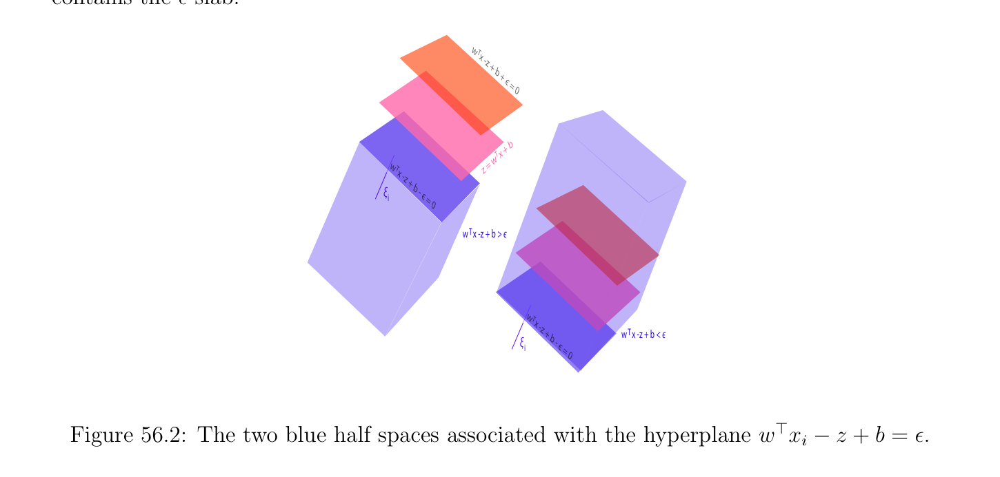
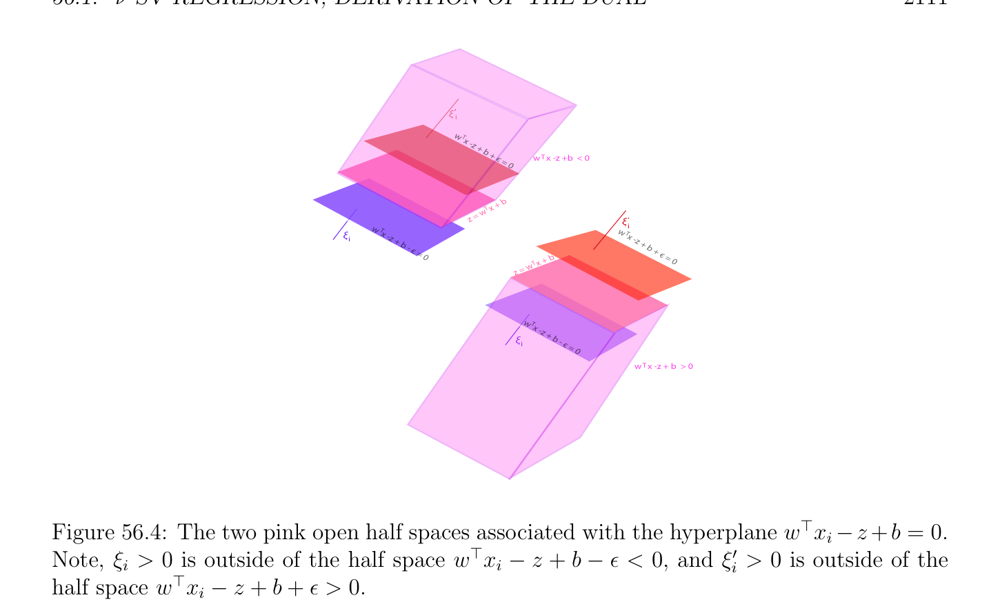
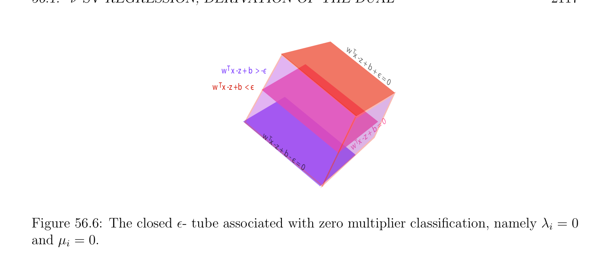

# -SV Hồi quy; Derivation của Đối ngẫu (dual)

<!-- PAGE 2107 -->
Chương $56 \nu$ -SV Hồi quy 56.1 $\nu$ -SV Hồi quy; Derivation của Đối ngẫu (dual) Cho ${(x_{1}, y_{1}), \dots  , (x_{m}, y_{m})}$ là tập hợp của được quan sát dữ liệu thường được gọi là tập hợp của huấn luyện (training) dữ liệu,
$$\mathbb{R}^{n} \mathbb{R}$$
Với $x_{i} \in$ và $y_{i} \in$. Như trong Chương $55$, ta tạo thành ma trận cỡ $m \times  n$ $X$ ở đâu các vectơ hàng $x_{i}^{\top}$ là các hàng của $X$. Của ta mục tiêu là đến learn afin hàm $f$ của tạo thành f(x) $= x^{\top}w + b$ rằng fits tập hợp của huấn luyện (training) dữ liệu, nhưng thực hiện không penalize các sai số ở dưới một số cho trước $\epsilon  \ge 0$. Geometrically, ta quan điểm các cặp $(x_{i}, y_{i})$ là các điểm trong $\mathbb{R}^{n+1}$, và ta thử đến fit siêu phẳng (hyperplane) $H_{w,b}$ của phương trình
$$(w^{\top}-1) \begin{pmatrix} x \\ z \end{pmatrix} + b = w^{\top}x -z + b = 0$$
Rằng tốt nhất fits tập hợp của các điểm $(x_{i}, y_{i})$ (ở đâu $(x, z) \in \mathbb{R}^{n+1})$. Ta seek $\epsilon  > 0$ sao cho hầu hết các điểm $(x_{i}, y_{i})$ là bên trong dải phẳng (slab) (hoặc tube) của chiều rộng $2\epsilon$ bị chặn bởi siêu phẳng (hyperplane) $H_{w,b-\epsilon}$ của phương trình
$$(w^{\top}-1) \begin{pmatrix} x \\ z \end{pmatrix} + b -\epsilon  = w^{\top}x -z + b -\epsilon  = 0$$
Và siêu phẳng (hyperplane) $H_{w,b+\epsilon}$ của phương trình
$$(w^{\top}-1) \begin{pmatrix} x \\ z \end{pmatrix} + b + \epsilon  = w^{\top}x -z + b + \epsilon  = 0.$$
Nhận thấy rằng các siêu phẳng $H_{w,b-\epsilon}, H_{w,b}$ và $H_{w,b+\epsilon}$ giao nhau trục $z$ khi $x = 0$ cho các giá trị $(b$ - $\epsilon , b, b + \epsilon$). Vì $\epsilon  \ge 0$, siêu phẳng (hyperplane) $H_{w,b-\epsilon}$ là ở dưới siêu phẳng (hyperplane) $H_{w,b}$ mà là ở dưới siêu phẳng (hyperplane) $H_{w,b+\epsilon}$. Ta refer đến thấp hơn siêu phẳng (hyperplane) $H_{w,b-\epsilon}$ như xanh lam lề (margin), đến trên siêu phẳng (hyperplane) $H_{w,b+\epsilon}$ như đỏ lề (margin), và đến siêu phẳng (hyperplane) $H_{w,b}$ như tốt nhất fit siêu phẳng (hyperplane). Cũng lưu ý rằng vì số hạng $-z$ xuất hiện trong các phương trình của các phần tử này các siêu phẳng, các điểm cho mà $w^{\top}x$ - $z + b \le 0$ là ở trên siêu phẳng (hyperplane) $H_{w,b}$, và các điểm cho mà $w^{\top}x$ - $z + b \ge 0$ là ở dưới siêu phẳng (hyperplane) $H_{w,b}$ (và tương tự cho $H_{w,b-\epsilon}$ và
$$2107$$

<!-- PAGE 2108 -->
$H_{b+\epsilon})$. miền bị chặn bởi các siêu phẳng $H_{w,b-\epsilon}$ và $H_{b+\epsilon}$ (mà chứa tốt nhất fit siêu phẳng (hyperplane) $H_{w,b})$ được gọi là $\epsilon$ -dải phẳng (slab). Ta cũng cho phép các sai số bởi cho phép điểm $(x_{i}, y_{i})$ là bên ngoài của $\epsilon$ -dải phẳng (slab) nhưng trong dải phẳng (slab) giữa siêu phẳng (hyperplane) $H_{w,b-\epsilon-\xi i}$ của phương trình
$$(w^{\top}-1) \begin{pmatrix} x \\ z \end{pmatrix} + b -\epsilon  -\xi_{i}  = w^{\top}x -z + b -\epsilon  -\xi_{i}  = 0$$
Với một số $\xi_{i}  > 0$ (mà là ở dưới xanh lam lề (margin) siêu phẳng (hyperplane) $H_{w,b-\epsilon})$ và siêu phẳng (hyperplane) $H_{w,b+\epsilon+\xi i'}$ của phương trình
$$(w^{\top}-1) \begin{pmatrix} x \\ z \end{pmatrix} + b + \epsilon  + \xi_{i}'  = w^{\top}x_{i} -z + b + \epsilon  + \xi_{i}'  = 0$$
Với một số $\xi_{i}'  > 0$ (mà là ở trên đỏ lề (margin) siêu phẳng (hyperplane) $H_{w,b+\epsilon})$, sao cho $w^{\top}x_{i}$ - $y_{i} + b$ - $\epsilon$ - $\xi_{i}  \le 0$ và $w^{\top}x_{i}$ - $y_{i} + b + \epsilon  + \xi_{i}'  \ge 0$, nghĩa là,
$$f(x) -y_{i} = w^{\top}x_{i} + b -y_{i} \le \epsilon  + \xi_{i} ,$$
$$-(f(x) -y_{i}) = -w^{\top}x_{i} -b + y_{i} \le \epsilon  + \xi_{i}' .$$
Của ta mục tiêu là để cực tiểu hóa $\epsilon$ và các sai số $\xi_{i}$ và $\xi_{i}'$. Xem Hình 56.1. trade offbetween
$$\xi ‘$$
$$i$$
$$є = 0$$
$$b +$$
$$+$$
$$x -z$$
$$w T$$
$$є$$
$$є$$
$$= 0$$
$$b$$
$$z +$$
$$x -$$
$$wT  = 0$$
$$- є$$
$$b$$
$$z +$$
$$Tx -$$
$$w$$
$$\xi$$
$$i$$

**Hình 56.1:** $\epsilon$ -dải phẳng (slab) xung quanh đồ thị của tốt nhất fit afin hàm f(x) $= x^{\top}w + b$. kích thước của $\epsilon$ và kích thước của bù/lỏng các biến $\xi_{i}$ và $\xi_{i}'$ là đạt được bằng cách sử dụng hai các hằng số $\nu  \ge 0$ và $C > 0$. phương pháp của $\nu$ -hỗ trợ/giá (support) vectơ hồi quy, cho ngắn $\nu$ -SV hồi quy, là specified bởi sau đây cực tiểu hóa bài toán:

<!-- PAGE 2109 -->
Bài toán quy hoạch $\nu$ -SV Hồi quy:
$$minimize \frac{1}{2} w^{\top}w + C \begin{pmatrix} 1 \\ \nu \epsilon  + & (\xi_{i}  + \xi_{i}' ) \\ m \end{pmatrix} \sum_{i=1}^{m}$$
$$subject to$$
$$w^{\top}x_{i} + b -y_{i} \le \epsilon  + \xi_{i} ,\xi_{i}  \ge 0i = 1, \dots  , m$$
$$-w^{\top}x_{i} -b + y_{i} \le \epsilon  + \xi_{i}' ,\xi_{i}'  \ge 0i = 1, \dots  , m$$
$$\epsilon  \ge 0,$$
Cực tiểu hóa trên các biến $w, b, \epsilon , \xi$, và $\xi'$. các ràng buộc là afin. bài toán là để cực tiểu hóa $\epsilon$ và các sai số $\xi_{i} , \xi_{i}'$ sao cho $\ell^{1}$ -sai số là “squeezed xuống” đến không như nhiều như khả dĩ/có thể, trong nghĩa rằng vế phải của bất đẳng thức
$$\sum_{i=1}^{m}  |y_{i} -x_{i}^{\top} w -b| \le m\epsilon  + \sum_{i=1}^{m}  \xi_{i}  + \sum_{i=1}^{m}  \xi_{i}'$$
Là như nhỏ như khả dĩ/có thể. Như được hiển thị bởi Hình 56.2, miền liên kết với ràng buộc $w^{\top}x_{i}$ - $z + b \le \epsilon$ chứa $\epsilon$ -dải phẳng (slab). Tương tự, như được minh họa bởi Hình 56.3, miền liên kết với ràng buộc $w^{\top}x_{i}$ - $z + b \ge -\epsilon$, tương đương $-w^{\top}x_{i} + z$ - $b \le \epsilon$, cũng chứa $\epsilon$ -dải phẳng (slab).
$$w T$$
$$x -$$
$$z + b + є =$$
$$0$$
$$+ b$$
$$wT  x$$
$$w Tz =$$
$$x -$$
$$z + b$$
$$\xi - є$$
$$i= 0$$
$$w   x -z + b > Tє$$
$$w T$$
$$x -$$
$$z + b w   x -z + b < Tє$$
$$\xi - є$$
$$i= 0$$

**Hình 56.2:** hai xanh lam một nửa các không gian liên kết với siêu phẳng (hyperplane) $w^{\top}x_{i}$ - $z + b = \epsilon$. Nhận thấy rằng nếu ta đòi hỏi $\epsilon  = 0$, thì bài toán là tương đương đến cực tiểu hóa
$$\|y -Xw -b1\|_{1} + \frac{1}{2} w^{\top}w.$$
Do đó nó xuất hiện rằng ở trên bài toán là phiên bản của Bài toán quy hoạch (RR3) (xem Mục 55.2) trong mà $\ell^{2}$ -chuẩn (norm) của $y$ -Xw-b1 được thay thế bởi của nó $\ell^{1}$ -chuẩn (norm). Điều này sort của “đối ngẫu (dual)” của lasso

<!-- PAGE 2110 -->
$$\xi  i‘$$
$$w  xT$$
$$-z + b + є =$$
$$0$$
$$w   x - z  + b  > - Tє$$
$$\xi  i‘$$
$$w  Tx$$
$$-z + b$$
$$+ є w   x - z  + b  < - Tє$$
$$= 0$$
$$w  xT$$
$$-z + b$$
$$- є =$$
$$0$$

**Hình 56.3:** hai đỏ một nửa các không gian liên kết với siêu phẳng (hyperplane) $w^{\top}x_{i}$ - $z + b = -\epsilon$. (xem Mục 55.5) ở đâu $(1/2)w^{\top}w = (1/2) \|w\|_{2}^{2}$ được thay thế bởi $\tau  \|w\|_{1}$, và $\|y$ - Xw - $b1\|_{1}$ được thay thế bởi $\|y$ - Xw - $b1\|_{2}^{2}$.

> **Mệnh đề 56.1.** Với mọi nghiệm tối ưu (optimal solution), các phương trình
$$\xi_{i} \xi_{i}'  = 0,i = 1, \dots  , m(\xi \xi' )$$
Đúng. Nếu $\epsilon  > 0$, thì các phương trình
$$w^{\top}x_{i} + b -y_{i} = \epsilon  + \xi_{i}$$
$$-w^{\top}x_{i} -b + y_{i} = \epsilon  + \xi_{i}'$$
Không thể đúng simultaneously.

*Chứng minh.* Cho nghiệm tối ưu (optimal solution) ta có
$$-\epsilon  -\xi_{i}'  \le w^{\top}x_{i} + b -y_{i} \le \epsilon  + \xi_{i} .$$
Nếu $w^{\top}x_{i} + b$ - $y_{i} \ge 0$, thì $\xi_{i}'  = 0$ vì bất đẳng thức
$$-\epsilon  -\xi_{i}'  \le w^{\top}x_{i} + b -y_{i}$$
Là một cách tầm thường được thỏa mãn (bởi vì $\epsilon , \xi_{i}'  \ge 0)$, và nếu $w^{\top}x_{i} + b$ - $y_{i} \le 0$, thì tương tự $\xi_{i}  = 0$. Xem Hình 56.4. Nhận thấy rằng các phương trình
$$w^{\top}x_{i} + b -y_{i} = \epsilon  + \xi_{i}$$
$$-w^{\top}x_{i} -b + y_{i} = \epsilon  + \xi_{i}'$$

<!-- PAGE 2111 -->
$$\xi  i‘$$
$$w  x T$$
$$-z +$$
$$b + є = 0w   x -z +b  < 0T$$
$$+ b$$
$$wT  x$$
$$z = \xi ‘$$
$$w  x Tw  x i$$
$$\xi i-z + T-z$$
$$b - є  + b$$
$$= 0 + є = 0$$
$$x + b$$
$$= w T$$
$$z$$
$$w  x T$$
$$-z +$$
$$\xi ib - є$$
$$= 0$$
$$w   x -z + b  > 0T$$

**Hình 56.4:** hai hồng mở một nửa các không gian liên kết với siêu phẳng (hyperplane) $w^{\top}x_{i} -z +b = 0$. Lưu ý, $\xi_{i}  > 0$ là bên ngoài của một nửa không gian $w^{\top}x_{i}$ - $z + b$ - $\epsilon  < 0$, và $\xi_{i}'  > 0$ là bên ngoài của một nửa không gian $w^{\top}x_{i}$ - $z + b + \epsilon  > 0$. có thể chỉ đúng simultaneously nếu
$$\epsilon  + \xi_{i}  = -\epsilon  -\xi' ,$$
Rằng là,
$$2\epsilon  + \xi_{i}  + \xi_{i}'  = 0,$$
Và vì $\epsilon , \xi_{i} , \xi_{i}'  \ge 0$, điều này có thể xảy ra chỉ nếu $\epsilon  = \xi_{i}  = \xi_{i}'  = 0$, và thì
$$w^{\top}x_{i} + b = y_{i}.$$
Đặc biệt, nếu $\epsilon  > 0$, thì các phương trình
$$w^{\top}x_{i} + b -y_{i} = \epsilon  + \xi_{i}$$
$$-w^{\top}x_{i} -b + y_{i} = \epsilon  + \xi_{i}'$$
Không thể đúng simultaneously. Nhận thấy rằng nếu $\nu  > 1$, thì nghiệm tối ưu (optimal solution) của ở trên bài toán quy hoạch phải cho $\epsilon  = 0$. Thật vậy, nếu $\epsilon  > 0$, ta có thể rút gọn nó bởi nhỏ lượng $\delta  > 0$ và tăng $\xi_{i}  + \xi_{i}'$ bởi $\delta$ đến vẫn thỏa mãn các ràng buộc, nhưng hàm mục tiêu (objective function) thay đổi bởi lượng $-\nu \delta  + \delta$, mà là âm vì $\nu  > 1$, do đó $\epsilon  > 0$ là không tối ưu.

<!-- PAGE 2112 -->
Driving $\epsilon$ đến không là không intended mục tiêu, bởi vì typically dữ liệu là không noise tự do do đó rất một vài các cặp $(x_{i}, y_{i})$ sẽ thỏa mãn phương trình $w^{\top}x_{i} + b = y_{i}$, và thì nhiều các cặp $(x_{i}, y_{i})$ sẽ tương ứng với sai số $(\xi_{i}  > 0$ hoặc $\xi_{i}'  > 0)$. Do đó, typically ta giả sử rằng $0 < \nu  \le 1$. để xây dựng Hàm Lagrange (Lagrangian), ta assign Các nhân tử Lagrange (Lagrange multipliers) $\lambda_{i}  \ge 0$ đến các ràng buộc $w^{\top}x_{i} +b-y_{i} \le \epsilon +\xi_{i}$, Các nhân tử Lagrange (Lagrange multipliers) $\mu_{i}  \ge 0$ đến các ràng buộc $-w^{\top}x_{i} -b+y_{i} \le \epsilon +\xi_{i}'$, Các nhân tử Lagrange (Lagrange multipliers) $\alpha_{i}  \ge 0$ đến các ràng buộc $\xi_{i}  \ge 0$, Các nhân tử Lagrange (Lagrange multipliers) $\beta_{i}  \ge 0$ đến các ràng buộc $\xi_{i}'  \ge 0$, và Nhân tử Lagrange (Lagrange multiplier) $\gamma  \ge 0$ đến ràng buộc $\epsilon  \ge 0$. Hàm Lagrange (Lagrangian) là
$$L(w, b, \lambda , \mu , \gamma , \xi , \xi' , \epsilon , \alpha , \beta ) = \frac{1}{2} w^{\top}w + C \begin{pmatrix} 1 \\ \nu \epsilon  + & (\xi_{i}  + \xi_{i}' ) \\ m \end{pmatrix} \sum_{i=1}^{m}  -\gamma \epsilon  - \sum_{i=1}^{m}  (\alpha_{i} \xi_{i}  + \beta_{i} \xi_{i}' )$$
$$+ \sum_{i=1}^{m}  \lambda_{i} (w^{\top}x_{i} + b -y_{i} -\epsilon  -\xi_{i} ) + \sum_{i=1}^{m}  \mu_{i} (-w^{\top}x_{i} -b + y_{i} -\epsilon  -\xi_{i}' ).$$
Hàm Lagrange (Lagrangian) có thể cũng được viết như
$$!!$$
$$L(w, b, \lambda , \mu , \gamma , \xi , \xi' , \epsilon , \alpha , \beta ) = \frac{1}{2} w^{\top}w + w^{\top} \sum_{i=1}^{m}  (\lambda_{i}  -\mu_{i} )x_{i}+ \epsilon C\nu  -\gamma  - \sum_{i=1}^{m}  (\lambda_{i}  + \mu_{i} )$$
$$!$$
$$+ \sum_{i=1}^{m}  \xi_{i} \begin{pmatrix} C \\ -\lambda_{i}  -\alpha_{i} \\ m \end{pmatrix} + \sum_{i=1}^{m}  \xi_{i}' \begin{pmatrix} C \\ -\mu_{i}  -\beta_{i} \\ m \end{pmatrix} + b \sum_{i=1}^{m}  (\lambda_{i}  -\mu_{i} )- \sum_{i=1}^{m}  (\lambda_{i}  -\mu_{i} )y_{i}.$$
Để tìm đối ngẫu (dual) hàm $G(\lambda , \mu , \gamma , \alpha , \beta$), ta cực tiểu hóa L(w, $b, \lambda , \mu , \gamma , \xi , \xi' , \epsilon , \alpha , \beta$) đối với gốc (primal) các biến $w, \epsilon , b, \xi$ và $\xi'$. Nhận thấy rằng Hàm Lagrange (Lagrangian) là lồi, và
$$\mathbb{R}^{n} \mathbb{R}\mathbb{R}^{m} \mathbb{R}^{m} \mathbb{R}$$
Vì $(w, \epsilon , \xi , \xi' , b) \in \times  \times \times \times$, lồi tập mở (open set), theo Định lý 40.13, Hàm Lagrange (Lagrangian) có cực tiểu khi và chỉ khi $\nabla L_{w,\epsilon ,b,\xi ,\xi'} = 0$, do đó ta tính gradien $\nabla L_{w,\epsilon ,b,\xi ,\xi'}$. Ta thu được
$$\sum_{i}$$
$$\sum_{ii}^{=1}$$
$$\nabla L_{w,\epsilon ,b,\xi ,\xi'} = \begin{pmatrix} w + & m(\lambda_{i}  -\mu_{i} )x_{i} \\ C\nu  -\gamma  - & m(\lambda_{i}  + \mu_{i} ) \\ =1 \\ m(\lambda  -\mu_{i} ) \\ =1 \\ \overline{m}-\lambda  -\alpha \\ C & \mu & \beta \end{pmatrix} \sum_{Ci}  ,$$
$$- -$$
$$\overline{m}$$
Ở đâu
$$\begin{pmatrix} C \\ -\lambda  -\alpha \\ m \end{pmatrix} = \frac{C}{m} -\lambda_{i}  -\alpha_{i} ,and \begin{pmatrix} C \\ -\mu  -\beta \\ m \end{pmatrix} = \frac{C}{m} -\mu_{i}  -\beta_{i} .$$
$$ii$$

<!-- PAGE 2113 -->
Hệ quả là, nếu ta tập hợp $\nabla L_{w,\epsilon ,b,\xi ,\xi'} = 0$, ta thu được các phương trình
$$w = \sum_{i=1}^{m}  (\mu_{i}  -\lambda_{i} )x_{i} = X^{\top}(\mu  -\lambda ),(*_{w})$$
$$C\nu  -\gamma  - \sum_{i=1}^{m}  (\lambda_{i}  + \mu_{i} ) = 0$$
$$\sum_{i=1}^{m}  (\lambda_{i}  -\mu_{i} ) = 0$$
$$\frac{C}{m} -\lambda  -\alpha  = 0, \frac{C}{m} -\mu  -\beta  = 0.$$
Thế ở trên các phương trình trong thứ hai biểu thức cho Hàm Lagrange (Lagrangian), ta tìm rằng đối ngẫu (dual) hàm $G$ là độc lập của các biến $\gamma , \alpha , \beta$ và được cho bởi
$$G(\lambda , \mu ) = - \frac{1}{2} \sum_{i,j=1}^{m}  (\lambda_{i}  -\mu_{i} )(\lambda_{j}  -\mu_{j} )x_{i}^{\top} x_{j} - \sum_{i=1}^{m}  (\lambda_{i}  -\mu_{i} )y_{i}$$
Nếu
$$\sum_{i=1}^{m}  \lambda_{i}  - \sum_{i=1}^{m}  \mu_{i}  = 0$$
$$\sum_{i=1}^{m}  \lambda_{i}  + \sum_{i=1}^{m}  \mu_{i}  + \gamma  = C\nu$$
$$\lambda  + \alpha  = \frac{C}{m} ,\mu  + \beta  = \frac{C}{m} ,$$
Và $-\infty$ ngược lại. đối ngẫu (dual) bài toán quy hoạch là thu được bởi cực đại hóa $G(\alpha , \mu$) hoặc tương đương bởi cực tiểu hóa $-G(\alpha , \mu$), trên $\alpha , \mu  \in \mathbb{R}_{+}^{m}$. Lấy vào account sự kiện rằng $\alpha , \beta  \ge 0$ và $\gamma  \ge 0$, ta thu được kết quả sau đối ngẫu (dual) bài toán quy hoạch: Đối ngẫu (dual) Bài toán quy hoạch cho $\nu$ -SV Hồi quy:
$$minimize \frac{1}{2} \sum_{i,j=1}^{m}  (\lambda_{i}  -\mu_{i} )(\lambda_{j}  -\mu_{j} )x_{i}^{\top} x_{j} + \sum_{i=1}^{m}  (\lambda_{i}  -\mu_{i} )y_{i}$$
$$subject to$$
$$\sum_{i=1}^{m}  \lambda_{i}  - \sum_{i=1}^{m}  \mu_{i}  = 0$$
$$\sum_{i=1}^{m}  \lambda_{i}  + \sum_{i=1}^{m}  \mu_{i}  \le C\nu$$
$$0 \le \lambda_{i}  \le \frac{C}{m} ,0 \le \mu_{i}  \le \frac{C}{m} ,i = 1, \dots  , m,$$

<!-- PAGE 2114 -->
Cực tiểu hóa trên $\alpha$ và $\mu$. Việc giải đối ngẫu (dual) bài toán quy hoạch (ví dụ, bằng cách sử dụng ADMM, xem Mục 56.3) thực hiện không xác định $b$, và cho điều này ta sử dụng KKT các điều kiện. KKT các điều kiện (cho gốc (primal) bài toán quy hoạch) là
$$\lambda_{i} (w^{\top}x_{i} + b -y_{i} -\epsilon  -\xi_{i} ) = 0,i = 1, \dots  , m$$
$$\mu_{i} (-w^{\top}x_{i} -b + y_{i} -\epsilon  -\xi_{i}' ) = 0,i = 1, \dots  , m$$
$$\gamma \epsilon  = 0$$
$$\alpha_{i} \xi_{i}  = 0,i = 1, \dots  , m$$
$$\beta_{i} \xi_{i}'  = 0,i = 1, \dots  , m.$$
Nếu $\epsilon  > 0$, vì các phương trình
$$w^{\top}x_{i} + b -y_{i} = \epsilon  + \xi_{i}$$
$$-w^{\top}x_{i} -b + y_{i} = \epsilon  + \xi_{i}'$$
Không thể đúng simultaneously, ta phải có
$$\lambda_{i} \mu_{i}  = 0,i = 1, \dots  , m.(\lambda \mu )$$
Từ các phương trình
$$\lambda_{i}  + \alpha_{i}  = \frac{C}{m} ,\mu_{i}  + \beta_{i}  = \frac{C}{m} ,\alpha_{i} \xi_{i}  = 0,\beta_{i} \xi_{i}'  = 0,$$
Ta thu được các phương trình
$$\begin{pmatrix} C \\ -\lambda_{i} \\ m \end{pmatrix} \xi_{i}  = 0, \begin{pmatrix} C \\ -\mu_{i} \\ m \end{pmatrix} \xi_{i}'  = 0,i = 1, \dots  , m.(*)$$
Giả sử ta có nghiệm tối ưu (optimal solution) với $\epsilon  > 0$. Bằng cách sử dụng ở trên các phương trình và sự kiện rằng $\lambda_{i} \mu_{i}  = 0$ ta thu được kết quả sau phân loại của các điểm $x_{i}$ theo $\lambda$ và $\mu$.
$(1) 0 < \lambda_{i}  < C/m$. Bởi (*), $\xi_{i}  = 0$, do đó phương trình $w^{\top}x_{i} + b$ - $y_{i} = \epsilon$ nghiệm đúng và $x_{i}$ là trên xanh lam lề (margin) siêu phẳng (hyperplane) $H_{w,b-\epsilon}$. Xem Hình 56.5.
$(2) 0 < \mu_{i}  < C/m$. Bởi (*), $\xi_{i}'  = 0$, do đó phương trình $-w^{\top}x_{i}$ - $b + y_{i} = \epsilon$ nghiệm đúng và $x_{i}$ là trên đỏ lề (margin) siêu phẳng (hyperplane) $H_{w,b+\epsilon}$. Xem Hình 56.5.
$(3) \lambda_{i}  = C/m$. Bởi $(\lambda \mu$), $\mu_{i}  = 0$, và bởi (*), $\xi_{i}'  = 0$. Do đó ta có
$$w^{\top}x_{i} + b -y_{i} = \epsilon  + \xi_{i}$$
$$-w^{\top}x_{i} -b + y_{i} \le \epsilon .$$
Thứ hai bất đẳng thức là tương đương đến $-\epsilon  \le w^{\top}x_{i} + b$ - $y_{i}$, và vì $\epsilon  > 0$ và $\xi_{i}  \ge 0$ nó là một cách tầm thường được thỏa mãn. Nếu $\xi_{i}  = 0$, thì $x_{i}$ là trên xanh lam lề (margin) $H_{w,b-\epsilon}$, khác $x_{i}$ là sai số và nó lies trong mở nửa không gian (half-space) bị chặn bởi xanh lam lề (margin) $H_{w,b-\epsilon}$ và không chứa tốt nhất fit siêu phẳng (hyperplane) $H_{w,b}$ (nó là bên ngoài của $\epsilon$ -dải phẳng (slab)). Xem Hình 56.5.

<!-- PAGE 2115 -->
$(4) \mu_{i}  = C/m$. Bởi $(\lambda \mu$), $\lambda_{i}  = 0$, và bởi (*), $\xi_{i}  = 0$. Do đó ta có
$$w^{\top}x_{i} + b -y_{i} \le \epsilon$$
$$-w^{\top}x_{i} -b + y_{i} = \epsilon  + \xi_{i}' .$$
Phương trình thứ hai là tương đương đến $w^{\top}x_{i} + b$ - $y_{i} = -\epsilon$ - $\xi_{i}'$, và vì $\epsilon  > 0$ và $\xi_{i}'  \ge 0$, thứ nhất bất đẳng thức nó là một cách tầm thường được thỏa mãn. Nếu $\xi_{i}'  = 0$, thì $x_{i}$ là trên đỏ lề (margin) $H_{w,b+\epsilon}$, khác $x_{i}$ là sai số và nó lies trong mở nửa không gian (half-space) bị chặn bởi đỏ lề (margin) $H_{w,b-\epsilon}$ và không chứa tốt nhất fit siêu phẳng (hyperplane) $H_{w,b}$ (nó là bên ngoài của $\epsilon$ -dải phẳng (slab)). Xem Hình 56.5.
$(5) \lambda_{i}  = 0$ và $\mu_{i}  = 0$. Bởi (*), $\xi_{i}  = 0$ và $\xi_{i}'  = 0$, do đó ta có
$$w^{\top}x_{i} + b -y_{i} \le \epsilon$$
$$-w^{\top}x_{i} -b + y_{i} \le \epsilon ,$$
Rằng là
$$-\epsilon  \le w^{\top}x_{i} + b -y_{i} \le \epsilon .$$
Nếu $w^{\top}x_{i} + b$ - $y_{i} = \epsilon$, thì $x_{i}$ là trên xanh lam lề (margin), và nếu $w^{\top}x_{i} + b$ - $y_{i} = -\epsilon$, thì $x_{i}$ là trên đỏ lề (margin). Nếu $-\epsilon  < w^{\top}x_{i} + b$ - $y_{i} < \epsilon$, thì $x_{i}$ là chặt bên trong của $\epsilon$ -dải phẳng (slab) (bị chặn bởi xanh lam lề (margin) và đỏ lề (margin)). Xem Hình 56.6. ở trên phân loại chỉ ra rằng điểm $x_{i}$ là sai số khi và chỉ khi $\lambda_{i}  = C/m$ và $\xi_{i}  > 0$ hoặc hoặc $\mu_{i}  = C/m$ và $\xi_{i}'  > 0$. Như trong trường hợp của SVM (xem Mục 50.6) ta định nghĩa hỗ trợ/giá (support) các vectơ như sau.

> **Định nghĩa 56.1.** vectơ $x_{i}$ sao cho hoặc $w^{\top}x_{i} + b$ - $y_{i} = \epsilon$ (mà suy ra $\xi_{i}  = 0)$ hoặc $-w^{\top}x_{i} -b+y_{i} = \epsilon$ (mà suy ra $\xi_{i}'  = 0)$ được gọi là một hỗ trợ/giá (support) vectơ. Hỗ trợ/giá (support) các vectơ $x_{i}$ sao cho $0 < \lambda_{i}  < C/m$ và hỗ trợ/giá (support) các vectơ $x_{j}$ sao cho $0 < \mu_{j}  < C/m$ là hỗ trợ/giá (support) các vectơ của loại/kiểu $1$. Hỗ trợ/giá (support) các vectơ của loại/kiểu $1$ đóng đặc biệt vai trò do đó ta ký hiệu các tập hợp của các chỉ số liên kết với chúng bởi
$$I_{\lambda} = {i \in {1, \dots  , m} | 0 < \lambda_{i}  < C/m}$$
$$I_{\mu} = {j \in {1, \dots  , m} | 0 < \mu_{j}  < C/m}.$$
Ta ký hiệu của chúng cardinalities bởi $numsvl_{1} = |I_{\lambda}|$ và $numsvm_{1} = |I_{\mu}|$. Hỗ trợ/giá (support) các vectơ $x_{i}$ sao cho $\lambda_{i}  = C/m$ và hỗ trợ/giá (support) các vectơ $x_{j}$ sao cho $\mu_{j}  = C/m$ là hỗ trợ/giá (support) các vectơ của loại/kiểu $2$. Hỗ trợ/giá (support) các vectơ cho mà $\lambda_{i}  = \mu_{i}  = 0$ được gọi là exceptional hỗ trợ/giá (support) các vectơ. sau đây định nghĩa cũng cho hữu ích phân loại tiêu chuẩn.

> **Định nghĩa 56.2.** điểm $x_{i}$ sao cho hoặc $\lambda_{i}  = C/m$ hoặc $\mu_{i}  = C/m$ được nói đến thất bại lề (margin). các tập hợp của các chỉ số liên kết với các vectơ thất bại lề (margin) được ký hiệu bởi
$$K_{\lambda} = {i \in {1, \dots  , m} | \lambda_{i}  = C/m}$$
$$K_{\mu} = {j \in {1, \dots  , m} | \mu_{j}  = C/m}.$$

<!-- PAGE 2116 -->
$$w   x -z + b + Tє = 00 <      < C/m\mu i$$
$$(x  , y  )iiw   x -z + b + Tє = 0$$
$$(x  , y  ) + bb$$
$$iiwT  xTx +$$
$$0 <      < C/m\lambda iz = = w$$
$$Tz$$
$$w   x -z +b - є = 0$$
$$Case (1)w   x -z +b - Tє = 0$$
$$Case (2)$$
$$\lambda i = C/mw   x -z +b + є = 0Tw   x -z +b + є = 0T$$
$$\xi  i= 0$$
$$+  + b$$
$$(x  , y  )wT  x bwT  x$$
$$iiz = z =$$
$$\xi i$$
$$w   x -z + b - є = 0T(x  , y  )$$
$$ii\lambda i = C/m$$
$$w   x -z + b - є = 0T$$
$$Case (3)\xi i > 0$$
$$\mu i = C/m(x  , y  )$$
$$\xi ‘= 0w   x -z +b +є = 0T\mu i = C/mii$$
$$i\xi ‘ > 0\xi ‘$$
$$(x  , y  )iiii$$
$$w   x -z +b + є = 0T$$
$$+ b$$
$$wT  x$$
$$z = + b$$
$$wT  x$$
$$w   x -z + b - є = 0TCase (4)z =$$
$$w   x -z + b - є = 0T$$
$$Figure 56.5: Classifying x_{i} in terms of nonzero \lambda  and \mu .$$
Ta ký hiệu của chúng cardinalities bởi $p_{f} = |K_{\lambda}|$ và $q_{f} = |K_{\mu}|$. Các vectơ $u_{i}$ sao cho $\lambda_{i}  > 0$ và các vectơ $v_{j}$ sao cho $\mu_{j}  > 0$ được nói đến có lề (margin) nhiều nhất $\epsilon$. điểm $x_{i}$ sao cho hoặc $\lambda_{i}  > 0$ hoặc $\mu_{i}  > 0$ được nói đến có lề (margin) nhiều nhất $\epsilon$. các tập hợp của các chỉ số liên kết với các vectơ này được ký hiệu bởi
$$I_{\lambda >0} = {i \in {1, \dots  , m} | \lambda_{i}  > 0}$$
$$I_{\mu >0} = {j \in {1, \dots  , m} | \mu_{j}  > 0}.$$
Ta ký hiệu của chúng cardinalities bởi $p_{m} = |I_{\lambda >0}|$ và $q_{m} = |I_{\mu >0}|$. Các điểm rằng thất bại lề (margin) và là không trên biên (boundary) của $\epsilon$ -dải phẳng (slab) lie bên ngoài đóng $\epsilon$ -dải phẳng (slab), do đó chúng là các sai số, cũng được gọi là outliers; chúng tương ứng với $\xi_{i}  > 0$ hoặc $\xi_{i}'  > 0$. Nhận thấy rằng ta có các phương trình $I_{\lambda} \cup K_{\lambda} = I_{\lambda >0}$ và $I_{\mu} \cup K_{\mu} = I_{\mu >0}$, và các bất đẳng thức $p_{f} \le p_{m}$ và $q_{f} \le q_{m}$. Ta cũng có sau đây các kết quả chỉ ra rằng $p_{f}, q_{f}, p_{m}$ và $q_{m}$ có trực tiếp influence trên lựa chọn của $\nu$.

> **Mệnh đề 56.2.**
$(1)$ Cho $p_{f}$ là số của các điểm $x_{i}$ sao cho $\lambda_{i}  = C/m$, và cho $q_{f}$ là số của các điểm $x_{i}$ sao cho $\mu_{i}  = C/m$. Ta có $p_{f}, q_{f} \le (m\nu )/2$.

<!-- PAGE 2117 -->
$$w T$$
$$x$$
$$-z +$$
$$T b +$$
$$w   x -z + b  > -є є = 0$$
$$w   x -z +b  < єT$$
$$= 0$$
$$b$$
$$w z +$$
$$Txx -$$
$$-z + w  T$$
$$b - є = 0$$

**Hình 56.6:** đóng $\epsilon$ - tube liên kết với không nhân tử phân loại, cụ thể là $\lambda_{i}  = 0$ và $\mu_{i}  = 0$.
$(2)$ Cho $p_{m}$ là số của các điểm $x_{i}$ sao cho $\lambda_{i}  > 0$, và cho $q_{m}$ là số của các điểm $x_{i}$ sao cho $\mu_{i}  > 0$. Ta có $p_{m}, q_{m} \ge (m\nu )/2$.
$(3)$ Nếu $p_{f} \ge 1$ hoặc $q_{f} \ge 1$, thì $\nu  \ge 2/m$.

*Chứng minh.* $(1)$ Nhắc lại rằng cho nghiệm tối ưu (optimal solution) với $w \neq  0$ và $\epsilon  > 0$ ta có $\gamma  = 0$, do đó ta có các phương trình
$$\sum_{i=1}^{m}  \lambda_{i}  = \frac{C\nu}{2} and \sum_{j=1}^{m}  \mu_{j}  = \frac{C\nu}{2} .$$
Nếu có $p_{f}$ các điểm sao cho $\lambda_{i}  = C/m$, thì
$$\frac{C\nu}{2} = \sum_{i=1}^{m}  \lambda_{i}  \ge p_{f} \frac{C}{m} ,$$
Do đó
$$p_{f} \le \frac{m\nu}{2} .$$
Đồng dạng lập luận áp dụng nếu có $q_{f}$ các điểm sao cho $\mu_{i}  = C/m$, và ta thu được
$$q_{f} \le \frac{m\nu}{2} .$$
$(2)$ Nếu $I_{\lambda >0} = {i \in {1, \dots  , m}$ | $\lambda_{i}  > 0}$ và $p_{m} = |I_{\lambda >0}|$, thì
$$\frac{C\nu}{2} = \sum_{i=1}^{m}  \lambda_{i}  = \sum_{i\in I\lambda >0}  \lambda_{i} ,$$
Và vì $\lambda_{i}  \le C/m$, ta có
$$\frac{C\nu}{2} = \sum_{i\in I\lambda >0}  \lambda_{i}  \le p_{m} \frac{C}{m} ,$$
