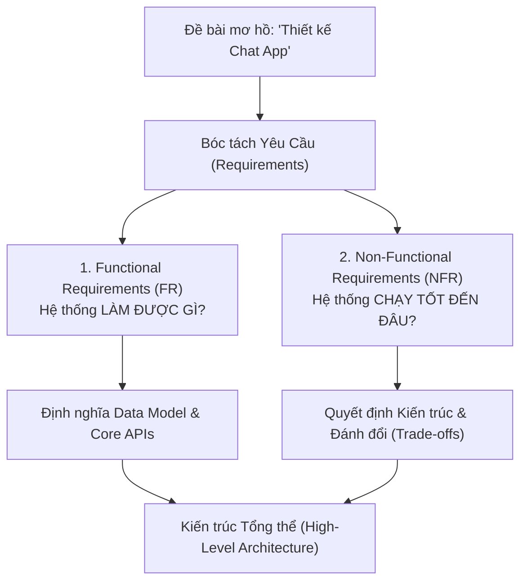
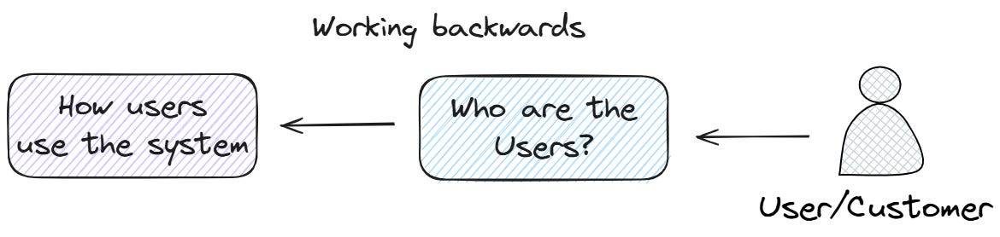

# Tuần 1: Xác Định Yêu Cầu (Requirements Gathering)
> **Nền tảng của một thiết kế hệ thống tốt (The Foundation of Good System Design)**  
> **Tác giả:** Franco Fernando (*The Polymathic Engineer* - Issue 135)  
> **Link bài gốc:** [newsletter.francofernando.com/p/requirements-the-foundation-of-good](https://newsletter.francofernando.com/p/requirements-the-foundation-of-good)  
> **Tệp gốc lưu trữ:** [HTML](file:///Users/kaka/learning/software_development/system_design/html/01_xac_dinh_yeu_cau.html) | [Markdown gốc](file:///Users/kaka/learning/software_development/system_design/original_markdown/01_xac_dinh_yeu_cau.md)

---

## 📌 Lời mở đầu

Hãy tưởng tượng bạn đang trong một buổi phỏng vấn System Design, người phỏng vấn đưa ra một yêu cầu ngắn gọn: **"Hãy thiết kế một hệ thống nhắn tin (Messaging System)."**

Phản xạ đầu tiên của nhiều kỹ sư là lao ngay vào tìm giải pháp kỹ thuật:
- *"Có nên dùng Apache Kafka không?"*
- *"Cần bao nhiêu con Load Balancer?"*
- *"Dùng Redis hay Cassandra để lưu tin nhắn?"*
- *"Cần bao nhiêu cụm máy chủ?"*

Tuy nhiên, nếu bạn bắt đầu ngay bằng công nghệ, bạn đã bỏ lỡ **bước quan trọng nhất** trong toàn bộ quy trình thiết kế. Ngay cả câu trả lời kỹ thuật tinh vi nhất cũng trở nên vô nghĩa nếu bạn không làm rõ hệ thống thực sự cần giải quyết bài toán gì.

> [!IMPORTANT]
> Trong phỏng vấn cũng như trong thực tế dự án: **Không có giải pháp tốt nhất, chỉ có giải pháp phù hợp nhất với các ràng buộc và yêu cầu.**

---

## 1. Tại Sao Xác Định Yêu Cầu Lại Là Bước Sống Còn?

### 1.1. Xử lý tính mơ hồ (Dealing with Ambiguity)
Người phỏng vấn cố tình dùng câu hỏi ngắn và mơ hồ (*"Design Twitter"*, *"Design YouTube"*, *"Build a Chat App"*). Họ không lười biếng, mà họ đang kiểm tra:
- Khả năng đương đầu với sự không rõ ràng.
- Khả năng bóc tách một hệ thống phức tạp thành các thành phần khả thi.
- Kỹ năng đặt đúng câu hỏi đào sâu trước khi ra quyết định.

Trong thực tế, Product Manager (PM) hay các bên liên quan (stakeholders) thường đưa ra mục tiêu kinh doanh rất rộng, còn người dùng thì không biết diễn đạt chính xác nhu cầu kỹ thuật của họ. Học cách làm chủ sự mơ hồ là kỹ năng cốt lõi của một Senior/Staff Engineer.

### 1.2. Yêu cầu là "kim chỉ nam" cho mọi quyết định kiến trúc
Khi đã thống nhất được các yêu cầu, chúng sẽ định hình mọi lựa chọn công nghệ tiếp theo:
- **Khả năng mở rộng (Scalability):** Cần xử lý 100 triệu tin nhắn/ngày $\rightarrow$ Phải phân vùng (partition) tin nhắn qua nhiều queue, tránh điểm nghẽn đơn lẻ (single bottleneck).
- **Tính sẵn sàng cao (High Availability):** Uptime 99.9% $\rightarrow$ Bắt buộc phải có nhân bản (replication: Leader-based hay Leaderless).
- **Giao tin độ trễ thấp (Fast / Low Latency):** Nhận tin trong < 100ms $\rightarrow$ Cần cân nhắc WebSocket, connection pooling, batching và compression.

Nếu không có yêu cầu, mọi quyết định kỹ thuật của bạn đều là **ngẫu nhiên (arbitrary)** và bạn không thể biện hộ (defend) cho kiến trúc của mình.



---

## 2. Yêu Cầu Chức Năng (Functional Requirements - FRs)

**Yêu cầu chức năng** mô tả các tính năng và hành vi cụ thể mà hệ thống phải có: người dùng có thể làm gì và hệ thống phản hồi lại điều gì. Đây giống như bản mô tả công việc (job description) của hệ thống.

Ví dụ với hệ thống Chat:
- Người dùng có thể gửi tin nhắn văn bản 1-1 tới người dùng khác.
- Người dùng có thể tạo nhóm chat (Group Chat) và gửi tin nhắn nhóm.
- Hệ thống lưu trữ lịch sử tin nhắn.
- Người nhận nhận được thông báo đẩy (push notification) khi có tin nhắn mới.
- Người gửi thấy trạng thái: Đã gửi (Sent) $\rightarrow$ Đã nhận (Delivered) $\rightarrow$ Đã xem (Read).

### Phương pháp "Working Backwards" của Amazon
Đừng cố gắng thiết kế toàn bộ tính năng của WhatsApp hay Slack trong 45 phút. Hãy áp dụng tư duy **Working Backwards**:
1. **Ai là người dùng (Actors/Customers)?** (End users, Admin, hay hệ thống dịch vụ nội bộ?)
2. **Hành trình chính của họ là gì (User Journeys)?**
3. **Phạm vi (Scope):** Tính năng nào thuộc MVP (P0), tính năng nào để phiên bản sau (P1, P2)?



### Chuyển đổi FRs thành API Interfaces
Sau khi thống nhất FRs, hãy thể hiện chúng thành các API cụ thể (REST hoặc RPC):
```http
POST   /v1/messages                # Gửi tin nhắn mới
GET    /v1/conversations/{id}      # Lấy lịch sử hội thoại
POST   /v1/conversations           # Tạo nhóm chat mới
POST   /v1/messages/{id}/read      # Đánh dấu đã đọc
```

---

## 3. Yêu Cầu Phi Chức Năng (Non-Functional Requirements - NFRs)

Nếu FRs là *"Hệ thống làm gì"*, thì NFRs là *"Hệ thống chạy tốt đến đâu"* (How well it behaves). Trong các buổi phỏng vấn, NFRs thường **không được nêu sẵn**, người phỏng vấn mong chờ bạn tự chủ động đặt câu hỏi và đưa ra các chỉ số.

### Bảng 7 Trụ Cột NFRs Cần Thu Thập:

| Trụ cột NFR | Câu hỏi cần làm rõ | Chỉ số đo lường (Metrics) | Tác động kiến trúc |
| :--- | :--- | :--- | :--- |
| **1. Scalability (Mở rộng)** | Số người dùng hàng ngày (DAU)? Tỉ lệ Đọc/Ghi? | DAU, QPS (Read/Write), Peak QPS | Cần Sharding database, Horizontal scaling, Message Queue |
| **2. Availability (Sẵn sàng)** | Hệ thống có chấp nhận downtime không? | SLA 99.9% (3 số 9) vs 99.99% (4 số 9) | Cần Multi-region, Active-Active, Failover, Replication |
| **3. Latency (Độ trễ)** | Phản hồi trong bao lâu là chấp nhận được? | P50 < 50ms, P99 < 200ms | Dùng Caching (Redis), CDN, WebSocket, Indexing |
| **4. Consistency (Nhất quán)** | Dữ liệu phải tức thì hay chấp nhận trễ? | Strong Consistency vs Eventual Consistency | Chọn cơ chế Database, CAP Theorem, Quorum reads/writes |
| **5. Durability (Bền vững)** | Tin nhắn đã gửi có được phép mất không? | 0% Data Loss (RPO = 0) | WAL (Write-Ahead Logging), Persistent Storage, Backup |
| **6. Security (Bảo mật)** | Dữ liệu nhạy cảm ra sao? | Mã hóa E2EE, TLS 1.3, Auth JWT/OAuth2 | End-to-End Encryption, Rate Limiting, RBAC |
| **7. Cost (Chi phí)** | Ngân sách hạ tầng có bị giới hạn không? | Server footprint, Storage cost/GB | Data retention policy, Cold/Hot storage tiering |

---

## 4. Phân Tích Đánh Đổi (Trade-offs Analysis)

Thiết kế hệ thống không có giải pháp hoàn hảo, chỉ có các quyết định đánh đổi:

1. **Availability vs Consistency (Định lý CAP):**
   - Hệ thống chat: Tin nhắn đến trễ 1 vài giây (Eventual Consistency) chấp nhận được hơn là toàn bộ hệ thống sập không thể chat (Availability).
   - Hệ thống thanh toán/ngân hàng: Bắt buộc Strong Consistency, chấp nhận từ chối giao dịch nếu không đảm bảo tính toàn vẹn.
2. **Latency vs Cost:**
   - Đặt toàn bộ dữ liệu lên In-Memory Cache (RAM) mang lại độ trễ microsecond nhưng chi phí RAM đắt hơn gấp 10-20 lần so với SSD.
   - Giải pháp dung hòa: Áp dụng quy tắc 80/20 (chỉ cache 20% dữ liệu hot nhất).
3. **Complexity vs Time-to-Market:**
   - Thiết kế Microservices phức tạp ngay từ ngày đầu thường dẫn đến thất bại do gánh nặng vận hành. Một Modular Monolith gọn gàng giúp release nhanh và dễ tối ưu giai đoạn đầu.

---

## 📋 Checklist Thực Hành Khi Nhận Đề Bài System Design

- [ ] **Bước 1 (1-2 phút):** Lắng nghe đề bài, không vội vẽ sơ đồ.
- [ ] **Bước 2 (3-5 phút):** Hỏi để chốt **3-4 Functional Requirements** quan trọng nhất.
- [ ] **Bước 3 (3-5 phút):** Thu thập và tính toán **Non-Functional Requirements** (DAU, QPS, Storage, SLA).
- [ ] **Bước 4 (2 phút):** Liệt kê các API chính tương ứng với FRs.
- [ ] **Bước 5:** Bắt đầu vẽ High-Level Diagram phục vụ chính xác các yêu cầu vừa chốt.
