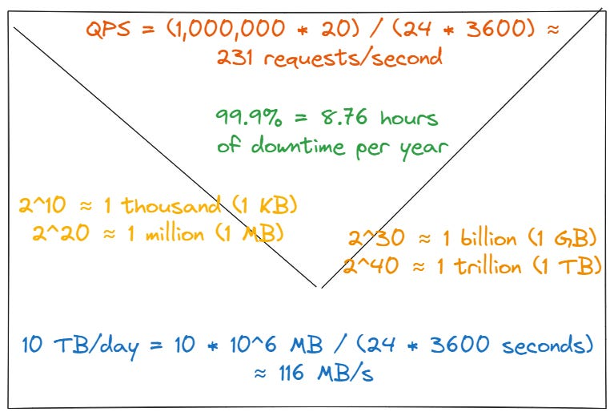

# Tuần 2: Ước Tính Nhanh Quy Mô Hệ Thống (Back-of-the-Envelope Estimation)
> **Cách tính toán dung lượng, băng thông và hiệu năng trước khi thiết kế hệ thống**  
> **Tác giả:** Franco Fernando (*The Polymathic Engineer* - Issue 115)  
> **Link bài gốc:** [newsletter.francofernando.com/p/back-of-the-envelope](https://newsletter.francofernando.com/p/back-of-the-envelope)  
> **Tệp gốc lưu trữ:** [HTML](file:///Users/kaka/learning/software_development/system_design/html/02_uoc_tinh_quy_mo.html) | [Markdown gốc](file:///Users/kaka/learning/software_development/system_design/original_markdown/02_uoc_tinh_quy_mo.md)

---

## 📌 Lời mở đầu

"Ước tính trên phong bì" (**Back-of-the-envelope calculation**) là thuật ngữ bắt nguồn từ nhà vật lý Enrico Fermi. Trong ngành kỹ thuật phần mềm, đây là kỹ năng dùng toán học đơn giản, các giả định hợp lý và các quy tắc ngón tay cái (rules of thumb) để **ước tính nhanh quy mô hệ thống (traffic, storage, memory, bandwidth)** trước khi bắt tay vào viết mã hay lựa chọn kiến trúc.

> [!TIP]
> Mục tiêu của tính toán nhẩm **không phải là độ chính xác tuyệt đối đến từng byte**, mà là để xác định **bậc quy mô (order of magnitude)**: Hệ thống của bạn là 100 QPS hay 100,000 QPS? Lưu trữ 100 GB hay 100 TB? Câu trả lời sẽ quyết định bạn dùng 1 máy chủ MySQL đơn lẻ hay phải dùng cụm phân tán sharding đa vùng.

---

## 1. Bảng Số Mũ Cơ Số 2 & Đơn Vị Lưu Trữ (Powers of Two)

Trong khoa học máy tính, việc ghi nhớ các mốc lũy thừa cơ số 2 giúp bạn quy đổi dung lượng trong vài giây:

| Lũy thừa | Giá trị chính xác | Giá trị xấp xỉ | Tên gọi | Ký hiệu |
| :--- | :--- | :--- | :--- | :--- |
| $2^{10}$ | 1,024 | $\approx 10^3$ (1 Nghìn) | 1 Kilobyte | 1 KB |
| $2^{20}$ | 1,048,576 | $\approx 10^6$ (1 Triệu) | 1 Megabyte | 1 MB |
| $2^{30}$ | 1,073,741,824 | $\approx 10^9$ (1 Tỷ) | 1 Gigabyte | 1 GB |
| $2^{40}$ | 1,099,511,627,776 | $\approx 10^{12}$ (1 Nghìn tỷ) | 1 Terabyte | 1 TB |
| $2^{50}$ | 1,125,899,906,842,624 | $\approx 10^{15}$ (1 Triệu tỷ) | 1 Petabyte | 1 PB |

---

## 2. Các Con Số Độ Trễ Mọi Lập Trình Viên Cần Biết (Latency Numbers)

Bảng số liệu kinh điển do **Jeff Dean (Google)** đúc kết, giúp kỹ sư hiểu được sự chênh lệch khủng khiếp giữa CPU Cache, RAM, SSD và Network:

| Thao tác phần cứng | Thời gian thực tế | Quy đổi trực quan (nếu 1 chu kỳ CPU = 1 giây) |
| :--- | :--- | :--- |
| **L1 cache reference** | 0.5 ns | 0.5 giây |
| **Branch mispredict** | 5 ns | 5 giây |
| **L2 cache reference** | 7 ns | 7 giây |
| **Mutex lock / unlock** | 25 ns | 25 giây |
| **Main memory (RAM) reference** | **100 ns** | **1.7 phút** |
| **Đọc tuần tự 1 MB từ RAM** | 250 µs (250,000 ns) | 2.9 ngày |
| **Round trip trong cùng Datacenter** | **500 µs (0.5 ms)** | **5.8 ngày** |
| **Đọc tuần tự 1 MB từ SSD** | 1,000 µs (1 ms) | 11.6 ngày |
| **Tìm kiếm trên ổ cứng HDD (Seek)** | **10 ms (10,000 µs)** | **3.8 tháng** |
| **Đọc tuần tự 1 MB từ HDD** | 20 ms | 7.7 tháng |
| **Gửi gói tin từ Mỹ sang Châu Âu (RTT)** | **150 ms** | **4.8 năm** |

> [!IMPORTANT]
> **Bài học rút ra:**
> 1. Truy cập RAM nhanh gấp **10,000 lần** so với đọc đĩa HDD và nhanh gấp **100 lần** so với SSD.
> 2. Đọc tuần tự (Sequential read) luôn nhanh hơn nhiều so với đọc ngẫu nhiên (Random seek).
> 3. Tránh việc gọi mạng (Network Round-trip) không cần thiết bằng cách dùng In-Memory Cache và Local Caching.

---

## 3. Các Công Thức Tính Toán Nhẩm Cốt Lõi

### Con số kỳ diệu: 1 ngày có bao nhiêu giây?
$$24 \text{ giờ} \times 60 \text{ phút} \times 60 \text{ giây} = 86,400 \text{ giây} \approx 10^5 \text{ giây (100,000s)}$$
*(Khi tính nhẩm phỏng vấn, có thể làm tròn 86,400 $\approx 100,000$ để chia nhanh, hoặc giữ 86,400 nếu cần độ chính xác cao hơn).*

### 3.1. Tính QPS (Queries Per Second)
$$\text{Average QPS} = \frac{\text{Total Daily Requests}}{86,400}$$
$$\text{Peak QPS} = \text{Average QPS} \times \text{Peak Factor (thường từ 2 đến 5)}$$

### 3.2. Tính Lưu Trữ (Storage Estimation)
$$\text{Storage per Day} = \text{Daily Writes} \times \text{Size per Record}$$
$$\text{Storage (5 years)} = \text{Storage per Day} \times 365 \times 5 \times \text{Replication Factor (3)}$$

### 3.3. Tính Băng Thông (Bandwidth Estimation)
$$\text{Ingress (Vào)} = \text{Write QPS} \times \text{Payload Size}$$
$$\text{Egress (Ra)} = \text{Read QPS} \times \text{Payload Size}$$

### 3.4. Tính Bộ Nhớ Cache (Quy tắc 80/20 Pareto)
Khoảng **20% nội dung phổ biến** tạo ra **80% lưu lượng truy cập**:
$$\text{Cache RAM} = \text{Daily Read Requests} \times 20\% \times \text{Payload Size}$$

---

## 4. Ví Dụ Thực Chiến: Tính Quy Mô Hệ Thống Rút Gọn Link (TinyURL)

Giả sử người phỏng vấn đưa ra đề bài: *"Thiết kế dịch vụ rút gọn URL như bit.ly"*.

### Giả thiết ban đầu:
- **100 triệu URL mới** được tạo mỗi tháng.
- Tỉ lệ Đọc : Ghi = **10 : 1** (10 lần click xem link cho 1 lần tạo link).
- Thời gian lưu trữ: **5 năm**.

### Bước 1: Tính QPS
- **Write QPS (Tạo link):**
  $$100 \text{ triệu / tháng} = \frac{100,000,000}{30 \times 86,400} \approx \frac{10^8}{2.6 \times 10^6} \approx 40 \text{ write QPS}$$
- **Read QPS (Click link):**
  $$40 \times 10 = 400 \text{ read QPS}$$
- **Peak Read QPS (gấp 2 lần):**
  $$400 \times 2 = 800 \text{ QPS}$$
$\rightarrow$ **Kết luận kiến trúc:** 800 QPS là mức tải nhẹ, một server web thông thường chạy Node.js/Go/Java có thể dễ dàng xử lý mà chưa cần cụm máy chủ quá phức tạp.

### Bước 2: Tính Dung Lượng Lưu Trữ (Storage)
Mỗi bản ghi URL gồm:
- URL gốc (long_url): ~500 bytes
- URL rút gọn (short_url): ~20 bytes
- Khóa định danh (id / hash): ~8 bytes
- Metadata (created_at, user_id): ~30 bytes
$\rightarrow$ Tổng cộng: **~600 bytes / record**.

- Số URL mới trong 5 năm:
  $$100 \text{ triệu/tháng} \times 12 \text{ tháng} \times 5 \text{ năm} = 6 \text{ tỷ bản ghi}$$
- Dung lượng lưu trữ trong 5 năm:
  $$6 \times 10^9 \times 600 \text{ bytes} = 3.6 \times 10^{12} \text{ bytes} = 3.6 \text{ TB}$$
$\rightarrow$ **Kết luận kiến trúc:** 3.6 TB là dung lượng hoàn toàn lưu được trên một cụm database ổ cứng SSD thông dụng. Tuy nhiên, để dự phòng mở rộng và giảm tải IOPS, ta có thể phân mảnh (sharding) theo hash của short_url.

### Bước 3: Tính Bộ Nhớ Cache (RAM)
- Lượng click đọc mỗi ngày:
  $$400 \text{ QPS} \times 86,400 \approx 35 \text{ triệu request/ngày}$$
- Áp dụng quy tắc 80/20, ta cache 20% lượng request này:
  $$35 \text{ triệu} \times 20\% = 7 \text{ triệu URL}$$
- Dung lượng RAM cần cho Redis/Memcached:
  $$7 \times 10^6 \times 600 \text{ bytes} \approx 4.2 \text{ GB}$$
$\rightarrow$ **Kết luận kiến trúc:** Chỉ cần **~4.2 GB RAM** là đủ cache 80% traffic click link của cả ngày. Một instance Redis tiêu chuẩn (8 GB hoặc 16 GB) thừa sức đáp ứng.

---

## 5. Những Sai Lầm Thường Gặp Cần Tránh

1. **Nhầm lẫn giữa Bit (b) và Byte (B):**
   - 1 Byte = 8 bits.
   - Băng thông mạng thường đo bằng **Mbps / Gbps (bits)**, trong khi lưu trữ và RAM đo bằng **MB / GB (bytes)**.
2. **Quên tính Peak Traffic (Tải đỉnh):**
   - Không hệ thống nào có traffic dàn đều cả ngày. Giờ cao điểm (Flash Sale, sự kiện) có thể tăng gấp 3 - 10 lần.
3. **Quên hệ số nhân bản (Replication Factor):**
   - Trong môi trường sản xuất (Production), dữ liệu luôn được nhân bản ít nhất 3 bản (Master + 2 Replicas) để đảm bảo High Availability, do đó dung lượng đĩa thực tế cần x3.
