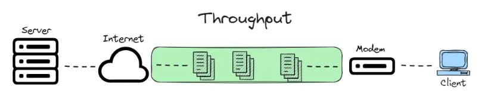
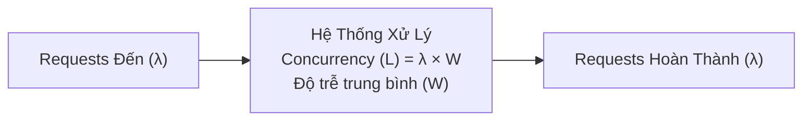
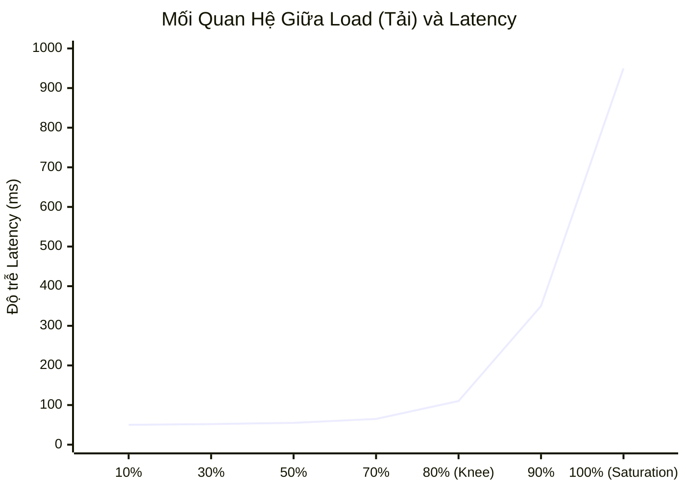
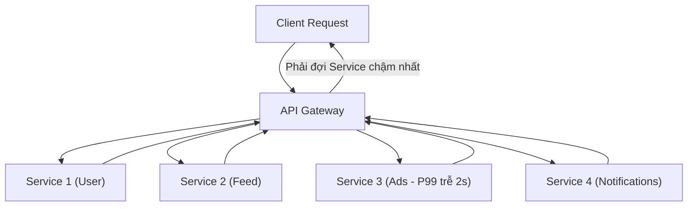

# Tuần 3: Latency Và Throughput (Độ Trễ Và Thông Lượng)
> **Bản chất của hai thước đo hiệu năng quan trọng nhất trong thiết kế hệ thống**  
> **Tác giả:** Franco Fernando (*The Polymathic Engineer* - Issue 77)  
> **Link bài gốc:** [newsletter.francofernando.com/p/latency-and-throughput](https://newsletter.francofernando.com/p/latency-and-throughput)  
> **Tệp gốc lưu trữ:** [HTML](file:///Users/kaka/learning/software_development/system_design/html/03_latency_va_throughput.html) | [Markdown gốc](file:///Users/kaka/learning/software_development/system_design/original_markdown/03_latency_va_throughput.md)

---

## 📌 Lời mở đầu

Khi đánh giá hiệu năng của bất kỳ hệ thống phân tán nào, hai khái niệm luôn được nhắc đến đầu tiên là **Latency (Độ trễ)** và **Throughput (Thông lượng)**. Nhiều kỹ sư thường dùng lẫn lộn hai khái niệm này, hoặc ngộ nhận rằng *"tăng Throughput thì Latency sẽ tự động giảm"*. 

Thực tế, mối quan hệ giữa chúng chứa đựng nhiều sự đánh đổi sâu sắc. Hiểu rõ bản chất toán học và vật lý của Latency và Throughput sẽ giúp bạn đưa ra những quyết định kiến trúc đúng đắn.

---

## 1. Định Nghĩa Cốt Lõi: Phân Biệt Latency & Throughput

### 1.1. Latency (Độ trễ - Thời gian)
- **Định nghĩa:** Là khoảng thời gian để một thao tác hoặc một đơn vị dữ liệu đi từ điểm bắt đầu đến điểm kết thúc và trả về kết quả.
- **Đơn vị đo:** Millisecond ($ms$), Microsecond ($\mu s$), hoặc Nanosecond ($ns$).
- **Ví dụ trực quan:** Thời gian một chiếc ô tô chạy từ Hà Nội đến Hải Phòng mất **1.5 giờ**.

> [!NOTE]
> **Thành phần cấu thành Latency tổng thể (End-to-End Latency):**
> $$\text{Total Latency} = \text{Network Propagation} + \text{Queueing Time} + \text{Processing Time} + \text{Data Transfer Time}$$
> Trong đó, **Queueing Time (thời gian nằm chờ trong hàng đợi)** chính là thủ phạm lớn nhất khiến độ trễ tăng đột biến khi hệ thống bị quá tải!

### 1.2. Throughput (Thông lượng - Tốc độ dòng chảy)
- **Định nghĩa:** Là số lượng thao tác hoặc khối lượng dữ liệu mà hệ thống có thể xử lý thành công trong một đơn vị thời gian.
- **Đơn vị đo:** Requests Per Second (RPS), Queries Per Second (QPS), Transactions Per Second (TPS), hoặc Mbps/Gbps.
- **Ví dụ trực quan:** Tuyến đường cao tốc Hà Nội - Hải Phòng có thể cho phép **10,000 lượt xe lưu thông qua mỗi giờ**.

### 1.3. Phép so sánh ẩn dụ: Ống nước (Water Pipe Analogy)
- **Đường kính của ống nước** tương đương với **Băng thông (Bandwidth)**.
- **Thời gian một giọt nước chảy từ đầu này sang đầu kia** là **Latency**.
- **Lượng nước chảy ra khỏi vòi mỗi giây** là **Throughput**.

---

## 2. Định Luật Little (Little's Law) - Cầu Nối Toán Học

Trong lý thuyết hàng đợi (Queueing Theory), **Định luật Little** xác lập mối liên hệ chặt chẽ giữa 3 đại lượng:
$$L = \lambda \times W$$

Trong đó:
- $L$ = Số lượng request đang được xử lý đồng thời trong hệ thống (**Concurrency**).
- $\lambda$ = Thông lượng xử lý trung bình (**Throughput** - requests/giây).
- $W$ = Thời gian trung bình một request ở trong hệ thống (**Latency** - giây).

### 💡 Ý nghĩa sống còn trong kiến trúc:
Giả sử hệ thống của bạn có độ trễ $W = 100ms = 0.1s$ và Throughput cần đạt là $\lambda = 5,000 \text{ RPS}$:
$$L = 5,000 \times 0.1 = 500 \text{ concurrent connections}$$
$\rightarrow$ Máy chủ của bạn cần duy trì ít nhất **500 kết nối/luồng (threads/goroutines)** đồng thời.

Nếu một ngày database bị chậm, độ trễ $W$ tăng từ $100ms \rightarrow 1,000ms (1s)$:
$$L = 5,000 \times 1 = 5,000 \text{ concurrent connections!}$$
$\rightarrow$ Lượng luồng cần xử lý tăng gấp 10 lần. Thread pool cạn kiệt, memory tràn, các request đến sau bị đẩy vào hàng đợi dài vô tận, dẫn đến hệ thống sập hoàn toàn (**Cascading Failure**).

---

## 3. Đường Cong Đánh Đổi (Latency vs Throughput Curve)

Khi hệ thống chịu tải tăng dần, độ trễ và thông lượng không biến đổi tuyến tính:

1. **Vùng tải thấp đến trung bình (< 70%):** Throughput tăng tuyến tính cùng lượng request đến. Latency gần như không đổi vì tài nguyên còn dư dả.
2. **Điểm gập (The Knee of the Curve - ~75-80%):** Hàng đợi bắt đầu tích lũy.
3. **Vùng bão hòa (> 85% - Saturation & Thrashing):** CPU/Memory bận rộn chuyển đổi ngữ cảnh (Context Switching), khóa tranh chấp (Lock Contention) tăng vọt. **Latency tăng theo hàm số mũ**, trong khi Throughput tụt giảm nghiêm trọng.

---

## 4. Cạm Bẫy Của Con Số Trung Bình: Tail Latency (P99, P99.9)

Đừng bao giờ dùng **Độ trễ trung bình (Mean/Average Latency)** để đánh giá hệ thống, vì con số trung bình che giấu hoàn toàn trải nghiệm tồi tệ của những người dùng kém may mắn!

Thay vào đó, hãy dùng các phân vị (Percentiles):
- **P50 (Median):** 50% số request có độ trễ thấp hơn giá trị này.
- **P90:** 90% số request đạt chuẩn.
- **P99 / P99.9 (Tail Latency):** 1% hoặc 0.1% request chậm nhất.

### Hiện tượng khuếch đại độ trễ (Tail Latency Amplification):
Trong kiến trúc Microservices, một trang chủ thường phải gọi đồng thời 50 đến 100 backend services để tổng hợp dữ liệu.

Nếu mỗi microservice có $P99 = 100ms$ (tức xác suất chậm 1%):
$$\text{Xác suất trang người dùng bị chậm} = 1 - (1 - 0.01)^{100} \approx 1 - 0.366 = \mathbf{63.4\%}!$$
> Mặc dù từng service riêng lẻ đều có SLA 99% tốt đẹp, nhưng hơn **63% người dùng thực tế sẽ phải chịu cảnh tải trang chậm chạp**!

---

## 5. Chiến Lược Tối Ưu Hóa Trong Thực Tế

### 5.1. Cách tối ưu Latency (Giảm thời gian phản hồi)
- **Caching gần người dùng:** Dùng CDN (Cloudflare, AWS CloudFront) cho tài sản tĩnh, Redis/Memcached cho dữ liệu động.
- **Giảm khoảng cách địa lý:** Triển khai Multi-region gần vị trí người dùng.
- **Tối ưu tầng giao vận:** Dùng **HTTP/2** (multiplexing trên 1 kết nối TCP) hoặc **HTTP/3 (QUIC)** loại bỏ hiện tượng Head-of-line blocking.
- **Tối ưu cơ sở dữ liệu:** Thêm Database Index thích hợp, tránh N+1 Query, chỉ SELECT các cột cần dùng.
- **Tối ưu kích thước payload:** Dùng Protocol Buffers (Protobuf) hoặc gRPC thay vì JSON cồng kềnh.

### 5.2. Cách tối ưu Throughput (Tăng khả năng chịu tải)
- **Batching (Gộp đợt):** Thay vì gửi 1,000 query đơn lẻ, hãy gộp thành 1 bulk query. Kafka tối ưu throughput vượt trội nhờ cơ chế gom batch trước khi ghi đĩa.
- **Bất đồng bộ hóa (Asynchronous & Message Queues):** Đẩy các tác vụ nặng (gửi email, xử lý ảnh, tạo báo cáo) vào hàng đợi (RabbitMQ, SQS, Kafka).
- **Non-blocking I/O & Event-Driven:** Dùng kiến trúc Non-blocking (Node.js, Netty, Go goroutines, Nginx) thay vì mô hình tạo 1 thread cho mỗi kết nối (Apache MPM Prefork).
- **Mở rộng chiều ngang (Horizontal Scaling):** Thêm máy chủ ứng dụng phía sau Load Balancer.

---

## ⚖️ Tóm Tắt Sự Đánh Đổi (Trade-offs)

| Chiến lược | Tác động tới Throughput | Tác động tới Latency | Đánh đổi (Trade-off) |
| :--- | :--- | :--- | :--- |
| **Gộp đợt (Batching)** | 🟢 Tăng rất mạnh | 🔴 Tăng nhẹ (phải chờ gom đủ batch) | Phù hợp cho xử lý nền, không hợp cho realtime chat |
| **Nén dữ liệu (Compression)** | 🟢 Tăng (ít tốn băng thông) | 🔴 Tăng nhẹ thời gian CPU nén/giải nén | Đánh đổi CPU để tiết kiệm Network I/O |
| **Thêm In-Memory Cache** | 🟢 Tăng mạnh (giảm tải DB) | 🟢 Giảm mạnh (đọc từ RAM) | Đánh đổi tính nhất quán dữ liệu (Cache Invalidation) |
| **Chia nhỏ microservices** | 🟢 Dễ scale độc lập từng phần | 🔴 Tăng Latency (nhiều network hop hơn) | Tăng độ phức tạp mạng và rủi ro Tail Latency |
