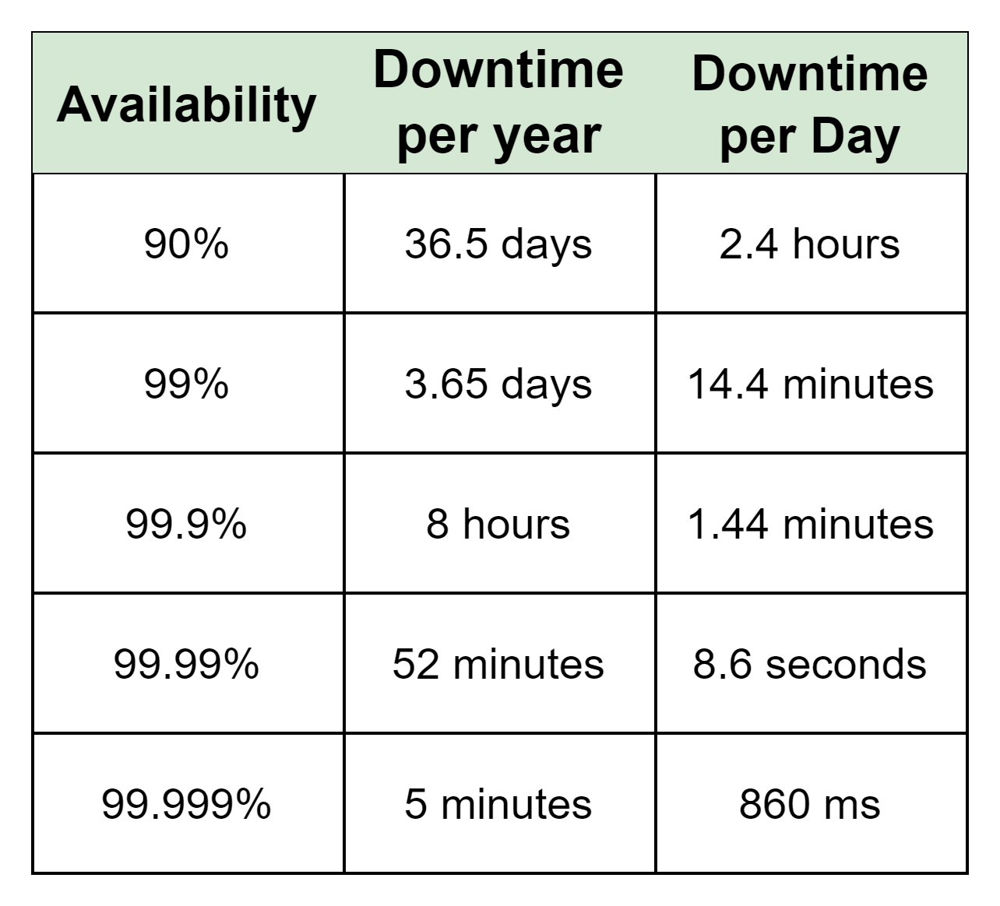
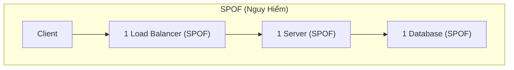
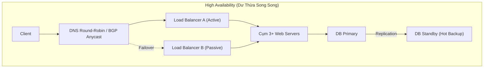

# Tuần 4: High Availability (Tính Sẵn Sàng Cao)
> **Cách thiết kế hệ thống vận hành liên tục, loại bỏ điểm nghẽn và đo lường SLA**  
> **Tác giả:** Franco Fernando (*The Polymathic Engineer* - Issue 66)  
> **Link bài gốc:** [newsletter.francofernando.com/p/availability](https://newsletter.francofernando.com/p/availability)  
> **Tệp gốc lưu trữ:** [HTML](file:///Users/kaka/learning/software_development/system_design/html/04_high_availability.html) | [Markdown gốc](file:///Users/kaka/learning/software_development/system_design/original_markdown/04_high_availability.md)

---

## 📌 Lời mở đầu

Trong thời đại số, mỗi phút downtime (thời gian ngừng hoạt động) đều dẫn đến tổn thất doanh thu nặng nề và làm mất lòng tin của khách hàng. Đối với các hệ thống lớn như Amazon, Netflix hay ngân hàng, hệ thống bắt buộc phải duy trì trạng thái luôn sẵn sàng phục vụ. 

**Tính sẵn sàng (Availability)** là chỉ số đo lường tỷ lệ thời gian hệ thống hoạt động bình thường so với tổng thời gian vận hành.

---

## 1. Phân Biệt Availability (Sẵn Sàng) Và Reliability (Độ Tin Cậy)

Hai khái niệm này có mối liên hệ mật thiết nhưng không đồng nhất:

- **Reliability (Độ tin cậy):** Xác suất một hệ thống hoạt động liên tục không xảy ra lỗi trong một khoảng thời gian nhất định. Đo bằng **MTBF (Mean Time Between Failures - Thời gian trung bình giữa các lần gặp sự cố)**.
- **Availability (Tính sẵn sàng):** Tỷ lệ phần trăm thời gian hệ thống có thể đáp ứng yêu cầu của người dùng. Phụ thuộc vào cả tần suất lỗi (MTBF) và **tốc độ khắc phục lỗi (MTTR - Mean Time To Repair)**.

### Công thức toán học:
$$\text{Availability} = \frac{\text{Uptime}}{\text{Total Time}} = \frac{\text{MTBF}}{\text{MTBF} + \text{MTTR}}$$

> [!TIP]
> Để tăng tính sẵn sàng của hệ thống, bạn có 2 hướng tiếp cận:
> 1. **Tăng MTBF:** Làm cho hệ thống ít lỗi hơn (kiểm thử kỹ, phần cứng tốt hơn).
> 2. **Giảm MTTR:** Khi sự cố xảy ra, phải **tự động phục hồi tức thì trong vài giây (Automated Failover)** thay vì chờ kỹ sư thức dậy sửa lúc nửa đêm!

---

## 2. Bảng "Các Số 9" Trong SLA (The "Nines" of Availability)

Trong các thỏa thuận dịch vụ (SLA - Service Level Agreement), tính sẵn sàng được cam kết bằng số lượng chữ số 9:

| Cấp độ | Uptime (%) | Downtime mỗi năm | Downtime mỗi tháng | Downtime mỗi ngày |
| :--- | :--- | :--- | :--- | :--- |
| **1 Số 9** | 90% | 36.5 ngày | 72 giờ | 2.4 giờ |
| **2 Số 9** | 99% | 3.65 ngày | 7.2 giờ | 14.4 phút |
| **3 Số 9 (Tiêu chuẩn)** | 99.9% | 8.76 giờ | 43.8 phút | 1.44 phút |
| **4 Số 9 (Doanh nghiệp cao)** | 99.99% | 52.6 phút | 4.38 phút | 8.64 giây |
| **5 Số 9 (Hàng không/Viễn thông)** | 99.999% | 5.26 phút | 26.3 giây | 0.86 giây |
| **6 Số 9 (Cực đoan)** | 99.9999% | 31.5 giây | 2.63 giây | 0.086 giây |

> [!CAUTION]
> **Quy luật chi phí hàm số mũ:**
> Việc nâng cấp từ **99.9%** (8.76 giờ chết/năm) lên **99.99%** (52 phút chết/năm) đòi hỏi chi phí hạ tầng và độ phức tạp kỹ thuật có thể tăng gấp **3 đến 5 lần**. Để lên **99.999%**, bạn cần kiến trúc Multi-region Active-Active, automated rollback, và zero-downtime deployment.

---

## 3. Tính Toán Availability Trong Hệ Thống Phức Tạp

Hầu hết các hệ thống được ghép từ nhiều thành phần:

### 3.1. Các thành phần mắc NỐI TIẾP (Sequential / Serial)
Nếu hệ thống phụ thuộc vào Server VÀ Database để hoàn thành request, nếu 1 trong 2 chết thì hệ thống sập:
$$A_{\text{total}} = A_1 \times A_2 \times \dots \times A_n$$

*Ví dụ:* Web Server ($99.9\%$) + Database ($99.9\%$):
$$A_{\text{total}} = 0.999 \times 0.999 = 0.998001 \approx \mathbf{99.8\%}$$
$\rightarrow$ **Hệ thống nối tiếp luôn có tính sẵn sàng KÉM HƠN thành phần yếu nhất!**

### 3.2. Các thành phần mắc SONG SONG (Redundant / Parallel)
Nếu bạn đặt 2 Web Server dự phòng song song (chỉ cần 1 con sống là hệ thống vẫn chạy):
$$A_{\text{total}} = 1 - (1 - A_1) \times (1 - A_2)$$

*Ví dụ:* 2 server cùng có availability $99.9\%$ ($0.999$):
$$A_{\text{total}} = 1 - (0.001 \times 0.001) = 1 - 0.000001 = \mathbf{99.9999\%} \text{ (6 số 9)!}$$
$\rightarrow$ **Thêm thành phần dự phòng song song (Redundancy) là bí quyết vàng để đạt High Availability!**

---

## 4. Các Mẫu Kiến Trúc Đảm Bảo High Availability

### 4.1. Loại bỏ điểm nghẽn đơn lẻ (Single Point of Failure - SPOF)
Bất kỳ thành phần nào trong hệ thống mà nếu nó dừng hoạt động, toàn bộ hệ thống sẽ ngừng hoạt động theo thì đó là **SPOF**.
- Một con Load Balancer duy nhất $\rightarrow$ SPOF.
- Một database master duy nhất $\rightarrow$ SPOF.
- Một datacenter duy nhất $\rightarrow$ SPOF khi cáp quang bị cắt hoặc mất điện diện rộng.

### 4.2. Mẫu Active-Passive (Master-Standby)
- Một node xử lý toàn bộ traffic (Active).
- Một node chạy ngầm đồng bộ dữ liệu (Passive/Standby).
- Cơ chế **Heartbeat (Nhịp tim)** liên tục kiểm tra trạng thái node Active. Nếu node Active chết, node Passive tự động kích hoạt thành Active (**Automated Failover**).

### 4.3. Mẫu Active-Active
- Tất cả các node đều cùng lúc nhận và xử lý traffic.
- Tải được dàn đều qua Load Balancer.
- Nếu một node bị sập, Load Balancer chỉ cần ngừng chuyển tiếp traffic tới node đó (Health check failed). **Thời gian downtime gần như bằng 0 (Zero Downtime)**.

### 4.4. Khoang Kín (Bulkhead Pattern) & Ngắt Mạch (Circuit Breaker)
- **Bulkhead:** Lấy cảm hứng từ các vách ngăn chống chìm tàu thủy. Nếu dịch vụ tính điểm thưởng (loyalty points) bị lỗi, chỉ cô lập khoang đó, không để nó làm sập quy trình thanh toán chính.
- **Circuit Breaker:** Khi một dependency gọi liên tục thất bại quá ngưỡng (ví dụ lỗi 50% trong 10s), Circuit Breaker sẽ "ngắt mạch" ngay lập tức để không gửi request tiếp, trả về fallback response, bảo vệ hệ thống không bị nghẽn thread pool.

---

## 5. Phân Tích Đánh Đổi (Trade-offs)

| Chiến lược HA | Điểm mạnh | Sự đánh đổi (Trade-off) |
| :--- | :--- | :--- |
| **Active-Passive** | Dễ triển khai, đảm bảo tính nhất quán dữ liệu cao | Lãng phí 50% tài nguyên server chờ, có downtime ngắn lúc failover |
| **Active-Active** | Tối ưu tài nguyên 100%, zero downtime khi rớt node | Độ phức tạp cao trong đồng bộ dữ liệu hai chiều (Conflict Resolution) |
| **Multi-Region** | Chống chịu được thảm họa toàn bộ trung tâm dữ liệu | Chi phí đường truyền đắt đỏ, độ trễ Replication xuyên lục địa |
