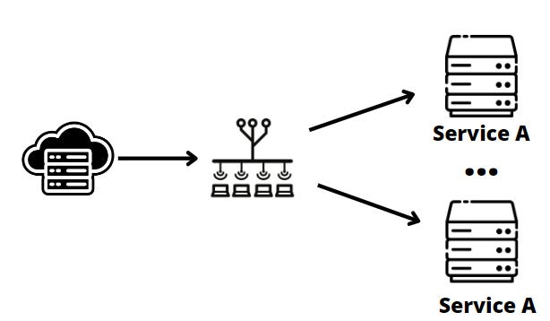
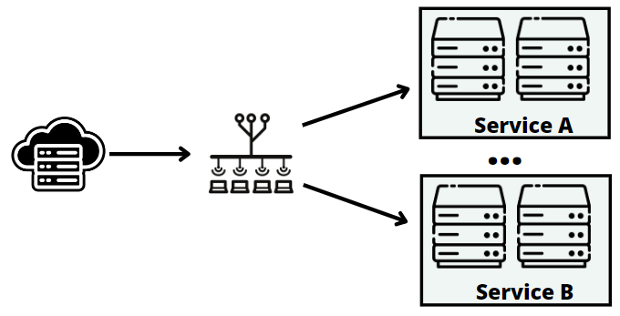
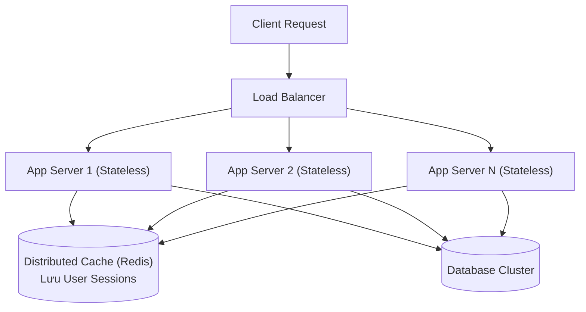
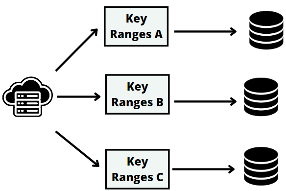
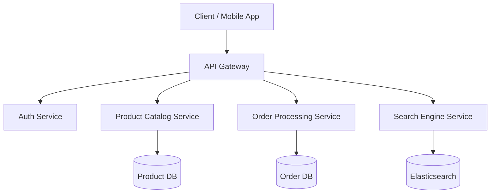
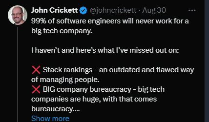

# Tuần 5: Các Phương Pháp Mở Rộng Hệ Thống (Designing for Scale)
> **Mô hình Khối Lập Phương Scale Cube: Nhân bản máy chủ, Tách chức năng và Phân vùng dữ liệu**  
> **Tác giả:** Franco Fernando (*The Polymathic Engineer* - Issue 88)  
> **Link bài gốc:** [newsletter.francofernando.com/p/how-to-design-a-system-for-scale](https://newsletter.francofernando.com/p/how-to-design-a-system-for-scale)  
> **Tệp gốc lưu trữ:** [HTML](file:///Users/kaka/learning/software_development/system_design/html/05_cac_phuong_phap_mo_rong.html) | [Markdown gốc](file:///Users/kaka/learning/software_development/system_design/original_markdown/05_cac_phuong_phap_mo_rong.md)

---

## 📌 Lời mở đầu

Khi ứng dụng của bạn thu hút hàng triệu người dùng, một máy chủ đơn lẻ dù mạnh mẽ đến đâu cũng sẽ chạm tới giới hạn vật lý của phần cứng (CPU, RAM, Disk I/O). Đây là lúc các kỹ sư phải đối mặt với bài toán: **Làm sao để mở rộng (Scale) hệ thống một cách hiệu quả và bền vững?**

Hai hướng mở rộng kinh điển:
1. **Vertical Scaling (Mở rộng theo chiều dọc / Scale-Up):** Mua máy chủ to hơn, nhiều RAM hơn, nhiều CPU core hơn.  
   *Nhược điểm:* Rất đắt đỏ, chạm trần giới hạn phần cứng, và vẫn là một Điểm Nghẽn Đơn Lẻ (SPOF).
2. **Horizontal Scaling (Mở rộng theo chiều ngang / Scale-Out):** Ghép nối nhiều máy chủ thông thường (commodity hardware) lại với nhau để cùng chia sẻ gánh nặng.

Để hệ thống hóa các phương pháp mở rộng theo chiều ngang, cuốn sách kinh điển *The Art of Scalability* đã giới thiệu mô hình **Khối Lập Phương Tăng Trưởng (The AKF Scale Cube)** với 3 trục tọa độ: **X, Y và Z**.

---

## 1. Trục X: Nhân Bản Máy Chủ (Adding Server Clones)

Trục X đại diện cho phương pháp đơn giản và phổ biến nhất: **Chạy nhiều bản sao giống hệt nhau (clones) của ứng dụng nằm sau một Load Balancer**.

### Nguyên tắc sống còn: Stateless Web Tier (Tầng Web Không Lưu Trạng Thái)
Để các máy chủ có thể thêm bớt linh hoạt theo nhu cầu (Auto-scaling), các máy chủ ở tầng ứng dụng **bắt buộc phải là Stateless**. Nghĩa là bất kỳ request nào của người dùng gửi tới bất kỳ máy chủ nào cũng phải nhận được kết quả như nhau.

> [!WARNING]
> **Cạm bẫy Sticky Sessions (Phiên dính):**
> Trước đây, nhiều hệ thống dùng Sticky Session (buộc một user luôn kết nối tới đúng 1 server đã lưu session trong RAM của nó). Điều này phá hỏng khả năng cân bằng tải: nếu server đó sập, toàn bộ session của user bị mất; nếu một server có nhiều user hoạt động mạnh, nó sẽ bị quá tải trong khi các server khác ngồi chơi.
> 
> **Giải pháp chuẩn:** Tách Session ra khỏi Server RAM, lưu vào cụm Cache phân tán dùng chung (**Redis** hoặc **Memcached**) hoặc mã hóa trong **JWT Token**.

---

## 2. Trục Y: Phân Tách Theo Chức Năng (Functional Partitioning / Microservices)

Khi codebase phình to và hệ thống đa dạng về nghiệp vụ, việc nhân bản toàn bộ ứng dụng Monolith bắt đầu bộc lộ hạn chế. Trục Y giải quyết vấn đề bằng cách **tách ứng dụng thành các dịch vụ độc lập dựa trên chức năng nghiệp vụ (Microservices / Service-Oriented Architecture)**.

### Lợi ích vượt trội của Trục Y:
1. **Mở rộng độc lập (Independent Scaling):** Dịch vụ Tìm kiếm (Search Service) cần nhiều CPU/RAM để đánh index có thể scale lên 50 máy, trong khi Dịch vụ Thanh toán (Payment Service) chỉ cần 5 máy được bảo mật nghiêm ngặt.
2. **Cách ly lỗi (Fault Isolation):** Nếu module Gợi ý (Recommendation) bị quá tải hoặc memory leak, nó không làm sập chức năng Đặt hàng (Checkout).
3. **Phân quyền và tự chủ đội ngũ (Team Autonomy):** Mỗi team kỹ sư phụ trách một microservice riêng, tự do lựa chọn công nghệ và chu kỳ triển khai (CI/CD) độc lập.

---

## 3. Trục Z: Phân Vùng Dữ Liệu (Data Partitioning / Sharding)

Trục Z là phương thức mở rộng cao cấp nhất: **Mỗi máy chủ hoặc cụm database chỉ chịu trách nhiệm lưu trữ và xử lý một tập hợp con dữ liệu của khách hàng**.

### Các cách tiếp cận phân vùng Trục Z:
- **Theo khu vực địa lý (Geographic):** Khách hàng ở Châu Á truy cập cụm Datacenter Singapore; khách hàng Châu Âu truy cập cụm Frankfurt.
- **Theo nhóm khách hàng (Customer Sharding / Tenant ID):** Phổ biến trong mô hình B2B SaaS. Khách hàng VIP doanh nghiệp lớn được cấp riêng 1 cụm database shard để không bị ảnh hưởng bởi người dùng thông thường (*Noisy Neighbor Problem*).
- **Theo Hash của User ID:** Dùng thuật toán Hash để băm dữ liệu đều vào 100 database shards khác nhau.

---

## 4. Kiến Trúc Mở Rộng Toàn Diện (Putting It All Together)

Một hệ thống đạt chuẩn quy mô triệu người dùng kết hợp linh hoạt cả 3 trục của Scale Cube:

1. **DNS & CDN:** Lọc và phân phối nội dung tĩnh tại rìa mạng internet.
2. **Load Balancers:** Phân phối tải tới các API Gateway.
3. **Trục Y (Microservices):** Tách bạch rõ ràng giữa các domain nghiệp vụ.
4. **Trục X (Auto-scaling Clones):** Từng microservice tự động tăng/giảm số lượng pod/container theo CPU/memory.
5. **Trục Z (Sharding & Caching):** Tầng lưu trữ được chia nhỏ thành các cụm Read-Replicas, Shards và Redis Cluster.

---

## ⚖️ Bảng So Sánh Các Trục Trong Scale Cube

| Đặc tính | Trục X (Cloning) | Trục Y (Functional) | Trục Z (Data Partitioning) |
| :--- | :--- | :--- | :--- |
| **Độ khó triển khai** | ⭐ Rất thấp (chỉ cần stateless) | ⭐⭐⭐ Trung bình (cần tách domain) | ⭐⭐⭐⭐⭐ Rất cao (xử lý cross-shard) |
| **Chi phí hạ tầng ban đầu** | Thấp | Trung bình | Cao |
| **Giải quyết nút thắt** | Nút thắt ở tầng Web/App | Nút thắt về sự phức tạp & team | Nút thắt về dung lượng và I/O Database |
| **Công nghệ tiêu biểu** | Docker, K8s HPA, AWS ALB | REST, gRPC, Event-driven, Kafka | Citus, Vitess, CockroachDB, DynamoDB |
