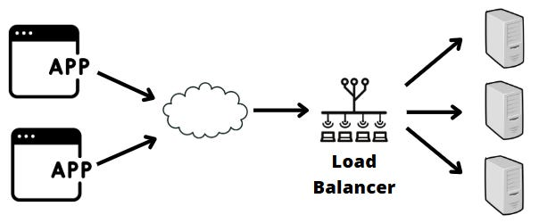
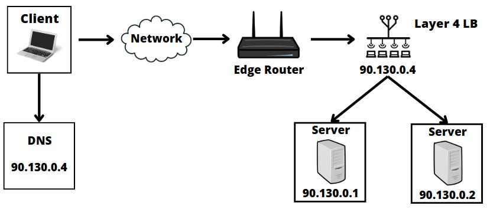
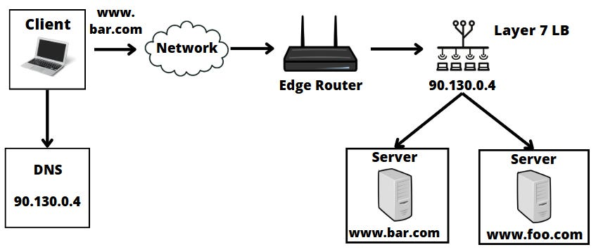
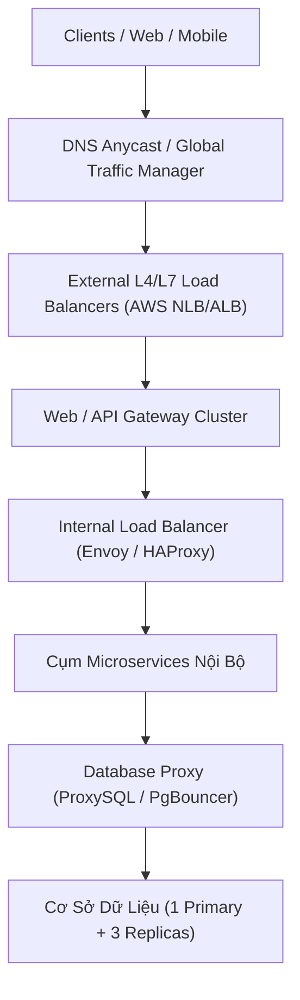

# Tuần 6: Load Balancer (Bộ Cân Bằng Tải)
> **Cẩm nang toàn diện về cách phân phối lưu lượng, thuật toán và phân tầng L4 vs L7**  
> **Tác giả:** Franco Fernando (*The Polymathic Engineer* - Issue 113)  
> **Link bài gốc:** [newsletter.francofernando.com/p/the-definitive-guide-to-load-balancers](https://newsletter.francofernando.com/p/the-definitive-guide-to-load-balancers)  
> **Tệp gốc lưu trữ:** [HTML](file:///Users/kaka/learning/software_development/system_design/html/06_load_balancer.html) | [Markdown gốc](file:///Users/kaka/learning/software_development/system_design/original_markdown/06_load_balancer.md)

---

## 📌 Lời mở đầu

Khi xây dựng các hệ thống phân tán chịu tải cao, việc bổ sung thêm các máy chủ ứng dụng sẽ trở nên vô nghĩa nếu không có một người điều phối giao thông thông minh đứng ở phía trước. **Bộ cân bằng tải (Load Balancer - LB)** chính là trái tim điều tiết dòng chảy lưu lượng, đảm bảo không có máy chủ nào bị quá tải trong khi các máy chủ khác đang rảnh rỗi.

---

## 1. Tại Sao Load Balancer Lại Quan Trọng?

Một bộ cân bằng tải hiện đại không chỉ đơn thuần là phân chia request, mà còn đảm nhiệm nhiều trọng trách kiến trúc then chốt:

1. **Phân phối tải đồng đều (Load Distribution):** Tối ưu hóa việc sử dụng tài nguyên CPU, RAM và Disk I/O trên toàn bộ cụm máy chủ.
2. **Loại bỏ điểm nghẽn đơn lẻ (High Availability):** Tự động phát hiện các máy chủ bị lỗi thông qua cơ chế kiểm tra sức khỏe (**Health Checks**) và cô lập chúng, ngăn chặn request gửi vào node chết.
3. **Mở rộng linh hoạt (Elastic Scalability):** Cho phép gắn thêm hoặc gỡ bỏ máy chủ (Scale in / Scale out) một cách trong suốt với người dùng cuối (**Zero Downtime**).
4. **Giải tải mã hóa (SSL/TLS Termination):** Đảm nhận việc bắt tay TLS (TLS Handshake) và giải mã HTTPS nặng nề, giúp máy chủ backend chỉ việc xử lý thuần túy logic nghiệp vụ.
5. **Bảo mật và Phòng thủ (Security & WAF):** Ngăn chặn các cuộc tấn công từ chối dịch vụ (DDoS), tích hợp Web Application Firewall (WAF) để lọc request độc hại.

---

## 2. Phân Loại Load Balancer: Layer 4 vs Layer 7

Sự khác biệt cốt lõi giữa các bộ cân bằng tải nằm ở tầng mà chúng hoạt động trong mô hình mạng **OSI 7 Tầng**:

### 2.1. Layer 4 Load Balancer (Tầng Giao Vận - Transport Layer)
- **Cách hoạt động:** Hoạt động dựa trên thông tin ở tầng mạng và giao vận: **Địa chỉ IP nguồn/đích** và **Cổng TCP/UDP Port**.
- **Không đọc nội dung ứng dụng:** LB Layer 4 **không giải mã và không đọc** dữ liệu bên trong gói tin (HTTP headers, cookies, URL path). Nó chỉ định tuyến các gói tin mạng thuần túy.
- **Ưu điểm:**
  - **Cực kỳ nhanh (Blazing fast):** Tốn rất ít chu kỳ CPU và bộ nhớ RAM.
  - Thông lượng (Throughput) cực cao, xử lý hàng triệu kết nối đồng thời dễ dàng.
- **Nhược điểm:**
  - Định tuyến "mù": Không thể định tuyến thông minh theo đường dẫn URL (như `/api` hay `/static`).
  - Không thể thực hiện SSL Termination hoặc kiểm tra Cookie người dùng.
- **Công nghệ tiêu biểu:** **AWS Network Load Balancer (NLB)**, **HAProxy** (ở chế độ TCP), **IPVS / LVS** (Linux Virtual Server).

### 2.2. Layer 7 Load Balancer (Tầng Ứng Dụng - Application Layer)
- **Cách hoạt động:** Hoạt động ở tầng cao nhất của mô hình mạng. Nó đọc hiểu toàn bộ giao thức ứng dụng (**HTTP, HTTPS, gRPC, WebSocket**).
- **Khả năng định tuyến thông minh (Smart Routing):**
  - **Định tuyến theo đường dẫn (Path-based routing):** `/api/v1/orders` $\rightarrow$ Cụm máy chủ Đơn hàng; `/images/*` $\rightarrow$ Cụm máy chủ Static/CDN.
  - **Định tuyến theo Header / Cookie:** Điều hướng người dùng thử nghiệm tính năng mới (**Canary Deployment / A/B Testing**).
- **Ưu điểm:**
  - Hỗ trợ SSL Termination, nén dữ liệu (Gzip/Brotli), HTTP/2 multiplexing.
  - Hỗ trợ Sticky Sessions thông qua Application Cookies.
- **Nhược điểm:**
  - Tốn nhiều tài nguyên CPU hơn L4 do phải giải mã gói tin và đọc nội dung.
- **Công nghệ tiêu biểu:** **Nginx**, **AWS Application Load Balancer (ALB)**, **Envoy Proxy**, **Traefik**, **HAProxy** (ở chế độ HTTP).

---

## 3. Các Thuật Toán Cân Bằng Tải Cốt Lõi

### 3.1. Thuật toán tĩnh (Static Algorithms)
Không quan tâm đến trạng thái chịu tải thực tế của máy chủ:

1. **Round Robin (Vòng tròn):**
   - Phân bổ tuần tự: Request 1 vào Server A, Request 2 vào Server B, Request 3 vào Server C...
   - *Phù hợp khi:* Tất cả các máy chủ có cấu hình phần cứng giống hệt nhau và các request có thời gian xử lý tương đương.
2. **Weighted Round Robin (Vòng tròn có trọng số):**
   - Gán trọng số dựa trên sức mạnh phần cứng. Ví dụ Server A (8 cores) có trọng số 3, Server B (2 cores) có trọng số 1. Cứ 4 requests thì Server A nhận 3, Server B nhận 1.
3. **IP Hash (Băm địa chỉ IP):**
   - Lấy địa chỉ IP của Client đi qua hàm băm: `Server_Index = Hash(Client_IP) % N`.
   - Giúp đảm bảo một người dùng luôn được định tuyến về đúng một máy chủ nhất định mà không cần cookie.

### 3.2. Thuật toán động (Dynamic Algorithms)
Liên tục thăm dò trạng thái hoạt động thực tế của từng máy chủ:

1. **Least Connections (Ít kết nối nhất):**
   - Chuyển request mới đến máy chủ đang có **số lượng kết nối hoạt động (active connections) thấp nhất**.
   - *Rất hiệu quả cho:* Các ứng dụng có phiên làm việc kéo dài (Long-lived connections như WebSocket, Streaming, File Upload).
2. **Weighted Least Connections:**
   - Kết hợp giữa số lượng kết nối hiện tại và năng lực xử lý (trọng số) của server.
3. **Least Response Time (Thời gian phản hồi nhanh nhất):**
   - Phân tích thời gian trả lời (TTFB - Time to First Byte) của từng máy chủ cộng với số kết nối đang chờ để gửi request tới máy chủ phản ứng nhanh nhất.

---

## 4. Các Vị Trí Đặt Load Balancer Trong Kiến Trúc

Trong một hệ thống phân tán quy mô lớn, Load Balancer được đặt ở nhiều tầng khác nhau:

---

## 5. Ai Sẽ Cân Bằng Tải Cho Chính Bộ Cân Bằng Tải? (HA for Load Balancers)

Nếu bạn chỉ có **một con Load Balancer**, nó sẽ trở thành **Single Point of Failure (SPOF)** lớn nhất của toàn hệ thống! Để giải quyết bài toán này:

1. **Cặp đôi Active-Passive với Virtual IP (Floating IP & Keepalived):**
   - Hai máy chủ LB chia sẻ chung một địa chỉ IP ảo (VIP).
   - Giao thức **VRRP (Virtual Router Redundancy Protocol)** liên tục kiểm tra nhịp tim giữa 2 máy. Nếu con Active chết, con Passive lập tức chiếm giữ IP ảo và phục vụ trong vài giây.
2. **DNS Round Robin / GeoDNS:**
   - Cấu hình nhiều bản ghi A trong hệ thống DNS trỏ về các IP của nhiều con LB khác nhau tại các vùng địa lý khác nhau.
3. **BGP Anycast:**
   - Kỹ thuật định tuyến cấp độ ISP cao cấp nhất (được Cloudflare, Google dùng). Nhiều bộ LB tại các lục địa khác nhau cùng dùng chung một địa chỉ IP duy nhất. Giao thức định tuyến internet (BGP) sẽ tự động dẫn người dùng tới bộ LB gần họ nhất về mặt mạng.

---

## ⚖️ Bảng So Sánh Đánh Đổi Giữa L4 và L7 Load Balancer

| Tiêu chí | Layer 4 Load Balancer | Layer 7 Load Balancer |
| :--- | :--- | :--- |
| **Giao thức hỗ trợ** | TCP, UDP | HTTP, HTTPS, WebSocket, gRPC |
| **Khả năng định tuyến** | Theo IP và Port đơn giản | Theo URL, Header, Cookie, Query Params |
| **Hiệu năng & Thông lượng** | Cực cao (hàng triệu packet/giây) | Thấp hơn L4 (do giải mã và đọc payload) |
| **Tốn tài nguyên CPU/RAM** | Cực thấp | Trung bình đến cao |
| **Tính năng cao cấp** | Giới hạn | SSL Offloading, WAF, Caching, Compression |
| **Trường hợp sử dụng** | Cổng vào đầu tiên cho Gaming, Video stream, DB proxy | Cổng vào cho Microservices, Web Apps, REST APIs |
