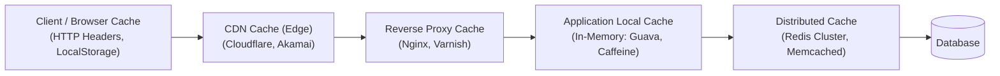
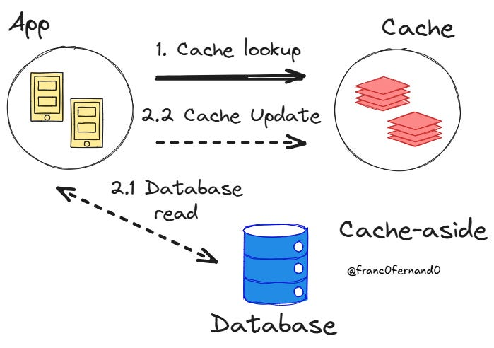
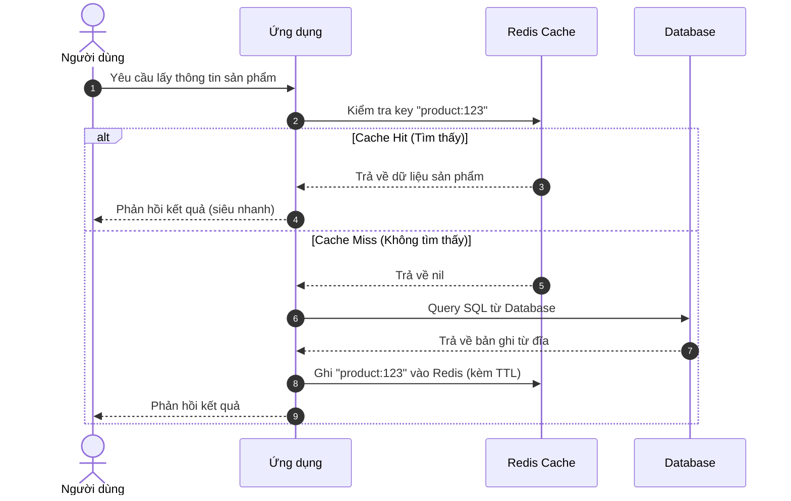
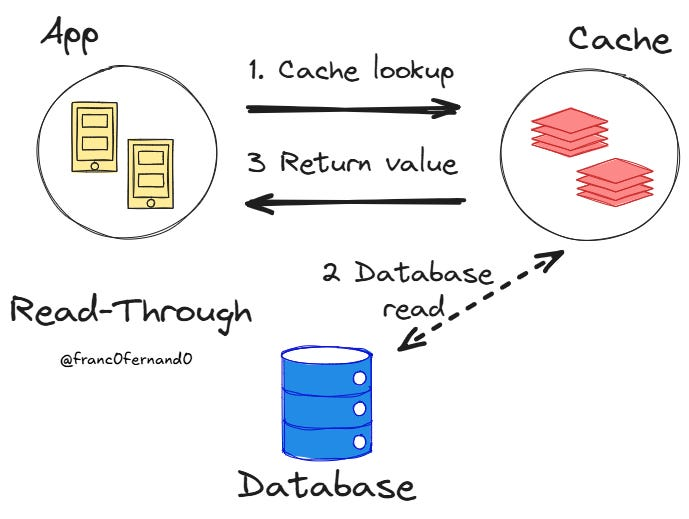
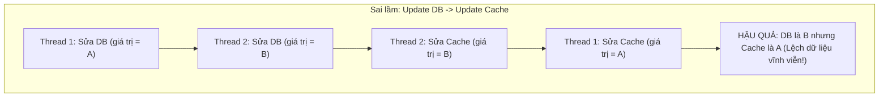

# Tuần 7: Caching (Bộ Nhớ Đệm Trong Hệ Thống Phân Tán)
> **Các chiến lược Đọc/Ghi, chính sách đào thải và cách xử lý 4 cơn ác mộng về Cache**  
> **Tác giả:** Franco Fernando (*The Polymathic Engineer* - Issue 144)  
> **Link bài gốc:** [newsletter.francofernando.com/p/caching-in-distributed-systems-part-6ca](https://newsletter.francofernando.com/p/caching-in-distributed-systems-part-6ca)  
> **Tệp gốc lưu trữ:** [HTML](file:///Users/kaka/learning/software_development/system_design/html/07_caching.html) | [Markdown gốc](file:///Users/kaka/learning/software_development/system_design/original_markdown/07_caching.md)

---

## 📌 Lời mở đầu

> *"Chỉ có hai điều thực sự khó trong Khoa học Máy tính: Đào thải bộ nhớ đệm (Cache Invalidation) và Đặt tên biến."*  
> — **Phil Karlton**

Truy cập dữ liệu từ bộ nhớ RAM chỉ mất khoảng **100 nano-giây**, trong khi đọc từ ổ cứng SSD mất **1 milli-giây** (chậm hơn 10,000 lần) và gọi qua mạng có thể mất hàng chục milli-giây. **Caching** là kỹ thuật lưu trữ tạm thời các dữ liệu được truy cập thường xuyên vào bộ nhớ có tốc độ truy xuất cực nhanh nhằm giảm tải cho cơ sở dữ liệu và hạ độ trễ cho người dùng cuối.

---

## 1. Các Tầng Caching Trong Hệ Thống Phân Tán

Một kiến trúc tiêu chuẩn áp dụng caching ở nhiều tầng khác nhau:

---

## 2. Các Chiến Lược Đọc Dữ Liệu (Read Strategies)

### 2.1. Cache-Aside (Lazy Loading - Nạp Lười)
Đây là chiến lược phổ biến và thông dụng nhất trong phát triển phần mềm:
1. Ứng dụng nhận yêu cầu đọc dữ liệu, kiểm tra trong Cache trước.
2. **Nếu có (Cache Hit):** Trả về kết quả ngay cho người dùng.
3. **Nếu không có (Cache Miss):** Ứng dụng tự đọc từ Database, ghi kết quả vào Cache để phục vụ các lần sau, rồi trả về cho người dùng.

- **Ưu điểm:**
  - Tiết kiệm RAM: Chỉ dữ liệu nào thực sự được người dùng hỏi đến mới được lưu vào cache.
  - Khả năng chịu lỗi cao: Nếu Redis bị sập, ứng dụng vẫn có thể đọc trực tiếp từ Database (dù sẽ chậm hơn).
- **Nhược điểm:**
  - Request đầu tiên luôn bị chậm (Cache Miss Penalty).
  - Nguy cơ dữ liệu bị cũ (Stale Data) nếu ai đó cập nhật trực tiếp vào Database.

### 2.2. Read-Through Cache
- Tương tự như Cache-Aside, nhưng ứng dụng coi Cache như cơ sở dữ liệu duy nhất. Thư viện/Plugin của Cache sẽ tự động đảm nhận việc gọi Database khi bị Cache Miss thay vì code ứng dụng phải tự làm.

---

## 3. Các Chiến Lược Ghi Dữ Liệu (Write Strategies)

### 3.1. Write-Through (Ghi Đồng Thời)
- Ứng dụng ghi dữ liệu vào Cache, và Cache sẽ **đồng bộ ghi ngay lập tức vào Database** trước khi báo thành công cho client.
- **Ưu điểm:** Đảm bảo dữ liệu trong Cache và Database luôn nhất quán 100%. Lần đọc sau chắc chắn là Cache Hit.
- **Nhược điểm:** Tăng độ trễ thao tác ghi (Write Latency) vì phải chờ cả 2 hệ thống hoàn tất.

### 3.2. Write-Around (Ghi Bỏ Qua Cache)
- Ứng dụng ghi dữ liệu **trực tiếp vào Database**, hoàn toàn không đụng tới Cache. Dữ liệu chỉ được nạp vào Cache ở lần đọc tiếp theo (theo cơ chế Cache-Aside).
- **Ưu điểm:** Tránh làm rác Cache đối với những dữ liệu ghi nhiều nhưng hiếm khi được đọc lại (ví dụ log hệ thống, lịch sử thanh toán cũ).
- **Nhược điểm:** Lần đọc đầu tiên ngay sau khi ghi chắc chắn bị Cache Miss.

### 3.3. Write-Back / Write-Behind (Ghi Bất Đồng Bộ)
- Ứng dụng chỉ ghi vào Cache và nhận phản hồi thành công ngay lập tức. Sau đó, Cache sẽ **âm thầm gom nhóm (batch) và ghi bất đồng bộ vào Database** trong nền.
- **Ưu điểm:** Tốc độ ghi cực nhanh, có thể chịu được lượng write bùng nổ (Flash sale, đếm view TikTok/YouTube).
- **Nhược điểm chết người:** **Nguy cơ mất dữ liệu (Data Loss)** nếu máy chủ Redis/Cache bị mất điện hoặc sập trước khi kịp xả dữ liệu xuống Database!

---

## 4. Chính Sách Đào Thải Bộ Nhớ (Eviction Policies)

Khi dung lượng RAM của Cache bị đầy, hệ thống cần thuật toán để quyết định xóa bỏ key nào:

1. **LRU (Least Recently Used - Ít được dùng gần đây nhất):** Loại bỏ key có thời gian truy cập gần nhất xa nhất. *(Thuật toán phổ biến và hiệu quả nhất trong thực tế).*
2. **LFU (Least Frequently Used - Tần suất dùng ít nhất):** Đếm số lần truy cập của từng key, loại bỏ key có số lần đọc thấp nhất.
3. **FIFO (First In, First Out):** Xóa theo thứ tự thời gian nạp vào, không quan tâm tần suất đọc.
4. **TTL (Time-To-Live):** Đặt hạn sử dụng (ví dụ sau 1 giờ thì tự hủy). Bắt buộc phải cấu hình cho mọi key trong Cache.

---

## 5. Xử Lý 4 Cơn Ác Mộng Về Cache (The 4 Classic Cache Pitfalls)

| Sự cố | Bản chất vấn đề | Hậu quả | Giải pháp chuẩn kỹ thuật |
| :--- | :--- | :--- | :--- |
| **1. Cache Penetration (Thủng Cache)** | Hacker cố tình gửi hàng triệu request tìm các ID **không hề tồn tại** (ví dụ `user_id = -9999`). | Cache luôn Miss, toàn bộ request đập thẳng vào Database làm sập DB. | **1. Dùng Bloom Filter** chặn request giả mạo ở cổng vào. **2. Cache cả giá trị Rỗng (Null)** với TTL ngắn (1-2 phút). |
| **2. Cache Breakdown / Stampede (Cháy Cache Hotspot)** | Một key siêu "hot" (ví dụ thông tin ca sĩ vừa ra MV) bị **hết hạn TTL đúng thời điểm cao điểm**. | Hàng chục ngàn kết nối đồng thời thấy Miss và cùng lúc lao vào query DB để nạp lại cache. | **1. Dùng Mutex Lock (Khóa phân tán):** Chỉ cho 1 luồng được query DB để nạp cache, các luồng khác chờ. **2. Logical Expiration:** Nạp nền trước khi key hết hạn. |
| **3. Cache Avalanche (Tuyết Lở Cache)** | Hàng triệu key được cài đặt **hết hạn (expire) vào cùng một giây** (ví dụ đúng 00:00 đêm). | Tại thời điểm đó, toàn bộ cache trống trơn, mọi traffic đổ ập vào DB khiến DB đổ sụp dây chuyền. | **Thêm độ trễ ngẫu nhiên (Jitter):** `TTL = Base_TTL + Random_Jitter(0, 300s)` để thời điểm hết hạn rải rác đều nhau. |
| **4. Dirty Read / Cache Invalidation** | Cập nhật database nhưng quên xóa hoặc ghi đè cache bị lỗi race condition. | Người dùng thấy dữ liệu cũ hoặc tiền bị trừ nhưng số dư hiển thị sai. | **Quy tắc vàng:** Luôn **XÓA (EVICT/DELETE)** key cache khi update DB, **không nên cập nhật (UPDATE)** đè lên cache! |

---

## ⚖️ Nên Xóa Cache Hay Cập Nhật Cache Khi Sửa Database?

Đây là câu hỏi phỏng vấn kinh điển:

> [!IMPORTANT]
> **Giải pháp tối ưu:** Áp dụng mẫu **Cache Eviction**:
> 1. Cập nhật dữ liệu vào Database trước.
> 2. **Xóa (DELETE)** key tương ứng trong Cache.
> 3. Lần đọc tiếp theo sẽ tự động nạp dữ liệu mới nhất từ Database theo mô hình Cache-Aside.
