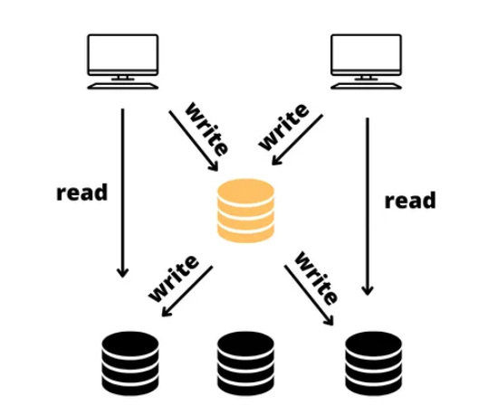
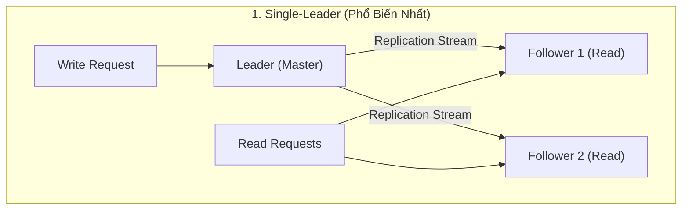

# Tuần 8: Database Replication (Nhân Bản Dữ Liệu)
> **Single-Leader, Multi-Leader và Leaderless: Bản chất, cơ chế đồng bộ và bài toán Replication Lag**  
> **Tác giả:** Franco Fernando (*The Polymathic Engineer* - Issue 51)  
> **Link bài gốc:** [newsletter.francofernando.com/p/replication](https://newsletter.francofernando.com/p/replication)  
> **Tệp gốc lưu trữ:** [HTML](file:///Users/kaka/learning/software_development/system_design/html/08_replication.html) | [Markdown gốc](file:///Users/kaka/learning/software_development/system_design/original_markdown/08_replication.md)

---

## 📌 Lời mở đầu

**Nhân bản dữ liệu (Replication)** là kỹ thuật lưu giữ các bản sao giống nhau của cùng một tập dữ liệu trên nhiều máy chủ vật lý khác nhau được kết nối qua mạng internet.

### 4 Lý do sống còn để thực hiện Replication:
1. **Tăng tính sẵn sàng (High Availability):** Nếu một máy chủ bị cháy phần cứng hoặc mất mạng, các máy chủ bản sao khác vẫn tiếp tục phục vụ người dùng.
2. **Mở rộng năng lực đọc (Read Scalability):** Đa số các ứng dụng web có tỉ lệ Đọc nhiều hơn Ghi rất nhiều (ví dụ tỉ lệ Đọc:Ghi của Twitter là 100:1). Việc thêm nhiều bản sao đọc (Read Replicas) giúp phân tải triệt để.
3. **Giảm độ trễ địa lý (Geographic Proximity):** Đặt bản sao dữ liệu tại các trung tâm dữ liệu ở Châu Á, Châu Âu, Châu Mỹ để người dùng ở từng khu vực truy cập nhanh nhất.
4. **Khắc phục thảm họa (Disaster Recovery):** Sao lưu dữ liệu dự phòng nóng (Hot Standby) sẵn sàng thay thế khi toàn bộ datacenter gặp sự cố.



---

## 1. Ba Kiến Trúc Replication Cốt Lõi

Để đồng bộ dữ liệu giữa các máy chủ, thế giới phân tán chia thành 3 mô hình kiến trúc nền tảng:



### 1.1. Single-Leader (Master-Slave / Primary-Replica)
- **Cơ chế:**
  - Chỉ có **DUY NHẤT một node Leader (Primary)** được quyền tiếp nhận các yêu cầu GHI (Write/Insert/Update/Delete).
  - Khi Leader ghi dữ liệu thành công vào ổ đĩa nội bộ (Write-Ahead Log - WAL), nó gửi dòng thay đổi (Replication Log/Stream) tới các node **Follower (Replicas)**.
  - Các node Follower **chỉ phục vụ các yêu cầu ĐỌC (Read-only)**.
- **Công nghệ tiêu biểu:** PostgreSQL, MySQL, Redis Master-Replica, MongoDB.

#### Các chế độ đồng bộ dữ liệu:
1. **Đồng bộ hoàn toàn (Synchronous Replication):**
   - Leader chỉ báo thành công cho Client sau khi TẤT CẢ follower đã ghi xong.
   - *Ưu điểm:* Đảm bảo không bao giờ mất dữ liệu.
   - *Nhược điểm:* Tốc độ ghi cực kỳ chậm; nếu 1 follower bị treo mạng thì toàn bộ thao tác ghi của hệ thống bị dừng lại (Block).
2. **Bất đồng bộ hoàn toàn (Asynchronous Replication):**
   - Leader ghi xong đĩa nội bộ là báo thành công ngay cho Client, sau đó mới gửi log cho Followers.
   - *Ưu điểm:* Tốc độ ghi cực nhanh, không phụ thuộc tốc độ của Followers.
   - *Nhược điểm:* Nếu Leader bị sập nguồn trước khi kịp gửi log sang Followers, các giao dịch vừa ghi sẽ **bị mất vĩnh viễn (Data Loss)** khi node Follower được bầu làm Leader mới!
3. **Bán đồng bộ (Semi-Synchronous Replication):**
   - Giải pháp dung hòa thực tế: Leader chỉ chờ **ít nhất 1 Follower** xác nhận đã nhận log là báo thành công, các follower còn lại đồng bộ ngầm.

---

### 1.2. Multi-Leader (Master-Master / Active-Active)
- **Cơ chế:** Có nhiều hơn một node Leader có quyền tiếp nhận thao tác GHI. Mỗi khi một Leader nhận write, nó sẽ nhân bản sang các Leader khác và các Follower tương ứng.
- **Trường hợp sử dụng:** Triển khai Multi-Datacenter (Mỗi trung tâm dữ liệu ở Mỹ, Âu, Á có 1 Leader riêng để người dùng ghi với độ trễ thấp).
- **Thách thức kinh hoàng: Xung Đột Ghi (Write Conflicts)!**
  - Hai người dùng ở hai lục địa cùng sửa tên của cùng một bài viết cùng một giây. Khi hai Leader đồng bộ với nhau, làm sao biết giá trị nào đúng?

```mermaid
flowchart LR
    subgraph DatacenterUS["Datacenter Mỹ"]
        UserA["User A: Sửa Title = 'Hello'"] --> LeaderUS["Leader US"]
    end
    subgraph DatacenterEU["Datacenter Châu Âu"]
        UserB["User B: Sửa Title = 'World'"] --> LeaderEU["Leader EU"]
    end
    LeaderUS <-->|XUNG ĐỘT GHI (Conflict)!| LeaderEU
```

#### Các chiến lược giải quyết xung đột ghi:
1. **Tránh xung đột (Conflict Avoidance):** Luôn điều hướng các request ghi của cùng một người dùng về đúng một Datacenter cố định (dựa theo User ID).
2. **Last Write Wins (LWW):** Dựa vào timestamp của máy chủ để chọn thao tác ghi muộn nhất, vứt bỏ thao tác trước. *(Nhược điểm: Đồng hồ giữa các máy chủ phân tán không bao giờ hoàn toàn đồng bộ, dễ làm mất dữ liệu oan).*
3. **CRDTs (Conflict-Free Replicated Data Types):** Cấu trúc dữ liệu toán học tự động hợp nhất kết quả mà không gây xung đột (được dùng trong Google Docs, Figma, collaborative editing).

---

### 1.3. Leaderless Replication (Dynamo-Style)
- **Cơ chế:** **Không có khái niệm Leader hay Master.** Client có thể gửi yêu cầu Đọc hoặc Ghi tới **BẤT KỲ node nào** trong cụm máy chủ.
- **Công nghệ tiêu biểu:** **Apache Cassandra**, **Amazon DynamoDB**, **ScyllaDB**, **Riak**.

#### Định lý Quorum Consensus (Đồng Thuận Đa Số):
Để đảm bảo tính nhất quán dữ liệu trong mô hình Leaderless, hệ thống sử dụng bộ 3 tham số:
- $N$ = Số lượng bản sao lưu trữ dữ liệu (Replication Factor, ví dụ $N = 3$).
- $W$ = Số lượng node tối thiểu phải xác nhận Ghi thành công để client nhận kết quả thành công.
- $R$ = Số lượng node tối thiểu phải phản hồi khi thực hiện thao tác Đọc.

> [!IMPORTANT]
> **Quy tắc Quorum cốt lõi:**
> $$W + R > N$$
> Nếu tổng số node Ghi ($W$) cộng với số node Đọc ($R$) lớn hơn tổng số bản sao ($N$), thì tập hợp các node được Đọc **chắc chắn sẽ chồng lấn (overlap)** với ít nhất một node vừa được Ghi giá trị mới nhất!
> 
> *Ví dụ kinh điển:* Với $N = 3$, ta chọn cấu hình **$W = 2$ và $R = 2$** ($2 + 2 = 4 > 3$). Khi đó, dù có 1 node bị chết hoặc mạng chập chờn, hệ thống vẫn đọc và ghi được dữ liệu mới nhất một cách an toàn!

---

## 2. Bài Toán Replication Lag & 3 Dị Thường Nhất Quán (Consistency Anomalies)

Trong các hệ thống dùng **Single-Leader Asynchronous Replication**, việc các Follower bị trễ dữ liệu vài giây so với Leader (**Replication Lag**) là điều tất yếu. Hiện tượng này sinh ra 3 dị thường trải nghiệm người dùng kinh điển:

### 2.1. Dị thường 1: Mất tính nhất quán Đọc-sau-khi-ghi (Read-After-Write Inconsistency)
- **Hiện tượng:** Người dùng cập nhật ảnh đại diện (Ghi vào Leader), trình duyệt lập tức tải lại trang (Đọc từ Follower đang bị lag 2s). Người dùng hoang mang vì thấy ảnh đại diện cũ!
- **Giải pháp:**
  - Đối với chính người dùng vừa thực hiện thao tác sửa: Ép buộc các request đọc của họ trong vòng 10 giây tiếp theo phải **được chuyển thẳng vào Leader**.
  - Đối với những người dùng khác: Vẫn cho đọc từ Follower bình thường.

### 2.2. Dị thường 2: Đọc ngược thời gian (Monotonic Reads Violation)
- **Hiện tượng:** Người dùng ấn F5 liên tục. Lần 1 request đọc trúng Follower A (lag 1s, thấy comment mới). Lần 2 request đọc trúng Follower B (lag 5s, không thấy comment đâu). Người dùng có cảm giác hệ thống bị "ngược thời gian".
- **Giải pháp:** Dùng cơ chế **Sticky Routing (User ID Hashing)** để đảm bảo một người dùng luôn luôn chỉ đọc từ một node Follower cố định.

### 2.3. Dị thường 3: Đọc sai thứ tự nhân quả (Consistent Prefix Reads)
- **Hiện tượng:** Người A hỏi *"Bạn có đó không?"*, Người B trả lời *"Có, tôi đây"*. Nhưng một người thứ ba nhìn thấy câu trả lời của B xuất hiện TRƯỚC câu hỏi của A do hai tin nhắn được đồng bộ qua 2 partition với độ trễ lệch nhau.
- **Giải pháp:** Đảm bảo các dữ liệu có mối quan hệ nhân quả (causally related) phải luôn được định tuyến vào **cùng một phân vùng (partition/shard)**.

---

## ⚖️ Bảng So Sánh 3 Kiến Trúc Replication

| Tiêu chí | Single-Leader | Multi-Leader | Leaderless (Dynamo) |
| :--- | :--- | :--- | :--- |
| **Độ phức tạp kiến trúc** | ⭐ Thấp (chuẩn mực, dễ hiểu) | ⭐⭐⭐⭐ Rất cao (xung đột ghi) | ⭐⭐⭐ Trung bình |
| **Khả năng scale Ghi** | 🔴 Giới hạn ở 1 máy chủ Leader | 🟢 Tốt (chia ra nhiều leader) | 🟢 Rất tốt (mọi node đều nhận write) |
| **Khả năng scale Đọc** | 🟢 Cực tốt (thêm nhiều follower) | 🟢 Cực tốt | 🟢 Cực tốt |
| **Rủi ro mất dữ liệu** | Có thể (khi failover bất đồng bộ) | Thấp | Rất thấp (nhờ Quorum $W+R>N$) |
| **Kịch bản phù hợp nhất** | RDBMS thông thường, ERP, E-commerce | Multi-region, app offline (Google Docs) | Time-series, IoT, giỏ hàng, viết cực nhiều |
