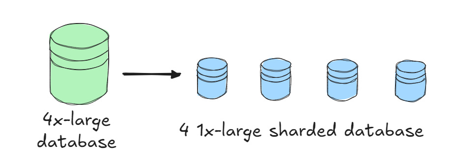
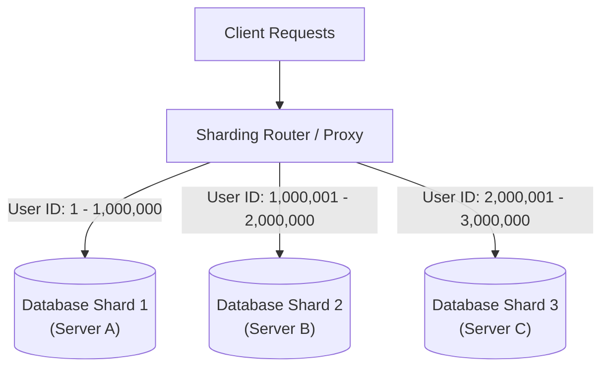

# Tuần 9: Database Sharding (Phân Mảnh Cơ Sở Dữ Liệu)
> **Giải pháp tối thượng để mở rộng dung lượng và tốc độ GHI dữ liệu quy mô Terabyte**  
> **Tác giả:** Franco Fernando (*The Polymathic Engineer* - Issue 105)  
> **Link bài gốc:** [newsletter.francofernando.com/p/a-comprehensive-guide-to-database](https://newsletter.francofernando.com/p/a-comprehensive-guide-to-database)  
> **Tệp gốc lưu trữ:** [HTML](file:///Users/kaka/learning/software_development/system_design/html/09_database_sharding.html) | [Markdown gốc](file:///Users/kaka/learning/software_development/system_design/original_markdown/09_database_sharding.md)

---

## 📌 Lời mở đầu

Ở tuần 8, chúng ta đã biết **Replication (Nhân bản)** là vũ khí tuyệt vời để scale các thao tác **ĐỌC (Read)**. Nhưng nếu ứng dụng của bạn tạo ra hàng triệu đơn hàng mỗi phút, hoặc dung lượng cơ sở dữ liệu phình to vượt quá 10 Terabyte thì sao?

Một máy chủ cơ sở dữ liệu đơn lẻ (Master) dù mạnh mẽ đến đâu cũng sẽ:
- Tràn dung lượng đĩa cứng.
- Nghẽn băng thông ghi (Disk I/O Bottleneck).
- Thời gian sao lưu (Backup) và phục hồi (Restore) mất cả ngày.

Đây là lúc bạn bắt buộc phải dùng tới **Database Sharding (Phân mảnh cơ sở dữ liệu)** — giải pháp mở rộng quy mô theo chiều ngang cho cả **Dung Lượng Lưu Trữ** và **Tốc Độ GHI (Write Throughput)**.

---

## 1. Sharding Là Gì? Phân Biệt Sharding vs Partitioning

**Sharding** là hình thức **Phân vùng ngang (Horizontal Partitioning)**, trong đó một bảng dữ liệu khổng lồ được chia nhỏ thành nhiều phần độc lập, và mỗi phần (**Shard**) được đặt trên một **máy chủ cơ sở dữ liệu vật lý riêng biệt**.

Mỗi Shard có schema giống hệt nhau, nhưng chứa các tập hợp hàng (rows) dữ liệu hoàn toàn khác nhau.

### Phân vùng Dọc (Vertical Partitioning) vs Phân vùng Ngang (Horizontal Partitioning / Sharding):
- **Phân vùng Dọc (Vertical):** Tách các cột trong một bảng ra nhiều bảng/database khác nhau. Ví dụ: Tách bảng `User` thành `User_Profile` (tên, avatar - đọc nhiều) và `User_Auth` (mật khẩu, 2FA - bảo mật cao).
- **Phân vùng Ngang (Sharding):** Giữ nguyên số cột, chia cắt số dòng dữ liệu ra nhiều máy chủ khác nhau dựa trên một tiêu chí phân loại gọi là **Sharding Key**.

---

## 2. Tiêu Chí Chọn Khóa Phân Vùng (Sharding Key)

**Khóa phân vùng (Sharding Key)** là quyết định kiến trúc quan trọng nhất khi triển khai Sharding. Một khi đã chọn sai Sharding Key, việc đổi lại khi hệ thống đang chạy là một thảm họa kỹ thuật!

Một Sharding Key lý tưởng cần thỏa mãn 3 tiêu chuẩn:
1. **Phân phối dữ liệu đồng đều (High Cardinality):** Đảm bảo dữ liệu dàn đều trên tất cả các shard, tránh tình trạng 1 shard gánh 80% dữ liệu.
2. **Tránh điểm nóng (Avoid Hotspots):** Các thao tác ghi và đọc không bị tập trung dồn dập vào cùng 1 shard tại một thời điểm.
3. **Phù hợp với các câu truy vấn phổ biến nhất:** Cho phép phần lớn các câu query chỉ cần chạm vào duy nhất một shard thay vì phải scan toàn bộ cụm.

---

## 3. Các Chiến Lược Sharding Phổ Biến

### 3.1. Sharding Theo Khoảng (Range-Based Sharding)
- **Cách làm:** Chia dữ liệu theo các khoảng giá trị cố định của Sharding Key.
  - Ví dụ theo ID: Shard 1 chứa ID từ $1 \rightarrow 1,000,000$; Shard 2 chứa từ $1,000,001 \rightarrow 2,000,000$.
  - Ví dụ theo Ngày tháng: Shard 2024 chứa dữ liệu năm 2024; Shard 2025 chứa dữ liệu năm 2025.
- **Ưu điểm:** Cực kỳ dễ triển khai; các câu truy vấn theo dải (Range Query) trong cùng một shard diễn ra rất nhanh.
- **Nhược điểm chết người:** **Hiện tượng Hotspot Shard!** Người dùng mới đăng ký hoặc đơn hàng mới tạo luôn có ID/Ngày tháng mới nhất, dẫn đến toàn bộ traffic ghi đổ dồn vào đúng một Shard mới nhất, khiến shard đó sập vì quá tải trong khi các shard cũ ngồi chơi!

### 3.2. Sharding Theo Băm (Hash-Based Sharding)
- **Cách làm:** Dùng hàm băm (Hash Function như MD5, MurmurHash) trên Sharding Key:
  $$\text{Shard ID} = \text{Hash}(\text{user\_id}) \pmod{\text{Total Shards}}$$
- **Ưu điểm:** Dữ liệu và lưu lượng ghi được phân bổ ngẫu nhiên **cực kỳ đồng đều** trên toàn bộ các shard, triệt tiêu nguy cơ Hotspot.
- **Nhược điểm:**
  - Không thể thực hiện Range Query hiệu quả (phải dùng Scatter-Gather).
  - Khó mở rộng thêm Shard: Nếu tăng từ 4 shards lên 5 shards, công thức modulo đổi khiến hầu hết dữ liệu bị đổi vị trí, đòi hỏi phải di chuyển dữ liệu hàng loạt *(Khắc phục bằng **Consistent Hashing** - xem Tuần 11)*.

### 3.3. Sharding Theo Bảng Tra Cứu (Directory-Based / Lookup Table)
- **Cách làm:** Duy trì một dịch vụ tra cứu trung tâm (Lookup Table) ghi nhận rõ: `User A -> Shard 2`, `User B -> Shard 5`.
- **Ưu điểm:** Linh hoạt tối đa. Cho phép di chuyển từng khách hàng lớn sang một Shard riêng mà không ảnh hưởng người khác.
- **Nhược điểm:** Tốn thêm 1 lần gọi mạng (Network Hop) để tra cứu bảng trước mỗi query; dịch vụ Lookup có nguy cơ trở thành SPOF.

---

## 4. Bốn Mặt Tối Của Sharding (The Dark Sides of Sharding)

Trước khi quyết định sharding database, bạn phải chuẩn bị tâm lý đối mặt với 4 bài toán hóc búa:

### 4.1. Câu Lệnh JOIN Xuyên Shard (Cross-Shard Joins)
Trong database đơn lẻ, lệnh `JOIN` giữa 2 bảng là chuyện bình thường. Khi sharding, nếu bảng `Orders` nằm ở Shard 1 còn bảng `Users` nằm ở Shard 2, database engine không thể tự JOIN được.
- *Giải pháp:* Phải thực hiện JOIN ở tầng ứng dụng (Application Layer Join), hoặc chấp nhận **phi chuẩn hóa dữ liệu (Denormalization)** — sao chép một số thông tin cần thiết của User lưu trực tiếp vào bảng Order.

### 4.2. Giao Dịch Phân Tán (Distributed Transactions)
Khi một thao tác cần cập nhật đồng thời dữ liệu trên Shard 1 và Shard 2, việc đảm bảo tính chất ACID đòi hỏi các giao thức đồng thuận phức tạp như **Two-Phase Commit (2PC)**.
- *Hậu quả:* 2PC làm tăng độ trễ lên gấp hàng chục lần và tiềm ẩn rủi ro khóa chết (Deadlock/Blocking). Đa số các hệ sinh thái phân tán hiện đại chuyển sang dùng **Mẫu Kiến Trúc Saga (Saga Pattern)** dựa trên Message Queue để đạt tính nhất quán sau cùng (**Eventual Consistency**).

### 4.3. Tái Phân Mảnh (Re-sharding & Live Migration)
Khi một shard bị đầy dung lượng, bạn cần tăng từ 8 shards lên 16 shards. Việc di chuyển hàng Terabyte dữ liệu giữa các máy chủ mà **không được phép dừng hệ thống (Zero Downtime)** là một trong những thử thách vận hành rủi ro nhất.

### 4.4. Bài Toán Người Nổi Tiếng (Celebrity Problem / Hotspot Key)
Nếu hệ thống của bạn là mạng xã hội và tài khoản của một ngôi sao nổi tiếng (như Cristiano Ronaldo với 600 triệu follower) rơi vào Shard 3, mỗi khi anh ấy đăng bài, hàng triệu lượt like và comment sẽ lập tức đánh sập Shard 3 trong khi các shard khác vẫn nhàn rỗi.
- *Giải pháp:* Phải có cơ chế đặc biệt cho các Celebrity IDs (tách riêng cache, phân tán comment qua nhiều shard phụ).

---

## 5. Các Phương Án Cần Thử Trước Khi Quyết Định Sharding

> [!CAUTION]
> **Quy tắc vàng của System Design:** **ĐỪNG SHARDING CHO ĐẾN KHI BẮT BUỘC PHẢI SHARDING!**  
> Độ phức tạp quản trị và chi phí vận hành của một cụm database sharding lớn hơn gấp 10 lần một database thông thường.

Hãy đảm bảo bạn đã thử hết các giải pháp sau trước khi nghĩ đến Sharding:
1. **Scale Up (Nâng cấp phần cứng):** Thuê máy chủ AWS RDS lớn hơn (ví dụ 64 cores, 512 GB RAM, ổ đĩa io2 SSD với 64,000 IOPS).
2. **Thêm Read Replicas:** Tách các câu query đọc ra các máy bản sao, giải phóng 90% tải cho máy Master.
3. **Thêm Cache triệt để:** Dùng Redis/Memcached chặn 80-90% lượng request trước khi chúng chạm vào Database.
4. **Lọc và Lưu trữ Lạnh (Data Archiving):** Chuyển các dữ liệu cũ trên 1 năm không còn hoạt động sang lưu trữ giá rẻ như **AWS S3** hoặc kho dữ liệu phân tích **ClickHouse / BigQuery**.
5. **Cân nhắc Distributed NewSQL:** Nếu bắt buộc phải scale ngang dữ liệu SQL, hãy xem xét các hệ quản trị CSDL thế hệ mới tự động sharding trong suốt như **CockroachDB**, **TiDB** hoặc **Google Cloud Spanner**.
