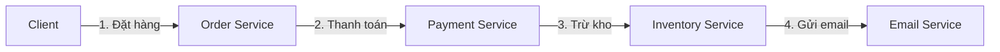
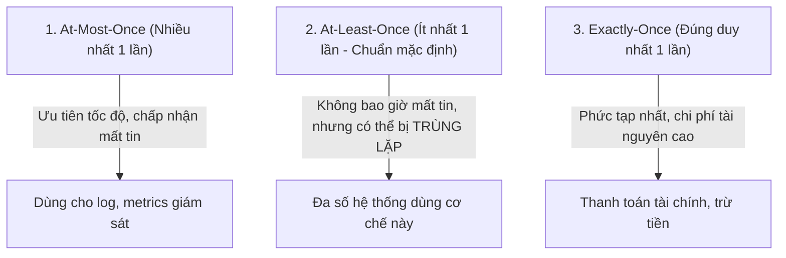
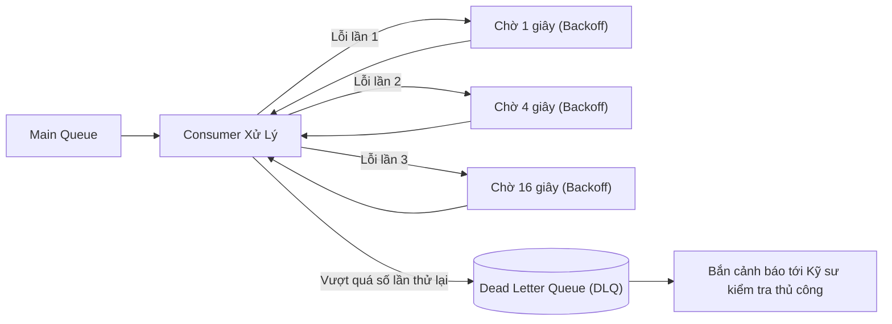

# Tuần 10: Hàng Đợi Thông Điệp & Kiến Trúc Hướng Sự Kiện (Message Queues & Event-Driven Architecture)
> **Cách tách rời các dịch vụ, san phẳng đỉnh tải (Traffic Spikes) và xử lý bất đồng bộ quy mô lớn**  
> **Chủ đề bổ trợ hoàn thiện Lộ trình 12 tuần System Design**

---

## 📌 Lời mở đầu

Trong kiến trúc đồng bộ truyền thống (Synchronous Request-Response qua REST hoặc gRPC), khi một yêu cầu đến, Service A phải gọi Service B, Service B gọi tiếp Service C, và người dùng phải ngồi chờ toàn bộ chuỗi này hoàn thành mới nhận được phản hồi.



### 3 Nhược điểm chí mạng của kiến trúc đồng bộ:
1. **Độ trễ cộng dồn (Cascading Latency):** Tổng thời gian phản hồi bằng tổng thời gian của tất cả các service con cộng lại.
2. **Khả năng chịu lỗi kém (Tight Coupling):** Nếu dịch vụ Email bị treo hoặc mất mạng 5 giây, toàn bộ thao tác Đặt hàng của khách hàng sẽ bị báo lỗi thất bại!
3. **Dễ chết chìm khi gặp tải đỉnh (Traffic Spikes):** Nếu lượng đơn hàng tăng gấp 20 lần trong đợt Flash Sale, các service hậu cần phía sau sẽ lập tức bị quá tải và sập đổ dây chuyền.

**Message Queue (Hàng đợi thông điệp)** chính là chiếc van giảm áp cứu tinh cho các hệ thống phân tán hiện đại.

---

## 1. Bản Chất Của Message Queue: Bộ Đệm Bất Đồng Bộ

Message Queue hoạt động theo nguyên lý **Người sản xuất (Producer) - Người tiêu thụ (Consumer)**:

```mermaid
flowchart LR
    P["Producer<br/>(Order Service)"] -->|Gửi message tức thì (10ms)| MQ[("Message Queue<br/>(Kafka / RabbitMQ / SQS)")]
    MQ -->|Lưu trữ bền vững trên đĩa| MQ
    MQ -->|Kéo message theo tốc độ xử lý| C1["Consumer 1<br/>(Inventory)"]
    MQ -->|Kéo message theo tốc độ xử lý| C2["Consumer 2<br/>(Email / SMS)"]
    MQ -->|Kéo message theo tốc độ xử lý| C3["Consumer 3<br/>(Analytics)"]
```

### 3 Lợi ích kiến trúc mang tính sống còn:
1. **Tách rời dịch vụ (Decoupling):** Order Service chỉ cần ném sự kiện `OrderCreated` vào hàng đợi là có thể lập tức trả kết quả thành công cho người dùng trong **vài milli-giây**. Nó không cần quan tâm dịch vụ Email hay Kho bãi đang làm gì.
2. **Cắt đỉnh tải (Peak Shaving / Traffic Buffering):** Khi có đợt Flash Sale với 50,000 đơn hàng/giây, hàng đợi đóng vai trò như một hồ chứa nước khổng lồ lưu trữ toàn bộ message. Các Consumer phía sau cứ thong thả xử lý với tốc độ an toàn (ví dụ 2,000 đơn/giây) mà không sợ bị sập máy chủ.
3. **Khả năng chịu lỗi độc lập (Fault Tolerance):** Nếu dịch vụ gửi Email bị sập trong 30 phút, các tin nhắn vẫn nằm an toàn trong Queue. Khi dịch vụ Email khởi động lại, nó tiếp tục lấy tin nhắn ra xử lý mà không làm mất bất kỳ thông tin nào của khách hàng.

---

## 2. So Sánh Hai Mô Hình: Message Broker (RabbitMQ) vs Event Streaming (Kafka)

Trong thực tế, có hai trường phái hàng đợi thông điệp chính:

| Tiêu chí | RabbitMQ (Message Broker truyền thống) | Apache Kafka (Distributed Event Streaming) |
| :--- | :--- | :--- |
| **Mô hình xử lý** | Đẩy tin nhắn (Push model). Sau khi Consumer nhận và Ack, tin nhắn sẽ **bị xóa khỏi queue**. | Kéo tin nhắn (Pull model). Message được lưu như một **nhật ký phân tán (Distributed Commit Log)** bền vững. |
| **Lưu trữ dữ liệu** | Tạm thời trong RAM và đĩa; dung lượng queue dài sẽ làm chậm broker. | Lưu trên đĩa hàng tuần/hàng tháng mà **không làm giảm hiệu năng**. |
| **Phát lại (Replay)** | Không thể (đã xóa sau khi đọc). | Có thể phát lại dữ liệu từ quá khứ bằng cách tua lại con trỏ (**Consumer Offset**). |
| **Thông lượng (Throughput)**| Hàng chục ngàn message/giây. | Hàng triệu message/giây (nhờ cơ chế gom batch, Zero-copy, và tuần tự đĩa). |
| **Kịch bản phù hợp** | Giao việc phức tạp, định tuyến linh hoạt (Routing Key, Exchange), hệ thống tài chính vi mô. | Xử lý Big Data, Event Sourcing, Activity Tracking, Clickstream, phân tích thời gian thực. |

---

## 3. Các Cấp Độ Cam Kết Phân Phối (Message Delivery Semantics)

Trong mạng phân tán, tin nhắn có thể bị mất hoặc gửi trùng lặp do timeout hoặc rớt mạng:



### Giải pháp kỹ thuật bắt buộc: Tính Khả Nghịch (Idempotency)
Vì đa số các hệ thống như Kafka, RabbitMQ, SQS đều hoạt động ở chế độ **At-Least-Once (Ít nhất một lần)**, nên Consumer **chắc chắn sẽ nhận phải các message bị gửi trùng lặp (Duplicate Messages)** khi mạng gặp sự cố!

> [!IMPORTANT]
> **Quy tắc vàng:** Tất cả các Consumer trong hệ thống phân tán **BẮT BUỘC PHẢI CÓ TÍNH KHẢ NGHỊCH (IDEMPOTENT)**!  
> *Một thao tác được gọi là Idempotent nếu bạn thực hiện nó 1 lần hay 100 lần thì kết quả trạng thái cuối cùng của hệ thống vẫn giống hệt nhau.*

#### Cách thiết kế Idempotent Consumer:
1. Mỗi message khi Producer sinh ra phải gắn kèm một mã định danh duy nhất: **`idempotency_key` (hoặc `transaction_id`)**.
2. Khi Consumer nhận message, trước khi thực hiện logic xử lý (như trừ tiền), nó kiểm tra trong Redis hoặc Database xem `idempotency_key` này đã được xử lý chưa:
   - **Nếu chưa có:** Tiến hành xử lý và lưu `idempotency_key` vào Database trong cùng một transaction.
   - **Nếu đã có:** Bỏ qua message đó ngay lập tức và xác nhận (Ack) thành công.

---

## 4. Xử Lý Tin Nhắn Lỗi: Dead Letter Queue (DLQ) & Exponential Backoff

Điều gì xảy ra nếu một message bị lỗi cú pháp (Poison Pill Message) khiến Consumer đọc vào là bị crash ứng dụng? Nếu cứ retry liên tục, hệ thống sẽ rơi vào vòng lặp vô tận và làm tắc nghẽn toàn bộ hàng đợi.



1. **Exponential Backoff with Jitter:** Tăng dần thời gian chờ giữa các lần thử lại (ví dụ $1s \rightarrow 2s \rightarrow 4s \rightarrow 8s$) cộng thêm một độ trễ ngẫu nhiên (Jitter) để tránh việc hàng triệu Consumer cùng đồng thanh retry vào cùng một giây (*Thundering Herd Problem*).
2. **Dead Letter Queue (DLQ):** Khi số lần retry vượt quá ngưỡng (ví dụ 3 lần), message lỗi sẽ được tách riêng và đẩy vào hàng đợi DLQ để không làm ảnh hưởng các tin nhắn khác, đồng thời kích hoạt cảnh báo tới đội ngũ vận hành.
