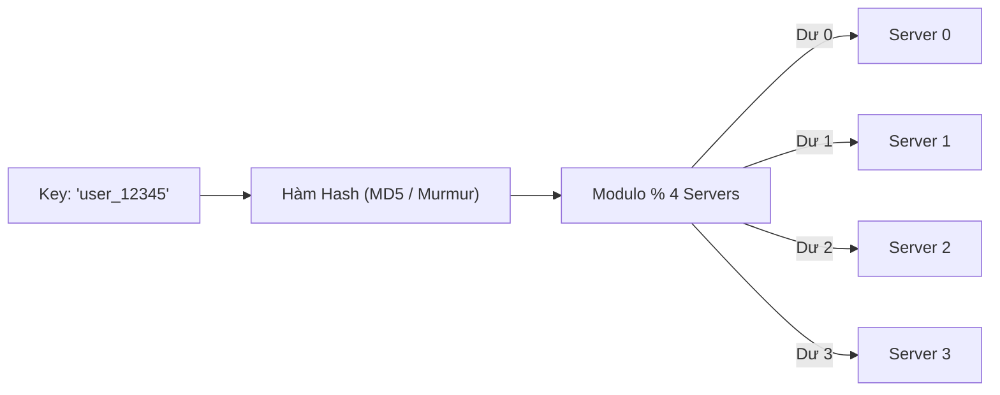
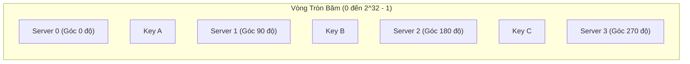
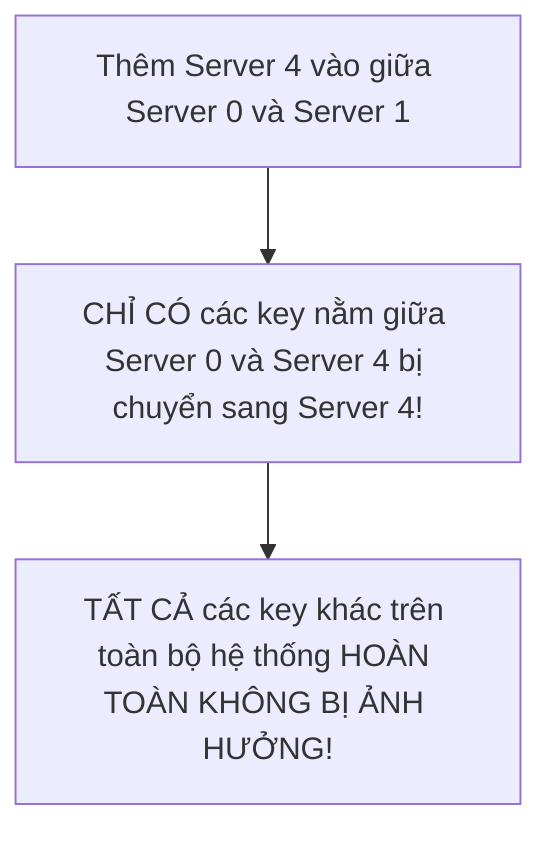
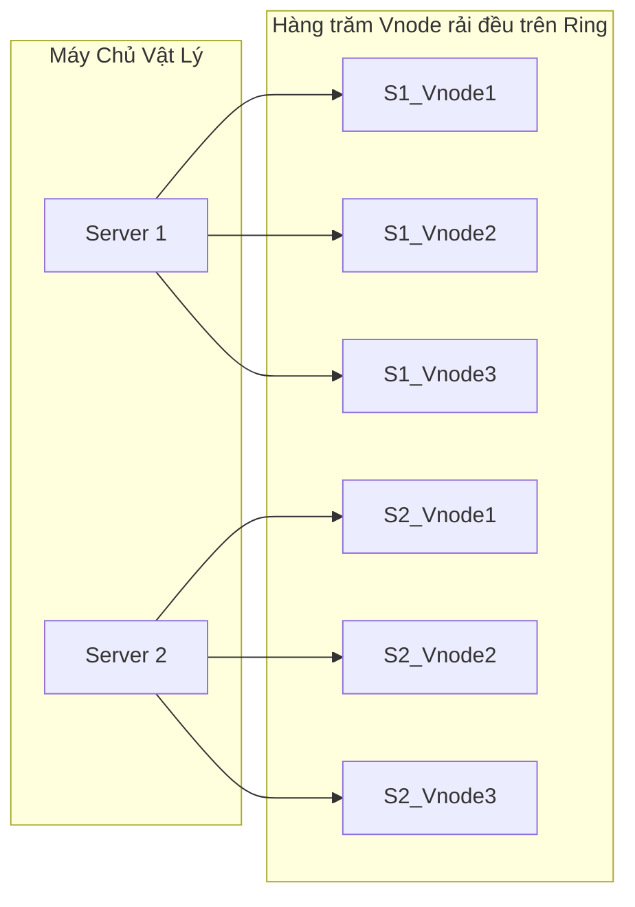

# Tuần 11: Consistent Hashing & Điều Phối Phân Tán (Consistent Hashing & Coordination)
> **Thuật toán băm nhất quán: Chìa khóa vàng giải quyết bài toán scale động của Redis Cluster, Cassandra và DynamoDB**  
> **Chủ đề bổ trợ hoàn thiện Lộ trình 12 tuần System Design**

---

## 📌 Lời mở đầu

Khi bạn xây dựng một cụm Cache phân tán (gồm 4 máy chủ Redis) hoặc cụm Database phân tán (như Cassandra), làm sao bạn quyết định một dữ liệu người dùng (`user_12345`) sẽ được lưu trữ trên máy chủ nào?

Cách tiếp cận ngây thơ nhất của hầu hết các lập trình viên là dùng phép chia lấy dư (**Modulo Hashing**):
$$\text{Server Index} = \text{Hash}(\text{key}) \pmod N$$
*(với $N$ là tổng số lượng máy chủ trong cụm).*

### Thảm Họa Của Phép Modulo Khi Cụm Máy Chủ Thay Đổi:
Điều gì xảy ra nếu hệ thống của bạn cần thêm 1 máy chủ (từ 4 lên 5 máy) để chịu tải dịp Black Friday, hoặc 1 máy chủ bị mất điện đột ngột (từ 4 giảm xuống 3 máy)?

$$N \text{ thay đổi từ } 4 \rightarrow 5$$

Bởi vì mẫu số $N$ đã thay đổi, nên kết quả của phép tính `Hash(key) % N` đối với **hầu hết tất cả các key sẽ bị thay đổi vị trí**!
- Hơn **80% đến 90% các key** sẽ trỏ sai máy chủ.
- Toàn bộ dữ liệu trong Cache trở thành vô dụng (**Cache Miss hàng loạt**).
- Hàng triệu kết nối đồng thời đổ ập xuống Cơ sở dữ liệu phía dưới, tạo ra một trận **Tuyết Lở Cache (Cache Avalanche)** đánh sập hoàn toàn hệ thống!

**Consistent Hashing (Thuật toán băm nhất quán)** ra đời để giải quyết triệt để thảm họa này.

---

## 1. Nguyên Lý Vòng Tròn Băm (The Hash Ring)

Consistent Hashing được phát minh tại Viện MIT bởi David Karger và các cộng sự (sau này được áp dụng thành công rực rỡ tại Akamai, Amazon và Discord).

Thay vì băm key theo số lượng server $N$, thuật toán ánh xạ cả **Máy chủ (Servers)** lẫn **Dữ liệu (Keys)** lên một **Vòng tròn băm (Hash Ring)** có dải giá trị từ $0$ đến $2^{32} - 1$:

### Quy tắc lưu trữ:
1. Mỗi máy chủ được băm địa chỉ IP hoặc Hostname để xác định một vị trí cố định trên vòng tròn: `Position = Hash(Server_IP)`.
2. Khi có một dữ liệu cần lưu: Băm key để tìm tọa độ trên vòng tròn: `Position = Hash(Key)`.
3. **Quy tắc kim đồng hồ (Clockwise):** Từ vị trí của Key, ta di chuyển theo chiều kim đồng hồ cho đến khi gặp máy chủ đầu tiên. Key đó sẽ được lưu trữ tại máy chủ này!

---

## 2. Phép Màu Khi Thêm Hoặc Xóa Máy Chủ

### 2.1. Khi một máy chủ mới được thêm vào (Server Added):
Giả sử ta thêm `Server 4` nằm giữa `Server 0` và `Server 1`:

> [!IMPORTANT]
> Với Consistent Hashing, khi thêm hoặc bớt một máy chủ, trung bình chỉ có **$1/N$ lượng dữ liệu cần phải di chuyển** (với $N$ là tổng số máy chủ). Hơn 80-90% dữ liệu còn lại vẫn nằm nguyên vị trí cũ!

---

## 3. Khắc Phục Lệch Tải Với Các Node Ảo (Virtual Nodes / Vnodes)

Trong mô hình vòng tròn băm cơ bản, có 2 nguy cơ tiềm ẩn:
1. **Dữ liệu phân bố không đều (Non-uniform Distribution):** Do hàm băm ngẫu nhiên, các máy chủ có thể nằm rất gần nhau, khiến một máy chủ phải gánh một cung tròn quá lớn còn máy chủ khác lại gánh một cung tròn rất nhỏ.
2. **Hiệu ứng sập dây chuyền (Cascading Failure):** Nếu Server 1 bị sập, toàn bộ dữ liệu của Server 1 sẽ dồn hết sang cho Server kế tiếp (Server 2), khiến Server 2 bị quá tải và sập theo.

### Giải pháp kỹ thuật: Virtual Nodes (Node Ảo)
Thay vì ánh xạ mỗi máy chủ vật lý thành **1 điểm duy nhất**, thuật toán gán cho mỗi máy chủ vật lý hàng trăm **điểm ảo (Virtual Nodes / Vnodes)** rải rác khắp vòng tròn (ví dụ Server 1 có `Server1#1`, `Server1#2`, `Server1#100`...):

- **Kết quả:** Dữ liệu được phân bổ đồng đều tuyệt đối trên toàn bộ cụm máy chủ.
- **Khi một máy chủ bị sập:** Các vnode của nó biến mất, nhưng gánh nặng dữ liệu của nó được chia đều cho **TẤT CẢ các máy chủ còn lại** trên vòng tròn, ngăn chặn triệt để hiện tượng sập dây chuyền!

---

## 4. Điều Phối Phân Tán (Distributed Coordination)

Trong một cụm phân tán gồm hàng trăm node, làm sao các máy chủ biết được:
- Ai đang gia nhập cụm? Ai vừa bị sập?
- Ai đang giữ vai trò Leader?
- Bản đồ Vòng tròn băm (Hash Ring) hiện tại ra sao?

### 4.1. Giao thức đồn thổi (Gossip Protocol - Decentralized)
- Được dùng trong **Apache Cassandra**, **Amazon DynamoDB**, **Consul**.
- Các máy chủ định kỳ gửi thông điệp "ngồi lê đôi mách" (gossip) ngẫu nhiên cho một vài máy chủ lân cận về trạng thái của mình và những gì mình biết về các máy khác.
- Sau vài trăm milli-giây, thông tin về một node bị sập hoặc node mới sẽ được lan truyền đến **100% các node trong toàn cụm** theo hàm số mũ mà không cần máy chủ điều phối trung tâm.

### 4.2. Dịch vụ điều phối đồng thuận (Consensus Coordination - Raft / Paxos)
- Được dùng trong **Apache Kafka (KRaft)**, **Kubernetes (etcd)**, **ZooKeeper**.
- Một nhóm nhỏ các node (3 hoặc 5 node) chạy thuật toán đồng thuận như **Raft** hoặc **Paxos** để đảm bảo tính nhất quán tuyệt đối về trạng thái cụm, danh sách các node đang sống và phân chia phân vùng (Partition Leader Election).
