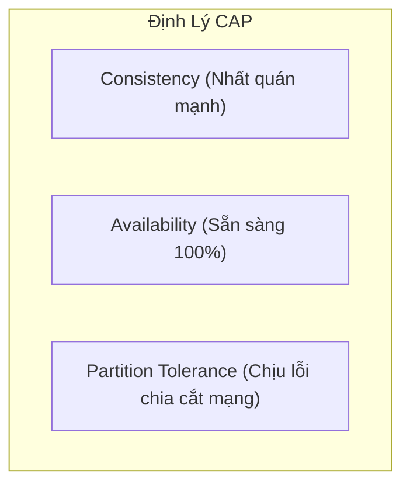
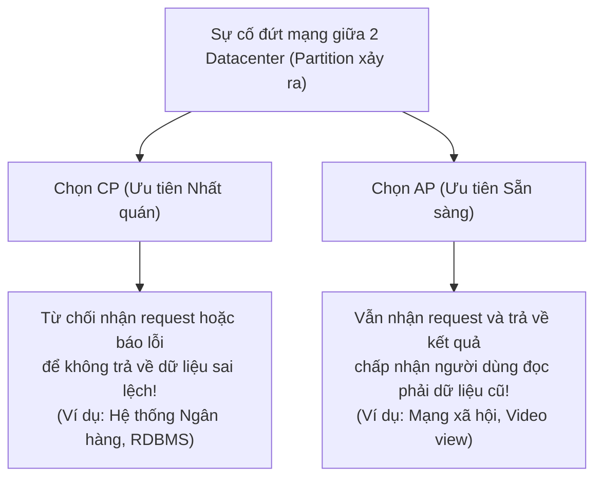
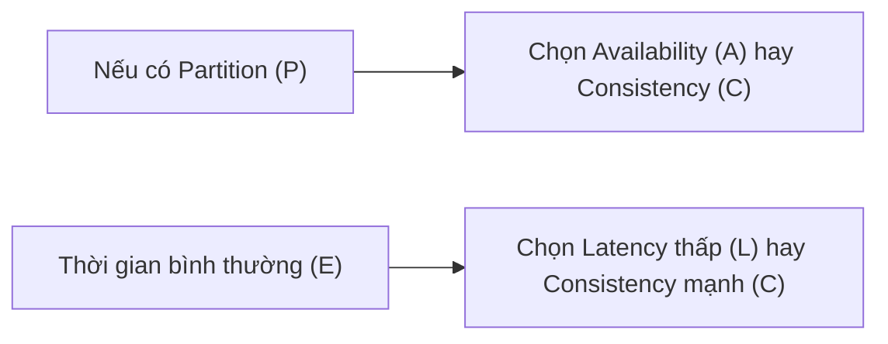
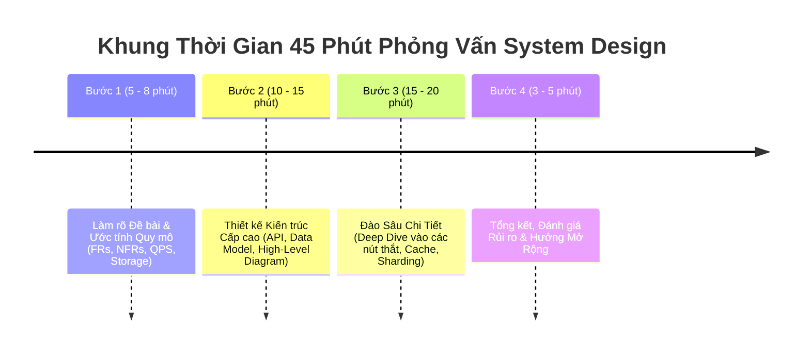
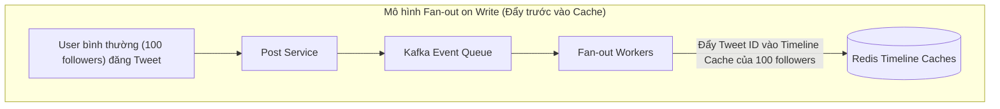
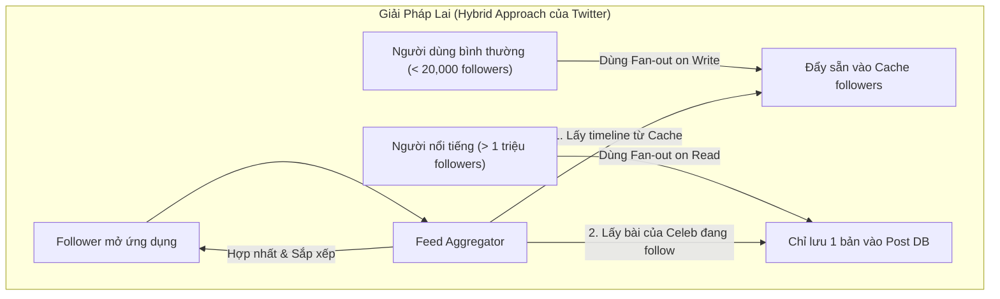

# Tuần 12: Định Lý CAP, PACELC & Case Study Tổng Hợp
> **Đỉnh cao của nghệ thuật đánh đổi và khung sườn 4 bước giải quyết mọi bài toán System Design**  
> **Chủ đề tổng kết hoàn thiện Lộ trình 12 tuần System Design**

---

## 📌 Lời mở đầu

Chào mừng bạn đến với tuần học thứ 12 — chặng cuối của lộ trình. Đến thời điểm này, bạn đã trang bị đầy đủ các khối linh kiện nền tảng: từ Xác định yêu cầu, Ước tính quy mô, Latency/Throughput, High Availability, Scale Cube, Load Balancer, Caching, Replication, Sharding, Message Queue cho đến Consistent Hashing.

Ở tuần này, chúng ta sẽ xâu chuỗi tất cả lại thông qua:
1. **Định lý CAP & PACELC:** Bản chất tối thượng của mọi sự đánh đổi trong hệ thống phân tán.
2. **Khung sườn 4 bước (The 4-Step Framework):** Phương pháp chuẩn mực để tự tin dẫn dắt bất kỳ buổi phỏng vấn hoặc phiên họp kiến trúc nào.
3. **Case Study thực chiến tổng hợp:** Thiết kế hoàn chỉnh một hệ thống từ đầu đến cuối.

---

## 1. Định Lý CAP: Sự Hiểu Lầm Phổ Biến Nhất

Năm 2000, Giáo sư Eric Brewer đưa ra phỏng đoán CAP (sau này được Seth Gilbert và Nancy Lynch chứng minh thành định lý toán học năm 2002):

- **Consistency (Tính nhất quán mạnh - Linearizability):** Mọi thao tác đọc đều nhận được dữ liệu vừa được ghi mới nhất hoặc trả về lỗi. Không bao giờ được trả về dữ liệu cũ.
- **Availability (Tính sẵn sàng):** Mọi request không bị lỗi đều phải nhận được phản hồi thành công (non-error response), dù không đảm bảo là dữ liệu mới nhất.
- **Partition Tolerance (Tính chịu lỗi phân mảnh mạng):** Hệ thống vẫn tiếp tục hoạt động dù kết nối mạng giữa các cụm máy chủ bị đứt hoặc trễ nghiêm trọng.

### ⚠️ Hiểu lầm kinh điển: "Được chọn 2 trong 3 (CA, CP, AP)"
Nhiều người nghĩ bạn có thể chọn một hệ thống **CA (vừa Nhất quán vừa Sẵn sàng)**. **ĐÂY LÀ ĐIỀU BẤT KHẢ THI TRONG THẾ GIỚI PHÂN TÁN!**

> [!IMPORTANT]
> Mạng internet và cáp quang vật lý **chắc chắn sẽ có lúc bị lỗi hoặc đứt cáp (Network Partition)**.  
> Do đó, **Partition Tolerance ($P$) là bắt buộc (Non-negotiable)**.  
> Khi sự cố mạng xảy ra, bạn chỉ có duy nhất **2 sự lựa chọn: CP hoặc AP**!

---

## 2. Định Lý PACELC: Bức Tranh Hoàn Hảo Hơn

Năm 2012, Daniel Abadi nhận thấy định lý CAP chỉ nói về thời điểm **khi có sự cố mạng xảy ra (If Partition)**. Vậy trong điều kiện bình thường (hơn 99.9% thời gian), hệ thống phải đánh đổi điều gì?

Định lý **PACELC** mở rộng:
- **Nếu có Partition ($P$):** Chọn giữa Availability ($A$) hay Consistency ($C$).
- **Ngược lại / Bình thường ($E$ - Else):** Bạn phải chọn giữa **Latency ($L$)** hay **Consistency ($C$)**!

- **Ví dụ hệ thống PA/EL (như Cassandra, DynamoDB):** Khi mạng đứt, ưu tiên Sẵn sàng ($A$); khi bình thường, ưu tiên Tốc độ phản hồi cực nhanh ($L$), chấp nhận dữ liệu nhất quán sau cùng.
- **Ví dụ hệ thống PC/EC (như MongoDB, HBase, Spanner):** Khi mạng đứt, ưu tiên Nhất quán ($C$); khi bình thường, sẵn sàng chờ đồng bộ để đảm bảo Nhất quán ($C$).

---

## 3. Khung Sườn 4 Bước Phỏng Vấn System Design (The 4-Step Framework)

Đừng bao giờ bước vào một buổi thiết kế hệ thống mà không có kế hoạch tác chiến rõ ràng. Hãy tuân thủ nghiêm ngặt 4 bước sau:

### Bước 1: Làm rõ đề bài và chốt phạm vi (Scope & Estimations)
- Hỏi người phỏng vấn để chốt **3-4 tính năng cốt lõi (FRs)**.
- Đặt câu hỏi về quy mô: DAU, QPS đọc/ghi, dung lượng lưu trữ trong 5 năm (NFRs).
- Ghi các con số tóm tắt lên bảng.

### Bước 2: Thiết kế cấp cao (High-Level Design)
- Định nghĩa các hàm API chính (REST / gRPC).
- Thiết kế mô hình dữ liệu (Database Schema: SQL hay NoSQL?).
- Vẽ sơ đồ tổng thể: Client $\rightarrow$ DNS/CDN $\rightarrow$ Load Balancer $\rightarrow$ Web Server $\rightarrow$ Database.

### Bước 3: Đào sâu vào các điểm nghẽn (Deep Dive)
- Đây là phần ăn điểm nhất! Hãy chủ động chỉ ra các điểm yếu:
  - *"Database này sẽ bị nghẽn I/O khi đạt 10,000 QPS, chúng ta cần bổ sung Redis Cache theo mẫu Cache-Aside."*
  - *"Để xử lý đợt tải đỉnh lúc Flash Sale, ta đẩy các tác vụ gửi thông báo vào Kafka Queue."*
  - *"Khi dung lượng vượt 5TB, ta sẽ sharding theo Hash của `user_id` dùng Consistent Hashing."*

### Bước 4: Tổng kết và đánh giá đánh đổi (Wrap-up)
- Chỉ ra các Single Point of Failure (SPOF) còn tồn tại và cách khắc phục.
- Nêu các kịch bản lỗi: Nếu một Datacenter bị mất điện thì hệ thống failover ra sao?
- Đề xuất hệ thống Giám sát & Cảnh báo (Prometheus, Grafana, Distributed Tracing).

---

## 4. Case Study Tổng Hợp: Thiết Kế Hệ Thống Đăng Bài & Bảng Tin (Twitter / News Feed)

Để xem cách tất cả 12 chủ đề kết hợp nhịp nhàng, hãy xem bài toán kinh điển: **Thiết kế News Feed của Twitter**.

### Vấn đề cốt lõi: Fan-out on Write vs Fan-out on Read
Khi một người dùng đăng một tweet mới, làm sao để hàng triệu người theo dõi (followers) của họ nhìn thấy tweet đó trên dòng thời gian (Timeline) với độ trễ dưới 200ms?

- **Mô hình Đẩy (Fan-out on Write):**
  - Mỗi khi user đăng bài, background workers sẽ tìm danh sách followers và ghi thẳng ID bài viết vào Cache dòng thời gian của từng follower.
  - *Ưu điểm:* Khi người dùng mở app đọc News Feed, độ trễ cực nhanh (**O(1)** vì chỉ việc đọc từ Redis Cache).
  - *Cơn ác mộng Celebrity:* Nếu một ngôi sao có 100 triệu followers đăng bài, hệ thống phải thực hiện 100 triệu thao tác ghi vào Redis! Điều này làm nghẽn toàn bộ hàng đợi.

> [!TIP]
> **Bài học kiến trúc tối thượng:** Không có một giải pháp đơn lẻ nào giải quyết được mọi trường hợp. Các hệ thống hàng đầu thế giới (Twitter, Netflix, Uber) luôn sử dụng **Giải Pháp Lai (Hybrid Architecture)** — kết hợp linh hoạt nhiều mẫu thiết kế để bù trừ nhược điểm cho nhau.

---

## 🎓 Lời Kết Lộ Trình

Học System Design không phải là học thuộc lòng các sơ đồ để trả bài phỏng vấn. Đó là rèn luyện **tư duy phân tích có hệ thống**, khả năng **lường trước rủi ro** và sự thấu hiểu sâu sắc về **giá trị của từng quyết định đánh đổi**.

Chúc bạn tự tin làm chủ mọi thử thách thiết kế hệ thống trong sự nghiệp kỹ sư của mình!
