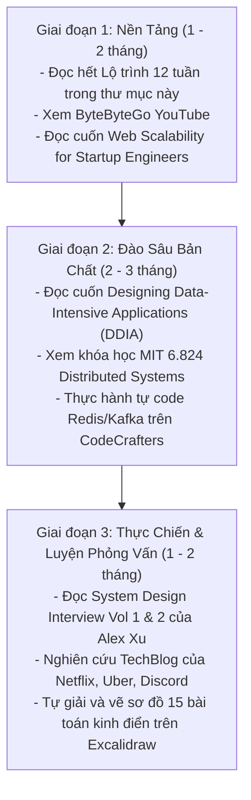

# 📚 Tổng Hợp Toàn Bộ Nguồn Học & Tài Liệu System Design Đỉnh Cao

> Cẩm nang tổng hợp các nguồn tài nguyên học tập, nghiên cứu và luyện phỏng vấn **Thiết kế Hệ thống (System Design)** và **Hệ thống Phân tán (Distributed Systems)** từ cơ bản đến trình độ Principal/Staff Engineer.

---

## 📖 1. Những Cuốn Sách "Kinh Điển" Bắt Buộc Phải Đọc

### 🥇 Nhóm 1: Nền tảng cốt lõi & Bản chất hệ thống (Foundations & Internals)
1. **Designing Data-Intensive Applications (DDIA)** – *Martin Kleppmann*
   - **Đánh giá:** Cuốn "Kinh thánh" số 1 thế giới về hệ thống dữ liệu phân tán. Không có cuốn sách nào giải thích sâu sắc và tường tận hơn về: B-Trees vs LSM-Trees, Single/Multi-Leader Replication, Phân vùng (Partitioning), Giao dịch ACID vs BASE, và các thuật toán Đồng thuận phân tán (Consensus / Raft).
   - **Đối tượng:** Từ Middle đến Senior/Staff Engineer.
2. **Database Internals: A Deep Dive into How Distributed Data Systems Work** – *Alex Petrov*
   - **Nội dung:** Đi sâu vào tầng thấp của các hệ quản trị CSDL: Storage Engines, cấu trúc bộ nhớ, kiểm soát tương thời (MVCC), phân tán dữ liệu và giao thức Paxos/Raft.
3. **Web Scalability for Startup Engineers** – *Artur Ejsmont*
   - **Nội dung:** Cuốn sách thực dụng nhất cho người mới bắt đầu. Phân tích rõ nét từng tầng: Front-end, Web Tier, Caching, Asynchronous Processing, và Database Scaling.

### 🥈 Nhóm 2: Luyện Phỏng Vấn & Phân Tích Đánh Đổi (Interviews & Trade-offs)
4. **System Design Interview – An Insider’s Guide (Volume 1 & 2)** – *Alex Xu & Sahn Lam*
   - **Đánh giá:** Bộ sách chuẩn mực nhất cho các kỳ phỏng vấn Big Tech. Volume 1 tập trung vào các bài toán nền tảng (URL Shortener, Rate Limiter, Chat App). Volume 2 đi sâu vào các bài toán khó (Payment System, Digital Wallet, Stock Exchange, S3 Object Storage).
5. **Software Architecture: The Hard Parts** – *Neal Ford, Mark Richards, Pramod Sadalage, Zhamak Dehghani*
   - **Nội dung:** Tập trung vào việc đưa ra quyết định kiến trúc khi **không có giải pháp hoàn hảo (Trade-off Analysis)**: Phân rã dữ liệu trong microservices, distributed transactions (Saga), tái cấu trúc Monolith.
6. **Building Microservices (2nd Edition)** – *Sam Newman*
   - **Nội dung:** Hướng dẫn toàn diện về thiết kế, triển khai, giao tiếp và bảo mật cho kiến trúc Microservices.

---

## 🐙 2. Kho Mã Nguồn Mở & GitHub Repositories Hàng Đầu

| Repository | Điểm nổi bật | Link truy cập |
| :--- | :--- | :--- |
| **`donnemartin/system-design-primer`** | Repo nổi tiếng nhất thế giới (>280k stars). Có lộ trình, flashcards, giải thích trực quan từng linh kiện và case study hoàn chỉnh. | [github.com/donnemartin/system-design-primer](https://github.com/donnemartin/system-design-primer) |
| **`karanpratapsingh/system-design`** | Bộ tài liệu trực quan, thiết kế đồ họa súc tích, giải thích ngắn gọn, dễ tiếp thu. | [github.com/karanpratapsingh/system-design](https://github.com/karanpratapsingh/system-design) |
| **`binhnguyennus/awesome-scalability`** | Kho lưu trữ bài viết và case study thực chiến từ các hệ thống chịu tải cao trên thế giới. | [github.com/binhnguyennus/awesome-scalability](https://github.com/binhnguyennus/awesome-scalability) |
| **`madd86/awesome-system-design`** | Tuyển tập liên kết tổng hợp các sách, bài báo khoa học, blog và khóa học uy tín. | [github.com/madd86/awesome-system-design](https://github.com/madd86/awesome-system-design) |
| **`checkcheckzz/system-design-interview`** | Bộ câu hỏi phỏng vấn thực tế kèm lời giải chi tiết và thảo luận chuyên sâu. | [github.com/checkcheckzz/system-design-interview](https://github.com/checkcheckzz/system-design-interview) |

---

## 🏢 3. Engineering Blogs Của Các Tập Đoàn Công Nghệ Lớn

Nơi tốt nhất để học System Design là học từ chính các kỹ sư đang vận hành các hệ thống phục vụ hàng trăm triệu đến hàng tỷ người dùng:

1. **Netflix TechBlog** ([netflixtechblog.com](https://netflixtechblog.com/)): Nổi tiếng nhất về Microservices, Chaos Engineering (kiểm thử khả năng chịu lỗi bằng cách cố tình đánh sập server), Kiến trúc Resilience và Edge Routing.
2. **Uber Engineering** ([uber.com/blog/engineering](https://www.uber.com/blog/engineering/)): Bậc thầy về hệ thống thời gian thực (Real-time), Geohashing (thuật toán không gian H3), Dispatching và Schemaless Database.
3. **Discord Engineering** ([discord.com/blog/category/engineering](https://discord.com/blog/category/engineering)): Nổi tiếng với các bài viết thực tế cực hay: *Tại sao Discord chuyển từ MongoDB sang Cassandra, rồi từ Cassandra sang ScyllaDB (tiết kiệm hàng chục máy chủ)*; *Cách Discord lưu trữ hàng tỷ tin nhắn*.
4. **Meta / Facebook Engineering** ([engineering.fb.com](https://engineering.fb.com/)): Các bài báo về TAO (đồ thị mạng xã hội), Memcached phân tán quy mô lớn, và cơ chế lưu trữ LogDevice.
5. **Amazon / AWS Architecture Blog** ([aws.amazon.com/blogs/architecture](https://aws.amazon.com/blogs/architecture/)): Khung kiến trúc AWS Well-Architected Framework, bài học về thiết kế hệ thống Multi-AZ / Multi-Region.
6. **LinkedIn Engineering** ([engineering.linkedin.com](https://engineering.linkedin.com/)): Nơi khai sinh ra **Apache Kafka** và kiến trúc Streaming Event-driven.
7. **Pinterest Engineering** ([medium.com/pinterest-engineering](https://medium.com/pinterest-engineering)): Bài toán Sharding MySQL kinh điển và phân tầng Caching.

---

## 📰 4. Newsletters Đáng Theo Dõi Hàng Tuần

Đọc các newsletter chất lượng cao là thói quen tốt nhất để duy trì tư duy kiến trúc nhạy bén:

- **The Polymathic Engineer** – *Franco Fernando* ([newsletter.francofernando.com](https://newsletter.francofernando.com)): Chuỗi bài học súc tích, sơ đồ trực quan về cấu trúc dữ liệu và hệ thống phân tán (chính là nguồn gốc của 9 chủ đề vừa tải về).
- **ByteByteGo Newsletter** – *Alex Xu* ([blog.bytebytego.com](https://blog.bytebytego.com)): Cung cấp infographic màu sắc tuyệt đẹp, phân tích kiến trúc của Twitter, YouTube, Uber, ChatGPT mỗi tuần.
- **The Pragmatic Engineer** – *Gergely Orosz* ([newsletter.pragmaticengineer.com](https://newsletter.pragmaticengineer.com)): Bản tin công nghệ #1 Substack về văn hóa kỹ thuật Big Tech, kiến trúc và xu hướng tuyển dụng.
- **Architecture Notes** – *Mahdi Yusuf* ([architecturenotes.co](https://architecturenotes.co)): Các bài viết có hình vẽ tay và animation tương tác cực kỳ ấn tượng về Redis, SSL/TLS, DNS, Database.
- **Quastor** ([quastor.org](https://www.quastor.org)): Tóm tắt ngắn gọn các bài blog kỹ thuật hay nhất của các công ty công nghệ mỗi tuần.

---

## 🎥 5. Kênh Video YouTube & Khóa Học Chất Lượng Cao

### Kênh YouTube Miễn Phí Hay Nhất:
1. **ByteByteGo** ([YouTube @ByteByteGo](https://www.youtube.com/@ByteByteGo)): Kênh video số 1 hiện nay với các video hoạt họa ngắn 5-10 phút giải thích cực kỳ trực quan các khái niệm System Design.
2. **Gaurav Sen** ([YouTube @gkcs](https://www.youtube.com/@gkcs)): Kênh tiên phong về System Design với các video phân tích bản chất: Consistent Hashing, Message Queues, Geohashing.
3. **Jordan has no life** ([YouTube @Jordanhasnolife](https://www.youtube.com/@Jordanhasnolife)): Dành cho những ai muốn đào sâu tới mức Senior/Staff, mổ xẻ từng ngóc ngách của các câu hỏi phỏng vấn khó.
4. **Hussein Nasser** ([YouTube @HNasser](https://www.youtube.com/@HNasser)): Chuyên gia về Backend, Database Internals (PostgreSQL, MySQL), Networking protocols (HTTP/1.1, HTTP/2, HTTP/3, QUIC, TCP, UDP).
5. **MIT 6.824: Distributed Systems** ([YouTube Playlist](https://www.youtube.com/playlist?list=PLrw6a1wE39_tb2fErI4-WkMbsvGQk9_UB)): Khóa học hệ thống phân tán chính thống của trường đại học danh tiếng MIT do Giáo sư Robert Morris giảng dạy. Có đầy đủ bài giảng và bài tập thực hành (tự code thuật toán Raft bằng Go).

### Nền Tảng Học Thực Hành (Interactive Learning):
- **CodeCrafters.io** ([codecrafters.io](https://codecrafters.io)): Nền tảng học System Design bằng cách **tự tay code lại từ đầu (build from scratch)** các công nghệ kinh điển: Tự code Redis Server, Kafka Broker, Git, hoặc SQLite.
- **Educative.io - Grokking the System Design Interview**: Khóa học dạng chữ tương tác kinh điển được hàng ngàn kỹ sư ôn luyện trước khi phỏng vấn.

---

## 📄 6. Các Bài Báo Khoa Học Định Hình Thế Giới (Seminal Papers)

Nếu bạn muốn hiểu tận gốc vì sao thế giới phân tán hiện đại lại vận hành như ngày nay, hãy đọc các bài báo nghiên cứu gốc này:

1. **The Google File System (GFS) (2003)** – Nền móng của Hadoop HDFS và lưu trữ phân tán.
2. **MapReduce: Simplified Data Processing on Large Clusters (2004)** – Nền tảng xử lý dữ liệu lớn Big Data.
3. **Bigtable: A Distributed Storage System for Structured Data (2006)** – Cảm hứng sinh ra Cassandra, HBase.
4. **Dynamo: Amazon’s Highly Available Key-value Store (2007)** – Bài báo quan trọng nhất về tính sẵn sàng, Consistent Hashing, Quorum và Vector Clocks.
5. **In Search of an Understandable Consensus Algorithm (Raft Paper) (2014)** – Thuật toán đồng thuận phân tán dễ hiểu thay thế cho Paxos.
6. **Kafka: a Distributed Messaging System for Log Processing (2011)** – Kiến trúc Distributed Commit Log của LinkedIn.

---

## 🇻🇳 7. Nguồn Tham Khảo & Cộng Đồng Tiếng Việt

- **Viblo.asia** (Tag `system-design`, `microservices`, `architecture`): Nhiều bài viết tổng hợp và dịch thuật chất lượng cao từ các kỹ sư Việt Nam.
- **Tôi Đi Code Dạo** (Kênh YouTube & Blog của Phạm Huy Hoàng): Có nhiều video chia sẻ trực quan, dễ hiểu về kiến trúc cơ bản cho người mới.
- **Vietnam Software Architecture Guild / Cộng đồng Kiến trúc Phần mềm Việt Nam**: Các nhóm thảo luận trên Facebook và LinkedIn chia sẻ kinh nghiệm vận hành hệ thống thực tế tại thị trường Việt Nam (Shopee, VNG, MoMo, Tiki, Viettel).

---

## 🎯 Lộ Trình Gợi Ý Tự Học (Study Plan 3 Giai Đoạn)

